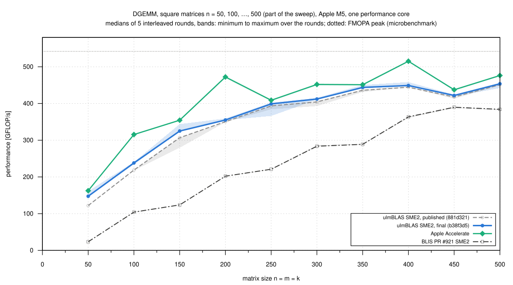
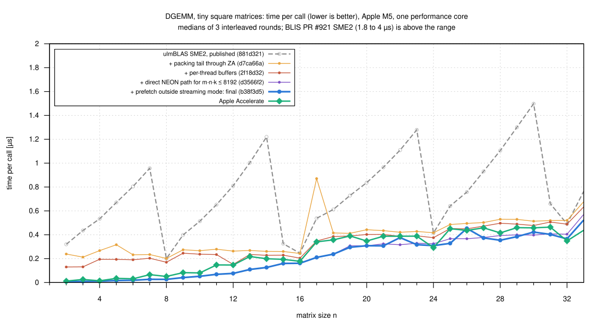
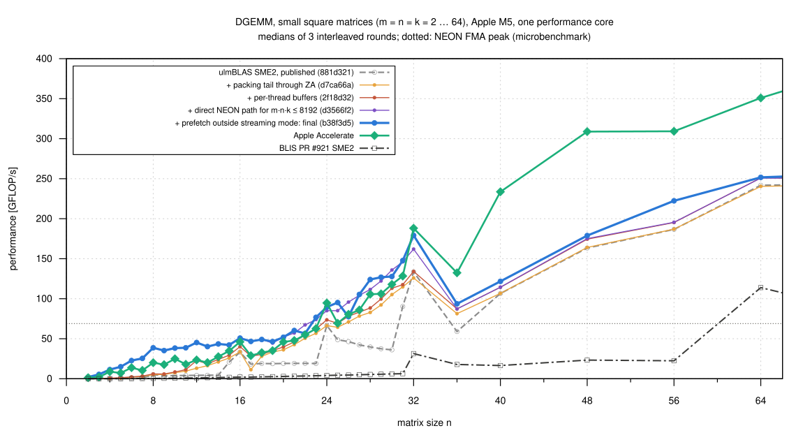

# Apple M5 experiments

Experiments with the experimental SME2 DGEMM backend of ulmBLAS on one
performance core of an Apple M5 (MacBook Air): how much the block sizes
matter (Part I) and what limits small matrices (Part II).  The backend
itself and its results are summarized in
[PERFORMANCE.md](PERFORMANCE.md#aarch64-sme2-apple-m5-experimental); every
experiment links to the benchmark campaign that documents it.

- [Part I: block sizes](#part-i-block-sizes)
- [Part II: small matrices](#part-ii-small-matrices)

## Part I: block sizes

The SME2 backend above is experimental: one micro kernel (32 x 16, derived
from BLIS pull request #921) inside the unchanged GEMM algorithm of
ulmBLAS, with block sizes fixed at compile time.  To see how much the
block sizes matter, 12 builds of the backend with fixed configurations —
MC ∈ {256, 384, 608}, KC ∈ {1024, 2240}, NC ∈ {1024, 3072} — were measured
on square matrices together with Apple Accelerate, BLIS pull request #921
(SME2) and the NEON kernel of ulmBLAS.  Each curve is one fixed
configuration over all sizes; no curve combines several configurations.

A selection — Accelerate, BLIS, NEON, the default configuration (384,
1024, 1024), the block sizes of BLIS pull request #921 (608, 2240, 3072)
and the two other configurations that are the best for at least two sizes
— with a zoom on the range where the curves cross (bars: minimum and
maximum over the rounds):

All 12 configurations:

| n = m = k | Apple Accelerate | BLIS PR #921 (SME2) | ulmBLAS NEON | ulmBLAS SME2, default 384, 1024, 1024 | ulmBLAS SME2, 608, 2240, 3072 |
|---:|---:|---:|---:|---:|---:|
| 32 | 190 | 32 | 39 | 137 | 139 |
| 128 | 431 | 243 | 57 | 346 | 349 |
| 384 | 500 | 425 | 64 | 454 | 457 |
| 1024 | 428 | 439 | 66 | 468 | 465 |
| 2048 | 419 | 467 | 66 | 472 | 490 |
| 4096 | 424 | 475 | 66 | 475 | 498 |

(Measured GFLOP/s, medians of 5 rounds.)

- **Measured vs. peak.**  The dotted lines are not DGEMM results: they are
  the instruction throughput of FMOPA (542 GFLOP/s) and of the NEON FMA
  (68.9 GFLOP/s), measured with microbenchmarks on this core.  The fastest
  measured DGEMM, 498 GFLOP/s (608, 2240, 3072 at n = 4096), is 92% of the
  FMOPA microbenchmark value; NEON reaches 66 GFLOP/s (96% of its peak),
  so SME2 is 7.5 times faster on this core.
- **Accelerate** is faster than every SME2 configuration for n ≤ 384, about
  equal at n = 512 and 768, and slower for n ≥ 1024, where it stays at 410
  to 428 GFLOP/s: the best SME2 configuration is 1.10 to 1.17 times, the
  default 1.09 to 1.13 times as fast as Accelerate.
- **BLIS pull request #921** is slower than the ulmBLAS default at every
  size except n = 2048 and 4096 (equal within the noise), and much slower
  for very small matrices (0.4 to 4 GFLOP/s for n = 8 to 24).
- **Different configurations are best for different sizes.**  For n ≥
  1536 only KC = 2240 together with NC = 3072 (MC = 384 or 608) avoids
  being clearly slower than the best; they are 2 to 5% faster than the
  default.  For n ≤ 1024 the configurations lie within the run-to-run
  noise of each other, and the best one changes from size to size.  The
  [block size study](benchmark_results/005-2026-10-25-macbook-m5-sme-blocksizes/README.md)
  shows that other shapes prefer other configurations: small m needs KC =
  1024 (up to 24% faster than KC = 2240), small n a small MC.

I am investigating problem-dependent configuration selection, inspired by
the original ATLAS (Automatically Tuned Linear Algebra Software) approach.
ulmBLAS does not perform automatic tuning; the library uses one fixed
configuration, and the other configurations exist only as builds for these
measurements.

**Conditions and limitations.**  One MacBook Air with an Apple M5, macOS
26.6, one performance core, double precision, column major, alpha = beta =
1.  Every implementation runs in its own process, interleaved per size in
a random order, 5 rounds; each program run under a thermal guard (3 s
pause, thermal state nominal before and after, otherwise repeated).  All
1350 runs were nominal, none was discarded, and every checked result was
correct.  For half of
the implementations and sizes the 5 rounds lie within 1% of each other, but
single rounds were up to 24% slower than the median, and absolute values
drift by a few percent between sessions on this machine; only interleaved measurements are compared.  The results
hold for this machine and these builds only.  The
[benchmark campaign](benchmark_results/006-2026-10-25-macbook-m5-sme-square/README.md)
contains the raw measurements of every run, the logs, the configurations,
the checksums of the programs and the scripts that reproduce the
measurements and the figures.

## Part II: small matrices

**The problem: small matrices.**  The experiments above left one clear
weakness.  Apple Accelerate was faster than ulmBLAS for all square
matrices up to n = 384, and for tiny matrices by large factors (n = 8:
0.05 µs instead of 0.20 µs per call).  For small problems the fixed costs
dominate: packing, buffers, and setting up the SME2 micro kernel.  Four
changes target them, each tested and measured on its own:

1. **No scalar stores in streaming mode.**  The SME2 packing copied the last
   k mod 8 rows of a panel with a scalar loop in streaming mode; data
   written that way and read right after by the SME unit cost up to 1 µs
   per panel.  Packing the tail through ZA like the rest made shapes with
   k mod 8 ≠ 0 up to 4.7 times faster (14³: 1.22 → 0.26 µs).
2. **Keep the buffers, drop the bookkeeping.**  The shared buffer pool
   (hash tables and lists behind a mutex) took a third of a 16³ call.
   Plain `new`/`delete` per call was *worse*: up to 2 times slower on
   macOS 26, although no page faults occur.  The buffers now stay in a
   small per-thread cache: 1.1 to 1.8 times faster for n ≤ 24.
3. **A direct NEON path.**  For m·n·k ≤ 8192 `gemm` computes with NEON
   register tiles directly on A, B and C, without packing and without
   buffers: up to 58 GFLOP/s (84% of the NEON FMA peak), n = 8 in 0.026 µs.
4. **No prefetch in streaming mode.**  The 48 PRFM of the micro kernel cost
   45 to 85 ns per call in streaming mode and nothing in ordinary mode;
   issuing them before entering streaming mode made n = 24 … 48 up to 1.29
   times faster.

Square DGEMM for n = 50, 100, …, 4000 (80 sizes), before (published
881d321) and after (final b38f3d5) the four changes, with Apple
Accelerate and BLIS pull request #921 as references.  Lines are medians of
5 interleaved rounds; the bands span the minimum to the maximum over the
rounds:

The same sweep for n ≤ 500:

Tiny matrices, time per call for every step (lower is better):

The same in GFLOP/s up to n = 64, with BLIS:

| n = m = k | published | final | Apple Accelerate | final vs. published | final vs. Accelerate |
|---:|---:|---:|---:|---|---|
| 2 | 0.320 µs | 0.008 µs | 0.012 µs | 41x faster | 1.55x faster |
| 8 | 0.201 µs | 0.026 µs | 0.051 µs | 7.6x faster | 1.93x faster |
| 16 | 0.246 µs | 0.161 µs | 0.178 µs | 1.52x faster | 1.10x faster |
| 24 | 0.416 µs | 0.309 µs | 0.292 µs | 1.35x faster | 0.95x (slower) |
| 40 | 1.20 µs | 1.05 µs | 0.55 µs | 1.14x faster | 0.52x (slower) |
| 100 | 219 GFLOP/s | 238 GFLOP/s | 316 GFLOP/s | 1.09x faster | 0.76x (slower) |
| 400 | 444 GFLOP/s | 449 GFLOP/s | 515 GFLOP/s | 1.01x faster | 0.87x (slower) |
| 1000 | 457 GFLOP/s | 455 GFLOP/s | 461 GFLOP/s | noise | noise |
| 2000 | 478 GFLOP/s | 479 GFLOP/s | 428 GFLOP/s | noise | 1.12x faster |
| 4000 | 486 GFLOP/s | 490 GFLOP/s | 431 GFLOP/s | noise | 1.14x faster |

(Medians; n ≤ 40 from the small-matrix campaign with 3 rounds, the others
from the sweep with 5 rounds.  *Noise*: the rounds of the two overlap or
the medians differ by less than 1%.)

- **Tiny matrices.**  For n ≤ 23 the final version is 1.5 to 48 times
  faster than the published one and faster than Accelerate (1.03 to 2.6
  times); skinny shapes gain most (200 x 4 x 4: 19 times faster than
  published, 2.8 times faster than Accelerate).  For n = 24 … 32 the
  comparison with Accelerate is mixed: the final version is faster at odd
  n = 25 … 31 and slower at n = 24, 26 and 32.
- **Small to medium matrices.**  For n = 36 … 850 Accelerate stays ahead,
  by up to 1.9 times at n = 40 and 1.33 times at n = 200.  The changes
  help here too, but less: 1.01 to 1.21 times for n = 50 … 400.
- **Large matrices** are unchanged: for n ≥ 450 the final and the
  published version are within the noise of each other, and from n = 1050
  on ulmBLAS is 1.06 to 1.15 times faster than Accelerate at all 60 sizes
  of the sweep (up to 490 GFLOP/s, 90% of the FMOPA microbenchmark peak).
- **Steps after multiples of 1024.**  Both ulmBLAS versions lose 6 to 7%
  from n = 1000 to 1050 and from 2000 to 2050.  The likely cause is the
  blocking with KC = 1024: for k = 2050 the last block has kc = 2, and
  every tile of C passes through ZA once more for only 2 FMOPA steps (not
  yet verified by a separate experiment).  Accelerate also drops at these
  sizes.
- **Correctness.**  None of the 2839 program runs of both campaigns
  reported a wrong result (bench2 compares with a naive product up to
  2·10⁸ multiply-adds).
  For the larger sizes, a separate check of 2000 random elements per size
  against sums in long double found no error above 0.5% of the rounding
  bound.  The new code is covered by tests for the packing tail, the
  buffer cache (also with 8 threads calling DGEMM concurrently, under
  AddressSanitizer and ThreadSanitizer) and every tile remainder of the
  direct path.

**What remains.**  For n = 36 … 850 Accelerate is still faster.  Every
call of the 32 x 16 SME2 micro kernel moves a tile of C through ZA (about
55 ns at the bandwidth of the SME unit) for only kc FMOPA steps, and both
operands are always packed.  Next steps:

- a 16-row tile for small m and moderate sizes;
- the direct path for skinny shapes beyond m·n·k = 8192 (2 x 2 x 4000 is
  4.1 times faster with it than with the SME2 path);
- one streaming-mode session per call instead of one per kernel call;
- in the spirit of ATLAS, choosing among these paths by problem size from
  measurements rather than by hand.

The run-to-run variation on the SME2 path for n = 17 … 30 is not
understood yet.  There, single program runs jump between levels while the
samples within a run agree: the results of the final version vary between
processes by about 20%, an intermediate version by up to 2.3 times.

The [benchmark campaign](benchmark_results/007-2026-10-26-macbook-m5-sme-small/README.md)
documents each change with its own measurements, the method (same as
above: interleaved, thermal guard, no run discarded), the raw data of all
runs, the checksums of the programs and the scripts.
