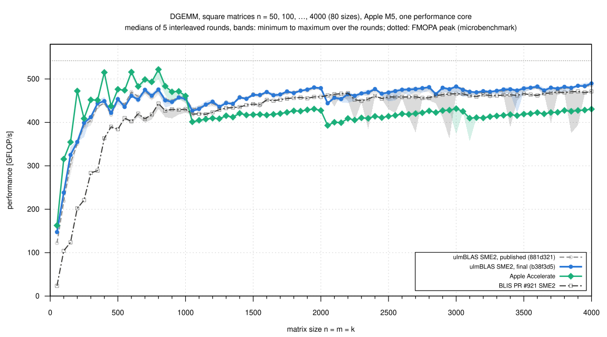

# ulmBLAS

A BLAS implementation in C++ that shows how high-performance matrix
multiplication works, and that is easy to extend.

## Contents

- [About](#about)
- [Performance](#performance)
- [Supported Platforms](#supported-platforms)
- [How to Install](#how-to-install)
- [How to Use](#how-to-use)
- [How ulmBLAS is organized](#how-ulmblas-is-organized)
- [Use of AI-assisted development](#use-of-ai-assisted-development)
- [License, provenance and acknowledgments](#license-provenance-and-acknowledgments)
- [Background and citation](#background-and-citation)

## About

ulmBLAS is a C++ library without matrix or vector classes.  Instead it
does the operations where performance matters for the matrix and vector
libraries that have such classes.
Think of it as the engine under the hood of the software built on top of
it.  How to call it from C or C++ is shown in [How to Use](#how-to-use).

The basic idea of an efficient GEMM (the BLAS level 3 function for the
matrix product) is explained in more detail in my tutorial
[how-to-optimize-gemm](https://github.com/michael-lehn/how-to-optimize-gemm).
It is based on the BLIS paper by Van Zee and van de Geijn (see
[Background and citation](#background-and-citation)).  I am working on a
similar tutorial for a GEMM implemented with CUDA:
[cULMblas](cuda/README.md).

It implements the complete BLAS (Basic Linear Algebra Subprograms), all
routines of levels 1, 2 and 3 for single and double precision, real and
complex, with a CBLAS and a Fortran 77 interface.  It follows the
approach of [BLIS](https://github.com/flame/blis): all level 3 operations
are built from cache blocking, packing and a small architecture-specific
*micro kernel*.  Everything else is portable C++ in header files (only
the C and Fortran 77 interfaces are compiled into libraries), so there
is a reference implementation on every platform and for every element
type, and a new CPU architecture needs one well-defined kernel, not a new
BLAS.  Optimized micro kernels exist for x86-64 and AArch64, see the
[support matrix](#current-micro-kernel-support).

Why do I care about that?  I don't think every C++ matrix library should
have to reinvent fast matrix multiplication.  Eigen, Blaze and the others
have their own abstractions, interfaces and expression templates, and
that is fine.  ulmBLAS does not want to replace them or impose yet another
matrix class hierarchy.  It wants to be the part underneath: micro kernels
for specific processors, packing and cache blocking, behind a plain
interface of pointers and strides.  A matrix library should be able to
build on that instead of maintaining its own collection of
architecture-specific kernels.  ulmBLAS provides this foundation today;
matrix libraries building on it is what I hope it will enable.

It matters to me in the other direction too.  The people who design micro
kernels, study instruction sets, optimize data movement and tune for new
processors do difficult work close to the hardware, and they deserve
credit for it.  I want their work to be visible and useful beyond a single
library: when a micro kernel gets better, everything built on top of it
should get better with it, without every library repeating the same
engineering.

### Good artists create; great artists steal

That is my motto, and I try to live up to both halves.  Where excellent
micro kernels already exist, I happily learn from them and use them, always
with their authorship and copyright notices intact and under the terms of
their licenses.  ulmBLAS can use selected micro kernels of
[BLIS](https://github.com/flame/blis),
[OpenBLAS](https://github.com/OpenMathLib/OpenBLAS) and
[AOCL-BLAS](https://github.com/amd/blis) inside its own GEMM algorithm,
and its AVX/FMA, NEON and SME2 DGEMM kernels are derived from BLIS
kernels.  I admire the engineering behind these libraries, and I take my
hat off to their developers.

I did not write the vendored kernels.  Each vendored file records its
upstream repository, revision, path and checksum and lists every change;
see [ulmblas/level3/ukernel/blis](ulmblas/level3/ukernel/blis/README.md),
[ulmblas/level3/ukernel/openblas](ulmblas/level3/ukernel/openblas/README.md)
and the [license section](#license-provenance-and-acknowledgments).  All
notices are reproduced in [LICENSE](LICENSE).

What I did write is everything around them: the algorithms of all level 3
routines with their blocking and packing, the interfaces, the build
system, the tests and the benchmarks.  Fitting a kernel of another
library into ulmBLAS is work of its own, too: an adapter for its
interface, packing in the layout it expects, block sizes, and sometimes
changes to the GEMM algorithm (OpenBLAS's kernels, for example, are called
once per packed block, as OpenBLAS's own driver does).  Some kernels are
my own: the SSE3 DGEMM kernel and the NEON and SME2 kernels for float,
complex float and complex double.  The AVX/FMA, NEON and SME2 DGEMM
kernels are derived from BLIS kernels, as said above.  The
[micro kernel README](ulmblas/level3/ukernel/README.md) gives the origin of
every kernel.

### History

I started ulmBLAS in 2014 for teaching, as part of my lecture
*Introduction to High Performance Computing* at Ulm University.  I wanted
my students to see, and to try out themselves, what goes on inside the
HPC libraries they use.  That is why the code is meant to be read: it
shows step by step how a matrix product gets to the performance of the
hardware.

Since then ulmBLAS has grown into a real library, with a portable build,
a regression test suite on several compilers and architectures, and
documented, reproducible benchmarks.  It is also listed in
[Meta Quest's third-party software notices](https://www.meta.com/en/legal/quest/third-party-notices/14/)
("ulmBLAS Copyright (C) 2014 Michael C. Lehn. Ulm University").

## Performance

I benchmark ulmBLAS on the machines I have access to.  The results are in
[PERFORMANCE.md](PERFORMANCE.md), sorted by operation and data type and
with a list of the machines.  My experiments with the SME2 backend on the
Apple M5 are in [M5_EXPERIMENTS.md](M5_EXPERIMENTS.md), and the
[benchmark archive](benchmark_results/README.md) has every campaign with
its raw data.  If you run the benchmarks on a machine I don't have
([How to Run Your Own Benchmarks](ARCHITECTURE.md#how-to-run-your-own-benchmarks)), I'd
be glad to hear about the results.

A benchmark plot takes some space, but people expect one on the front page
of an HPC BLAS library, so here we go.  This is DGEMM on one performance
core of an Apple M5 (MacBook Air) with the SME2 backend of ulmBLAS
([campaign 007](benchmark_results/007-2026-10-26-macbook-m5-sme-small/README.md)):



The plot shows how fast the product C ← A B + C of two square n x n
matrices of double precision numbers is computed, for n from 50 to 4000.
Speed is measured in GFLOP/s, billions of floating-point operations
(multiplications and additions) per second, and one product takes 2n³ of
them.  More is better.  The dotted line is the peak of the core's matrix
unit as I measured it with a microbenchmark that does nothing but its
outer-product instructions (542 GFLOP/s), so the closer a curve gets to
it, the better the hardware is used.  For large matrices ulmBLAS reaches
up to 490 GFLOP/s and is 1.06 to 1.15 times as fast as Apple Accelerate
(n ≥ 1050).  For medium sizes (n = 36 … 850) Accelerate is still faster.

In the [cULMblas tutorial](cuda/README.md) (work in progress) you will
find a whole bunch of benchmarks for GEMM with CUDA, where we start with a
simple implementation, try to make progress step by step, and sometimes
hit a wall and have to reconsider.

## Supported Platforms

Every routine has a generic C++ implementation that needs only a C++11
compiler and GNU Make.  The level 3 routines are cache friendly even
there, because they use the same blocking and packing as the optimized
builds.  And since it is all templates, you can use other element types
too, for example the multiple-precision types of GMP in numerical
experiments (see [How to Use](#how-to-use)).

To get close to the peak of a processor, though, you need micro kernels
that make use of its vector and matrix units.  The table lists the
optimized GEMM micro kernels on master by instruction set and data type.
The level 3 routines of a type are built on its GEMM micro kernel.

### Current micro kernel support

| Platform / architecture | float (SGEMM) | double (DGEMM) | complex float (CGEMM) | complex double (ZGEMM) |
|---|:---:|:---:|:---:|:---:|
| [Portable C++, universal fallback](ulmblas/level3/ukernel/README.md#portable-reference-kernel-all-types) | ○ | ○ | ○ | ○ |
| x86-64 SSE3 | [●](ulmblas/level3/ukernel/README.md#sgemm-x86-64) | [●](ulmblas/level3/ukernel/README.md#dgemm-x86-64-sse3) | ○ | ○ |
| x86-64 AVX | [●](ulmblas/level3/ukernel/README.md#sgemm-x86-64) | [●](ulmblas/level3/ukernel/README.md#dgemm-x86-64-avx) | [●](ulmblas/level3/ukernel/README.md#cgemm-x86-64) | [●](ulmblas/level3/ukernel/README.md#zgemm-x86-64) |
| x86-64 AVX2/FMA | [●](ulmblas/level3/ukernel/README.md#sgemm-x86-64) | [●](ulmblas/level3/ukernel/README.md#dgemm-x86-64-avx2fma) | [●](ulmblas/level3/ukernel/README.md#cgemm-x86-64) | [●](ulmblas/level3/ukernel/README.md#zgemm-x86-64) |
| x86-64 AVX-512 | [●](ulmblas/level3/ukernel/README.md#sgemm-x86-64) | [●](ulmblas/level3/ukernel/README.md#dgemm-x86-64-avx-512) | [●](ulmblas/level3/ukernel/README.md#cgemm-x86-64) | [●](ulmblas/level3/ukernel/README.md#zgemm-x86-64) |
| AArch64 NEON | [●](ulmblas/level3/ukernel/README.md#sgemm-aarch64-neon) | [●](ulmblas/level3/ukernel/README.md#dgemm-aarch64-neon) | [●](ulmblas/level3/ukernel/README.md#cgemm-aarch64-neon) | [●](ulmblas/level3/ukernel/README.md#zgemm-aarch64-neon) |
| AArch64 SME2 (Apple M4, M5; tested on M5) | [●](ulmblas/level3/ukernel/README.md#sgemm-aarch64-sme2) | [●](ulmblas/level3/ukernel/README.md#dgemm-aarch64-sme2) | [●](ulmblas/level3/ukernel/README.md#cgemm-aarch64-sme2) | [●](ulmblas/level3/ukernel/README.md#zgemm-aarch64-sme2) |

● optimized micro kernel(s) on master, tested and benchmarked on native
hardware ·
◐ on master and tested, benchmarks still in progress ·
○ portable reference kernel only

Each symbol links to the [micro kernel README](ulmblas/level3/ukernel/README.md),
which lists origin, MR x NR, selection macros, requirements, tests,
benchmarks and licenses of the kernels in that cell.  The kernels of
ulmBLAS itself are the defaults for their instruction set, the kernels of
BLIS, AOCL-BLAS and OpenBLAS are selected at build time.  The tested
configurations are listed in [BUILDING.md](BUILDING.md#tested-configurations).

### ulmBLAS's own work on Apple Silicon

For the matrix unit of the Apple M4 and M5, ulmBLAS has an SME2 DGEMM
micro kernel (32 x 16).  It is derived from the double precision kernel of
[BLIS pull request #921](https://github.com/flame/blis/pull/921).  I
developed the backend around it in ulmBLAS: packing in streaming mode, a
path without packing for very small products, per-thread packing buffers
and block sizes chosen from measurements.  The SME2 and NEON kernels for
float, complex float and complex double are my own (the SME2 SGEMM kernel
uses the tile layout of the single precision kernel of PR #921, but none
of its code).  For results see [Performance](#performance).

## How to Install

You need a recent C++ compiler (C++11 or newer) and GNU Make, and a
Fortran compiler only if you want the Fortran 77 interface of BLAS.
Usually this is all it takes:

```sh
git clone https://github.com/michael-lehn/ulmBLAS.git
cd ulmBLAS
make check_arch                   # supported ARCHFLAGS, with a suggestion
make                              # SSE3 kernels on x86-64, NEON on AArch64
make help                         # all targets and settings
```

`make` builds the C interface of BLAS (`libcblas.a`, `cblas.h`) and of the
LAPACK routines (`libclapack.a`, `clapack.h`).  `make check_arch` tells you
how to select faster micro kernels for your CPU.  Everything I skipped
here (requirements, choosing micro kernels, tests, installing into a
directory) is in [INSTALL.md](INSTALL.md).

## How to Use

You can use ulmBLAS like any other CBLAS implementation
([examples/dgemm.c](examples/dgemm.c)).  Compile against `cblas.h` and
link with `libcblas.a`, using a C++ compiler for linking, because the
library needs the C++ runtime:

```c
#include <cblas.h>

/* column major: A is 2 x 3, B is 3 x 2, C is 2 x 2 */
double A[] = { 1, 4,  2, 5,  3, 6 };
double B[] = { 1, 0, 2,  0, 1, 1 };
double C[4];

cblas_dgemm(CblasColMajor, CblasNoTrans, CblasNoTrans, 2, 2, 3,
            1.0, A, 2, B, 3, 0.0, C, 2);          /* C = [ 7 5 ; 16 11 ] */
```

```sh
cc -I. -c examples/dgemm.c -o dgemm.o
c++ -o dgemm dgemm.o libcblas.a
./dgemm                                           # C = [ 7 5 ; 16 11 ]
```

You can also call the C++ interface directly
([examples/gemm.cc](examples/gemm.cc)).  It is header only, so no library
is needed.  A matrix is a pointer and two strides (`incRow`, `incCol`),
which makes column major, row major and transposed operands the same
call, and the element type is a template parameter:

```cpp
#include <ulmblas/ulmblas.h>

double A[] = { 1, 4,  2, 5,  3, 6 };              // 2 x 3, column major
double B[] = { 1, 0, 2,  0, 1, 1 };               // 3 x 2, column major
double C[4];

ulmBLAS::gemm(2L, 2L, 3L,                         // m, n, k
              1.0,                                // alpha
              false, A, 1L, 2L,                   // conjA, A, incRowA, incColA
              false, B, 1L, 3L,                   // conjB, B, incRowB, incColB
              0.0,                                // beta
              C, 1L, 2L);                         // C = [ 7 5 ; 16 11 ]
```

```sh
c++ -std=c++11 -O3 -I. examples/gemm.cc -o gemm   # add ARCHFLAGS for the
./gemm                                            # optimized micro kernels
```

For element types other than the four BLAS types you declare block sizes
with a specialization of `ulmBLAS::BlockSize`; the example does this for
`long double`.

Note that this is a low-level C++ interface: plain pointers and strides,
no matrix classes.  I see that as an advantage.  C++ libraries with their
own fancy matrix and vector classes can build on it, whatever their
design.  ulmBLAS is not married to a particular C++ matrix library, it
supports all of them ;-)  One caveat: I don't treat the templates as a
stable interface yet, their signatures can still change
([ARCHITECTURE.md](ARCHITECTURE.md#interfaces)).

## How ulmBLAS is organized

How the GEMM algorithm and the source tree are organized, how micro
kernels are selected and how to add one, the interfaces, the tests, and
how to run your own benchmarks: all of that is in
[ARCHITECTURE.md](ARCHITECTURE.md).

## Use of AI-assisted development

I started developing ulmBLAS in 2014, and the core library was implemented well before the widespread availability of modern AI coding assistants. Its numerical algorithms, BLAS implementation, and overall architecture are my own work and were not AI-generated.

More recently, I have used Claude to expand existing test cases into a comprehensive, extensible regression test suite, modernize the build system, and develop infrastructure for automated, reproducible benchmarking.

My approach to AI-assisted development is to delegate tasks that I could carry out myself, while retaining responsibility for the architecture, numerical correctness, performance, and verification of the results.

The origins and licenses of third-party micro-kernels are documented separately in this repository.

## License, provenance and acknowledgments

ulmBLAS is licensed under the BSD 3-Clause License (Copyright (c)
2014-2026, Michael C. Lehn and the ulmBLAS contributors), see
[LICENSE](LICENSE).  Third-party components keep their own copyright and
license terms, which [LICENSE](LICENSE) reproduces:

- BLIS: the design of ulmBLAS follows BLIS, and ulmBLAS uses code,
  concepts and ideas of the BLIS framework (BSD 3-Clause, The University of
  Texas).
- AVX/FMA micro kernel: derived from the micro kernel
  `bli_dgemm_haswell_asm_6x8` of BLIS 2.0 (Copyright (C) 2014, The
  University of Texas at Austin; Copyright (C) 2018 - 2019, Advanced Micro
  Devices, Inc.; BSD 3-Clause), as adapted for the course High Performance
  Computing I (Ulm University, 2025/26); provenance and modifications are
  listed in `ulmblas/level3/ukernel/avx/ugemm.tcc`.
- NEON micro kernel: derived from the micro kernel
  `bli_dgemm_armv8a_asm_8x6r` of BLIS 2.0 (Copyright (C) 2014, The
  University of Texas at Austin; Copyright (C) 2021, The University of
  Tokyo; BSD 3-Clause); provenance and modifications are listed in
  `ulmblas/level3/ukernel/neon/ugemm.tcc`.
- SME2 micro kernel: derived from the double precision kernel of BLIS
  pull request #921 (https://github.com/flame/blis/pull/921, commit
  235ef8ec; Copyright (C) 2014, The University of Texas at Austin;
  Copyright (C) 2021, The University of Tokyo; BSD 3-Clause); provenance
  and modifications are listed in `ulmblas/level3/ukernel/sme/ugemm.tcc`.
- Vendored micro kernels of BLIS 2.0, AOCL-BLAS 5.0 and 5.1 in
  `ulmblas/level3/ukernel/blis/kernel/` (The University of Texas at Austin;
  Advanced Micro Devices, Inc.; BSD 3-Clause) and of OpenBLAS 0.3.34 in
  `ulmblas/level3/ukernel/openblas/` (The OpenBLAS Project; BSD 3-Clause):
  generated from the unmodified upstream files; every file names its
  source with revision and checksum and lists its changes; see sections 7
  and 8 of [LICENSE](LICENSE) and the READMEs of
  [blis](ulmblas/level3/ukernel/blis/README.md) and
  [openblas](ulmblas/level3/ukernel/openblas/README.md).
- ATLAS timing programs and headers in `bench/` (ATLAS 3.10.1, BSD-style
  license; R. Clint Whaley, Antoine P. Petitet, Jeff Horner and others).
- Reference BLAS in `refblas/` (from LAPACK 3.3.1) and the BLAS and
  CBLAS test programs in `test/F77/` and `test/C/` (from Netlib), under
  the terms of Netlib and LAPACK.

The comparison benchmarks use BLIS (including BLIS pull request #921),
OpenBLAS, oneMKL, AOCL-BLAS, Eigen and Apple Accelerate, which are not
part of ulmBLAS.  I (Michael C. Lehn, Ulm University) wrote ulmBLAS and
work on it alone; Sebastian Kölle (GitHub: aquileia) contributed early on
with the repository setup and the plots of the benchmarks.

## Background and citation

The design of ulmBLAS was strongly inspired by

Field G. Van Zee and Robert A. van de Geijn. *BLIS: A Framework for Rapidly
Instantiating BLAS Functionality.* ACM Transactions on Mathematical Software,
41(3), 14:1–14:33, June 2015.
[https://doi.org/10.1145/2764454](https://doi.org/10.1145/2764454)
(at the time of the initial development, mainly in 2014, the
[preprint](https://www.cs.utexas.edu/~flame/pubs/blis1_toms_rev3.pdf)).

ulmBLAS is part of my lecture *Introduction to High Performance
Computing* (MATH9367, Ulm University).  The current lecture is
[High Performance Computing I, winter 2025/26](https://www.mathematik.uni-ulm.de/numerik/hpc/ws25/); its
sessions build a blocked GEMM step by step, as described in
[ARCHITECTURE.md](ARCHITECTURE.md).  Its last sessions turn to CUDA, and
that is where my new side project starts: a tutorial on BLAS with CUDA in
[cuda/](cuda/README.md), so far with a simple GEMM kernel, tested and
benchmarked against cuBLAS.  There is also a
[course page for ulmBLAS](http://www.mathematik.uni-ulm.de/~lehn/ulmBLAS),
the [general course page](http://www.mathematik.uni-ulm.de/~lehn/sghpc),
and a step-by-step walk from a naive loop to peak performance,
[Achieving peak performance for GEMM](http://www.mathematik.uni-ulm.de/~lehn/sghpc/gemm/index.html).
A related project is [ulmBLAS-core](https://github.com/michael-lehn/ulmBLAS-core).

If you use ulmBLAS in your work, please cite it
([CITATION.cff](CITATION.cff)):

Michael C. Lehn. *ulmBLAS: A high performance BLAS implementation.* Ulm
University, GitHub. https://github.com/michael-lehn/ulmBLAS, 2014.

```bibtex
@misc{Lehn_ulmBLAS,
  author       = {Michael C. Lehn},
  title        = {ulmBLAS: A high performance BLAS implementation},
  year         = {2014},
  publisher    = {GitHub},
  howpublished = {\url{https://github.com/michael-lehn/ulmBLAS}},
  note         = {Ulm University, Version 1.0}
}
```
