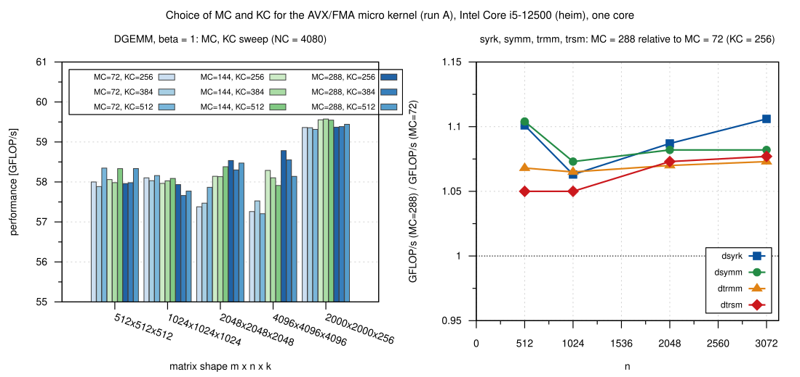
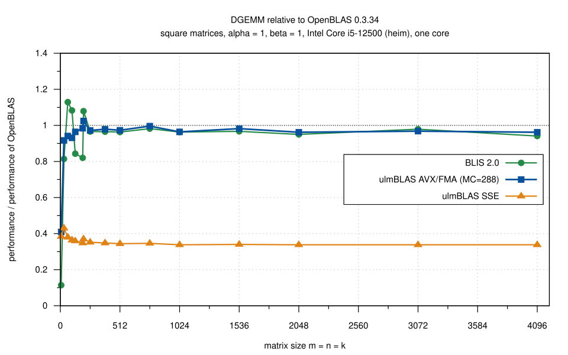
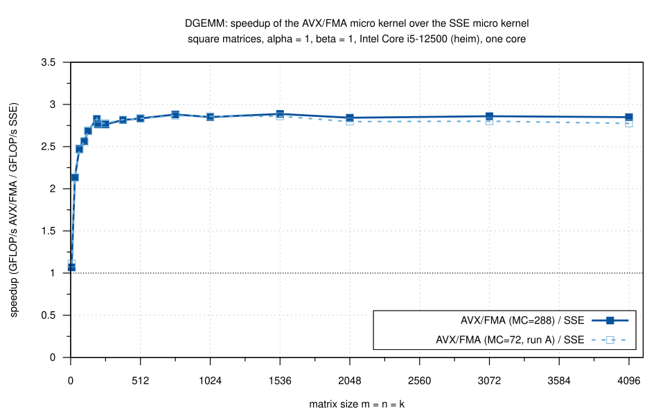
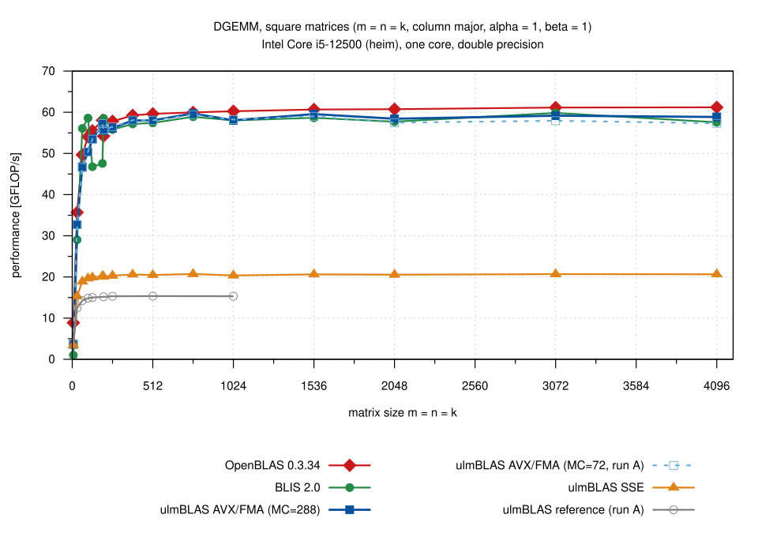
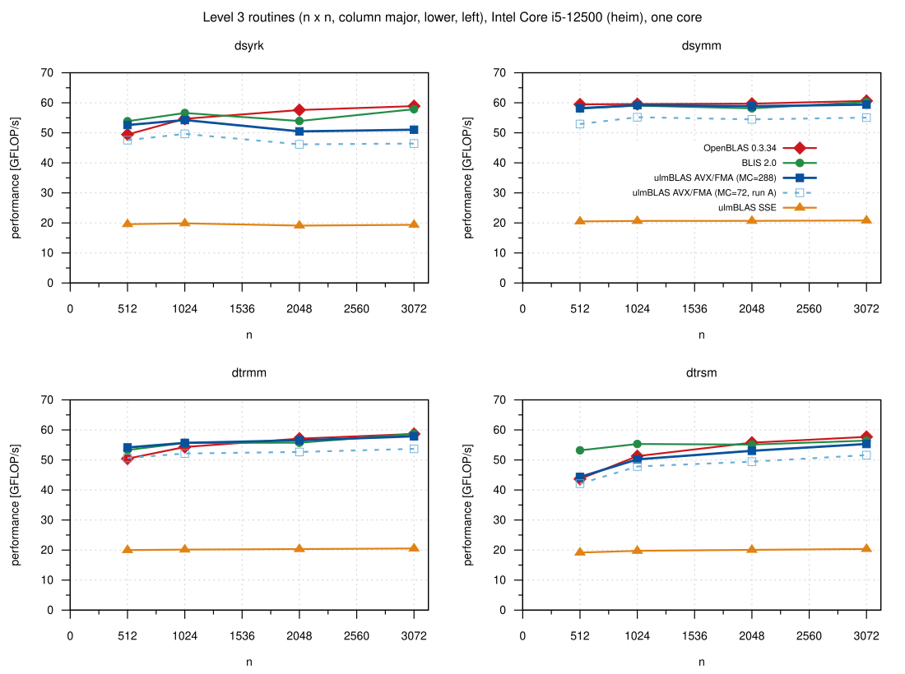

# AVX/FMA DGEMM micro kernel on an Intel Core i5-12500 (heim), 2026-10-24

I measured ulmBLAS's new AVX/FMA micro kernel for double (6 x 8, derived
from the BLIS kernel `bli_dgemm_haswell_asm_6x8`) against its SSE and
reference kernels, BLIS 2.0 and OpenBLAS 0.3.34, and chose its block sizes.
Everything is single-threaded.

## Results

- **DGEMM: AVX/FMA is 2.8 times as fast as SSE** (2.76 to 2.89 for n >= 256)
- **On par with BLIS 2.0**: 0.99 to 1.02 for n >= 256
  - BLIS uses the same assembly kernel
- **0.96 to 1.00 of OpenBLAS 0.3.34** for n >= 256
  - ulmBLAS up to 59.7 GFLOP/s, OpenBLAS up to 61.2
- **Small matrices** (n <= 128): BLIS and OpenBLAS are partly faster
  - n = 7: OpenBLAS 2.3 to 2.6 times as fast as the ulmBLAS variants
- **Block sizes: MC = 288, KC = 256, NC = 4080** (run B)
  - MC hardly matters for DGEMM with large k (up to 3%)
  - MC = 288 instead of 72 (the BLIS value): 12% faster for k = 32, 5 to
    11% for dsyrk, dsymm, dtrmm and dtrsm (they use MC x MC blocks)
  - KC = 256, 384 or 512: at most 1.1% difference
- **Other level 3 routines** (MC = 288)
  - 2.3 to 2.9 times as fast as with the SSE kernel
  - dsymm and dtrmm 0.99 to 1.01 of BLIS for n >= 1024
  - dsyrk 0.88 to 0.98 and dtrsm 0.83 to 0.98 of BLIS leave room (with the
    AVX kernel the diagonal blocks of trsm use the reference kernels)
- **Reproducible**: BLIS and OpenBLAS differ by at most 0.9% between runs A
  and B; the rounds of a run by at most 1.6% (n >= 64)

In short: the AVX/FMA kernel brings all level 3 routines to the level of
BLIS and close to OpenBLAS.  Remaining gaps are small matrices (packing),
dsyrk (diagonal blocks) and the diagonal blocks of dtrsm (no AVX/FMA trsm
kernel yet).  The block sizes were measured on this CPU only.

## Runs

| Run | AVX/FMA block sizes | Contents |
|-----|---------------------|----------|
| A | MC = 72, KC = 256, NC = 4080; sweep MC = 72, 144, 288 x KC = 256, 384, 512 | DGEMM of all variants; sweep; level 3 with MC = 72, 144, 288 |
| B | MC = 288, KC = 256, NC = 4080 (final) | DGEMM and level 3: SSE, AVX/FMA, BLIS, OpenBLAS |

The figures label the two block sizes "MC=72, run A" and "MC=288".  The
reference kernel was measured in run A only, up to n = 1024.

## Setup

- **Machine**: heim (Ulm University), Intel Core i5-12500 (Alder Lake, 6
  P-cores, 2 threads each), Debian 12, Linux 6.1
  - L1d 48 KiB, L2 1.25 MiB per core, L3 18 MiB
  - AVX2 and FMA, no AVX-512; intel_pstate, governor powersave, turbo on
- **Compiler**: GCC 12.2.0; benchmark programs `gcc -O2`

| Variant | Build | MR x NR, MC, KC, NC |
|---------|-------|---------------------|
| ulmBLAS reference | `make cblas ARCHFLAGS=` | 4 x 4, 384, 384, 4096 |
| ulmBLAS SSE | `make cblas` (`-msse3`) | 4 x 4, 384, 384, 4096 |
| ulmBLAS AVX/FMA | `make cblas ARCHFLAGS='-mavx -mfma'` | 6 x 8; A: 72, 256, 4080; B: 288, 256, 4080 |
| BLIS 2.0 (commit e8566eb) | `./configure ... haswell` | 6 x 8, 72, 256, 4080 |
| OpenBLAS 0.3.34 | `make USE_THREAD=0 ...`, target HASWELL | 4 x 8, P 512, Q 256, R 13824 |

All libraries are static and single-threaded and are called through CBLAS.

**ulmBLAS sources** (working trees of `feature/avx-dgemm-6x8` before
committing):

- run B: exactly commit e195bea ("Tune the block sizes of the AVX/FMA
  micro kernel"; tree hash aaaba196dde274c9)
- run A: commit d004ae1 (MC = 72), except that the clobber list of the
  AVX/FMA kernel also listed r8 to r12 and r15 (same instructions), plus
  test and documentation changes; tree hash 23470970201c8ad1.  For the
  sweep `source/bench.sh` set MC and KC per variant.

The tree hash is the first 16 hex digits of `find . -type f | LC_ALL=C sort
| xargs shasum -a 256 | shasum -a 256` in the source tree.

## Method

- **Single thread** pinned to core 3; no other load (load average about 1)
- **Operands**: column major, random entries in [-0.5, 0.5], alpha = 1,
  beta = 1; beta = 0 with C set to NaN to check that C is not read
  - dsyrk lower; dsymm left, lower; dtrmm and dtrsm left, lower, non-unit
- **Timing** (`source/bench2.c`, `bench3.c`)
  - warm-up of at least 0.3 s, then 7 samples (5 for the sweep and level
    3) of at least 0.2 s each, median reported
  - one result per size checked against a naive product (m n k <= 2e8);
    none was wrong
- **Rounds**: 3 per run, order of the variants rotated; figures and tables
  show the median
- **Flops**: dgemm 2 m n k, dsyrk n^3, dsymm 2 n^3, dtrmm and dtrsm n^3
  (including the copy of B)
- **Sizes**: square n = 7 ... 4096, thin k 2000 x 2000 x 32, 128, 256 and
  4000 x 4000 x 64, level 3 n = 512 ... 3072

## Tables (medians of 3 rounds, GFLOP/s)

DGEMM, square, beta = 1 (`data/summary/dgemm_square.csv`):

| n | reference (A) | SSE | AVX/FMA MC=72 (A) | AVX/FMA MC=288 | BLIS 2.0 | OpenBLAS 0.3.34 | AVX MC=288 / SSE |
|---|---|---|---|---|---|---|---|
| 64 | 14.25 | 18.90 | 46.56 | 46.75 | 56.07 | 49.67 | 2.47 |
| 256 | 15.31 | 20.33 | 56.48 | 56.17 | 55.80 | 57.80 | 2.76 |
| 1024 | 15.32 | 20.37 | 58.22 | 58.06 | 58.02 | 60.25 | 2.85 |
| 2048 | - | 20.56 | 57.47 | 58.42 | 57.71 | 60.74 | 2.84 |
| 4096 | - | 20.66 | 57.31 | 58.86 | 57.57 | 61.20 | 2.85 |

DGEMM, thin k, beta = 1 (`data/summary/dgemm_thin_k.csv`):

| m x n x k | SSE | AVX/FMA MC=72 (A) | AVX/FMA MC=288 | BLIS 2.0 | OpenBLAS 0.3.34 |
|---|---|---|---|---|---|
| 2000 x 2000 x 32 | 18.62 | 47.11 | 53.00 | 49.78 | 55.80 |
| 2000 x 2000 x 128 | 20.23 | 58.10 | 59.19 | 52.13 | 60.52 |
| 2000 x 2000 x 256 | 20.62 | 59.29 | 59.44 | 59.76 | 60.79 |
| 4000 x 4000 x 64 | 19.81 | 55.36 | 57.73 | 55.34 | 59.57 |

Level 3, n = 2048 (`data/summary/level3_*.csv`):

| Routine | SSE | AVX/FMA MC=72 (A) | AVX/FMA MC=288 | BLIS 2.0 | OpenBLAS 0.3.34 |
|---|---|---|---|---|---|
| dsyrk | 19.11 | 46.17 | 50.48 | 53.93 | 57.59 |
| dsymm | 20.69 | 54.47 | 58.87 | 58.16 | 59.71 |
| dtrmm | 20.33 | 52.65 | 56.53 | 55.74 | 57.10 |
| dtrsm | 20.08 | 49.43 | 53.05 | 55.11 | 55.76 |

## Files

| File | Contents |
|------|----------|
| `data/raw/run-A/`, `run-B/` | outputs of the benchmark programs per kind, variant and round |
| `data/dgemm.csv`, `data/level3.csv` | all measurements |
| `data/summary/*.csv` | medians over the rounds (data of the figures) |
| `data/logs/` | run and build logs, source checksums of BLIS and OpenBLAS |
| `source/` | benchmark programs, build and run scripts, `summarize.py` |
| `plots/` | Gnuplot scripts and figures |

To regenerate: `python3 source/summarize.py` here, then `make
add_benchmark_result BENCHMARK_DIR=benchmark_results/001-2026-10-24-heim-avx-fma`
in the top-level directory.

## Figures

<!-- BEGIN FIGURES (generated by make add_benchmark_result) -->

<!-- END FIGURES -->
