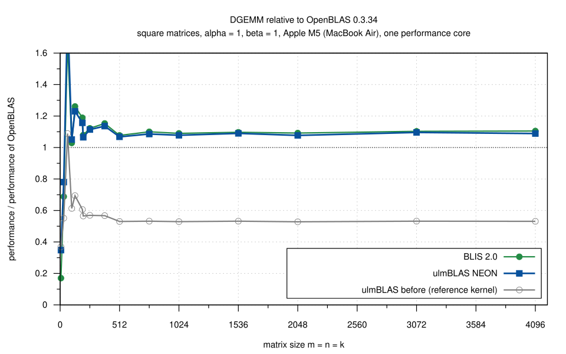
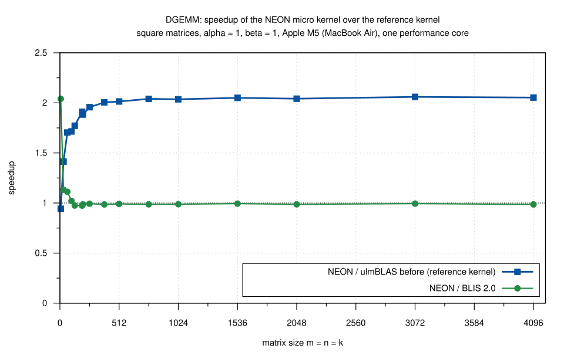
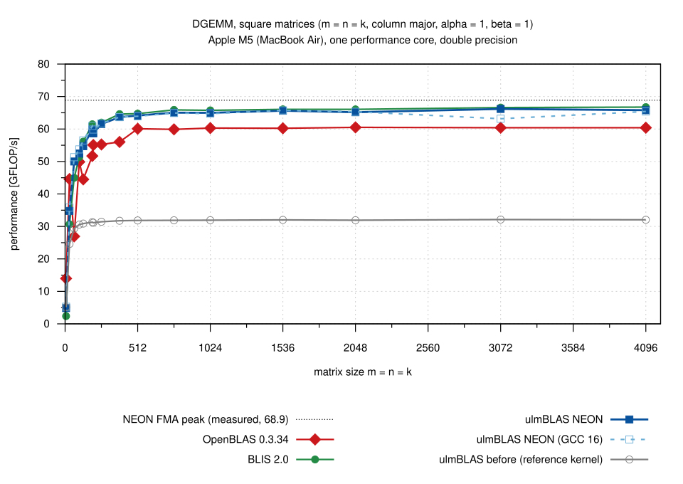
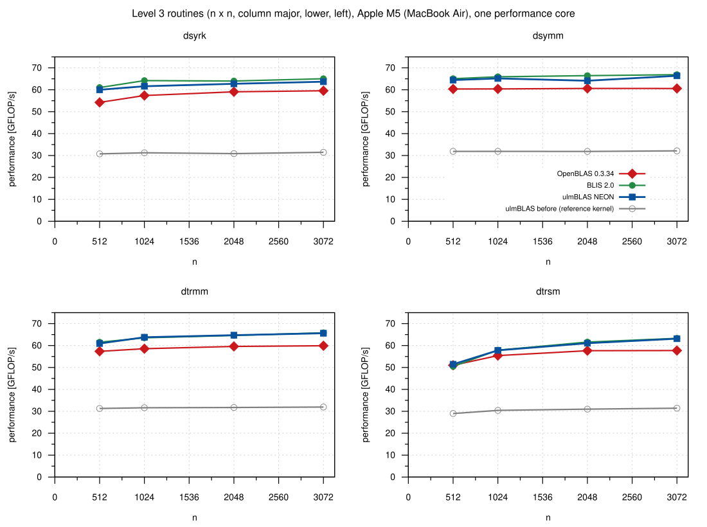
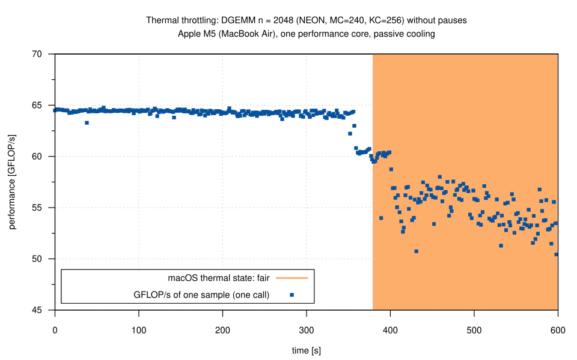
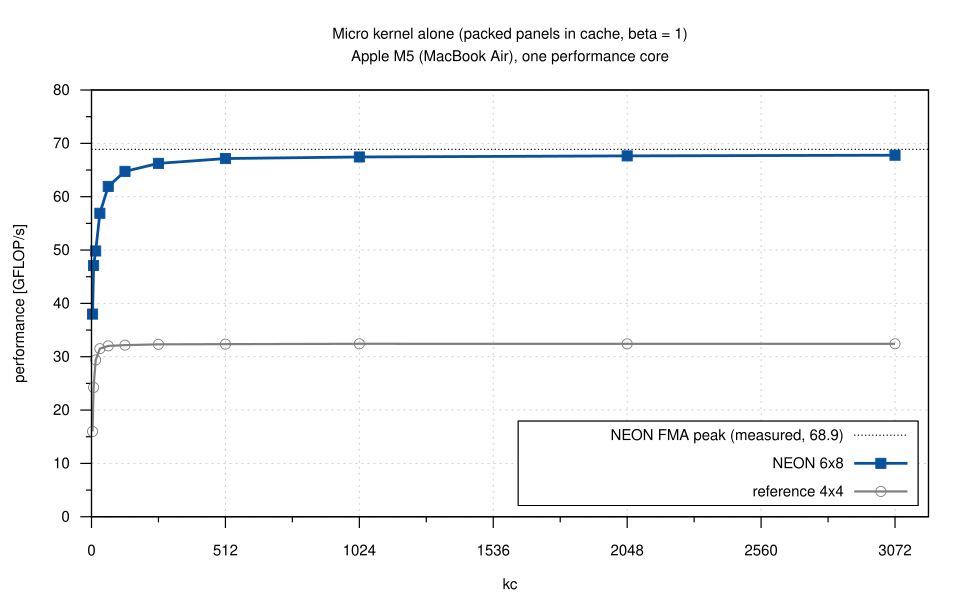

# NEON DGEMM micro kernel on an Apple M5 (2026-10-24)

I measured ulmBLAS's new NEON micro kernel for double (6 x 8, derived from
the BLIS kernel `bli_dgemm_armv8a_asm_8x6r`) against the portable
reference kernel, BLIS 2.0 and OpenBLAS 0.3.34, and chose its block sizes.
Everything is single-threaded on one performance core of a MacBook Air.

## Results

- **DGEMM: NEON is 2.0 times as fast as the reference kernel**
  - 1.96 to 2.06 for n >= 256
  - 1.70 to 1.91 for n = 64 to 199
- **0.986 to 0.994 of BLIS 2.0** for n >= 256
  - BLIS runs the same assembly kernel, with KC = 3072
- **1.07 to 1.14 times OpenBLAS 0.3.34** for n >= 256
  - OpenBLAS uses its NEON kernel `dgemm_kernel_8x4` on this CPU
- **Fraction of the FMA peak** (68.9 GFLOP/s) for n >= 1024
  - ulmBLAS 94 to 96% (up to 66.2 GFLOP/s)
  - BLIS 95 to 97%, OpenBLAS 87 to 88%
- **Small matrices**
  - n = 31 to 100: ulmBLAS 2 to 13% faster than BLIS
  - n = 7 and 31: OpenBLAS is faster (n = 7: 14.0 GFLOP/s, ulmBLAS 4.9,
    BLIS 2.4)
- **Thin k**
  - k = 32 and 64: ulmBLAS clearly ahead of BLIS (2000 x 2000 x 32: 54.4
    vs. 44.7 GFLOP/s; 4000 x 4000 x 64: 60.3 vs. 38.9) and OpenBLAS (37.8,
    56.3)
  - k >= 128: BLIS up to 2% faster
- **Other level 3 routines** (dsyrk, dsymm, dtrmm, dtrsm, n = 512 to 3072)
  - 1.8 to 2.1 times as fast as with the reference kernel
  - 0.96 to 1.02 of BLIS, 1.01 to 1.11 times OpenBLAS
  - dsyrk (0.96 to 0.98 of BLIS) leaves the most room
- **Micro kernel alone** (packed panels in cache)
  - 67.4 GFLOP/s for kc = 1024, 67.8 for kc = 3072: 98% of the FMA peak
  - reference kernel (auto-vectorized by clang): 32.4 GFLOP/s
- **Block sizes: MC = 960, KC = 1024, NC = 4080**
  - KC = 1024 instead of 256: 1 to 1.5% faster for DGEMM
  - MC hardly matters for square DGEMM (within 0.5%)
  - MC = 960 instead of 240: 2.3% faster for k = 32, up to 3.7% for dsyrk
    and 2.6% for dtrsm (dtrmm with n = 1024 1.1% slower)
- **Compilers**: built with GCC 16 the library is as fast as with Apple
  clang 21 (0.99 to 1.03 for n >= 64; the assembly kernel is the same)
- **Thermal throttling**
  - the MacBook Air has passive cooling: after about 6 minutes of load on
    one core macOS goes from *nominal* to *fair* and DGEMM gets about 15%
    slower (`thermal.svg`)
  - this spoiled the first sweep (run A0); all other runs use a thermal
    guard
- **Apple Accelerate** (one thread, for context only): 400 to 490 GFLOP/s
  for n >= 128, because it uses the matrix unit of the M5, not NEON

In short: the NEON kernel doubles the performance of all level 3 routines
on Apple silicon and brings DGEMM within about 1% of BLIS.  The kernel
itself runs at 98% of the peak, so the remaining gap lies in the packing
and the macro kernel.  The block sizes were measured on the M5 only; Apple
cores with a smaller L2 (M1: 12 MiB) may prefer a smaller MC.

## Runs

| Run | Contents | Valid |
|-----|----------|-------|
| A0 | DGEMM sweep MC = 120 ... 960 x KC = 256 ... 2048, no pauses | no: thermal throttling |
| A | the same with KC <= 1024 and the thermal guard | yes, but the block sizes differ less than the noise |
| A2 | DGEMM, 5 candidates, tightly interleaved (8 cycles) | yes: chooses KC and MC |
| A3 | dsyrk, dsymm, dtrmm, dtrsm, 4 candidates, interleaved (6 cycles) | yes: chooses MC |
| B | final block sizes: DGEMM (square, thin k, beta = 0) and level 3, all variants, 3 rounds | yes |
| ukernel | micro kernels alone, kc = 4 to 3072 | yes |
| diag | DGEMM n = 2048 for 10 minutes without pauses | diagnosis of the throttling |

## Setup

- **Machine**: MacBook Air (Mac17,4), Apple M5 (4 performance, 6
  efficiency cores), 32 GiB, macOS 26.6, on AC power
  - performance cores: L1d 128 KiB per core, L2 16 MiB shared; cache line
    128 bytes
  - measured FMA peak 68.9 GFLOP/s (16 flops per cycle at about 4.3 GHz)
- **Compilers**: Apple clang 21.0.0; GCC 16.2.0 for the variant `neon-gcc`;
  benchmark programs `clang -O2`

| Variant | Build | MR x NR, MC, KC, NC |
|---------|-------|---------------------|
| ulmBLAS before (`base`, commit 8266ae3) | `make cblas` (reference kernel) | 4 x 4, 384, 384, 4096 |
| ulmBLAS reference (`ref`) | `make cblas CPPFLAGS=-DULMBLAS_NO_NEON` | 4 x 4, 384, 384, 4096 |
| ulmBLAS NEON (`neon`) | `make cblas` | 6 x 8, 960, 1024, 4080 |
| ulmBLAS NEON, GCC (`neon-gcc`) | `make cblas CXX=g++-16 CC=gcc-16` | 6 x 8, 960, 1024, 4080 |
| ulmBLAS sweep (`neon-MC-KC`) | `make cblas`, MC and KC set by `source/setblocks.py` | 6 x 8, MC, KC, 4080 |
| BLIS 2.0 (commit e8566eb) | `./configure --disable-shared --enable-cblas -t no firestorm` | 8 x 6, 256, 3072, 8184 |
| OpenBLAS 0.3.34 | `make USE_THREAD=0 NO_SHARED=1 ...`, target VORTEXM4 | 8 x 4, P 256, Q 512, R 4096 |
| Apple Accelerate | `-framework Accelerate`, `VECLIB_MAXIMUM_THREADS=1` | matrix unit, context only |

All libraries are static (except Accelerate) and single-threaded and are
called through CBLAS.  Compile commands: `data/logs/variants.txt`; build
logs of BLIS and OpenBLAS: `data/logs/build-refs.log`.

**ulmBLAS sources.**  I measured snapshots of the working tree of the
branch `feature/arm64-dgemm-8x6` before committing:

- runs A0 to A3: tree hash a35fbb818cd29cd4, which differs from commit
  7ccda42 only in comments (`LICENSE`, the BLIS notice in
  `neon/ugemm.tcc`)
- runs B and ukernel: tree hash f1ecfba0f755cc98, which differs from
  commit ad778d4 only in the wording of one comment in `blocksize.h`

The tree hash is the first 16 hex digits of `find . -type f | LC_ALL=C sort
| xargs shasum -a 256 | shasum -a 256` in the source tree.

## Method

- **Single thread** on a performance core (QoS class user-interactive;
  macOS has no CPU affinity)
- **Thermal guard** (`source/guard.sh`; all runs except A0 and diag)
  - a run starts only when the thermal state is *nominal*, after a pause
    of 10 s (5 s in A2 and A3)
  - it counts only if the state is still *nominal* afterwards; otherwise
    it is repeated
  - discarded runs: 0 (A), 0 (A2), 2 (A3), 1 (B), 0 (ukernel)
- **FMA peak** (`source/peak.c`) before every variant and round; run B:
  median 68.9 GFLOP/s (66.2 to 69.0)
- **Operands**: column major, random entries in [-0.5, 0.5], alpha = 1,
  beta = 1; beta = 0 with C set to NaN to check that C is not read
  - dsyrk lower; dsymm left, lower; dtrmm and dtrsm left, lower, non-unit
- **Timing** (`source/bench2.c`, `bench3.c`)
  - warm-up of at least 0.3 s, then 7 samples (5 for level 3) of at least
    0.2 s each, median reported
  - one result per size checked against a naive product (m n k <= 2e8);
    none was wrong
- **Rounds**: runs A and B have 3 rounds with the order of the variants
  rotated; A2 and A3 interleave the candidates tightly, so slow changes of
  the machine hit all of them alike
- **Flops**: dgemm 2 m n k, dsyrk n^3, dsymm 2 n^3, dtrmm and dtrsm n^3
  (including the copy of B)
- **Sizes of run B**: square n = 7 ... 4096 (`ref` up to 1024), thin k
  2000 x 2000 x 32, 128, 256 and 4000 x 4000 x 64, level 3 n = 512 ...
  3072

## How reliable the numbers are

The MacBook was not idle (desktop session, load average 2 to 8).

- Round 1 of run B ran right after the builds (load 6 to 8) and was 3 to
  11% slower for all variants; rounds 2 and 3 agree within 0.2 to 3.2%, so
  the medians are values of round 2 or 3.
- `neon-gcc` at n = 3072 in round 2 overlapped with a Homebrew install:
  its median (63.2 GFLOP/s) is an outlier.
- In run A the rounds differ by up to 7%, more than the block sizes
  (about 1%); the block sizes were therefore chosen from A2 and A3.
- Within one program run the samples agree within 0.1 to 0.5%.

## Tables (medians of 3 rounds, GFLOP/s)

DGEMM, square, beta = 1 (`data/summary/dgemm_square.csv`):

| n | before (reference) | NEON | NEON (GCC 16) | BLIS 2.0 | OpenBLAS 0.3.34 | NEON / before | NEON / BLIS | NEON / OpenBLAS |
|---|---|---|---|---|---|---|---|---|
| 7 | 5.16 | 4.86 | 5.26 | 2.38 | 13.97 | 0.94 | 2.04 | 0.35 |
| 31 | 24.59 | 34.77 | 35.81 | 30.68 | 44.59 | 1.41 | 1.13 | 0.78 |
| 64 | 29.35 | 50.00 | 51.33 | 44.97 | 26.94 | 1.70 | 1.11 | 1.86 |
| 128 | 30.88 | 54.70 | 56.50 | 56.12 | 44.49 | 1.77 | 0.97 | 1.23 |
| 256 | 31.44 | 61.52 | 61.73 | 61.98 | 55.24 | 1.96 | 0.99 | 1.11 |
| 512 | 31.85 | 64.14 | 63.92 | 64.74 | 60.08 | 2.01 | 0.99 | 1.07 |
| 1024 | 31.92 | 64.98 | 64.74 | 65.75 | 60.29 | 2.04 | 0.99 | 1.08 |
| 2048 | 31.92 | 65.17 | 65.32 | 66.05 | 60.51 | 2.04 | 0.99 | 1.08 |
| 3072 | 32.12 | 66.18 | 63.16 | 66.60 | 60.40 | 2.06 | 0.99 | 1.10 |
| 4096 | 32.05 | 65.79 | 65.39 | 66.74 | 60.40 | 2.05 | 0.99 | 1.09 |

DGEMM, thin k, beta = 1 (`data/summary/dgemm_thin_k.csv`):

| m x n x k | before (reference) | NEON | BLIS 2.0 | OpenBLAS 0.3.34 |
|---|---|---|---|---|
| 2000 x 2000 x 32 | 31.30 | 54.43 | 44.65 | 37.79 |
| 2000 x 2000 x 128 | 32.09 | 63.36 | 63.73 | 54.23 |
| 2000 x 2000 x 256 | 32.12 | 63.82 | 65.16 | 57.23 |
| 4000 x 4000 x 64 | 31.31 | 60.27 | 38.92 | 56.31 |

Level 3, n = 2048 (`data/summary/level3_*.csv`):

| Routine | before (reference) | NEON | BLIS 2.0 | OpenBLAS 0.3.34 | NEON / BLIS |
|---|---|---|---|---|---|
| dsyrk | 30.87 | 62.72 | 63.98 | 59.07 | 0.98 |
| dsymm | 31.86 | 64.12 | 66.44 | 60.60 | 0.97 |
| dtrmm | 31.74 | 64.73 | 64.60 | 59.60 | 1.00 |
| dtrsm | 30.99 | 61.07 | 61.59 | 57.65 | 0.99 |

Block sizes, interleaved runs (`data/summary/blocksize_dgemm.csv`,
`blocksize_level3.csv`), relative to MC = 240, KC = 256:

| Case | MC=120 KC=1024 | MC=240 KC=1024 | MC=480 KC=1024 | MC=960 KC=1024 |
|---|---|---|---|---|
| DGEMM 1024 | 1.011 | 1.015 | 1.007 | 1.010 |
| DGEMM 2048 | 1.012 | 1.011 | 1.008 | 1.013 |
| DGEMM 2000 x 2000 x 32 | 0.953 | 0.991 | 1.003 | 1.023 |
| dsyrk 2048 | - | 1.006 | 1.017 | 1.037 |
| dsymm 2048 | - | 0.999 | 1.005 | 1.009 |
| dtrmm 1024 / 2048 | - | 1.005 / 1.000 | 1.010 / 1.009 | 0.989 / 1.011 |
| dtrsm 2048 | - | 1.005 | 1.014 | 1.026 |

## Files

| File | Contents |
|------|----------|
| `data/raw/` | outputs of the benchmark programs per run, variant and round; `ukernel/` and `diag/` |
| `data/dgemm.csv`, `data/level3.csv` | all measurements |
| `data/summary/*.csv` | medians over the rounds (data of the figures), ratios, variability, FMA peaks, block sizes |
| `data/logs/` | run logs, thermal logs, discarded runs, builds, source checksums, compile commands |
| `source/` | benchmark programs, build and run scripts, `summarize.py` (CSV files from the raw outputs) |
| `plots/` | Gnuplot scripts and figures |

The diagnosis run was made by hand: `bench-neon-240-256 3 1 2048 2048 2048
...` (360 times n = 2048) with a time stamp per line, while `thermal 10`
logged the thermal state.

To regenerate: `python3 source/summarize.py` here, then `make
add_benchmark_result
BENCHMARK_DIR=benchmark_results/002-2026-10-24-macbook-m5-neon` in the
top-level directory (figures; Gnuplot 6.0.5, 5.4 also works).

## Figures

<!-- BEGIN FIGURES (generated by make add_benchmark_result) -->

<!-- END FIGURES -->
