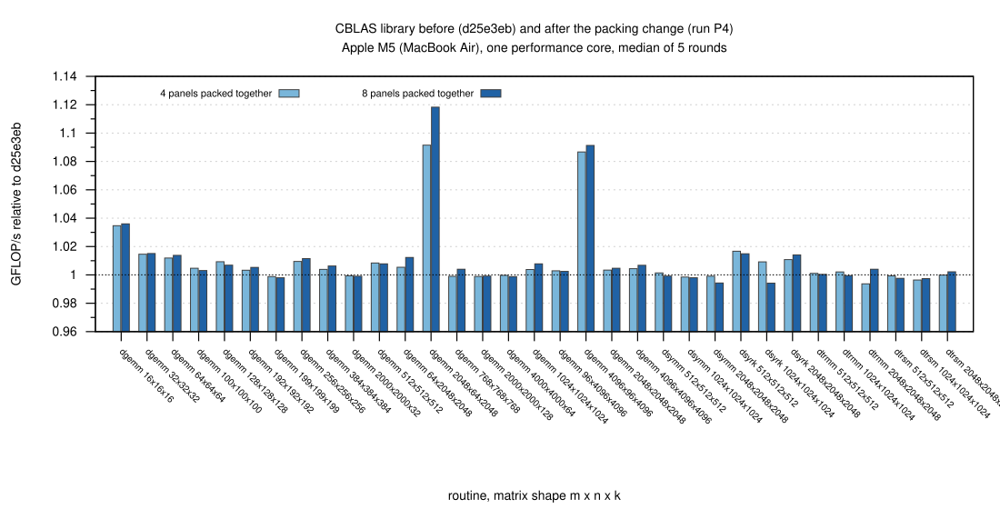
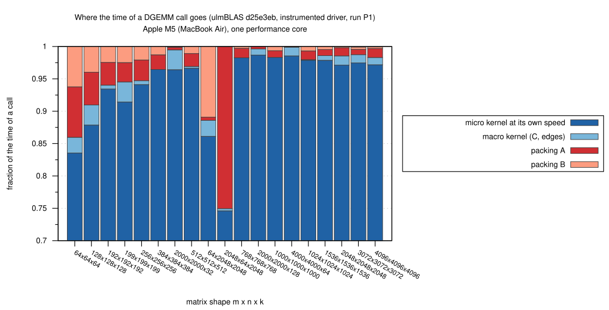
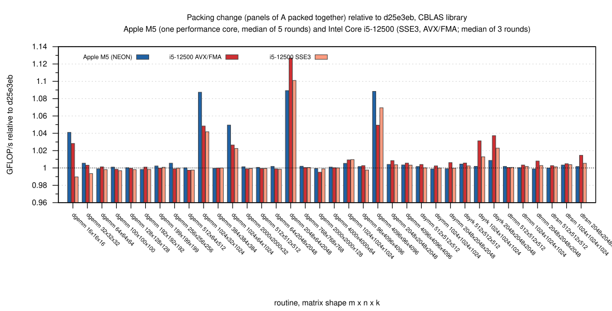
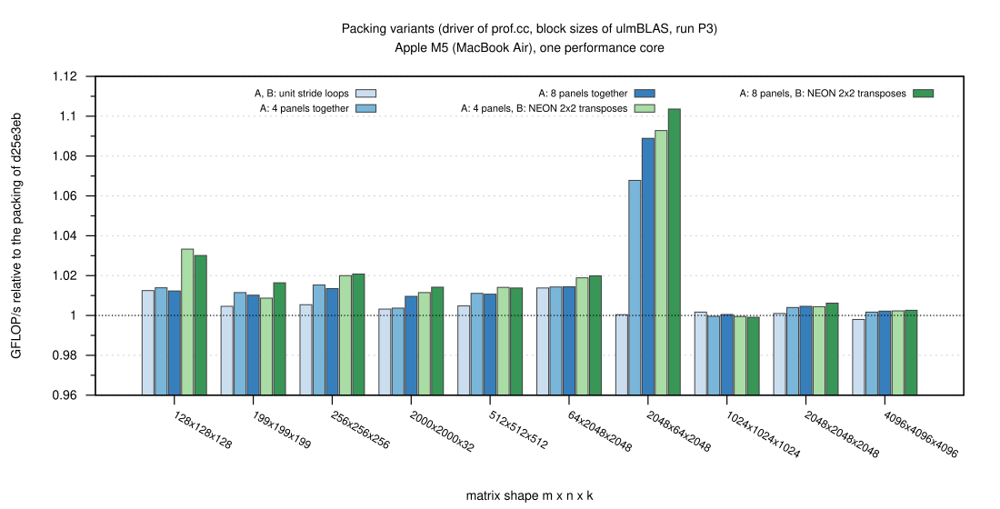

# Where ulmBLAS DGEMM loses time on an Apple M5 (2026-10-25)

With the NEON kernel of campaign
[002-2026-10-24-macbook-m5-neon](../002-2026-10-24-macbook-m5-neon/README.md)
ulmBLAS reached 0.986 to 0.994 of BLIS 2.0, which runs the same assembly
kernel.  I wanted to know where the rest goes: I split the time of a DGEMM
call into packing, micro kernel and the rest, compared the surrounding
code with BLIS and tried changes of the packing.  The hypothesis was that
packing explains the gap.

- Source: master d25e3eb
- Outcome: the commit "Pack panels of A together if the columns of A are
  far apart" (after "Test the packing routines gepack_A and gepack_B")

## Results

- **Large matrices: the micro kernel dominates** (n >= 1024,
  `breakdown.svg`)
  - 97 to 98% of the time is the micro kernel, at the speed it reaches
    alone on packed panels in cache (67.7 to 68.7 GFLOP/s)
  - packing A and B 1.2 to 2.3%, the macro kernel around it 0 to 1.4%
  - the rest (loops, calls, buffers) is below the measurement error (0.8%)
  - ulmBLAS reached 0.988 to 0.998 of BLIS in the same program (run P1)
- **The gap to BLIS is packing, but small**
  - at n = 2048 BLIS spends 1.25% of the samples in packing, ulmBLAS 2.1%
    in packing and macro kernel (1.8% after the change)
  - ulmBLAS packed A 1.4 to 2.7 times slower per element than B (n = 1024
    ... 3072): A is packed panel by panel, column by column, reading only
    MR = 6 elements (48 bytes) per column and panel
  - at n = 4096 NC = 4080 splits n into 4080 + 16 columns and A is packed
    a second time (about 0.5%; NC = 8160 or BLIS's loop order remove it)
  - otherwise block sizes and loop order are not the reason: BLIS's loop
    order and block sizes in the ulmBLAS driver give the same performance;
    KC = 2048 or 3072 is not faster
- **Thin shapes: packing dominates**
  - 2048 x 64 x 2048: packing A takes 26% (BLIS uses its unpacked "sup"
    kernels here and is 40% slower than ulmBLAS)
  - 64 x 2048 x 2048: packing B takes 11%
- **Partial tiles cost what the padding costs**
  - n = 64 and 199: the macro kernel is 2.8% and 3.3% slower than the
    micro kernel alone; the zero padding (64 -> 66, 199 -> 204) is 3.1% and
    2.5% more work, the same in BLIS
- **Call overhead matters only for tiny matrices**
  - the memory pool takes 47 ns per call: n = 8 takes 131 ns instead of
    79 ns, n = 16 18% longer, n >= 32 below 4%; not changed

### Packing experiments (`packing.svg`, runs P2, P3)

Variants of the packing routines in the instrumented driver
(`source/packvar.h`):

| Variant | Effect (driver, M5) |
|---------|---------------------|
| A and B: separate loops for unit stride (vector loads) | -0.2 to +1.4% |
| A: all panels together, column by column | +2.3% (n = 128) to -23% (2048 x 64 x 2048), -1 to -4% for n >= 512: the panels are 48 KiB apart in the buffer, a multiple of the L1 way size (16 KiB), so all write streams hit the same cache sets |
| A: groups of 4 or 8 panels column by column | +7 to +9% for 2048 x 64 x 2048, +1 to +1.5% for n = 128 ... 512, 0 to +0.5% for large n; 16 panels much slower (same conflicts) |
| B: two rows at a time with 2 x 2 transposes in NEON registers (as `bli_dpackm_armv8a_int_6x8` of BLIS) | packing of B about 30% faster, DGEMM -0.3 to +2.3%, 0 for large n |
| B: the same in portable C++ | not faster: the compiler does not generate the transposes |

### Check on heim (Intel Core i5-12500, SSE3 and AVX/FMA)

The packing code is the same on all architectures, so I measured every
change on heim too (`data/raw/heim`):

- grouping 4 or 8 panels of A plus the unit-stride loops made small
  matrices up to 17% slower with AVX/FMA (n = 16 ... 256), up to 5% with
  SSE3
- the unit-stride loop for **B** becomes 96 shuffles with GCC 12 and
  `-mavx`: up to 14% slower at n = 16, so I dropped it (it gained only 0.4
  to 1.3% on the M5)
- **grouping** the panels of A is slower when A is in cache (pack time 378
  vs. 484 ns at n = 32), up to 7% for n = 32 ... 256; the unit-stride loop
  for A is neutral
- grouping pays off when the columns of A are far apart
  - m = 512, small n: neutral; m >= 1024, small n: +3 to +12%
  - square n = 1024 ... 2048: -0.1 to +1.5%; n <= 768: -2.0 to +0.1%
  - with "columns at least 8 KiB apart" as condition the losses disappear
    on both machines

### The change and its effect (`final.svg`, runs P6 and heim/final)

`gepack_A` packs four panels together if the columns of A are at least 8
KiB apart, with a separate loop for unit row stride; `gepack_B` is
unchanged.  CBLAS library relative to d25e3eb:

| | Apple M5 (5 rounds) | i5-12500 AVX/FMA (3 rounds) | i5-12500 SSE3 (3 rounds) |
|---|---|---|---|
| DGEMM, small n, m = k >= 1024 (4 shapes) | +5.0 to +8.9% | +2.7 to +12.7% | +2.3 to +10.1% |
| DGEMM, all other shapes (20) | -0.2 to +0.6% (n = 16: +4.1%) | -0.5 to +0.9% (n = 16: +2.8%) | -1.0 to +1.0% |
| dsyrk n = 512 ... 2048 | +0.2 to +0.9% | +0.6 to +3.7% | +0.2 to +2.3% |
| dsymm, dtrmm, dtrsm | -0.1 to +0.3% | +0.1 to +1.5% | 0 to +0.5% |

- without the unit-stride loop (variant pTG) small matrices on the M5 were
  up to 5% slower (n = 32), so the loop stays
- not done: NEON packing of B (architecture-specific code for at most
  2.3%), a larger NC (0.5% at n = 4096 only, twice the buffer), a cheaper
  memory pool (tiny matrices only)

## Method

- **Instrumented driver** (`source/prof.cc`): a copy of `ulmBLAS::gemm`
  with run-time block sizes, the loop orders of ulmBLAS and BLIS, and
  timers (41.7 ns resolution) around packing and macro kernel
  - modes: `lib` (ulmBLAS::gemm), `inst` (with timers), `nopack` (buffers
    packed once before), `pack`, `kern` (micro kernel alone on panels in
    cache), `pool`, `cblas` (BLIS or OpenBLAS in the same program),
    `check`
  - driver and library differ by less than 1% for n >= 128
- **Breakdown** (`source/tables.py`): kernel = flops / speed of `kern`;
  macro kernel = `nopack` - kernel; packing = timers of `inst`; rest = the
  remainder
- **Profiles**: `/usr/bin/sample` (1 ms, 5 s) of BLIS and ulmBLAS at n =
  2048 and 2048 x 64 x 2048; in d25e3eb packing is inlined into `gemm`, so
  only the timers separate it
- **No hardware counters**: the PMU of the M5 needs root and Instruments
  needs Xcode; the explanations (cache set conflicts, partly used cache
  lines, TLB) are inferred from controlled experiments
- **Memory bandwidth** (`source/bw.c`): one core reads about 60 GB/s and
  copies 73 to 82 GB/s; d25e3eb packed A from DRAM at about 13 + 13 GB/s
- **Thermal guard** (`source/guard.sh`): runs of at most 15 s, pause 5 s
  (10 s for `sample`), accepted only in the nominal state; none was
  discarded
- **Rounds**: variants of a size measured one after the other, order
  rotated per round; P1 to P3 3 rounds, P4 to P6 5 rounds; medians
  - per run: warm-up >= 0.2 s, 5 or 7 samples of >= 0.1 s, median
- **heim**: GCC 12.2, Clang 16.0.6, Debian 12, pinned to CPU 3 or 5,
  `-msse3 -mfpmath=sse` and `-mavx -mfma`
  - the first AVX runs of `prof` crashed (unaligned buffers; the AVX
    kernel needs 32-byte alignment); the breakdown on heim uses the fixed
    program
  - the driver uses the block sizes of the M5 there, so its heim numbers
    compare the variants only

Software: macOS 26.6, Apple clang 21.0.0, Python 3.15, Gnuplot 6.0.5;
BLIS 2.0 and OpenBLAS 0.3.34 built as in campaign 002.

## Tests

- `make check` with the change: M5 (Apple clang 21 and GCC 16) 720 PASS,
  0 FAIL each; heim (GCC 12 and Clang 16) 839 PASS, 0 FAIL
- the new test T0347 compares the packed buffers element by element,
  including the grouped path; it detects three mutations of the grouped
  path (two by the comparison, one by an invalid access)
- `prof -m check` compares the driver with ulmBLAS::gemm for all packing
  variants, both loop orders and block sizes down to 7 (150 cases, all ok)

## Files

| File | Contents |
|------|----------|
| `data/summary/breakdown.csv` | P1: fractions of the time (kernel, macro, packA, packB, rest) and GFLOP/s |
| `data/summary/packing.csv`, `blocksizes.csv`, `overhead.csv` | P3: packing variants, block sizes and loop order, call overhead |
| `data/summary/before_after.csv`, `final.csv`, `final_all.csv` | P4, P6 and heim/final: library variants |
| `data/summary/heim_*_rel.csv`, `medians/` | heim runs; medians of all runs |
| `data/raw/` | outputs per run and round (P1 ... P6, heim, sample) |
| `data/logs/` | run logs, thermal state, heim logs, make check summaries |
| `source/` | driver (`prof.cc`, `packvar.h`), library variants (`variants/`), run scripts, summaries, helper programs |

Runs: P1 baseline breakdown, P2 packing variants, P3 B transposes, block
sizes, call overhead, P4 to P6 library variants (P6: the change).  The
summaries are regenerated with `sh source/make-summaries.sh .`.

## Figures

<!-- BEGIN FIGURES (generated by make add_benchmark_result) -->

<!-- END FIGURES -->
