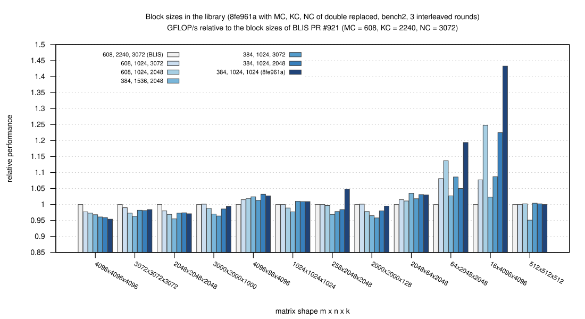
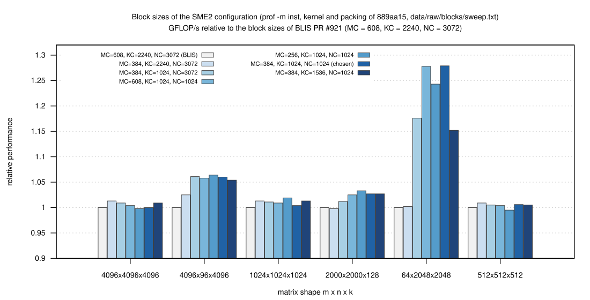
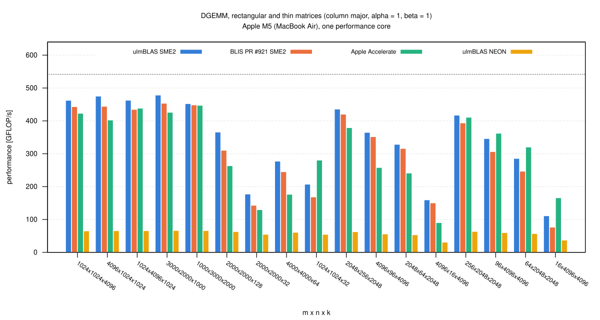
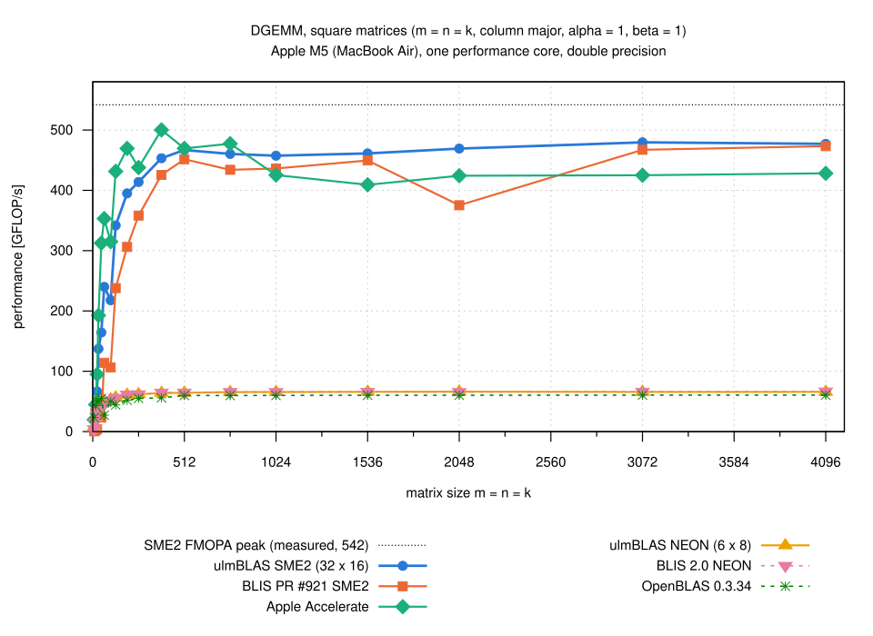
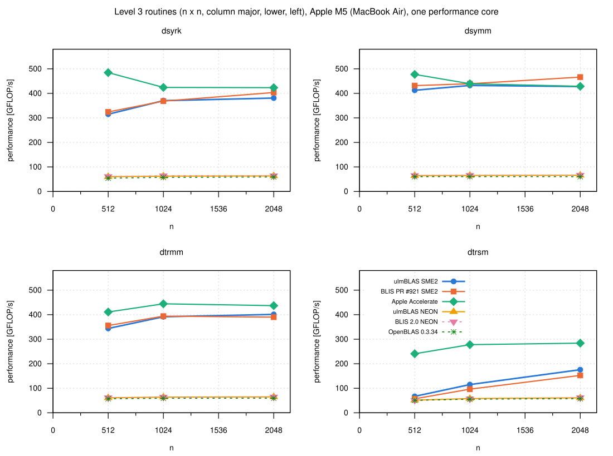
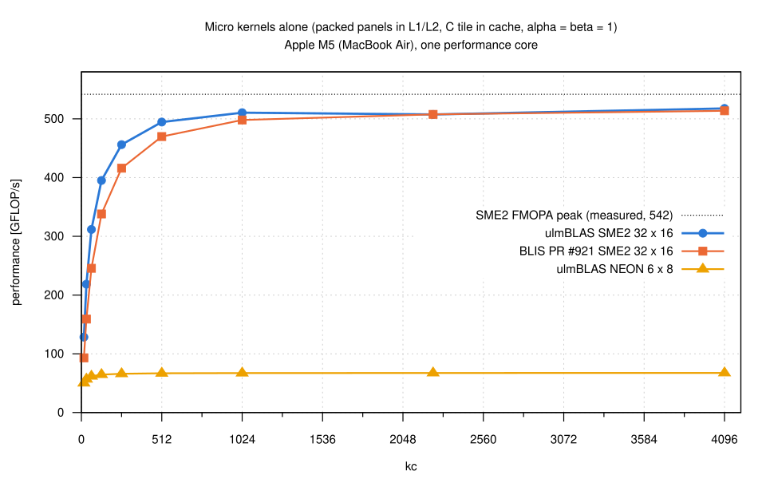

# An SME2 DGEMM backend for the Apple M5 (2026-10-25)

Besides NEON the Apple M5 has a matrix unit, programmed with SME2: in
streaming mode the outer-product instruction FMOPA accumulates into the ZA
array (eight 8 x 8 tiles of doubles at a vector length of 512 bits).
Until now ulmBLAS used only NEON, about 66 GFLOP/s for DGEMM (campaign
[002-2026-10-24-macbook-m5-neon](../002-2026-10-24-macbook-m5-neon/README.md)).
Here I built and measured an experimental SME2 backend for double, with
BLIS pull request #921 (SME kernels for Apple M4, fork Luislo1/blis, head
235ef8ec, configuration `m4sme_p`) as the reference for the micro kernel,
the packing format and the block sizes.

- Source: branch `feature/sme-dgemm` on master 5c674ad, commits 6d6fe01
  ... 8fe961a ("Tune the block sizes of the SME2 configuration")
- Measured: 8fe961a (`sme`) and master 5c674ad (`neon`); 3e9b5e4 corrects
  the comment on the block sizes afterwards (see block sizes below)

## Results

- **SME2 works and is selected at compile time**
  - C++ with the ACLE intrinsics of `arm_sme.h`, Apple clang 21 or clang
    23 with `-mcpu=apple-m4` (there is no M5 option yet)
  - GCC 16 compiles it but cannot link (the Darwin runtime lacks
    `__arm_get_current_vg`), so the backend needs clang (`USE_SME`)
- **FMOPA peak of one performance core: 542 GFLOP/s**, 7.9 times the NEON
  peak
  - FMOPA latency needs at least 4 independent tiles: 1 tile 135, 2 tiles
    271, 4 tiles 542
  - stays at the peak for packed panels up to 6 MiB (kc = 16384), 214 to
    216 for panels from DRAM
- **Micro kernel** (32 x 16, 4 x 2 tiles of 8 x 8, `ukernel.svg`)
  - 507 to 518 GFLOP/s for kc >= 1024 (94 to 96% of the peak); BLIS PR
    #921 498 to 514
  - faster than BLIS for small kc (kc = 128: 395 vs. 338, kc = 16: 128 vs.
    93), because for alpha = 1 and beta = 0 or 1 it loads and stores C
    directly with ZA slices instead of going through a buffer
- **Square DGEMM, n >= 512** (`dgemm_square.svg`)
  - 457 to 480 GFLOP/s (84 to 89% of the peak)
  - 7.0 to 7.3 times ulmBLAS NEON
  - 1.01 to 1.06 times BLIS PR #921 (n = 2048: 1.25, not representative,
    see Variation)
  - 1.08 to 1.13 times Accelerate for n >= 1024
- **Square DGEMM, small n**
  - Accelerate is faster for n <= 768 (n = 384: 500 vs. 453, n = 128: 432
    vs. 342, n = 32: 193 vs. 137)
  - ulmBLAS is faster than BLIS PR #921 for all n (n = 128: 342 vs. 238, n
    = 64: 240 vs. 114; BLIS SME2 is below NEON for n < 64)
  - n = 8: SME2 is slower than NEON (5.1 vs. 7.5), presumably because
    entering and leaving streaming mode (about 28 ns) and moving data
    between the modes cost more than the 1024 flops
- **Rectangular and thin shapes** (`dgemm_shapes.svg`)
  - all dimensions >= 1000: 452 to 478 (BLIS 434 to 453, Accelerate 402 to
    447)
  - small k (2000 x 2000 x 32 ... 128): 177 to 366, ahead of BLIS (143 to
    310) and Accelerate (130 to 263), except 1024 x 1024 x 32 (Accelerate
    280 vs. 207)
  - small n (16 ... 256): 160 to 436, BLIS 150 to 420, Accelerate 90 to 379
  - **small m is the weak spot**: m = 16 ... 96: 111 to 346, Accelerate 166
    to 362 (m = 16: 111 vs. 166, m = 64: 286 vs. 320), BLIS 76 to 306
- **beta = 0**: 423 to 470, about as with beta = 1
  - except small k (2000 x 2000 x 32: 229 vs. 177; C is only written)
  - BLIS PR #921 is faster with beta = 0 at n = 2048 (490 vs. 470)
- **Level 3** (`level3.svg`; unchanged frame algorithms on the DGEMM
  kernel)
  - dsymm 413 to 432, dtrmm 344 to 401, dsyrk 315 to 381 GFLOP/s: about
    BLIS PR #921 (dsyrk and dsymm up to 6% and 8% slower at n = 2048), 5
    to 7 times NEON
  - Accelerate is faster for n = 512 (dsyrk 485)
  - dtrsm only 67 to 176 (BLIS 57 to 153, NEON 51 to 61, Accelerate 241 to
    284): the solve inside the diagonal blocks uses the scalar reference
    kernel `utrlsm` with MR = 32
- **Block sizes: a trade-off between large and small m**
  (`blocksize_lib.svg`: the library with seven block sizes, 3 interleaved
  rounds)
  - BLIS's 608, 2240, 3072 are the fastest for large matrices: every
    variant with KC = 1024 is 2 to 5% slower for m = n = k >= 2048
  - small m needs a small packed block of B: 384, 1024, 1024 (8 MiB of the
    16 MiB L2) is 19% faster for 64 x 2048 x 2048, 43% for 16 x 4096 x
    4096, 5% for 256 x 2048 x 2048 and 3% for small n
  - but 4.6%, 1.6% and 2.9% slower for n = 4096, 3072 and 2048
  - no variant is best for both; 8fe961a uses 384, 1024, 1024
  - the sweep with the instrumented driver (`blocksize.svg`) had shown no
    loss for square matrices, the library does (timers and buffers
    differ), so I corrected the comment of 8fe961a afterwards
  - the packed block of A must fit well into L2: 12 to 32 MiB was 14 to
    43% slower for n = 4096
- **Where the time goes** (`prof -m inst`, chosen block sizes)
  - square n >= 512: 93 to 96% in the macro kernel, packing 4.5 to 7%
  - 4096 x 96 x 4096: packing A 26%; 64 x 2048 x 2048: packing B 32%
  - packing is the remaining bottleneck of thin shapes

### Variation

- 3 rounds, medians; spread at most 5% for SME2 and 3% for NEON
- except SME2 n = 512, 768, 1024 with beta = 1 (11 to 12%: that program
  run was slower in round 3)
- BLIS PR #921 is bimodal at 2048 x 2048 x 2048 with beta = 1 (348, 375,
  468; 465 in an earlier run), so its ratio 1.25 there is not
  representative

## How the backend works

The frame algorithm (`gemm.tcc`: blocking, loop order, memory pool) and
the macro kernel (`mgemm.tcc`) are unchanged.  The SME2 part is a micro
kernel and the packing of single panels, chosen by overload resolution
under `USE_SME`, so the object code of the other builds stays
byte-identical.

- **Micro kernel** (`ukernel/sme/ugemm.tcc`, derived from BLIS PR #921
  `bli_dgemm_armsme_int_4SVLx2SVL`, BSD notice kept)
  - per k: one 4-vector load of A (32 doubles), one 2-vector load of B (16
    doubles), 8 FMOPA into the 8 tiles
  - my changes: horizontal ZA slices with swapped FMOPA operands, so a
    column of C is a ZA slice and is loaded and stored directly for unit
    row stride, alpha = 1 and beta = 0 or 1; otherwise an update in vector
    registers
  - partial tiles through predicates instead of a buffer; prefetch of the
    next C tile; a local tile for non-unit row stride
- **Packing** (`ukernel/sme/pack.tcc`)
  - the packed format of NEON with MR = 32, NR = 16, but packed in
    streaming mode: contiguous panels with multi-vector loads, transposed
    panels through ZA (load horizontal slices, store vertical ones)
  - partial panels too, through the hooks `pack_MRxk_partial` and
    `pack_kxNR_partial` in `gepack.tcc`
  - exploratory (`packa.cc`, `packb.cc`): A 115 GB/s in streaming mode vs.
    34 to 44 with NEON, B 72 vs. 45 to 52
  - NEON packing cannot simply be reused: entering streaming mode costs
    about 28 ns per call, and data written in one mode and read in the
    other about 0.7 to 0.9 µs per 2 KiB
- **Development steps** (4096 x 4096 x 4096): first kernel 442 GFLOP/s,
  prefetch of C 455, NEON packing with explicit vector copies 476,
  streaming-mode packing 498

## Configurations

| Data | Library, commit | Block sizes for double (MC, KC, NC; MR x NR) |
|------|-----------------|-----------------------------------------------|
| `data/dgemm.csv`, `level3.csv`, `ukernel.csv`, all figures except `blocksize*.svg`: variant `sme` | ulmBLAS 8fe961a, `ARCHFLAGS=-mcpu=apple-m4` | 384, 1024, 1024; 32 x 16 |
| same, variant `neon` | ulmBLAS master 5c674ad, default flags | 960, 1024, 4080; 6 x 8 |
| same, variant `blis-sme` | BLIS PR #921 235ef8ec, `m4sme_p` | 608, 2240, 3072; 32 x 16 |
| same, variants `blis`, `openblas`, `accelerate` | BLIS 2.0 firestorm, OpenBLAS 0.3.34, Accelerate of macOS 26.6 | their own |
| `ukernel.csv` | micro kernels alone | kc as given, no MC, NC |
| `data/blocksizes.csv`, `blocksize.svg` | instrumented driver `prof` with d14013d (`stage1`, `stage2`) and 889aa15 (`sweep`) | per line (columns `mc`, `kc`, `nc`) |
| `data/blocksizes_lib.csv`, `blocksize_lib.svg` | 8fe961a with the constants for double replaced | per column (`bMC_KC_NC`) |
| `data/summary/ab_v5_final.csv` | 889aa15 (`v5`) and 8fe961a (`final`): same kernel and packing | 608, 2240, 3072 and 384, 1024, 1024 |
| `data/summary/session_check.csv` | the program `bench2-sme` of the campaign (8fe961a) | 384, 1024, 1024 |

The published library (8fe961a and later) uses 384, 1024, 1024, which
favors small m.  With BLIS's block sizes ulmBLAS reached 475 to 485 GFLOP/s
for n = 2048 to 4096 in the interleaved runs.

## Method

- **Programs** (`source/`)
  - `bench2.c`, `bench3.c`: DGEMM and level 3 through CBLAS, as in
    campaign 002 (warm-up, 5 or 7 samples, median)
  - `ukernel.cc`, `ukernel-blis.c`: the micro kernels on packed panels in
    cache
  - `smepeak.c`: FMOPA peak with 1 to 8 tiles and on streamed panels
  - `prof.cc`: instrumented driver of campaign 003; `smecheck.c`:
    randomized correctness test
- **Variants**: `sme`, `neon`, `blis-sme` (PR #921), `blis` (BLIS 2.0
  firestorm), `openblas` (0.3.34), `accelerate` (one thread); all single
  threaded, Apple clang 21, built by `source/build-sme.sh` and
  `build-blis-sme.sh`
- **Thermal guard** (`source/guard.sh`): pause of 10 s, accepted only in
  the nominal state; no run discarded; NEON FMA peak between the rounds
  66.8 to 69.5 GFLOP/s
- **Rounds**: 3, order rotated, medians (`source/summarize-sme.py`)
  - nothing else ran: earlier a parallel `make check` had made the micro
    kernel 2.4 times slower (the SME unit and L2 are shared by the
    cluster)
- **Block size sweeps** (`source/sweep-blocks*.sh`, `prof -m inst`): MC x
  KC, then NC (d14013d), then around the candidates (889aa15; same kernel
  and packing as 8fe961a)
- **No hardware counters** (the PMU needs root)

Hardware: MacBook Air, Apple M5, 4 performance cores, L1d 128 KiB, L2 16
MiB shared, SME2, SME2p1, SME_F64F64, SVL 512 bits.  Software: macOS 26.6,
Apple clang 21.0.0, Python 3.15, Gnuplot 6.0.5.

## How reliable the numbers are

- I compare only variants measured interleaved in the same session.
- Absolute numbers differ between sessions by a few percent: `bench2-sme`
  gave 477 GFLOP/s for n = 4096 in the campaign and 456 to 462 in two later
  sessions, where the NEON FMA peak was also lower (68.5 and 68.1 vs.
  68.9).
- Running n = 4096 alone or after other sizes made no difference (461 vs.
  462).  The thermal state stayed nominal.

## Tests

- `make check` of 8fe961a with Apple clang 21, with SME2 and with NEON: 839
  PASS, 0 FAIL each (240 SKIP: the AVX configurations)
  - the new configuration testcase09 (MR x NR = 32 x 16, MC, KC, NC = 64,
    12, 48) runs all tests with the SME2 kernel and packing: 119 PASS, 1
    DESIGN
  - I checked that the kernels are used by counting FMOPA and FMLA
    instructions in the test programs
- `smecheck` against a long double reference: random orders,
  transpositions, sizes around MR, NR and the block sizes, padded leading
  dimensions, special alpha and beta, NaN and Inf in A and B, NaN in C for
  beta = 0
  - 8fe961a: 7500 cases, 0 failures
  - two mutations detected: skipping the last k (220 of 300 cases fail),
    the wrong ZA tile in the transposed packing of B (53 of 300)
- `bench2` checks small sizes against a reference: 288 of 702 runs
  checked, all ok
- the NEON backend is unchanged: without `USE_SME` the object code stays
  byte-identical (arm64 with clang and GCC 16, x86 SSE3 and AVX)

## Files

| File | Contents |
|------|----------|
| `data/dgemm.csv`, `level3.csv`, `ukernel.csv`, `smepeak.csv` | all measurements, one line per run and round |
| `data/blocksizes.csv` | block size sweeps (GFLOP/s, fractions of the time in packing B, packing A and macro kernel) |
| `data/blocksizes_lib.csv` | the library with seven block sizes (bench2, one line per run and round) |
| `data/raw/blocks-lib/` | outputs of `ab-blocks2.sh` |
| `data/summary/` | medians over the rounds with the spread; wide tables per figure (`dgemm_square.csv`, `dgemm_shapes.csv`, `dgemm_beta0.csv`, `level3_*.csv`, `ukernel_kc.csv`, `blocksizes.csv`, `blocksizes_lib.csv`) |
| `data/raw/campaign/` | outputs of the programs, `KIND-VARIANT-ROUND.txt` |
| `data/raw/blocks/` | outputs of the sweeps (`stage1`, `stage2`: d14013d; `sweep`: 889aa15) |
| `data/logs/` | run log (thermal state, peak between the rounds), thermal log, discards, failures, build log, sweep logs |
| `source/build-sme.sh`, `build-blis-sme.sh`, `bench-sme.sh` | build and run the campaign |
| `source/summarize-sme.py` | CSV files and summaries: `python3 source/summarize-sme.py data/raw/campaign data data/raw/blocks/stage1.txt data/raw/blocks/stage2.txt data/raw/blocks/sweep.txt` |
| `source/sweep-blocks.sh`, `sweep-blocks2.sh`, `prof.cc`, `packvar.h` | block size sweeps |
| `source/ab-blocks2.sh`, `summarize-blocks-lib.py` | block sizes in the library: run (programs `bench2-bMC_KC_NC` built from 8fe961a with the constants for double replaced) and summary |
| `source/ab-blocks.sh`, `ab-runlength.sh`, `summarize-checks.py` | later checks: 889aa15 vs. 8fe961a, and the campaign program in a later session (`data/raw/ab-v5-final`, `data/raw/session-check`, logs in `data/logs/`) |
| `source/packa.cc`, `packb.cc` | packing speed of single panels (exploratory) |
| `source/smecheck.c` | randomized correctness test |
| `source/bench2.c`, `bench3.c`, `ukernel.cc`, `ukernel-blis.c`, `smepeak.c`, `peak.c`, `thermal.m`, `guard.sh`, `accelerate/cblas.h` | benchmark programs and thermal guard |

## Figures

<!-- BEGIN FIGURES (generated by make add_benchmark_result) -->

<!-- END FIGURES -->
