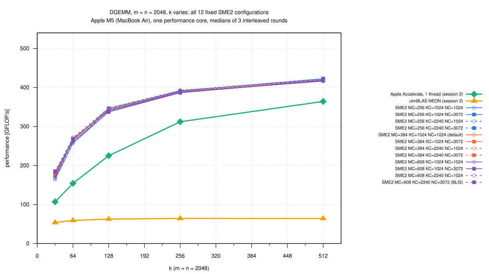
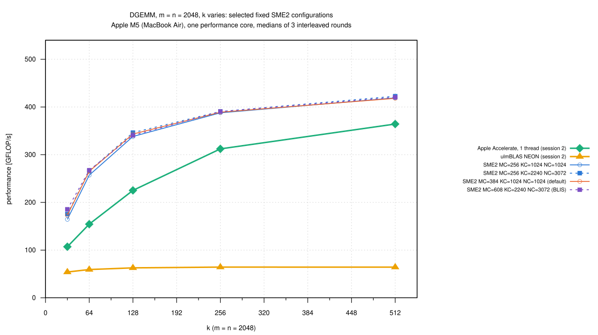
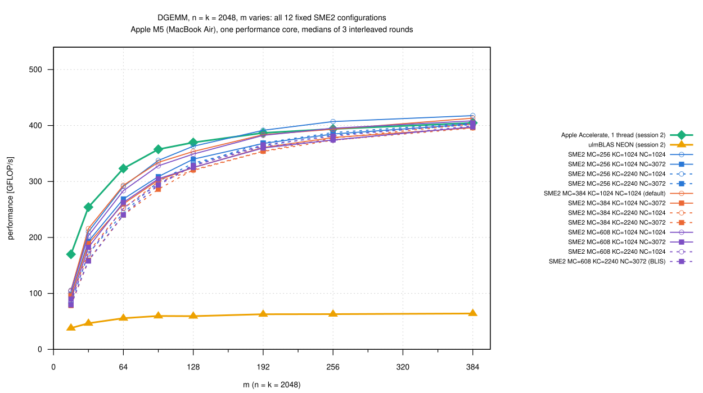
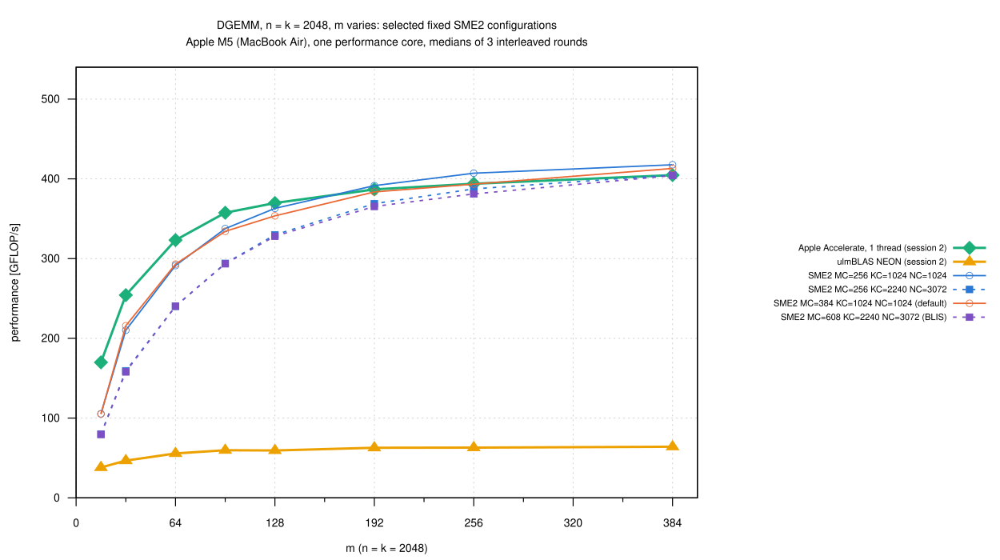
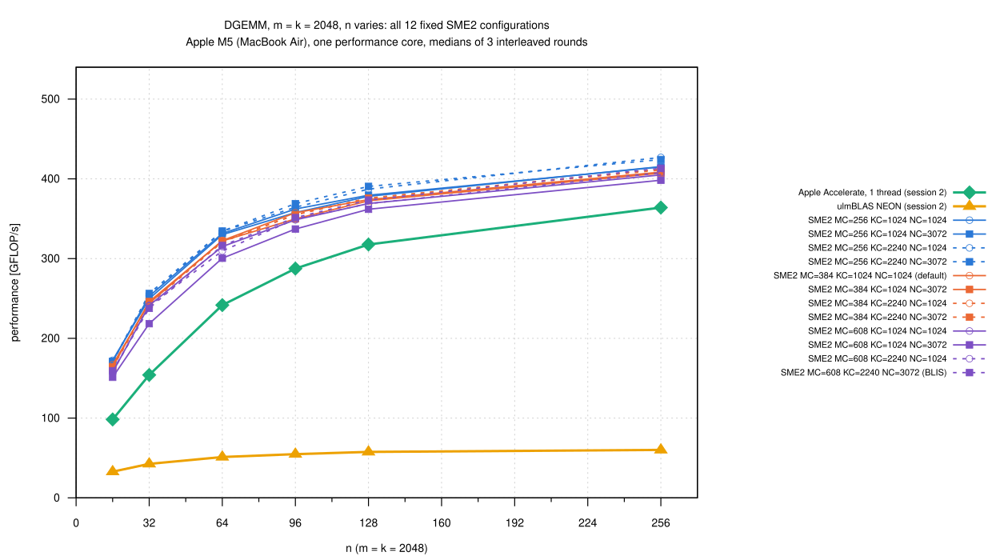
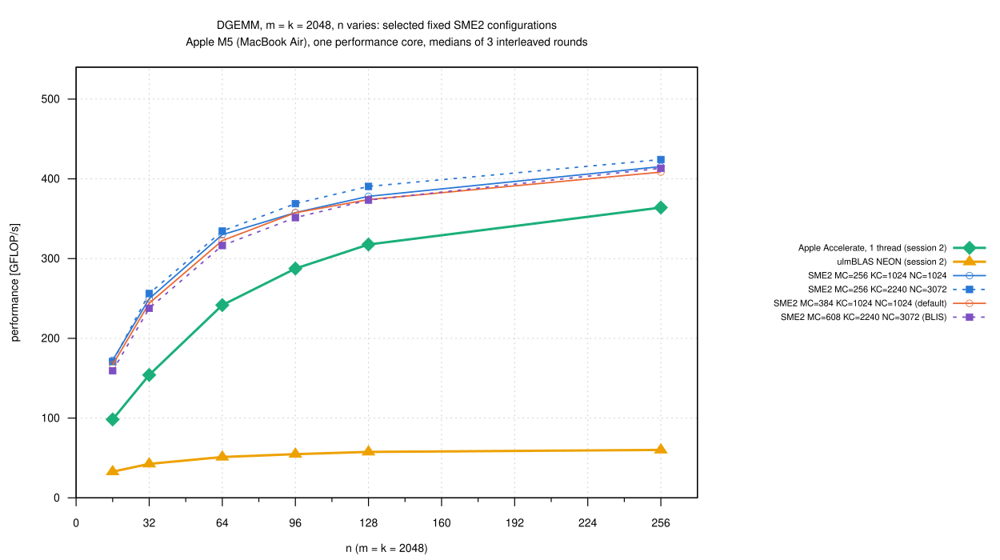
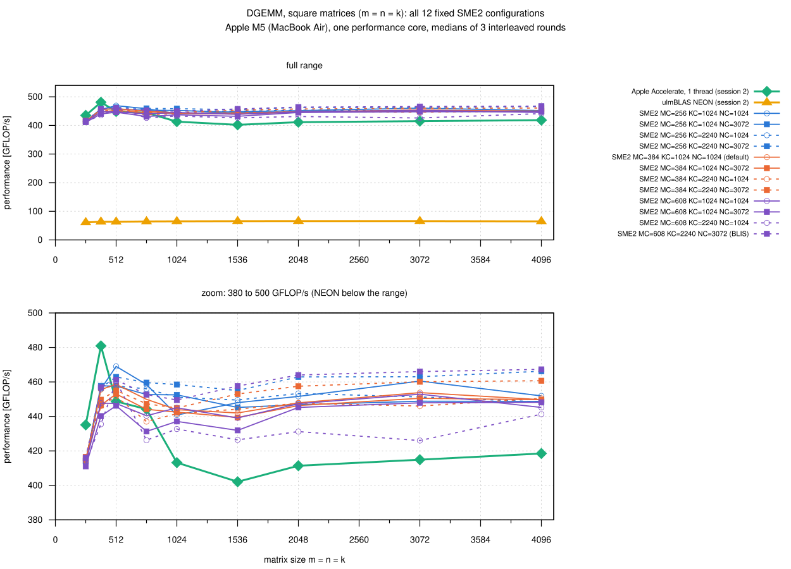
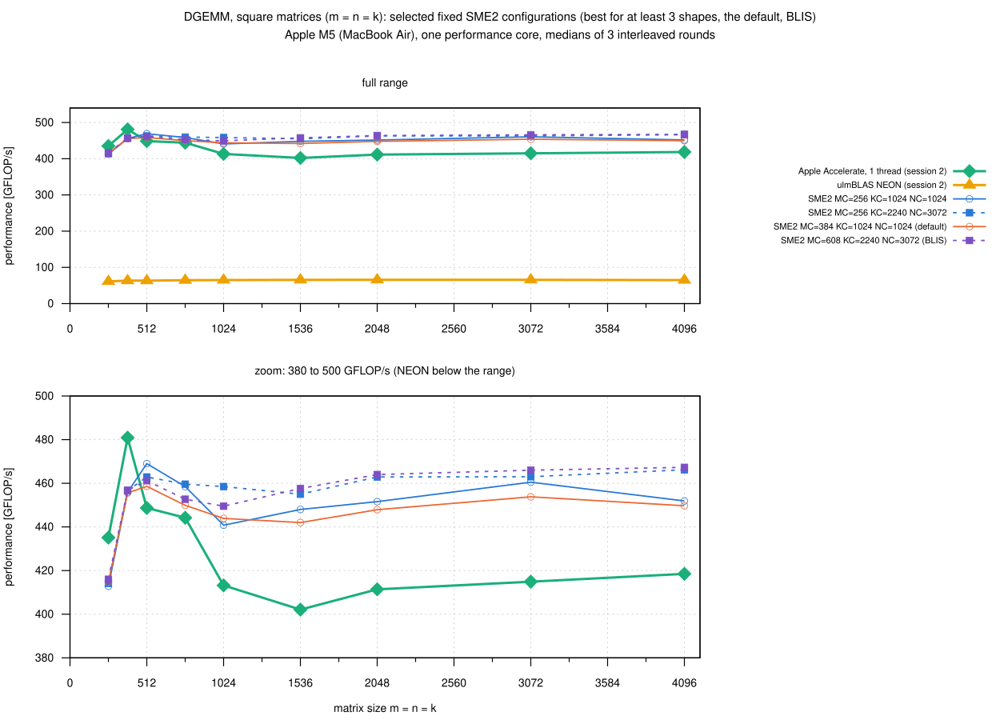

# How sensitive is the SME2 backend to the block sizes? (2026-10-25)

The SME2 DGEMM backend (campaign
[004-2026-10-25-macbook-m5-sme](../004-2026-10-25-macbook-m5-sme/README.md))
uses one fixed set of block sizes, MC, KC, NC = 384, 1024, 1024, and other
values were faster for some shapes.  Here I measured 12 fixed
configurations, MC in {256, 384, 608} x KC in {1024, 2240} x NC in {1024,
3072}, on square matrices and three families of thin shapes, to see where
their curves cross.  The library is not changed.

- Source: master 2d05ef0, with the three constants for double replaced per
  configuration (`source/build-blocks.sh`; the values read back from each
  build are in `data/configurations.txt`)
- MR x NR = 32 x 16, micro kernel and packing are the same everywhere

## Results

Best fixed configuration per shape (`data/summary/best.csv`, medians of 3
interleaved rounds).  *Clear* means: the slowest round of the better
configuration beats the fastest round of the other one, and the medians
differ by at least 1%; otherwise *noise*.  The default is 384, 1024, 1024.

| Region (shapes) | Best fixed configuration (median) | vs. default | Verdict | Clearly worse than the best |
|---|---|---|---|---|
| square, n = 256 … 1024 | changes from size to size (256, 1024, 1024; 256, 2240, 3072; 384, 2240, 3072; 256, 1024, 3072) | +0.4 to +3.3% | noise | only 608, 1024, 3072 (n = 768, 1024) |
| square, n = 1536 … 4096 | 608, 2240, 3072 (BLIS PR #921), 458-467 | +2.7 to +3.9% | **clear** | the default and most other KC = 1024 configurations, 608, 2240, 1024 |
| small m (n = k = 2048), m = 16 … 128 | KC = 1024: 256, 1024, 1024 or the default (tied) | 0 to +2.6% | noise | **all KC = 2240** (the best KC = 1024 configuration is 9-24% faster) |
| small m, m = 192 … 384 | 256, 1024, 1024 | +1.1 to +3.5% | noise | none (KC = 1024 still 3-6% ahead) |
| small n (m = k = 2048), n = 16 … 256 | MC = 256 (256, 2240, 3072 for n = 32 … 128) | +3.2 to +5.0% | noise | **MC = 608** configurations (MC = 256 3-8% faster) |
| small k (m = n = 2048), k = 32, 64 | MC = 608, KC = 2240 (NC = 3072 for k = 32, 1024 for k = 64) | +7.1%, +2.5% | **clear** | several MC ≤ 384 configurations |
| small k, k = 128 … 512 | changes (608, 2240, 1024; 384, 2240, 1024; 256, 2240, 3072) | +0.9 to +1.2% | noise | 608, 1024, 1024 |

- **No configuration is best everywhere**
  - large square matrices and small k want KC = 2240 (small k also MC =
    608)
  - small m wants KC = 1024 (the packed block of B then fits into L2)
  - small n wants a small MC
  - the default is never clearly the worst, is among the best for small
    m, and is 2.7 to 3.9% behind 608, 2240, 3072 for large square matrices
- **Most differences are small**
  - big effects only for KC with small m (up to 24%) and MC with small n
    (up to 8%)
  - for square n <= 1024 and k >= 128 the ranking is within the noise
- **Accelerate** (session 2)
  - faster than every SME2 configuration for square n = 256 and 384 and
    for m <= 128 (m = 16: 170 vs. at most 106 GFLOP/s)
  - slower than every SME2 configuration for square n >= 1024 (the
    default by 7 to 10%), small n (9 to 76%) and small k (14 to 76%)
- **NEON** reaches 33 to 66 GFLOP/s

## Reading the figures

- `square_all.svg`: all 12 configurations, Accelerate and NEON; the lower
  panel zooms into 380 to 500 GFLOP/s
- `square_selected.svg`: only the configurations that are the best for at
  least 3 of the 28 shapes (256, 1024, 1024: 8 shapes; 256, 2240, 3072: 7;
  608, 2240, 3072: 5) and the default; being the best once or twice is
  mostly noise
- `small_m_*`: n = k = 2048, m = 16 ... 384; `small_n_*`: m = k = 2048, n
  = 16 ... 256; `small_k_*`: m = n = 2048, k = 32 ... 512
- color by MC (256 blue, 384 orange, 608 purple), line by KC (1024 solid,
  2240 dashed), point by NC (1024 open circle, 3072 filled square)
- every curve is one fixed configuration, never a pointwise maximum

## Sessions and noise

- **Session 1** (17:29 to 18:07, `source/study-shapes.sh`): the 12
  configurations, 3 rounds, order rotated; each program run measures all
  28 shapes (warm-up, 5 samples, median) under the thermal guard
  - 5 runs went to "fair" and were repeated
  - rounds 2 and 3 were 1 to 7.5% slower than round 1, by different
    amounts per configuration; the spread over the rounds is up to 21% for
    small m and 5 to 15% elsewhere, so the verdicts use all three rounds
- **Session 2** (18:08 to 18:28, `source/study-ref.sh`): Accelerate (one
  thread), ulmBLAS NEON (2d05ef0) and two SME2 programs as anchors (384,
  1024, 1024 and 608, 2240, 3072), 3 rounds; 5 runs repeated
  - the anchors were 0.93 to 1.01 of their session 1 medians (median
    0.99), so Accelerate and NEON compare with the SME2 curves within a few
    percent
  - the SME2 configurations are compared with each other only within
    session 1
- The absolute numbers are 3 to 6% below campaign 004 for the same program
  (default, n = 1024 ... 4096: 442 to 454 here, 457 to 480 there); the
  MacBook was idle but warmer.

## Reproduction

```sh
# programs (Apple clang 21; bench2.c as in the earlier M5 campaigns)
sh source/build-blocks.sh B /path/to/ulmBLAS 2d05ef0 \
   256_1024_1024 256_1024_3072 256_2240_1024 256_2240_3072 \
   384_1024_1024 384_1024_3072 384_2240_1024 384_2240_3072 \
   608_1024_1024 608_1024_3072 608_2240_1024 608_2240_3072
clang -O2 source/peak.c -o B/peak
clang -O2 -framework Foundation source/thermal.m -o B/thermal
PAUSE=10 sh source/study-shapes.sh B            # session 1 -> B/res
# session 2: R/bench2-accelerate (bench2.c with -Isource/accelerate
# -framework Accelerate), R/bench2-neon (2d05ef0, make cblas, default
# flags), R/bench2-b384_1024_1024 and R/bench2-b608_2240_3072 from B,
# R/peak, R/thermal
PAUSE=10 sh source/study-ref.sh R               # -> R/res
python3 source/summarize-study.py B/res R/res data plots
```

`summarize-study.py` generates `data/summary/` and `plots/_selection.gp`
from `data/raw/` (identical files from the archived raw data).

## Files

| File | Contents |
|------|----------|
| `data/configurations.txt` | MC, KC, NC, MR, NR of each SME2 program, read back from the built trees |
| `data/study.csv`, `data/reference.csv` | every measurement of session 1 and 2 (variant, m, n, k, round, GFLOP/s) |
| `data/summary/square.csv`, `small_m.csv`, `small_n.csv`, `small_k.csv` | medians per shape: Accelerate, NEON (session 2), the 12 SME2 configurations (session 1) |
| `data/summary/best.csv` | best configuration per shape, runner-up, gap, verdict, tied configurations, comparison with the default, clearly worse configurations, spread, Accelerate, NEON |
| `data/summary/sessions.csv` | the two anchor configurations in both sessions |
| `data/raw/study/`, `data/raw/reference/` | outputs of bench2, `VARIANT-ROUND.txt` |
| `data/logs/` | run logs (thermal state, peak between the rounds), discarded runs |
| `source/build-blocks.sh` | builds one library and bench2 per configuration |
| `source/study-shapes.sh`, `source/study-ref.sh` | sessions 1 and 2 |
| `source/summarize-study.py` | tables, verdicts and the selection of the readable plots |
| `source/bench2.c`, `guard.sh`, `thermal.m`, `peak.c`, `accelerate/cblas.h` | benchmark program, thermal guard, as in the earlier M5 campaigns |

## Figures

<!-- BEGIN FIGURES (generated by make add_benchmark_result) -->

















<!-- END FIGURES -->
