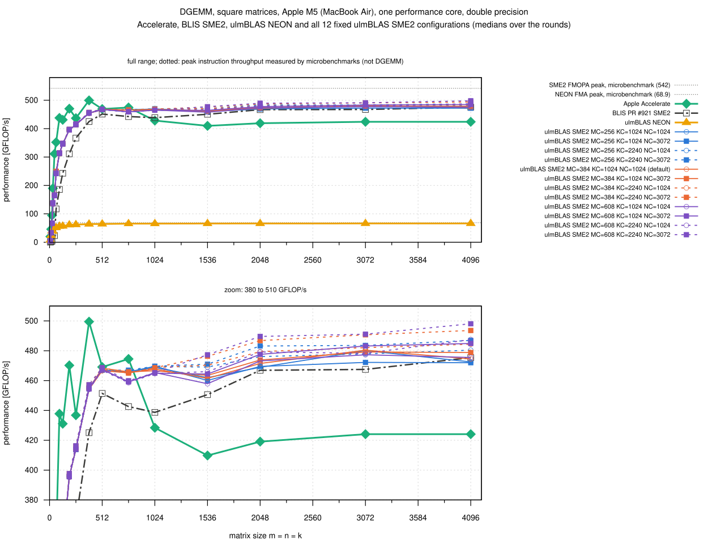
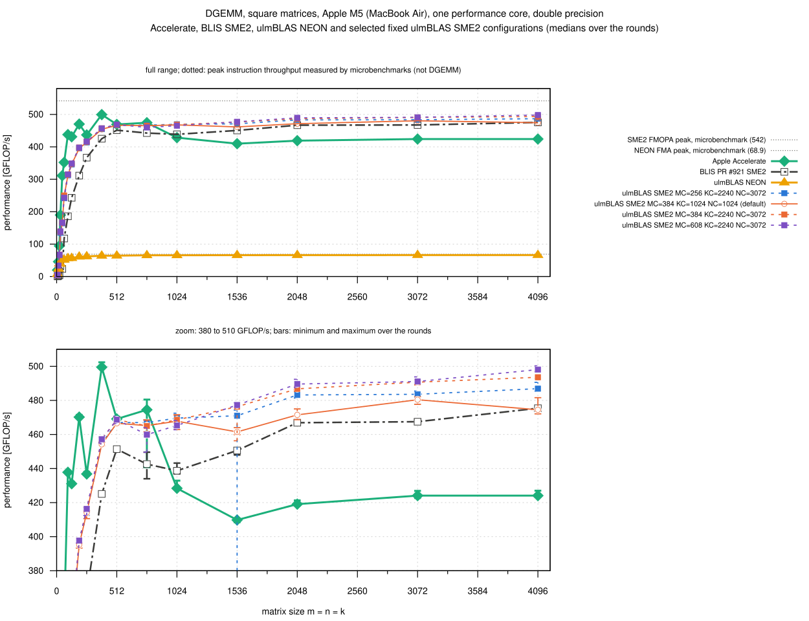

# Square DGEMM on the Apple M5: SME2 configurations and references (2026-10-25)

Square DGEMM, n = 8 ... 4096, one thread, of 15 implementations on one
performance core of the MacBook Air:

- **12 fixed configurations of the SME2 backend**: MC in {256, 384, 608} x
  KC in {1024, 2240} x NC in {1024, 3072}, MR x NR = 32 x 16
  - the default is 384, 1024, 1024; 608, 2240, 3072 are the block sizes of
    BLIS PR #921
  - the programs of the block size study
    [005-2026-10-25-macbook-m5-sme-blocksizes](../005-2026-10-25-macbook-m5-sme-blocksizes/README.md)
    (ulmBLAS 2d05ef0)
- **BLIS PR #921 SME2** (head 235ef8ec, `m4sme_p`; the ulmBLAS SME2 micro
  kernel is derived from it), the program of
  [004-2026-10-25-macbook-m5-sme](../004-2026-10-25-macbook-m5-sme/README.md)
- **Apple Accelerate** (macOS 26.6, one thread), the program of 004
- **ulmBLAS NEON** (2d05ef0, default)

Every curve is one fixed implementation over all sizes.  Checksums of the
programs: `data/programs.sha256`.  The library was not changed.

## Results

GFLOP/s, medians over 5 rounds (`data/summary/square.csv`, `best.csv`).
"Best" is the SME2 configuration with the highest median at that size.

| n | Accelerate | BLIS PR #921 | NEON | SME2 default | best SME2 configuration | best vs. default |
|---:|---:|---:|---:|---:|---|---|
| 8 | 20.0 | 0.4 | 7.7 | 5.1 | 608, 1024, 1024: 5.1 | +0.3%, noise |
| 32 | 189.8 | 32.2 | 39.1 | 137.3 | 608, 2240, 3072: 138.8 | +1.1%, noise |
| 64 | 352.0 | 117.4 | 51.6 | 247.5 | 384, 2240, 3072: 250.0 | +1.0%, noise |
| 128 | 431.1 | 242.9 | 56.8 | 346.3 | 608, 2240, 3072: 348.5 | +0.6%, noise |
| 256 | 436.8 | 366.7 | 62.1 | 414.1 | 608, 2240, 3072: 416.3 | +0.5%, noise |
| 384 | 499.5 | 425.1 | 64.1 | 454.2 | 608, 2240, 3072: 457.2 | +0.7%, noise |
| 512 | 469.1 | 451.4 | 64.4 | 466.6 | 608, 2240, 3072: 468.7 | +0.4%, noise |
| 768 | 474.5 | 442.6 | 65.5 | 465.2 | 256, 2240, 3072: 467.0 | +0.4%, noise |
| 1024 | 428.4 | 438.7 | 65.6 | 467.8 | 256, 2240, 3072: 469.6 | +0.4%, noise |
| 1536 | 409.8 | 450.6 | 66.0 | 461.5 | 608, 2240, 3072: 477.3 | +3.4%, **clear** |
| 2048 | 419.1 | 466.9 | 66.1 | 471.5 | 608, 2240, 3072: 489.6 | +3.8%, **clear** |
| 3072 | 424.1 | 467.5 | 66.2 | 480.4 | 608, 2240, 3072: 491.1 | +2.2%, **clear** |
| 4096 | 424.1 | 475.4 | 66.2 | 474.5 | 608, 2240, 3072: 498.1 | +5.0%, **clear** |

All 18 sizes are in the CSV files.

- **Large matrices want KC = 2240 with NC = 3072** (n >= 1536)
  - 608, 2240, 3072 and 384, 2240, 3072 are tied; the other 10
    configurations, the default included, are clearly slower
  - +2.2 to +5.0% over the default
  - highest median 498.1 GFLOP/s at n = 4096: 92% of the FMOPA peak
- **n <= 1024: the configurations are within the noise**
  - the best is clearly faster than the default only at n = 48 (+1.1%)
  - at n = 768 the four MC = 608 configurations are clearly behind
- **Accelerate**
  - faster than every SME2 configuration for n <= 384 (n = 8: 20.0 vs.
    5.1; n = 48: 311 vs. 166; n = 384: 500 vs. 457)
  - tied at n = 512 and 768
  - slower for n >= 1024 (410 to 428 GFLOP/s): the best SME2 configuration
    is 1.10 to 1.17 times as fast, the default 1.09 to 1.13
- **BLIS PR #921**
  - slower than the default at every size except n = 2048 and 4096 (tied)
  - much slower for small matrices (n = 8 ... 24: 0.4 to 4.1 GFLOP/s, 12
    to 16 times below the default)
  - n >= 512: the best SME2 configuration is 1.04 to 1.07 times BLIS; both
    use the same block sizes there, so the difference is not the blocking
- **NEON**: 66.2 GFLOP/s (96% of the NEON peak); the best SME2
  configuration is 7.5 times NEON at n = 4096, the default 7.2

## Method

- `source/square-interleaved.sh`: 5 rounds; per round and size all 15
  implementations, each in its own program run
  - `bench2 5 1 n n n`: check against a naive product for n <= 512,
    warm-up >= 0.3 s, 5 samples >= 0.2 s, median
  - the order is a random permutation per round and size (seed 1000 *
    round + n); the order of the sizes alternates between rounds
- **Thermal guard**: 3 s pause, nominal before and after; the campaign
  would stop if more than 10% of the runs were discarded
- **Session** 19:04 to 20:45: 1350 program runs, **none discarded**, no
  wrong results; NEON peak between rounds 68.9 to 71.1 GFLOP/s; load
  average 1.3 to 2.9
- *Clear* means: the slowest round of the faster implementation beats the
  fastest round of the other one and the medians differ by at least 1%
- The dotted lines in the figures are the measured peaks of campaign 004
  (FMOPA 542, NEON FMA 68.9 GFLOP/s), not data sheet values

## Noise

- spread over the 5 rounds at most 0.9% for half of the 270 pairs of
  implementation and size, at most 3% for 90%
- larger spreads come from single slow rounds, which the medians ignore
  - 256, 2240, 3072 at n = 1536, round 1: 368 GFLOP/s, other rounds 470 to
    474
  - Accelerate at n = 24 (round 1: 73 vs. 94 to 95) and n = 32 (round 3:
    145 vs. 188 to 190)
  - 608, 1024, 3072 at n = 768 (13%), several configurations at n = 32 (8
    to 11%)
- no measurement was removed
- across sessions the default at n = 1024 ... 4096 was 462 to 480 here,
  457 to 480 in campaign 004 and 442 to 454 in the (warmer) study 005

## Reading the figures

- `square_readable.svg`: Accelerate, BLIS PR #921, NEON and four SME2
  configurations (the default, BLIS's block sizes, and 384, 2240, 3072 and
  256, 2240, 3072, the best for at least 2 sizes)
  - lower panel: 380 to 510 GFLOP/s with min and max over the rounds
  - the x axis is linear, so n <= 128 is squeezed at the left (values in
    the table)
- `square_complete.svg`: all 12 configurations
- styles as in study 005: color by MC, line by KC, point by NC

## Reproduction

```sh
# programs: as in 004-2026-10-25-macbook-m5-sme (bench2-accelerate,
# bench2-blis-sme: source/build-blis-sme.sh) and
# 005-2026-10-25-macbook-m5-sme-blocksizes (bench2-neon and the 12 SME2
# programs: source/build-blocks.sh), all in B, with B/peak and B/thermal
clang -O2 source/peak.c -o B/peak
clang -O2 -framework Foundation source/thermal.m -o B/thermal
DRY_RUN=1 sh source/square-interleaved.sh B     # the plan, nothing measured
ROUNDS=5 PAUSE=3 sh source/square-interleaved.sh B   # -> B/res, B/run*
python3 source/summarize-square.py B/res data plots
(cd plots && gnuplot square_readable.gp && gnuplot square_complete.gp)
```

`summarize-square.py` generates `data/square.csv`, `data/summary/` and
`plots/_selection.gp` from `data/raw/`.

## Files

| File | Contents |
|------|----------|
| `data/raw/V-n-R.txt` | output of bench2 for implementation V, size n, round R (m n k beta median min max calls-per-sample check) |
| `data/square.csv` | every program run (implementation, n, round, median, min and max of the samples, check) |
| `data/summary/square.csv` | per n and implementation: median, minimum and maximum over the rounds |
| `data/summary/spread.csv` | spread over the rounds per implementation and n |
| `data/summary/best.csv` | best configuration per n, runner-up, gap, verdict, tied configurations, comparison with the default, BLIS PR #921 and Accelerate |
| `data/configurations.txt` | MC, KC, NC, MR, NR of each SME2 program |
| `data/programs.sha256` | checksums of the programs |
| `data/logs/run.log`, `console.log` | start, rounds (NEON peak, thermal state, load), end |
| `data/logs/run.order` | time, round, n and implementation of every program run, in order |
| `data/logs/run.discards`, `run.failures` | discarded runs, failed commands (both empty) |
| `source/square-interleaved.sh`, `summarize-square.py` | this campaign |
| `source/build-blocks.sh`, `build-blis-sme.sh`, `build-sme.sh` | build scripts of the programs |
| `source/bench2.c`, `guard.sh`, `thermal.m`, `peak.c`, `accelerate/cblas.h` | benchmark program and thermal guard, as in the earlier M5 campaigns |

## Figures

<!-- BEGIN FIGURES (generated by make add_benchmark_result) -->





<!-- END FIGURES -->
