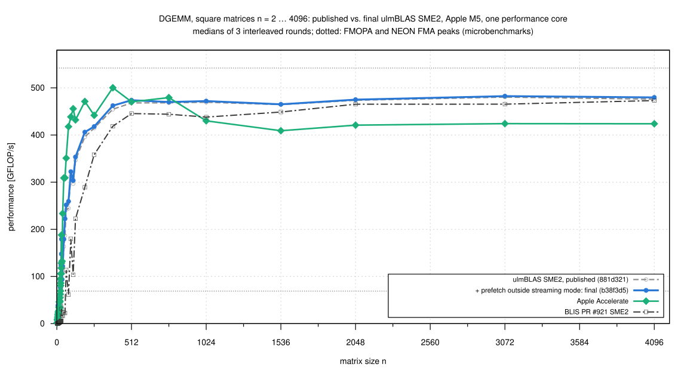
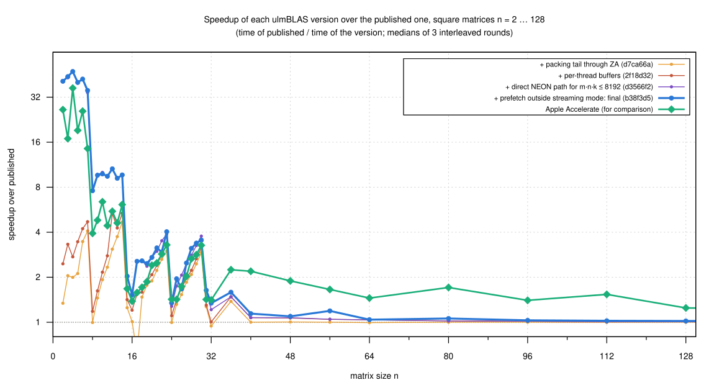

# Small DGEMM on the Apple M5: what made ulmBLAS slow, and what fixed it (2026-10-26)

For small matrices the fixed costs dominate: packing, setting up the
micro kernel, buffers.  In the square campaign
[006-2026-10-25-macbook-m5-sme-square](../006-2026-10-25-macbook-m5-sme-square/README.md)
the SME2 backend was behind Apple Accelerate up to n = 384.  Here I
document four changes for small problems, each measured on its own, and
compare the final version with the published one, Accelerate and BLIS PR
#921 (all through CBLAS):

| Step | Commit | Change | Effect (square n, this campaign) |
|---|---|---|---|
| published | 881d321 | SME2 backend as published | — |
| packtail | 57e1c8a, d7ca66a | k tail of the SME2 packing through ZA instead of scalar stores | up to 4.7x for k mod 8 ≠ 0 (14³: 1.22 → 0.26 µs) |
| cache | 04cf17b, 2f18d32 | packing buffers kept in a per-thread cache instead of a locked shared pool | 1.1-1.8x for n ≤ 24 (8³: 0.20 → 0.17 µs) |
| direct | 6228fcb, d3566f2 | direct NEON path without packing for m·n·k ≤ 8192 | 1.3-18x for n ≤ 20 (8³: 0.17 → 0.026 µs) |
| final | b38f3d5 | prefetch of the next tile of C before entering streaming mode | 1.0-1.11x for n = 24 … 128 (1.20, 1.29 at n = 24, 32 in its own comparison) |

The library sources of every step are the listed commits; the commits in
between only add tests (9d2b45a, 2f18d32, d3566f2).

## Results

Time per call in µs (medians of 3 interleaved rounds; lower is better):

| n | published | packtail | cache | direct | final | Accelerate | BLIS PR #921 | final vs. published | final vs. Accelerate |
|---:|---:|---:|---:|---:|---:|---:|---:|---:|---:|
| 2 | 0.320 | 0.239 | 0.130 | 0.008 | 0.008 | 0.012 | 1.778 | 41x | 1.55x faster |
| 8 | 0.201 | 0.202 | 0.170 | 0.026 | 0.026 | 0.051 | 2.528 | 7.6x | 1.93x faster |
| 12 | 0.811 | 0.263 | 0.152 | 0.076 | 0.076 | 0.147 | 3.159 | 10.6x | 1.92x faster |
| 14 | 1.220 | 0.261 | 0.228 | 0.127 | 0.126 | 0.199 | 3.573 | 9.7x | 1.58x faster |
| 16 | 0.246 | 0.243 | 0.204 | 0.161 | 0.161 | 0.178 | 3.901 | 1.52x | 1.10x faster |
| 20 | 0.837 | 0.442 | 0.402 | 0.308 | 0.308 | 0.348 | 5.532 | 2.7x | 1.13x faster |
| 24 | 0.416 | 0.417 | 0.376 | 0.325 | 0.309 | 0.292 | 6.732 | 1.35x | 0.95x (slower) |
| 32 | 0.491 | 0.520 | 0.489 | 0.405 | 0.366 | 0.348 | 2.087 | 1.34x | 0.95x (slower) |
| 48 | 1.354 | 1.348 | 1.268 | 1.263 | 1.236 | 0.716 | 9.497 | 1.10x | 0.58x (slower) |
| 64 | 2.168 | 2.181 | 2.088 | 2.091 | 2.083 | 1.494 | 4.604 | 1.04x | 0.72x (slower) |
| 128 | 12.10 | 12.09 | 12.01 | 12.02 | 11.87 | 9.71 | 18.85 | 1.02x | 0.82x (slower) |
| 384 | 249.1 | 248.9 | 247.5 | 247.9 | 245.0 | 226.4 | 270.5 | 1.02x | 0.92x (slower) |
| 1024 | 4574 | 4567 | 4562 | 4560 | 4550 | 4993 | 4903 | 1.01x (noise) | 1.10x faster |
| 4096 | 288763 | 287217 | 287554 | 291123 | 286503 | 324262 | 290530 | 1.01x (noise) | 1.13x faster |

All 59 shapes are in `data/small/summary/`.  Skinny shapes gain most from
the direct path: 200 x 4 x 4 0.160 µs (published 3.04, Accelerate 0.453),
2 x 2 x 2000 1.73 µs (published 7.34, Accelerate 5.70).

- **n <= 23: faster than Accelerate** (1.03 to 2.6 times)
  - 1.5 to 48 times as fast as the published version (n = 16: 1.5; n <=
    14: 7.6 to 48)
  - below m n k = 8192 it computes with NEON directly on the operands (at
    most 58 GFLOP/s, 84% of the NEON peak)
- **n = 24 ... 32: mixed**
  - clearly faster at n = 25, 27, 29, 31 (1.15 to 1.37 times), clearly
    slower at 24, 26, 32 (0.95 to 0.96), noise at 28 and 30
  - this is the range of the run-to-run variation (see Noise)
- **n = 36 ... 384: Accelerate is clearly ahead** (up to 1.9 times at n =
  40; 512 and 768 within the noise)
  - here every micro kernel call loads and stores a 32 x 16 tile of C
    through ZA (about 55 ns) for only kc <= k FMOPA steps, and both
    operands are always packed
- **Large n: unchanged** (n >= 512 within the noise); ulmBLAS stays 1.10
  to 1.14 times as fast as Accelerate for n >= 1024
- **BLIS PR #921** is far slower for small problems (1.8 µs at n = 2) and
  1.01 to 1.06 times slower than ulmBLAS for n >= 512

## Sweep n = 50, 100, ..., 4000

The same programs (identical checksums) for the published and final
version, Accelerate and BLIS PR #921: 80 sizes, 5 interleaved rounds, 1600
runs (`data/sweep/`, `sweep.svg`, `sweep_small.svg`).  GFLOP/s, medians:

| n | published | final | Accelerate | BLIS PR #921 | final vs. published | final vs. Accelerate |
|---:|---:|---:|---:|---:|---|---|
| 50 | 122.0 | 147.5 | 162.6 | 23.5 | 1.21x, clear | 0.91x, clear |
| 100 | 218.8 | 238.2 | 315.5 | 104.3 | 1.09x, clear | 0.76x, clear |
| 200 | 350.6 | 355.1 | 472.3 | 202.1 | 1.01x, clear | 0.75x, clear |
| 400 | 444.3 | 449.0 | 515.1 | 363.7 | 1.01x, clear | 0.87x, clear |
| 800 | 474.2 | 475.8 | 521.9 | 443.4 | noise | 0.91x, clear |
| 1000 | 457.4 | 455.0 | 460.9 | 430.7 | noise | 0.99x, noise |
| 1050 | 430.5 | 426.7 | 401.3 | 419.0 | noise | 1.06x, clear |
| 2000 | 478.2 | 479.0 | 427.5 | 458.8 | noise | 1.12x, clear |
| 2050 | 444.7 | 444.0 | 393.0 | 462.2 | noise | 1.13x, clear |
| 3000 | 482.8 | 482.6 | 431.6 | 465.9 | noise | 1.12x, clear |
| 4000 | 485.8 | 489.8 | 430.6 | 471.2 | noise | 1.14x, clear |

- **Never slower than the published version**
  - clearly faster at 7 of 8 sizes n = 50 ... 400 (1.01 to 1.21; n = 250
    noise)
  - noise for all n >= 450 (0.98 to 1.01)
- **Accelerate is faster up to n = 850**
  - clearly at 16 of the 20 sizes n <= 1000, up to 1.33 times at n = 200;
    noise at 350, 900, 950, 1000
- **ulmBLAS is faster from n = 1050 on**, clearly at all 60 sizes 1050 ...
  4000: 1.06 to 1.15 times
  - highest median 489.8 GFLOP/s at n = 4000 (90% of the FMOPA peak);
    Accelerate's is 521.9 at n = 800
- **BLIS PR #921**: clearly slower at 65 of 80 sizes (6.3 times at n = 50,
  1.06 to 1.18 at n = 500 ... 600), noise at 13, clearly faster at n =
  2050 and 2150 (1.04, 1.03)
- **Steps after multiples of 1024**
  - ulmBLAS loses 6 to 7% from n = 1000 to 1050 and from 2000 to 2050 (1%
    from 3050 to 3100)
  - hypothesis (not tested separately): with KC = 1024, k = 2050 leaves a
    last block with kc = 2, and every tile of C goes through ZA once more
    for only 2 FMOPA steps; BLIS (KC = 2240) has no step at 2050
  - Accelerate also loses 13% from 1000 to 1050 and 8% from 2000 to 2050
- **Small spread for large n**: the bands of the final version are at most
  5.5% of the median for n >= 300, except 3450 (11%, one slow round)
- **Correctness for all 80 sizes** (`source/verify-large.c`): 2000 random
  elements of C per size compared with long double sums against the bound
  4 (k + 2) eps sum |a b|, for both libraries: no violation, largest error
  0.005 of the bound (bench2 itself checks only up to n <= 584)

## The four changes

### 1. Scalar stores in streaming mode (packing tail)

`pack_B_colmajor` and `pack_A_rowmajor` transpose 8 values of k at once
through ZA; the last k mod 8 were copied in a scalar loop in streaming
mode.  Microbenchmark (`source/experiments/packtail-exp.cc`):

| rewriting only the tail rows of a packed panel with | ns per panel (12 x 12 panel, k = 12) |
|---|---|
| nothing (predicated ZA tail) | 79 |
| integer stores | 216 |
| scalar FP stores | 222 |
| predicated SVE stores (`st1d`) | 84 |

- data written by scalar stores in streaming mode and read right after by
  SME loads is expensive on the M5 (up to 1 µs per panel)
- the fix loads the tail as one more block through ZA with a k predicate
  and stores only the needed slices; the packed layout is bit-identical
  (1920 cases)
- interleaved benchmark (`data/experiments/1-packtail/`, 5 rounds): 1.37
  to 4.69 times as fast for k mod 8 != 0, everything else noise

### 2. Buffers: neither the old pool nor plain malloc

`gemm` takes two packing buffers (3 and 8 MiB) per call.  The shared pool
(free lists in hash tables behind a mutex) took about a third of a 16 x 16
x 16 DGEMM.  I measured plain `new`/`delete` per call first
(`data/experiments/allocbench.txt`, `2a-allocation/`, 3 rounds):

| strategy | n = 8 | n = 32 | n = 64 | n = 256 |
|---|---:|---:|---:|---:|
| shared pool (master then) | 0.201 µs | 0.486 | 2.163 | 80.8 |
| new/delete per call | 0.394 (0.51x) | 0.858 (0.57x) | 3.140 (0.69x) | 86.4 (0.94x) |
| new/delete, buffers of the problem size | 0.209 (0.96x) | 0.468 | 3.528 (0.61x) | 86.4 (0.94x) |
| per-thread cache (first version) | 0.170 (1.18x) | 0.493 | 2.077 (1.04x) | 80.6 |

- allocating per call made DGEMM up to two times slower, although malloc
  and free took only 7 to 8% of the samples (the old pool 6%)
- no page faults, the same addresses every call, but the whole call ran
  about 1.45 times slower at n = 64; why is not established (hypothesis:
  side effects of the allocator's deferred reclamation of large blocks,
  e.g. TLB invalidations)
- so blocks must be kept; the cost of the old pool was its bookkeeping
- the new `MemoryPool` keeps up to 16 blocks per element type and thread
  in a `thread_local` array: no lock, no hash tables; a block released by
  another thread is freed
- tests T0350 and T0351 (8 threads calling DGEMM at once), also under ASan
  and TSan without reports; the final cache measured on its own in
  `2b-buffer-cache/`

### 3. A direct NEON path for tiny problems

After 1 and 2 a call with n <= 32 spent about 60% in the SME2 micro kernel
and 30% packing B: fixed costs of streaming mode for a few hundred flops.

- `gemmdirect.tcc` computes problems with m n k <= 8192 (double, AArch64,
  A and C with unit row stride) with NEON register tiles of up to 8 x 4
  directly from A, B and C
- scans (`data/experiments/direct-scan-*.txt`): at most 58 GFLOP/s,
  break-even with SME2 at m n k of about 8000 for compact shapes
- skinny shapes gain far more (200 x 4 x 4: 16.8 times) and would also
  gain beyond the threshold (2 x 2 x 4000: 4.1, 64 x 64 x 4: 1.36; not
  used yet)
- test T0352 covers every tile remainder; the configurations with small
  block sizes disable the direct path, so they keep testing the blocked
  algorithm

### 4. PRFM in streaming mode

The kernel alone (`source/experiments/kernexp.cc`, 32 x 16 tile, operands
in cache):

| kc | kernel as published | without the 48 PRFM | PRFM in ordinary mode | FMOPA alone (peak) |
|---:|---:|---:|---:|---:|
| 0 | 115.8 ns | 31.7 | 32.2 | 0 |
| 32 | 159.1 | 96.8 | 96.7 | 60.5 |
| 64 | 218.7 | 157.0 | 157.3 | 120.9 |

The 48 PRFM that prefetch the next tile of C cost 45 to 85 ns per call in
streaming mode and nothing in ordinary mode.  The kernel now prefetches
before it enters streaming mode; large problems keep the benefit
(`data/experiments/4-prefetch/`).

## Noise

- the 3 rounds agree within 1.5% for most shapes
- but for n = 17 ... 30 on the SME2 path single program runs jump between
  levels while their samples agree: `final` at n = 30 gave 128, 138 and
  114 GFLOP/s, `packtail` at n = 17 25.6, 11.3 and 11.0
- the deciding state is per process (hypothesis: the buffer addresses)
- so four comparisons with identical code paths come out "clearly slower":
  packtail vs. published at n = 32 (0.94), final vs. direct at n = 10
  (0.98), 22 (0.84) and 26 (0.81); they are not regressions, but they
  bound what 3 rounds can resolve here

## Method

- `source/compare.sh`, as in campaign 006: per round and shape all
  programs one after the other, each in its own program run
  - `bench2 5 1 m n k`: column major, alpha = beta = 1, one thread, check
    against a naive product up to 2e8 multiply-adds, warm-up >= 0.3 s, 5
    samples >= 0.2 s, median
  - random order per round and shape; the order of the shapes alternates
- Accelerate with `VECLIB_MAXIMUM_THREADS=1`
- thermal guard: 3 s pause, nominal before and after
- *clear* means: the slowest round of the faster program beats the
  fastest round of the other one and the medians differ by at least 1%
- the dotted line in the figures is the FMOPA peak of campaign 004 (542
  GFLOP/s)

| | small matrices (`data/small/`) | sweep (`data/sweep/`) |
|---|---|---|
| shapes | 59: squares n = 2 … 32, 36, 40, 48, 56, 64, 80, 96, 112, 128, 192, 256, 384, 512, 768, 1024, 1536, 2048, 3072, 4096 and 9 others | 80 squares n = 50, 100, …, 4000 |
| programs | published, packtail, cache, direct, final, Accelerate, BLIS PR #921 | published, final, Accelerate, BLIS PR #921 |
| rounds | 3 | 5 |
| session | 2026-10-26 00:45-02:13, 1239 runs | 2026-10-26 02:13-04:19, 1600 runs |
| discarded, wrong results | none, none | none, none |
| NEON FMA peak between rounds | 69.7-71.1 GFLOP/s | 69.0-71.0 GFLOP/s |

- the thermal state stayed nominal; load average 1.1 to 2.7
- the programs of both parts have the same checksums
  (`data/*/programs.sha256`)
- the libraries are exactly the listed commits; 8a9749b (comment only),
  e6aba3a and f920c69 (buffer alignment for x86, only `trsm.o` changes on
  the M5) leave the measured DGEMM code unchanged, so it is that of master
  f920c69
- the experiments of the four changes (`data/experiments/`) are shorter
  interleaved comparisons with the same method

## Reproduction

On an Apple M5 (macOS 26, Apple clang, Gnuplot for the figures):

    sh source/build-small.sh B /path/to/ulmBLAS
    # programs of 006-2026-10-25-macbook-m5-sme-square: bench2-accelerate,
    # bench2-blis-sme, peak, thermal into B (see its source/)
    sh source/compare.sh B                    # with SHAPES="2_2_2 ...", ROUNDS=3
    python3 source/summarize-small.py B/res data/small

    # sweep: a directory with bench2-published, bench2-final,
    # bench2-accelerate, bench2-blis-sme, peak, thermal
    SHAPES="$(seq 50 50 4000 | sed 's/.*/&_&_&/')" ROUNDS=5 sh source/compare.sh W
    python3 source/summarize-small.py W/res data/sweep

    # correctness for large n (per library of build-small.sh)
    clang -O2 -I B/lib/final source/verify-large.c B/lib/final/libcblas.a -lc++ -o verify
    ./verify $(seq 50 50 4000)

The shapes of both campaigns are in `data/*/logs/shapes.txt`.

## Files

- `data/small/`, `data/sweep/`: `runs.csv` (every program run),
  `summary/` (medians, steps with verdicts), `raw/`, `logs/`,
  `programs.sha256`; `data/sweep/verify/`: the correctness check
- `data/experiments/`: the comparisons of the four changes and the
  microbenchmarks
- `source/`: build, benchmark and summary scripts, benchmark programs;
  `source/experiments/`: microbenchmarks and the patches of the variants
- `plots/`: Gnuplot scripts and figures

## Figures

<!-- BEGIN FIGURES (generated by make add_benchmark_result) -->

<!-- END FIGURES -->
