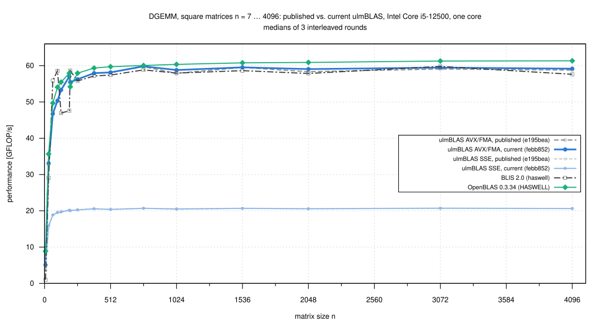
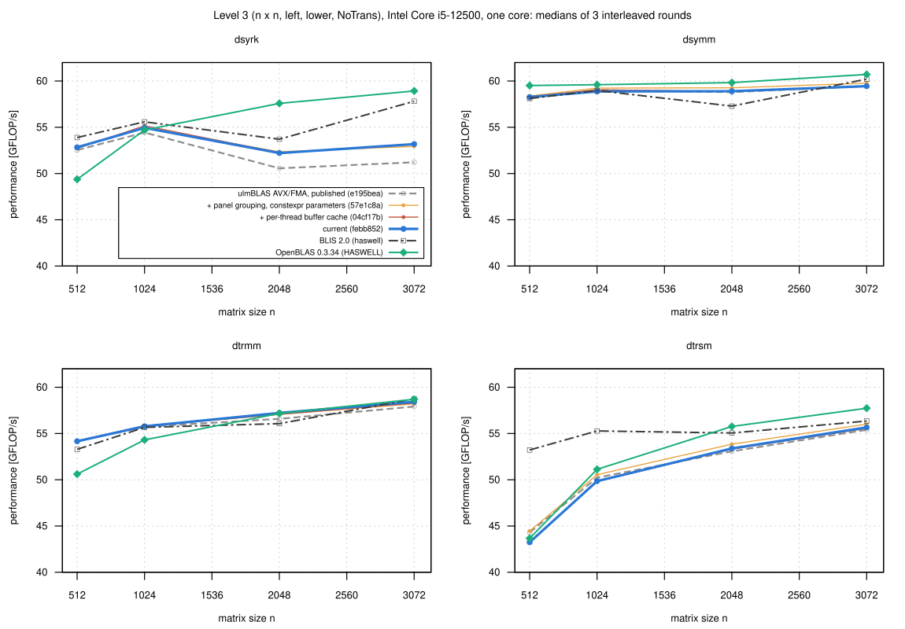
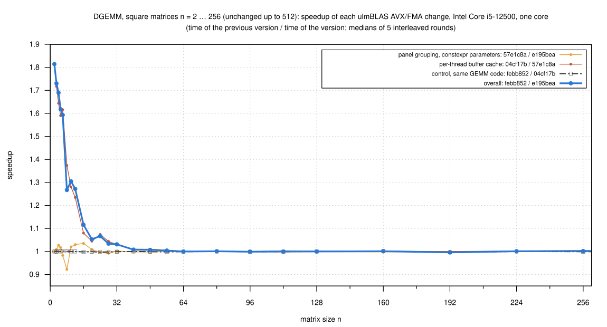
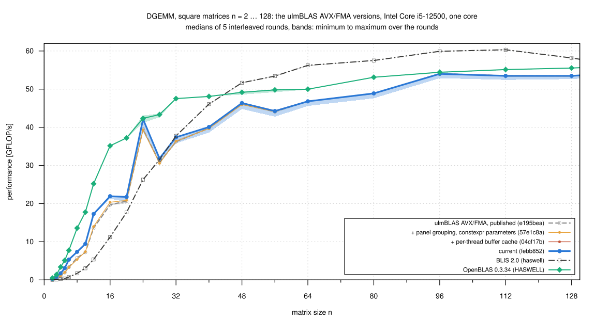

# Intel Core i5-12500: do the recent changes of ulmBLAS help the AVX/FMA backend? (2026-10-26)

Since campaign
[001-2026-10-24-heim-avx-fma](../001-2026-10-24-heim-avx-fma/README.md)
(published ulmBLAS e195bea) I made and measured the changes of ulmBLAS on
an Apple M5.  Here I checked on the same Intel machine, with the same
programs, block sizes and reference libraries, whether they help there
too.  Most changes concern only NEON and SME2; two kinds reach the x86
builds:

| Version | Commit | Library changes for x86-64 since the previous version |
|---|---|---|
| published | e195bea | AVX/FMA micro kernel as in campaign 2026-10-24 (run B) |
| + grouping | 57e1c8a | tuning parameters `constexpr`; gepack_A packs 4 panels of A together if the columns of A are far apart; fixes of gescal and trlscal/truscal for alpha = 0 with general strides |
| + buffer cache | 04cf17b | buffers of the level 2 and 3 routines kept in a per-thread cache instead of a pool behind a mutex with hash tables |
| current | febb852 | level 1 only (missing routines, nrm2 fix); the objects of all level 2 and level 3 routines are identical to 04cf17b, so this pair is a control for the noise |

The block sizes are the same in all versions (AVX/FMA: 6 x 8, MC = 288, KC
= 256, NC = 4080).

## Results

- **Small DGEMM is faster because of the buffer cache** (current vs.
  published)
  - 1.59 to 1.81 times for n = 2 ... 6, 1.27 to 1.31 for n = 8 ... 12,
    1.12 for n = 16 (all outside the spread of the rounds)
  - 1.03 to 1.07 for n = 20 ... 32 (ranges overlap)
  - the step 57e1c8a -> 04cf17b alone gives the same factors
  - it saves 0.03 to 0.06 µs per call, presumably the lock, hash tables and
    list nodes of the old pool (not profiled)
- **No change from n = 40 on**
  - DGEMM up to 4096, thin k and beta = 0 within +-1.5%; the control pair
    febb852 / 04cf17b within +-0.4% everywhere
  - the only clear differences above n = 32: n = 1024 and 2048 (1.015,
    1.012 times as fast, from 57e1c8a), as large as the run-to-run spread
- **dsyrk 2048 and 3072: 1.03 to 1.04 times as fast** (from 57e1c8a,
  presumably the grouping in gepack_A; not isolated)
- **dtrsm: 1 to 3% slower with 04cf17b** (512: 0.973, 1024: 0.985, 2048:
  0.990; current vs. published 0.976 at 512, noise above)
  - not a cost of the buffers but a side effect on the code GCC generates
    for `trsm.o`, see [the dtrsm regression](#the-dtrsm-regression)
- **SSE builds**: the same picture (1.4 to 1.9 times for n <= 8, 1.01 to
  1.21 for n = 10 ... 40, none from n = 48; dsyrk 2048, 3072: 1.03)
- **Against BLIS and OpenBLAS** (current ulmBLAS)
  - OpenBLAS is faster at almost all sizes: 1.5 to 2 times for n <= 20
    (0.034 instead of 0.061 µs at n = 2), 5 to 27% for n = 28 ... 80, 2 to
    4% for n >= 128
  - ulmBLAS is faster for 2000 x 2000 x 32 with beta = 0 (1.39 times) and
    some level 3 cases
  - BLIS has a fixed cost of 0.6 µs per call: slower than ulmBLAS for n <=
    24, but 1.09 to 1.21 times as fast for n = 40 ... 128
  - n >= 256: all three within a few percent, as in campaign 001
- **Reproducible**: the published version, SSE, BLIS and OpenBLAS, run
  again with the programs of 2026-10-24, reach 0.997 to 1.012 of the old
  values for all 16 square sizes

In short: the per-thread buffer cache helps on both machines (here 1.1 to
1.8 times for n <= 16); the much larger gains on the M5 (direct NEON path,
SME2 changes) are specific to ARM.  For n >= 64 nothing changes.

## Square DGEMM, small sizes

Time per call in µs (medians of 5 interleaved rounds; lower is better);
"noise" if the ranges of the rounds overlap or the difference is below 1%:

| n | published | + grouping | + buffer cache | current | BLIS | OpenBLAS | current vs. published | buffer cache vs. before |
|---:|---:|---:|---:|---:|---:|---:|---:|---:|
| 2 | 0.110 | 0.110 | 0.061 | 0.061 | 0.593 | 0.034 | 1.814x | 1.814x |
| 3 | 0.118 | 0.117 | 0.068 | 0.068 | 0.628 | 0.039 | 1.730x | 1.717x |
| 4 | 0.125 | 0.122 | 0.074 | 0.074 | 0.582 | 0.038 | 1.690x | 1.644x |
| 5 | 0.130 | 0.128 | 0.081 | 0.081 | 0.644 | 0.049 | 1.618x | 1.590x |
| 6 | 0.129 | 0.131 | 0.081 | 0.081 | 0.578 | 0.056 | 1.593x | 1.616x |
| 8 | 0.176 | 0.191 | 0.139 | 0.139 | 0.596 | 0.075 | 1.267x | 1.374x |
| 10 | 0.277 | 0.271 | 0.212 | 0.212 | 0.657 | 0.113 | 1.305x | 1.280x |
| 12 | 0.255 | 0.247 | 0.200 | 0.200 | 0.646 | 0.137 | 1.272x | 1.235x |
| 16 | 0.417 | 0.403 | 0.373 | 0.373 | 0.730 | 0.233 | 1.116x | 1.080x |
| 20 | 0.774 | 0.768 | 0.735 | 0.736 | 0.904 | 0.430 | 1.053x (noise) | 1.045x |
| 24 | 0.700 | 0.703 | 0.654 | 0.656 | 1.052 | 0.653 | 1.067x (noise) | 1.074x |
| 28 | 1.426 | 1.437 | 1.377 | 1.379 | 1.393 | 1.013 | 1.034x (noise) | 1.044x |
| 32 | 1.808 | 1.804 | 1.752 | 1.753 | 1.736 | 1.379 | 1.031x (noise) | 1.030x |
| 40 | 3.219 | 3.224 | 3.193 | 3.194 | 2.778 | 2.662 | 1.008x (noise) | 1.010x (noise) |
| 48 | 4.803 | 4.812 | 4.765 | 4.771 | 4.280 | 4.498 | 1.007x (noise) | 1.010x (noise) |
| 64 | 11.20 | 11.19 | 11.19 | 11.20 | 9.322 | 10.49 | 1.000x (noise) | 1.000x (noise) |

One step was slower: 57e1c8a vs. e195bea at n = 8 (0.922) and 6 (0.983);
the buffer cache more than makes up for it.  All values, including n = 56
... 512 (no clear difference between the versions), are in
`data/summary/dgemm_sweep.csv`.

## The dtrsm regression

dtrsm (left, lower, NoTrans, n x n), GFLOP/s, 3 rounds:

| n | 57e1c8a | 04cf17b | febb852 | 04cf17b / 57e1c8a |
|---:|---:|---:|---:|---:|
| 512 | 44.46 | 43.27 | 43.24 | 0.973 (clear) |
| 1024 | 50.55 | 49.81 | 49.85 | 0.985 (clear) |
| 2048 | 53.85 | 53.31 | 53.38 | 0.990 (clear) |
| 3072 | 56.02 | 55.56 | 55.66 | 0.992 (noise) |

- the benchmark runs dtrsm after dtrmm in the same process; both request
  buffers of the same sizes, which the new cache shares
- measured alone (`source/bench3x.c`, `trsm-only.sh`, 5 rounds) the
  difference is smaller but still there: n = 512 44.19 vs. 43.58 GFLOP/s
  (0.986, ranges overlap in one round), n = 1024 50.54 vs. 49.98 (0.989,
  clear)
- the buffers are not the cause: logging the allocations
  (`source/pmlog.c`) shows the same two blocks for both versions (663600
  and 9400384 bytes, once per process, same offset in their pages)
- what differs is the code of `trsm.o`: GCC 12 inlines and clones
  differently (in 04cf17b `trlsm` is split into two clones, and
  `ref::utrlsm` is a 0x598-byte clone instead of a 0xd43-byte weak
  function); `avx::ugemm` is unchanged
- not pursued further; dsyrk, dsymm and dtrmm show no such effect

## Method

- **Machine**: heim, Intel Core i5-12500 (Alder Lake, AVX2/FMA, no
  AVX-512), Debian 12, Linux 6.1, GCC 12.2.0, governor powersave, turbo on
  - one thread pinned to core 3
  - `logs/conditions.csv`: load, package temperature (40 to 54 C), clock
    of core 3 (median 3987 MHz), login sessions (2 of another user)
  - load average 1.0, except right after the builds (up to 5.4); the
    published version, measured first, still agrees with campaign 001
- **Programs** of campaign 001 run B, unchanged: `bench2.c` (DGEMM, 7
  samples >= 0.2 s, median, result checked) and `bench3.c` (level 3, 5
  samples); BLIS 2.0 (haswell) and OpenBLAS 0.3.34 the same binaries
- **ulmBLAS**: `make cblas ARCHFLAGS="-mavx -mfma"` or `"-msse3
  -mfpmath=sse"` from a copy of each commit (`logs/compile-commands.txt`)
- **Sizes**: the shapes of 001 in 3 rounds, and a sweep n = 2 ... 512 (29
  sizes) in 5 rounds; the 8 programs in rotated order
- **Statistics**: median of the samples per round, then median, min and
  max over the rounds; "clear" if the ranges do not overlap and the
  medians differ by at least 1%
- **Correctness** (febb852, before the measurements)
  - `make check`: 1196 PASS, 0 FAIL (344 SKIP: NEON and SME2)
  - with ASan and UBSan: 856 PASS, no reports
  - Reference-LAPACK 3.12.1 test programs for an SSE and an AVX/FMA build
  - during the campaign every DGEMM result checked (2120 measurements, 0
    wrong), and `verify-large.c` for n = 768 ... 4096 (0 violations)

## Files

- `data/raw/`: outputs of the programs (`main`, `beta0`, `sweep`, `l3`,
  `verify-*`, `trsm-only-*`)
- `data/runs.csv`, `data/summary/*.csv`: generated by
  `source/summarize-intel2.py`
- `logs/`: system, builds, checks, conditions, run log
- `source/`: `bench-intel2.sh` (the campaign), `check-heim.sh`,
  `trsm-only.sh`, `bench3x.c`, `pmlog.c`, benchmark programs
- `plots/`: Gnuplot scripts

## Reproduction

Build BLIS 2.0, OpenBLAS 0.3.34, `bench2.c` and `bench3.c` as in
[001-2026-10-24-heim-avx-fma](../001-2026-10-24-heim-avx-fma/README.md);
put `git archive` trees of e195bea, 57e1c8a, 04cf17b and febb852 and
`verify-large.c` into a workspace, set `D` in `bench-intel2.sh` to the
programs of 001 and run `sh bench-intel2.sh WORKSPACE` (about 1.5 hours).
Then copy `WORKSPACE/bench/res/*.txt` to `data/raw/` and run `python3
source/summarize-intel2.py`.

## Figures

<!-- BEGIN FIGURES (generated by make add_benchmark_result) -->

<!-- END FIGURES -->
