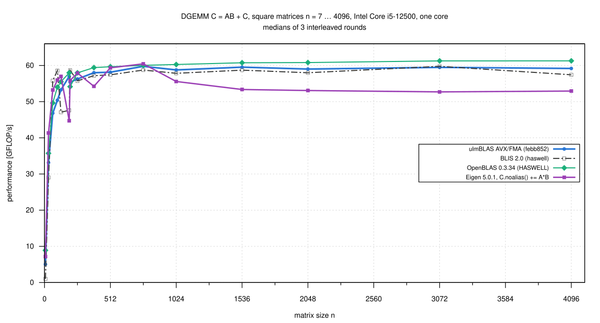
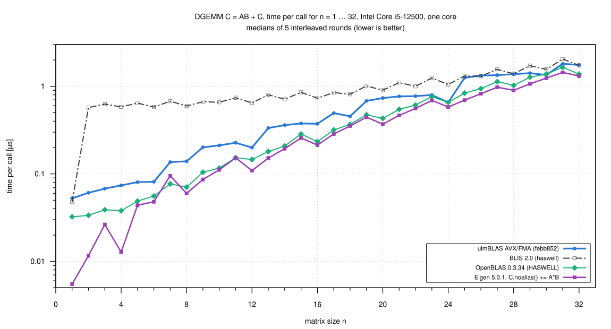
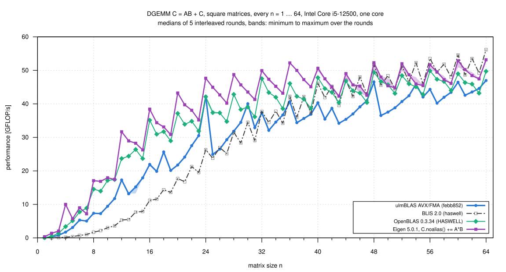
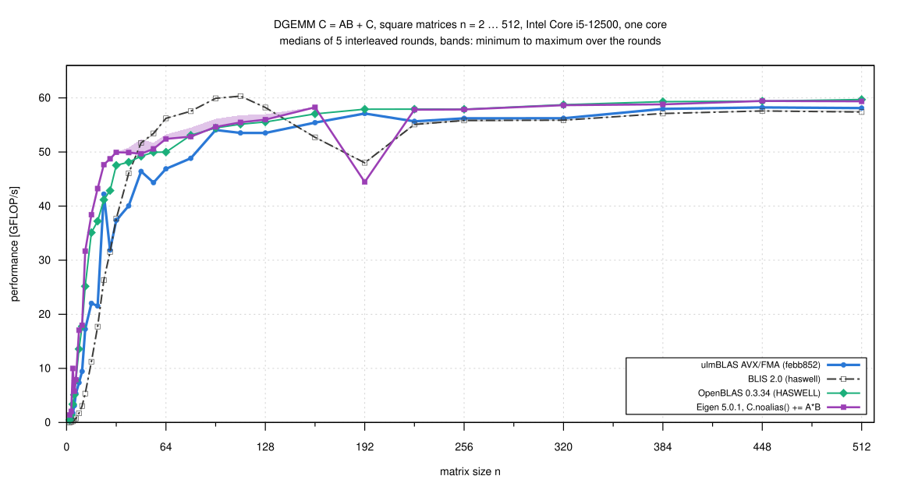

# Intel Core i5-12500: Eigen compared with ulmBLAS, BLIS and OpenBLAS (2026-10-26)

I added Eigen 5.0.1 to the DGEMM comparison of campaigns
[001-2026-10-24-heim-avx-fma](../001-2026-10-24-heim-avx-fma/README.md) and
[008-2026-10-26-heim-avx-fma-memory](../008-2026-10-26-heim-avx-fma-memory/README.md),
on the same machine with the same sizes and timing.  Eigen computes C <- AB
+ C with

```cpp
using Matrix = Eigen::Matrix<double, Eigen::Dynamic, Eigen::Dynamic, Eigen::ColMajor>;
C.noalias() += A*B;
```

against ulmBLAS febb852 (AVX/FMA), BLIS 2.0 and OpenBLAS 0.3.34, all
single-threaded on core 3.  ulmBLAS, BLIS and OpenBLAS were measured again
in the same rounds, with the unchanged programs of the earlier campaigns.

## Results

- **n <= 41: Eigen is the fastest**, except n = 7 (OpenBLAS 0.077 µs, Eigen
  0.095) and n = 11 (tie with OpenBLAS)
  - n <= 6: Eigen does not call its product kernel but an inlined
    coefficient-based product (see [Eigen's product
    paths](#eigens-product-paths)): 0.012 µs at n = 2, OpenBLAS 0.034,
    ulmBLAS 0.061, BLIS 0.57
  - n = 8 ... 41 (block-panel kernel): 1.04 to 1.34 times OpenBLAS, 1.09
    to 2.33 times ulmBLAS
- **n = 42 ... 128: BLIS and Eigen alternate**
  - BLIS is the fastest at 10 of the 23 sizes n = 42 ... 64 and at all of
    n = 80 ... 128, by 3 to 14% over Eigen (n = 64: BLIS 56.2, Eigen 53.2,
    OpenBLAS 49.7, ulmBLAS 47.0 GFLOP/s)
  - Eigen is the fastest at n = 43, 44, 45, 49, 53, 61; tie at 42, 47, 48,
    51, 52, 55, 57
  - n = 80 ... 128: Eigen and OpenBLAS tie
- **n = 160 ... 768: Eigen and OpenBLAS are the fastest**, tied (57.8 to
  60.5 GFLOP/s)
  - Eigen 1 to 5% above ulmBLAS and 3 to 10% above BLIS; at n = 160 1.02
    times OpenBLAS
  - except n = 192 (Eigen only 44.5, 0.77 of OpenBLAS and ulmBLAS) and n =
    384, see [the dips](#size-dependent-dips-of-eigen)
- **n >= 1024: OpenBLAS is the fastest** (60.3 to 61.3 GFLOP/s)
  - Eigen 52.7 to 55.6: 0.86 to 0.92 of OpenBLAS, 0.89 to 0.95 of ulmBLAS,
    0.88 to 0.96 of BLIS
  - thin shapes (k = 32 ... 256) alike: Eigen 0.83 to 0.97 of OpenBLAS
    (but 1.035 times ulmBLAS for 2000 x 2000 x 32)
- **beta = 0** (`C.noalias() = A*B`): 2000 x 2000 x 32: Eigen 40.6 and
  OpenBLAS 40.9, ulmBLAS 56.8 and BLIS 56.5 GFLOP/s; for 1024 and 2048 the
  order is as for beta = 1
- **Reproducible**: ulmBLAS, BLIS and OpenBLAS reach 0.972 to 1.009
  (median 1.000) of campaign 008 at all 53 common shapes; 2148
  measurements, none wrong

The small sizes do not rank micro kernels alone: Eigen is a header
library, so its product is compiled into the program (here with
`-march=native`) and its small path is inlined, while ulmBLAS, BLIS and
OpenBLAS are called through `cblas_dgemm` and check arguments, choose a
path and get buffers on every call.  For n >= 1024, where the call does
not matter, Eigen's 12 x 4 kernel with its blocking is 4 to 14% slower than
the other three.

## Square DGEMM, small sizes

Time per call in µs (medians of 5 interleaved rounds, sweep "fine"; lower
is better).  "fastest" lists every variant within the noise of the
fastest:

| n | ulmBLAS | BLIS | OpenBLAS | Eigen | Eigen / OpenBLAS | Eigen / ulmBLAS | fastest |
|---:|---:|---:|---:|---:|---:|---:|---|
| 1 | 0.0526 | 0.0476 | 0.0323 | 0.0055 | 5.839 | 9.526 | Eigen |
| 2 | 0.0608 | 0.571 | 0.0336 | 0.0116 | 2.889 | 5.228 | Eigen |
| 3 | 0.0678 | 0.628 | 0.0389 | 0.0264 | 1.476 | 2.572 | Eigen |
| 4 | 0.0739 | 0.582 | 0.0379 | 0.0128 | 2.958 | 5.769 | Eigen |
| 5 | 0.0805 | 0.644 | 0.0489 | 0.0438 | 1.118 | 1.839 | Eigen |
| 6 | 0.0813 | 0.580 | 0.0558 | 0.0481 | 1.160 | 1.692 | Eigen |
| 7 | 0.136 | 0.676 | 0.0770 | 0.0952 | 0.809 | 1.431 | OpenBLAS |
| 8 | 0.139 | 0.596 | 0.0704 | 0.0599 | 1.174 | 2.323 | Eigen |
| 10 | 0.212 | 0.658 | 0.117 | 0.111 | 1.046 | 1.900 | Eigen |
| 12 | 0.200 | 0.647 | 0.146 | 0.109 | 1.338 | 1.833 | Eigen |
| 16 | 0.373 | 0.732 | 0.233 | 0.213 | 1.093 | 1.751 | Eigen |
| 20 | 0.735 | 0.904 | 0.431 | 0.370 | 1.164 | 1.987 | Eigen |
| 24 | 0.655 | 1.050 | 0.656 | 0.580 | 1.131 | 1.129 | Eigen |
| 28 | 1.379 | 1.393 | 1.025 | 0.901 | 1.138 | 1.531 | Eigen |
| 32 | 1.754 | 1.737 | 1.379 | 1.313 | 1.050 | 1.336 | Eigen |
| 40 | 3.173 | 2.776 | 2.675 | 2.529 | 1.058 | 1.255 | Eigen |
| 48 | 4.754 | 4.278 | 4.476 | 4.231 | 1.058 (noise) | 1.124 | Eigen = BLIS = OpenBLAS |
| 56 | 7.923 | 6.561 | 7.045 | 6.795 | 1.037 | 1.166 | BLIS |
| 64 | 11.16 | 9.331 | 10.54 | 9.860 | 1.069 | 1.132 | BLIS |

All n = 1 ... 64 are in `data/summary/dgemm_fine.csv`.  The sweeps "fine"
and "sweep" give the same "fastest" at every common size, but for a few
sizes their medians differ by more than the spread (Eigen at n = 6: 8.98
vs. 7.90 GFLOP/s; OpenBLAS at n = 8, 10, 12: 0.94 to 1.07).  Factors below
about 1.07 for n <= 24 are not exact.

## Square DGEMM, medium and large sizes

GFLOP/s (n <= 448: sweep, 5 rounds; n >= 512: main shapes, 3 rounds):

| n | ulmBLAS | BLIS | OpenBLAS | Eigen | Eigen / OpenBLAS | Eigen / ulmBLAS | Eigen / BLIS | fastest |
|---:|---:|---:|---:|---:|---:|---:|---:|---|
| 80 | 48.8 | 57.5 | 53.1 | 52.8 | 0.995 (noise) | 1.082 | 0.918 | BLIS |
| 96 | 54.1 | 59.9 | 54.4 | 54.6 | 1.003 (noise) | 1.011 | 0.912 | BLIS |
| 112 | 53.5 | 60.3 | 55.1 | 55.5 | 1.006 (noise) | 1.037 | 0.920 | BLIS |
| 128 | 53.5 | 58.2 | 55.5 | 56.0 | 1.008 (noise) | 1.046 | 0.961 | BLIS |
| 160 | 55.4 | 52.7 | 57.0 | 58.3 | 1.021 | 1.051 | 1.105 | Eigen |
| 192 | 57.1 | 48.0 | 57.9 | 44.5 | 0.768 | 0.778 | 0.926 | OpenBLAS |
| 224 | 55.7 | 55.1 | 57.9 | 57.8 | 0.998 (noise) | 1.039 | 1.049 | OpenBLAS = Eigen |
| 256 | 56.2 | 55.8 | 57.9 | 57.9 | 0.999 (noise) | 1.029 | 1.036 | OpenBLAS = Eigen |
| 320 | 56.2 | 55.9 | 58.7 | 58.6 | 0.998 (noise) | 1.043 | 1.050 | OpenBLAS = Eigen |
| 384 | 58.0 | 57.1 | 59.3 | 58.8 | 0.992 (noise) | 1.014 | 1.030 | OpenBLAS = Eigen |
| 448 | 58.2 | 57.6 | 59.4 | 59.4 | 1.000 (noise) | 1.020 | 1.032 | Eigen = OpenBLAS |
| 512 | 58.1 | 57.4 | 59.7 | 59.4 | 0.995 (noise) | 1.021 | 1.034 | OpenBLAS = Eigen |
| 768 | 59.8 | 58.7 | 60.0 | 60.5 | 1.007 (noise) | 1.012 | 1.029 | Eigen = OpenBLAS |
| 1024 | 58.8 | 57.8 | 60.3 | 55.6 | 0.922 | 0.946 | 0.961 | OpenBLAS |
| 1536 | 59.5 | 58.7 | 60.7 | 53.4 | 0.878 | 0.896 | 0.909 | OpenBLAS |
| 2048 | 59.0 | 58.0 | 60.8 | 53.1 | 0.873 | 0.899 | 0.915 | OpenBLAS |
| 3072 | 59.5 | 59.8 | 61.3 | 52.7 | 0.860 | 0.886 | 0.882 | OpenBLAS |
| 4096 | 59.2 | 57.4 | 61.3 | 52.9 | 0.864 | 0.894 | 0.922 | OpenBLAS |

Thin and beta = 0 shapes (GFLOP/s, 3 rounds):

| m x n x k | beta | ulmBLAS | BLIS | OpenBLAS | Eigen | Eigen / OpenBLAS | Eigen / ulmBLAS | fastest |
|---|---:|---:|---:|---:|---:|---:|---:|---|
| 2000 x 2000 x 32 | 1 | 52.9 | 49.8 | 56.4 | 54.7 | 0.970 | 1.035 | OpenBLAS |
| 2000 x 2000 x 128 | 1 | 58.9 | 52.2 | 60.7 | 50.6 | 0.833 | 0.859 | OpenBLAS |
| 2000 x 2000 x 256 | 1 | 60.0 | 59.8 | 60.9 | 54.0 | 0.886 | 0.900 | OpenBLAS |
| 4000 x 4000 x 64 | 1 | 57.7 | 55.2 | 59.6 | 54.9 | 0.920 | 0.950 | OpenBLAS |
| 256 x 256 x 256 | 0 | 56.8 | 56.6 | 56.7 | 57.2 | 1.007 (noise) | 1.007 (noise) | all four |
| 1024 x 1024 x 1024 | 0 | 58.9 | 57.9 | 59.9 | 55.9 | 0.933 | 0.950 | OpenBLAS |
| 2000 x 2000 x 32 | 0 | 56.8 | 56.5 | 40.9 | 40.6 | 0.991 (noise) | 0.713 | ulmBLAS = BLIS |
| 2048 x 2048 x 2048 | 0 | 59.1 | 57.8 | 60.4 | 52.5 | 0.869 | 0.888 | OpenBLAS |

### Size-dependent dips of Eigen

- n = 192: 44.2 to 44.7 GFLOP/s in every run
- n = 384 depends on the program run, not on the round: 58.8 in the sweep
  (after n = 320), but 54.2 in the main shapes (after n = 256), 54.3 alone
  and 54.3 after n = 256 alone; each stable within 0.1%
- OpenBLAS alone: 59.3 at n = 384, 60.2 at 1024, as in the rounds; Eigen
  alone at 1024 and 2048: 54.5 and 53.4
- the cause (blocking, placement in memory) was not investigated

## Eigen's configuration

- **Eigen 5.0.1** (2025-11-11), header only, from
  `https://gitlab.com/libeigen/eigen/-/archive/5.0.1/eigen-5.0.1.tar.gz`
  (SHA-256
  e9c326dc8c05cd1e044c71f30f1b2e34a6161a3b6ecf445d56b53ff1669e3dec)
- **Compiler**: `g++ -std=c++17 -O3 -DNDEBUG -march=native` (GCC 12.2.0;
  AVX2 and FMA, no AVX-512)
  - `EIGEN_VECTORIZE_AVX2` and `EIGEN_VECTORIZE_FMA` defined, packets of 4
    doubles (`logs/eigen-info.txt`)
- **Kernel**: `gebp_kernel<double, double, long, ..., 12, 4>` (12 x 4), 306
  `vfmadd...pd` on ymm registers (`logs/eigen-binary.txt`)
- **Blocking** (Eigen's heuristic for L1 48 KiB, L2 1.25 MiB, L3 18 MiB):
  n = 256: kc 256, mc 132, nc 256; n = 1024: 344, 1024, 256; n = 4096:
  376, 4096, 256
- **One thread**: no OpenMP, `Eigen::setNbThreads(1)`, pinned to core 3
- **No external BLAS**: `EIGEN_USE_BLAS` and `EIGEN_USE_MKL_ALL` not
  defined; `ldd` and `nm` show no BLAS

ulmBLAS (febb852, `ARCHFLAGS="-mavx -mfma"`), BLIS 2.0 (haswell) and
OpenBLAS 0.3.34 (HASWELL) are the binaries of campaigns 001 and 008,
linked to `bench2.c` with `gcc -O2`; `logs/programs.sha256` matches.

### Eigen's product paths

`logs/eigen-perf.txt` (`perf record -e task-clock`):

- n <= 6 (m + n + k < `EIGEN_GEMM_TO_COEFFBASED_THRESHOLD` = 20): no
  product kernel, the time is in the inlined coefficient-based product
- n = 7, 8, 16, 64, 512: `gebp_kernel<..., 12, 4>` (55% at n = 7, 85% at n
  = 64), the packing routines and the driver
- the step from n = 6 to 7 (0.048 to 0.095 µs) is the switch between the
  two paths
- Eigen allocates its packing buffers inside the product (on the stack up
  to 128 KiB, else on the heap), like the BLAS libraries

## Method

As in campaign 008: heim, Intel Core i5-12500 (AVX2/FMA), Debian 12, Linux
6.1, governor powersave, turbo on, one thread on core 3.

- `source/bench-eigen.cpp` is `bench2.c` with `cblas_dgemm` replaced by
  `C.noalias() += A*B` (or `= A*B` for beta = 0)
  - same random values, one checked call, warm-up >= 0.3 s, 7 samples >=
    0.2 s, median; for beta = 0 C is set to NaN before each sample
  - the timed loop holds only the product and an empty `asm` with a memory
    clobber, so the compiler cannot merge or drop inlined small products
- Shapes: the main and beta = 0 shapes of campaign 001 (3 rounds), the
  sweep n = 2 ... 512 of campaign 008 (5 rounds), every n = 1 ... 64
  ("fine", 5 rounds); the 4 programs in rotated order
- Statistics: median of the samples per round, then median, min and max
  over the rounds; "clear" if the ranges do not overlap and the medians
  differ by at least 1%
- Conditions: package 29 to 54 C, clock of core 3 median 3994 MHz; from
  round 4 (ulmBLAS) to round 5 (OpenBLAS) another login session ran a
  process (load 2.0); those rounds are 0.94 to 1.04 (median 1.000) of
  rounds 1 to 3, none discarded

## Correctness

- every measurement checks its first result against the naive product
  (bound 4 (k + 2) 2.3e-16 (sum |a b| + |c|)), with a random C for beta = 1
  and NaN in C for beta = 0; bench-eigen also reports an error if A or B
  changed or C was reallocated; 2148 measurements, 0 wrong
- `source/verify-eigen.cpp` for n = 768 ... 4096: 2000 elements per n
  against a long double sum, 0 violations (largest error 1.3e-5 to 2.0e-4
  of the bound); the BLAS libraries with `verify-large`: 0 violations
- `noalias()` is correct here because C is a different object than A and B

## Files

- `data/raw/`: outputs (`main`, `beta0`, `sweep`, `fine`, `verify-*`,
  `isolated-*`, `after256-eigen`)
- `data/runs.csv`, `data/summary/*.csv`: from `source/summarize-eigen.py`;
  `reproduction.csv` compares with campaign 008
- `logs/`: system, Eigen build, configuration, binary, profile,
  conditions, run log
- `source/`: `bench-eigen.cpp`, `verify-eigen.cpp`, `eigen-info.cpp`,
  `check-eigen.sh`, `bench-eigen.sh`, `summarize-eigen.py`
- `plots/`: Gnuplot scripts

## Reproduction

Build the programs of campaign 008 (`bench-avx-cur`, `bench-blis`,
`bench-openblas`, `verify-*`), then in a workspace W:

```sh
curl -LO https://gitlab.com/libeigen/eigen/-/archive/5.0.1/eigen-5.0.1.tar.gz
tar xzf eigen-5.0.1.tar.gz
mkdir src && cp SOURCE_OF_THIS_CAMPAIGN/*.cpp SOURCE_OF_THIS_CAMPAIGN/*.sh src/
sh src/check-eigen.sh W          # builds bin/bench-eigen, bin/verify-eigen, logs
# set P in src/bench-eigen.sh to the directory of the other programs
sh src/bench-eigen.sh W          # about 66 minutes
```

Then copy `W/bench/res/*.txt` to `data/raw/` and run `python3
source/summarize-eigen.py` in the campaign directory.

## Figures

<!-- BEGIN FIGURES (generated by make add_benchmark_result) -->









<!-- END FIGURES -->
