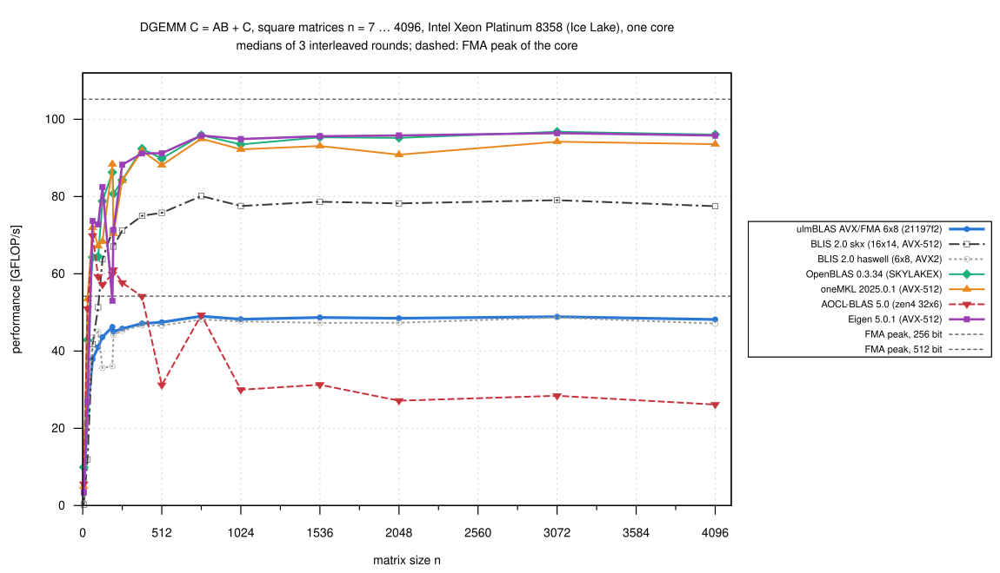
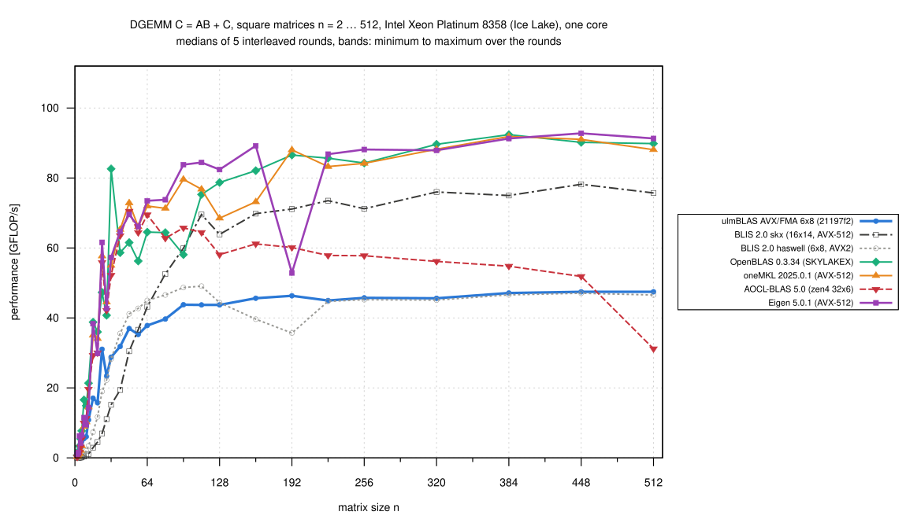
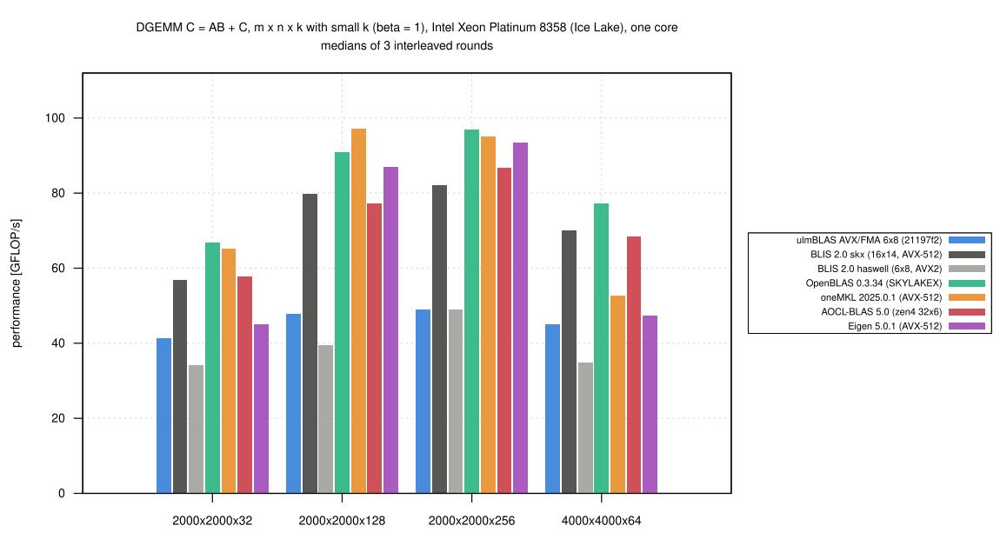

# Intel Xeon Platinum 8358 (Ice Lake): DGEMM baseline on bwUniCluster 3.0 (2026-10-26)

My first DGEMM campaign on bwUniCluster 3.0 (KIT), partition `cpu_il`:
one core of an Intel Xeon Platinum 8358 (Ice Lake-SP, AVX-512 with two
512-bit FMA units) on an exclusive node, single-threaded.  I measured
ulmBLAS with its AVX/FMA 6 x 8 kernel (a port of BLIS `haswell`) against
the BLAS libraries on the cluster, with the shapes and timing of
[009-2026-10-26-heim-eigen](../009-2026-10-26-heim-eigen/README.md).  The
use of the cluster, the hardware and how the kernels were identified are
in
[investigations/2026-10-bwunicluster3](../../investigations/2026-10-bwunicluster3/README.md).

## Results

n = m = k >= 1024 (5 sizes, medians of 3 rounds):

| Variant | Micro kernel actually used | GFLOP/s | of the 512-bit FMA peak (105.2) | ulmBLAS / variant |
|---|---|---:|---:|---:|
| ulmBLAS 21197f2 (AVX/FMA) | ulmBLAS AVX/FMA 6 x 8 (BLIS haswell assembly) | 48.2-48.9 | 0.46 (0.89-0.90 of the 256-bit peak 54.2) | — |
| BLIS 2.0 `haswell` | `bli_dgemm_haswell_asm_6x8` | 47.1-48.7 | 0.45-0.46 | 1.004-1.029 (median 1.023) |
| BLIS 2.0 `auto` → `skx` | `bli_dgemm_skx_asm_16x14` (AVX-512) | 77.5-79.1 | 0.74-0.75 | 0.618-0.622 |
| OpenBLAS 0.3.34 `SKYLAKEX` | `dgemm_kernel_16x2_skylakex` (AVX-512) | 93.5-96.8 | 0.89-0.92 | 0.502-0.516 |
| oneMKL 2025.0.1, sequential | AVX-512 code path | 90.8-94.2 | 0.86-0.90 | 0.51-0.53 |
| Eigen 5.0.1, `-march=native` | gebp, AVX-512 | 94.9-96.4 | 0.90-0.92 | 0.50-0.51 |
| AOCL-BLAS 5.0 (single threaded) | `bli_dgemm_zen4_asm_32x6` (AMD's Zen 4 configuration, chosen on every AVX-512 CPU) | 26.1-31.3 | 0.25-0.30 | 1.56-1.84 |

- **The AVX2/FMA kernel gets only half the peak of this core**
  - ulmBLAS reaches 89 to 90% of the 256-bit FMA peak, on par with BLIS
    using the same kernel (1.00 to 1.03)
  - the AVX-512 libraries are about twice as fast
- **BLIS `skx` is behind the other AVX-512 libraries**: 0.82 of OpenBLAS,
  0.84 of MKL (each size 0.81 to 0.86)
- **OpenBLAS and Eigen are the fastest** (within 1%); MKL 1 to 5% slower
  than OpenBLAS
- **AOCL-BLAS on Intel is no reference**
  - it selects its Zen 4 configuration (`zen4`, "Genoa") on every AVX-512
    CPU
  - 26 to 31 GFLOP/s for n >= 512, less than ulmBLAS's AVX2 kernel; 54 to
    70 for n <= 384
- **Small sizes**: OpenBLAS, MKL and Eigen are the fastest; BLIS is slow
  for n <= 31 (0.26 GFLOP/s at n = 7, as on heim); ulmBLAS (3.1 at n = 7)
  is in between
- 1519 measurements, every first result checked up to 2e8 multiply-adds,
  none wrong; `verify-*` for n = 768 ... 4096: no violation

## Setup

- **Node** `uc2n839` (`cpu_il`, `sbatch --exclusive`), Slurm job 8002010
  - 2 x Xeon Platinum 8358, 32 cores per socket, SMT on, 4 NUMA nodes;
    per core 48 KiB L1d, 1.25 MiB L2; 48 MiB L3 per socket
  - 2.6 GHz base, turbo up to 3.4 GHz, governor `performance`
  - measured FMA peak of core 3: 54.20 GFLOP/s with ymm, 105.19 with zmm
    (before and after the rounds)
- **Software**: RHEL 9.6, GCC 14.2.0
- **Pinning**: `numactl --physcpubind=3 --membind=0`; one benchmark
  process at a time

| Variant | Version and build |
|---|---|
| ulmblas | ulmBLAS 21197f2 (library code identical to febb852), `make cblas CXX=g++ ARCHFLAGS="-mavx -mfma"` (`-O3`) |
| blis-auto | BLIS 2.0 (`configure --disable-shared --enable-cblas -t no auto`, built on an Ice Lake node: configuration `skx`), MC/KC/NC 240/256/3752 |
| blis-haswell | BLIS 2.0 configuration `haswell`, MC/KC/NC 72/256/4080 |
| openblas | OpenBLAS 0.3.34, `USE_THREAD=0 USE_OPENMP=0 NO_SHARED=1 NOFORTRAN=1 NO_LAPACK=1`, target detected: `SKYLAKEX` |
| mkl | oneMKL 2025.0.1 (module `numlib/mkl/2025.0`), static `mkl_intel_lp64`, `mkl_sequential`, `mkl_core`; `MKL_VERBOSE`: AVX-512 code path |
| aocl | AOCL-BLAS 5.0.0 Build 20241001 (module `lib/aocl/5.0.0`), static single-threaded `libblis.a`; selects `zen4` |
| eigen | Eigen 5.0.1, `g++ -std=c++17 -O3 -DNDEBUG -march=native` (`icelake-server`: AVX-512, packet size 8), `C.noalias() += A*B` |

The BLAS programs are `bench2.c` and `verify-large.c` of the heim
campaigns (`gcc -O2 -no-pie`, static).  I determined the configurations
and kernels the libraries select at run time on this node type
(`logs/kernels.txt`, `source/blis-info.c`, `openblas-info.c`,
`mkl-info.c`).

## Method

- As in campaign 009: per size one checked call, warm-up >= 0.3 s, 7
  samples >= 0.2 s, median
- Shapes: squares 7 ... 4096, thin and beta = 0 shapes ("main", "beta0", 3
  rounds) and the sweep n = 2 ... 512 (5 rounds); the 7 programs in
  rotated order (`source/bench.sbatch`)
- Statistics (`source/summarize-uc3.py`): median per round, then median,
  min and max over the rounds; "noise" if the ranges overlap or the
  difference is below 1%
- Conditions: the node was exclusive, only system processes besides the
  benchmark
  - the load average was still 25 from the previous job and decayed to 1.0
    in about 3 minutes; round 1 of the variants measured then (ulmBLAS,
    BLIS auto) differs from rounds 2 and 3 by at most 0.4% (BLIS) and 1.9%
    (ulmBLAS, small sizes)
  - the campaign took 57 minutes

## Files

- `data/raw/`: outputs (`main`, `beta0`, `sweep`, `verify-*`, `peak-*`)
- `data/runs.csv`, `data/summary/*.csv`: from `source/summarize-uc3.py`;
  columns `VARIANT_of_peak_ymm`, `_zmm` relative to the measured peaks
- `logs/`: hardware probe, builds, selected kernels, compile commands,
  checksums, conditions, run log, Slurm feedback
- `source/`: programs and job scripts
- `plots/`: Gnuplot scripts

## Reproduction

With a workspace `W` (see the investigation report): put
`blis-2.0.tar.gz`, `OpenBLAS-0.3.34.tar.gz`, `eigen-5.0.1.tar.gz` and a
clone of ulmBLAS in `$W/src` and the programs of `source/` in
`$W/src/bench`, then

```sh
sbatch -p dev_cpu_il build.sbatch icelake       # 6 minutes
sbatch -p cpu_il smoke.sbatch icelake           # optional functional test
sbatch -p cpu_il bench.sbatch icelake           # exclusive node, about 1 hour
```

and copy `$W/icelake/run-JOBID/res/*.txt` to `data/raw/`.

## Figures

<!-- BEGIN FIGURES (generated by make add_benchmark_result) -->







<!-- END FIGURES -->
