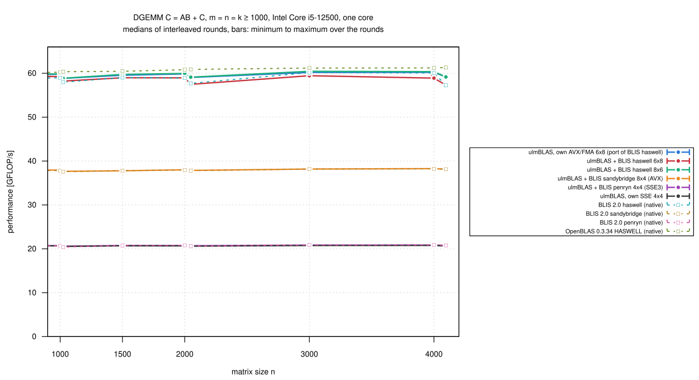
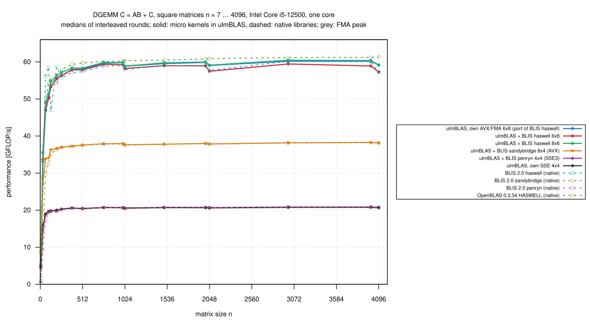
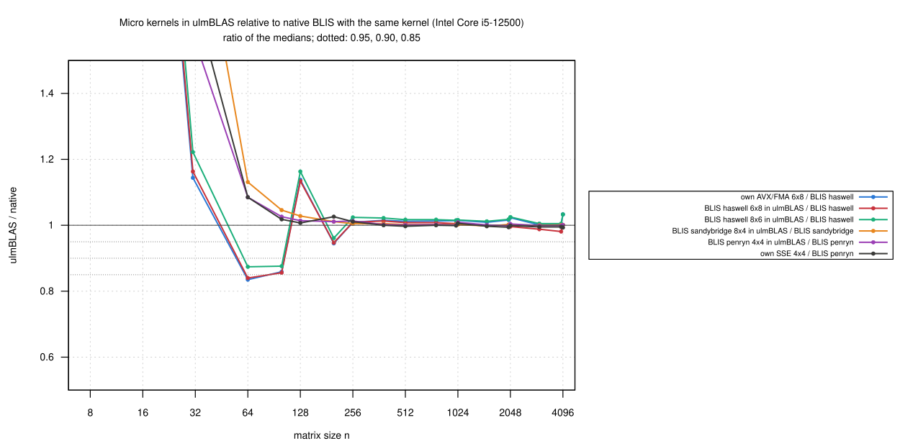

# Intel Core i5-12500: BLIS micro kernels inside ulmBLAS (2026-10-26)

The first benchmark of the BLIS DGEMM kernels that ulmBLAS can now use
(`ulmblas/level3/ukernel/blis/`, selected at build time with
`-DULMBLAS_DGEMM_UKERNEL_blis_NAME`), on the heim CPU (Alder Lake,
AVX2/FMA, no AVX-512).  I measured every kernel this CPU can run inside
ulmBLAS (ulmBLAS's packing, blocking and macro kernel, with the block sizes
of the BLIS configuration that uses the kernel) against **native BLIS 2.0
with the same kernel**, ulmBLAS's own kernels and OpenBLAS.

- The kernels are vendored from BLIS 2.0 (`mk/vendor_blis_kernels.py`),
  not written for ulmBLAS
- ulmBLAS's own AVX/FMA kernel is itself a port of BLIS's `haswell` 6 x 8

## Results

n = m = k >= 1000 (8 sizes, medians of 3 rounds), ratio to native BLIS with
the same kernel:

| Variant | Kernel | Block sizes MC/KC/NC | GFLOP/s | / native BLIS: median (min … max) |
|---|---|---|---:|---|
| ulmBLAS, own AVX/FMA kernel | ulmBLAS 6 x 8 (port of BLIS haswell) | 288/256/4080 | 58.8-60.2 | 1.014 (1.001 … 1.033) vs. BLIS haswell |
| ulmBLAS + BLIS haswell 6 x 8 | `bli_dgemm_haswell_asm_6x8` | 72/256/4080 | 57.3-59.4 | **1.000** (0.981 … 1.005) vs. BLIS haswell |
| ulmBLAS + BLIS haswell 8 x 6 | `bli_dgemm_haswell_asm_8x6` | 72/256/4080 | 58.9-60.5 | **1.015** (1.005 … 1.033) vs. BLIS haswell (6 x 8) |
| ulmBLAS + BLIS sandybridge 8 x 4 | `bli_dgemm_sandybridge_asm_8x4` (AVX, no FMA) | 96/256/4096 | 37.7-38.3 | **1.001** (0.998 … 1.003) vs. BLIS sandybridge |
| ulmBLAS + BLIS penryn 4 x 4 | `bli_dgemm_penryn_asm_4x4` (SSE3) | 384/384/4096 | 20.6-20.9 | **1.001** (0.998 … 1.009) vs. BLIS penryn |
| ulmBLAS, own SSE kernel | ulmBLAS 4 x 4 (SSE) | 384/384/4096 | 20.5-20.8 | 0.996 (0.993 … 1.006) vs. BLIS penryn |
| OpenBLAS 0.3.34 (HASWELL) | | | 60.3-61.3 | |

- **Every BLIS kernel inside ulmBLAS is as fast as native BLIS** (n >=
  1000)
  - all medians 0.996 to 1.015, every size 0.98 to 1.04
- **The vendored haswell 6 x 8 is 1.4% slower than ulmBLAS's own port of
  the same assembly** (0.986, per size 0.968 to 0.991)
  - the only difference is MC (72 from BLIS's haswell configuration vs.
    288)
  - haswell 8 x 6 with MC = 72 is as fast as ulmBLAS's own kernel (1.001)
  - with MC = 288 the gap shrinks to 0.5 to 0.8%, see
    [013-2026-10-27-heim-blis-kernels-mc](../013-2026-10-27-heim-blis-kernels-mc/README.md)
- **Kernels without FMA**: sandybridge 8 x 4 (AVX, separate multiply and
  add) reaches 0.64 of the AVX/FMA kernels, penryn 4 x 4 and ulmBLAS's SSE
  kernel 0.35, as the instruction throughput predicts
- **Small sizes**
  - n = 64 and 100: BLIS (its "sup" kernels on unpacked matrices) is 1.17
    to 1.19 times as fast as ulmBLAS with the same kernel
  - n = 128: ulmBLAS is 1.13 times as fast
  - n >= 256: all within 1 to 2%
  - n <= 31: BLIS is slow (1.0 GFLOP/s at n = 7), ulmBLAS 5.0
- **The default build is unchanged**: f530d1a without a BLIS kernel and
  the febb852 program of the earlier campaigns agree within 0.1% at every
  size
- 726 measurements, every first result checked up to 2e8 multiply-adds,
  none wrong; `verify-*` for n = 1000 ... 4096: no violation

## Setup

- **Machine**: heim, Intel Core i5-12500 (AVX2/FMA), Debian 12, Linux 6.1,
  governor powersave, turbo on; one thread on core 3
- **ulmBLAS** f530d1a, `make cblas ARCHFLAGS=...` per variant (GCC 12.2,
  `-O3`; `logs/compile-commands.txt`)
  - own kernels: `-mavx -mfma` (AVX/FMA), `-msse3 -mfpmath=sse` (SSE)
  - BLIS kernels: `-DULMBLAS_DGEMM_UKERNEL_blis_NAME` with `-mavx -mfma`
    (haswell), `-mavx` (sandybridge), `-msse3 -mfpmath=sse` (penryn)
- **Native BLIS 2.0**: `haswell` (the program of campaign 001),
  `sandybridge` and `penryn` (built for this campaign from the same
  archive)
- **OpenBLAS** 0.3.34, HASWELL (the program of campaign 001)
- **Programs**: `bench2.c`, `verify-large.c` (unchanged), `gcc -O2`,
  static; checksums in `logs/programs.sha256`

All these kernels pass the test suite on this machine, also with ASan and
UBSan:
[investigations/2026-10-bwunicluster3/kernels/tests](../../investigations/2026-10-bwunicluster3/kernels/tests/README.md).

## Method

- `bench2.c`: one checked call, warm-up >= 0.3 s, 7 samples >= 0.2 s,
  median
- Sizes: square n = 7 ... 768 and n = 1000, 1024, 1500, 2000, 2048, 3000,
  4000, 4096; thin 2000 x 2000 x {32, 128, 256} and 4000 x 4000 x 64; beta
  = 1
- 3 rounds, the 11 programs in rotated order (`source/kernels-heim.sh`);
  median per round, then median, min and max over the rounds
- Conditions: package 41 to 52 C, core 3 at 3.79 to 4.00 GHz (one reading
  of 2.79 at an idle moment); the first measurement still had the builds
  in the load average (5.95), its round agrees with the others within
  0.3%; 68 minutes

## Files

- `data/raw/`: `main-VARIANT-ROUND.txt`, `verify-VARIANT.txt`
- `data/runs.csv`, `data/summary/*.csv`: from `source/summarize-kernels.py
  haswell=blis-haswell,sandybridge=blis-sandybridge,penryn=blis-penryn,avx=blis-haswell,sse=blis-penryn`;
  `kernels_large.csv` has the ratios for n >= 1000 per size
- `logs/`: system, builds, compile commands, checksums, conditions, run
  log
- `source/`: `kernels-heim.sh`, `bench2.c`, `verify-large.c`,
  `summarize-kernels.py`
- `plots/`: Gnuplot scripts (`_labels.gp` lists the variants)

## Reproduction

With the programs of
[001-2026-10-24-heim-avx-fma](../001-2026-10-24-heim-avx-fma/README.md) and
[008-2026-10-26-heim-avx-fma-memory](../008-2026-10-26-heim-avx-fma-memory/README.md)
(paths at the top of `kernels-heim.sh`):

```sh
git -C ulmBLAS archive --prefix=src/ f530d1a | tar xf -
sh source/kernels-heim.sh $PWD/src $PWD/w        # about 75 minutes
cp w/res/*.txt data/raw/
python3 source/summarize-kernels.py haswell=blis-haswell,sandybridge=blis-sandybridge,penryn=blis-penryn,avx=blis-haswell,sse=blis-penryn
```

## Figures

<!-- BEGIN FIGURES (generated by make add_benchmark_result) -->







<!-- END FIGURES -->
