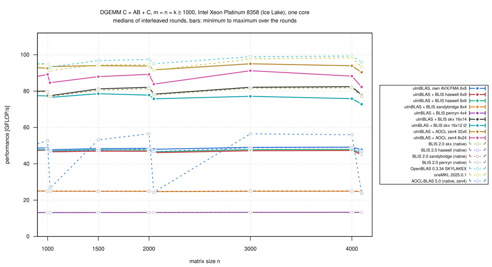
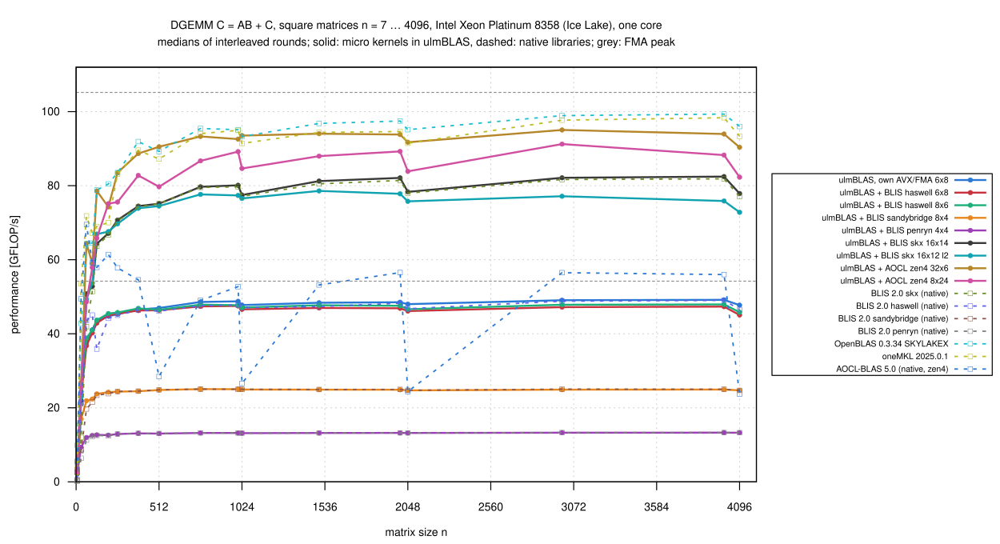
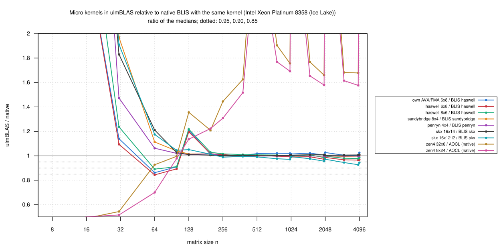

# Intel Xeon Platinum 8358 (Ice Lake): BLIS and AOCL micro kernels inside ulmBLAS (2026-10-26)

I measured every vendored DGEMM kernel that an Ice Lake core can run
(AVX-512, AVX2/FMA, AVX, SSE3) inside ulmBLAS, with the block sizes of the
BLIS or AOCL configuration that uses it, on an exclusive node of
bwUniCluster 3.0 (`cpu_il`), against **native BLIS 2.0 with the same
kernel**, OpenBLAS, oneMKL and AOCL-BLAS.

- The kernels are vendored from BLIS 2.0 and AOCL-BLAS 5.0, not written
  for ulmBLAS
- `zen5_8x24` is missing: this build (f530d1a) still had the AOCL 5.0
  version with a defective beta test, since replaced by the 5.1 version
  (see `ulmblas/level3/ukernel/blis/README.md`)

## Results

n = m = k >= 1000 (8 sizes), medians over 2 or 3 rounds (see
[Rounds](#rounds)):

| Variant | Kernel | ISA | MC/KC/NC | GFLOP/s | / native BLIS with the same kernel | / OpenBLAS |
|---|---|---|---|---:|---|---|
| ulmBLAS + BLIS skx 16 x 14 | `bli_dgemm_skx_asm_16x14` | AVX-512 | 224/256/3752 | 77.5-82.5 | **1.007** (1.005 … 1.010) vs. BLIS skx | 0.830 |
| ulmBLAS + BLIS skx 16 x 12 l2 | `bli_dgemm_skx_asm_16x12_l2` | AVX-512 | 240/256/3744 | 72.8-78.6 | 0.963 (0.927 … 0.993) vs. BLIS skx (16 x 14) | |
| ulmBLAS + AOCL zen4 32 x 6 | `bli_dgemm_zen4_asm_32x6` | AVX-512 | 96/512/4002 | **90.4-95.1** | (AOCL on Intel: see below) | **0.963** (0.941 … 1.003) |
| ulmBLAS + AOCL zen4 8 x 24 | `bli_dgemm_zen4_asm_8x24` | AVX-512 | 120/512/4008 | 82.3-91.2 | | 0.908 (0.857 … 0.938) |
| ulmBLAS, own AVX/FMA 6 x 8 | port of BLIS haswell 6 x 8 | AVX2/FMA | 288/256/4080 | 47.7-49.2 | 1.018 (1.003 … 1.027) vs. BLIS haswell | |
| ulmBLAS + BLIS haswell 6 x 8 | `bli_dgemm_haswell_asm_6x8` | AVX2/FMA | 72/256/4080 | 45.1-47.5 | 0.979 (0.965 … 0.994) vs. BLIS haswell | |
| ulmBLAS + BLIS haswell 8 x 6 | `bli_dgemm_haswell_asm_8x6` | AVX2/FMA | 72/256/4080 | 45.8-47.9 | 0.992 (0.978 … 1.007) vs. BLIS haswell | |
| ulmBLAS + BLIS sandybridge 8 x 4 | `bli_dgemm_sandybridge_asm_8x4` | AVX | 96/256/4096 | 24.7-25.0 | 0.998 (0.995 … 1.001) vs. BLIS sandybridge | |
| ulmBLAS + BLIS penryn 4 x 4 | `bli_dgemm_penryn_asm_4x4` | SSE3 | 384/384/4096 | 13.2-13.3 | 0.999 (0.998 … 1.000) vs. BLIS penryn | |
| native BLIS 2.0 skx | | AVX-512 | 240/256/3752 | 77.1-81.8 | | 0.826 |
| OpenBLAS 0.3.34 SKYLAKEX | | AVX-512 | | 93.3-99.3 | | |
| oneMKL 2025.0.1 | | AVX-512 | | 91.4-98.3 | | 0.978 |
| AOCL-BLAS 5.0 (zen4) | `bli_dgemm_zen4_asm_32x6` | AVX-512 | 128/512/4002 | 23.7-56.5 | | |

- **The BLIS kernels inside ulmBLAS are as fast as native BLIS**
  - skx 16 x 14: 1.005 to 1.010 of native BLIS at every size
  - the AVX2, AVX and SSE kernels: 0.965 to 1.007
  - no tuning needed for the target "within 10% of native BLIS"
- **AOCL's Zen 4 kernel is the fastest kernel in ulmBLAS on this Intel
  CPU**
  - 90 to 95 GFLOP/s: 0.96 of OpenBLAS, 0.98 of MKL, 1.17 times BLIS skx;
    ulmBLAS's AVX/FMA kernel reaches 0.52 of it
  - native AOCL-BLAS, which selects this kernel on every AVX-512 CPU,
    reaches only 47 to 57 GFLOP/s at n = 1000, 1500, 2000, 3000, 4000 and
    24 to 27 at 1024, 2048, 4096: the kernel is fast on Intel, AOCL's
    framework (blocking for Zen 4 caches, paths for AMD CPUs) is not
- **Powers of two**: several kernels are 3 to 7% slower at n = 1024, 2048,
  4096 than at the neighbouring sizes (zen4 8 x 24, skx 16 x 12 l2, less
  so the others), as is native BLIS
- 963 measurements, every first result checked up to 2e8 multiply-adds,
  none wrong; n = 1000 ... 4096 verified against long double sums for all
  16 programs (separate run): no violation

## Rounds

- The job was limited to 90 minutes, too short for the slow SSE and AVX
  kernels; it ended during round 3
  - 3 rounds: 11 variants (all BLIS kernels in ulmBLAS except haswell 6 x
    8, all native BLIS)
  - 2 rounds (median = mean): ulmBLAS's own AVX/FMA kernel, haswell 6 x 8,
    MKL, AOCL; OpenBLAS 3 rounds for 17 of 22 sizes
- At the start the load average still had the previous job (36, down to 1
  within 4 minutes): round 1 of the first variants is up to 2.4% slower
  than round 2, so ulmBLAS's own AVX/FMA kernel and haswell 6 x 8 may be up
  to about 1% low
- The `verify-*` programs ran afterwards on a shared node (job 8008945,
  `logs/verify-separate.txt`): results only, no timing
- ulmBLAS AVX/FMA, skx 16 x 14, zen4 32 x 6, BLIS skx, OpenBLAS and MKL
  are measured again in 3 rounds in the OpenBLAS kernel campaign 014

## Setup

- **Node** `uc2n650` (`cpu_il`, exclusive), Slurm job 8005434; core 3,
  NUMA node 0
  - FMA peak of core 3: 54.2 (ymm) / 105.2 (zmm) GFLOP/s (campaign
    [010-2026-10-26-uc3-icelake-dgemm](../010-2026-10-26-uc3-icelake-dgemm/README.md))
- **ulmBLAS** f530d1a, one library per kernel: `make cblas CXX=g++
  ARCHFLAGS="... -DULMBLAS_DGEMM_UKERNEL_blis_NAME"`, GCC 14.2
  - `-mavx -mfma -mavx512f` (AVX-512), `-mavx -mfma` (haswell, own
    AVX/FMA), `-mavx` (sandybridge), `-msse3 -mfpmath=sse` (penryn)
  - build: `investigations/2026-10-bwunicluster3/slurm/kernels-build.sbatch`
- **Native BLIS 2.0**: `auto` (= skx here), `haswell`, `sandybridge`,
  `penryn`, built on Ice Lake nodes
- **OpenBLAS, MKL, AOCL**: as in campaign 010

All kernels pass the ulmBLAS test suite on this CPU type:
[investigations/2026-10-bwunicluster3/kernels/tests](../../investigations/2026-10-bwunicluster3/kernels/tests/README.md).

## Method

- `bench2.c`: warm-up >= 0.3 s, 7 samples >= 0.2 s, median, first result
  checked
- square n = 7 ... 768 and 1000 ... 4096, thin shapes, beta = 1; the 16
  programs in rotated order per round (`source/kernels-bench.sbatch`)
- statistics: `python3 source/summarize-kernels.py
  haswell=blis-haswell,sandybridge=blis-sandybridge,penryn=blis-penryn,skx=blis-auto,zen4=aocl,avx=blis-haswell`
  (for the zen4 kernels the reference is native AOCL)

## Files

- `data/raw/`: `main-VARIANT-ROUND.txt`, `verify-VARIANT.txt`
- `data/runs.csv`, `data/summary/*.csv` (`kernels_large.csv`: ratios per
  size for n >= 1000)
- `logs/`: system, conditions, run log, checksums, verification
- `source/`: `kernels-bench.sbatch`, `kernels-build.sbatch`,
  `build-blis-extra.sbatch`, `bench2.c`, `verify-large.c`,
  `summarize-kernels.py`
- `plots/`: Gnuplot scripts

## Figures

<!-- BEGIN FIGURES (generated by make add_benchmark_result) -->

<!-- END FIGURES -->
