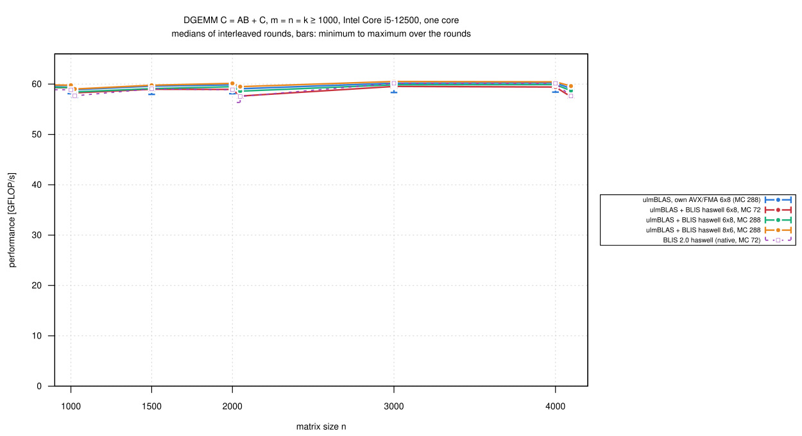
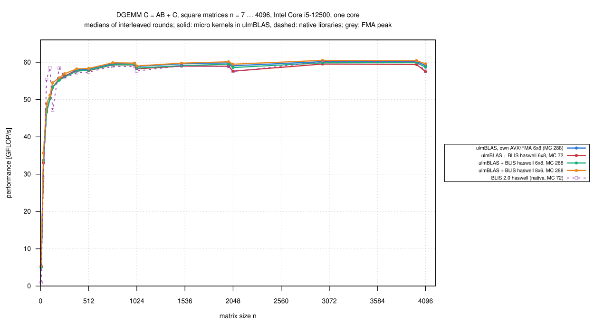
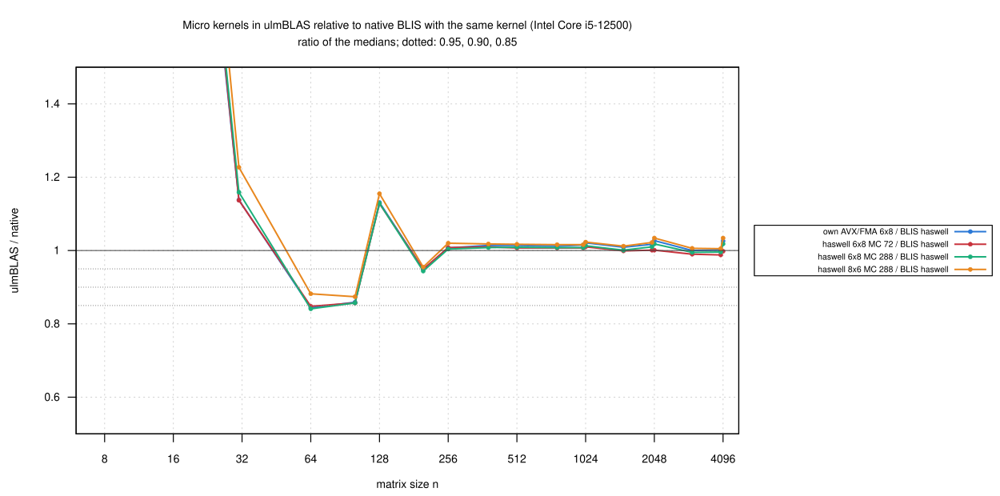

# Intel Core i5-12500: MC of the vendored BLIS haswell kernels (2026-10-27)

Tuning iteration 1 for the BLIS haswell kernels inside ulmBLAS.  In
[011-2026-10-26-heim-blis-kernels](../011-2026-10-26-heim-blis-kernels/README.md)
ulmBLAS with the vendored `bli_dgemm_haswell_asm_6x8` was 1.4% slower for
n >= 1000 than with its own AVX/FMA kernel, a port of the same assembly.
The two differ only in MC: 72 (BLIS's haswell configuration) vs. 288; KC =
256 and NC = 4080 are the same.

- **Hypothesis**: MC explains the difference
- **Test**: the vendored kernel with `-DULMBLAS_DGEMM_MC=288`, in the same
  rounds as ulmBLAS's own kernel, the vendored kernel with MC = 72 and
  native BLIS (MC = 72); also the vendored 8 x 6 kernel with MC = 288

## Results

n = m = k >= 1000 (8 sizes, medians of 3 rounds), relative to ulmBLAS's
own AVX/FMA kernel:

| Variant | MC/KC/NC | / ulmBLAS AVX/FMA: median (min … max) |
|---|---|---|
| ulmBLAS + BLIS haswell 6 x 8 | 72/256/4080 | 0.988 (0.972 … 0.992) |
| ulmBLAS + BLIS haswell 6 x 8 | **288**/256/4080 | **0.993 (0.992 … 0.995)** |
| ulmBLAS + BLIS haswell 8 x 6 | 288/256/4080 | 1.004 (1.001 … 1.008) |
| native BLIS 2.0 haswell | 72/256/4080 | 0.985 (0.974 … 1.000) |

| n | ulmBLAS AVX/FMA | haswell 6x8, MC 72 | haswell 6x8, MC 288 | haswell 8x6, MC 288 | BLIS haswell |
|---:|---:|---:|---:|---:|---:|
| 1000 | 59.74 | 59.28 | 59.33 | 59.78 | 58.86 |
| 1024 | 58.88 | 58.25 | 58.44 | 59.02 | 57.67 |
| 1500 | 59.60 | 58.97 | 59.10 | 59.77 | 59.05 |
| 2000 | 59.85 | 58.94 | 59.48 | 60.14 | 58.88 |
| 2048 | 59.07 | 57.62 | 58.59 | 59.49 | 57.54 |
| 3000 | 60.18 | 59.53 | 59.86 | 60.52 | 60.15 |
| 4000 | 60.24 | 59.41 | 59.90 | 60.44 | 60.14 |
| 4096 | 59.11 | 57.48 | 58.68 | 59.60 | 57.62 |

- **The hypothesis holds for the clear part of the difference**
  - with MC = 288 the vendored 6 x 8 kernel gains most at the powers of two
    (2048: +1.7%, 4096: +2.1%), where MC = 72 is slowest
  - the gap to ulmBLAS's own kernel shrinks from 1.2% (up to 2.8%) to 0.5
    to 0.8% at every size, below the 1% threshold of these campaigns
  - native BLIS with MC = 72 shows the same pattern as the vendored kernel
    with MC = 72
- **The remaining 0.5 to 0.8%** (same assembly, same block sizes) has a
  consistent sign
  - plausible sources: the per-call overhead of the vendored kernel (an
    out-of-line call, BLIS's edge-case setup with a stack tile, saving the
    registers of BLIS's clobber list), which ulmBLAS's port avoids
  - not investigated (below the threshold)
- **The 8 x 6 kernel** (prefers columns; ulmBLAS stores C column major) is
  0.4% faster than ulmBLAS's own kernel with the same block sizes

The vendored kernels keep BLIS's block sizes as defaults, so "inside
ulmBLAS" and "native BLIS" use the same blocking;
`-DULMBLAS_DGEMM_MC=288` reproduces this iteration.

## Setup and method

- as in campaign 011: heim, core 3, ulmBLAS f530d1a with GCC 12.2,
  `bench2.c` (7 samples >= 0.2 s, median), the same sizes
- 3 rounds, the 5 programs in rotated order
  (`source/kernels-heim-iter.sh`; flags in `logs/compile-commands.txt`)
- native BLIS haswell is the program of campaign 001
- 330 measurements, none wrong; `verify-*` for n = 1000 ... 4096: no
  violation
- the first measurement still had the builds in the load average (3.62);
  23 minutes
- summaries: `python3 source/summarize-kernels.py
  haswell=blis-haswell,avx=blis-haswell`

## Figures

<!-- BEGIN FIGURES (generated by make add_benchmark_result) -->

<!-- END FIGURES -->
