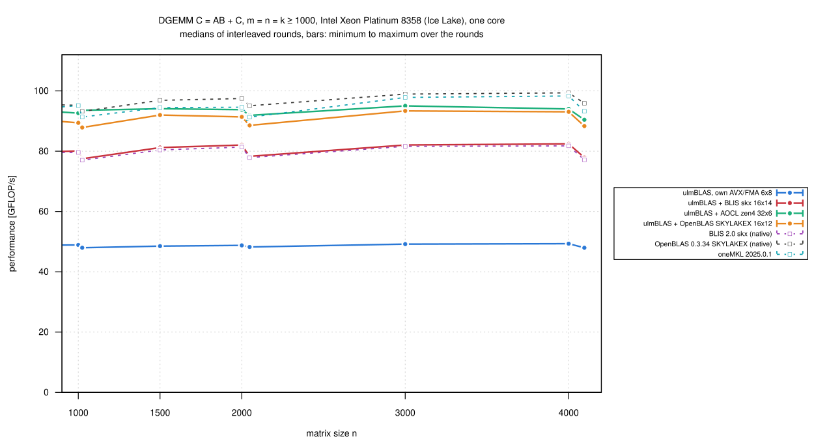
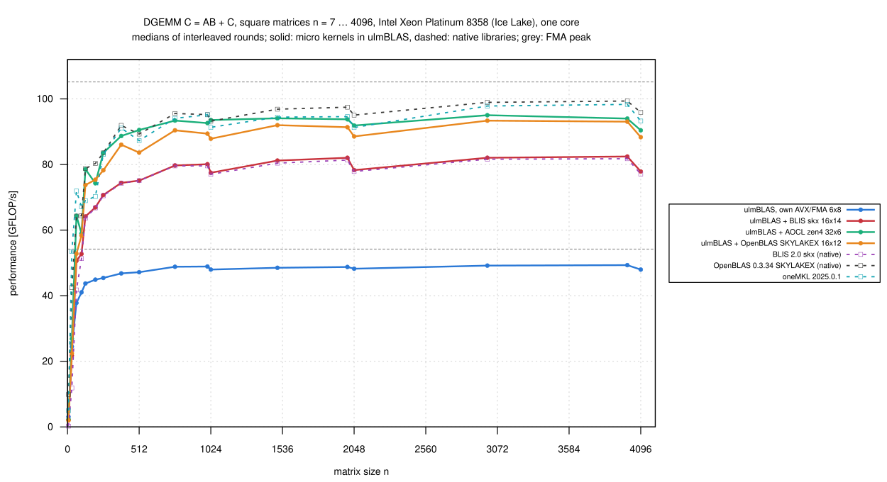
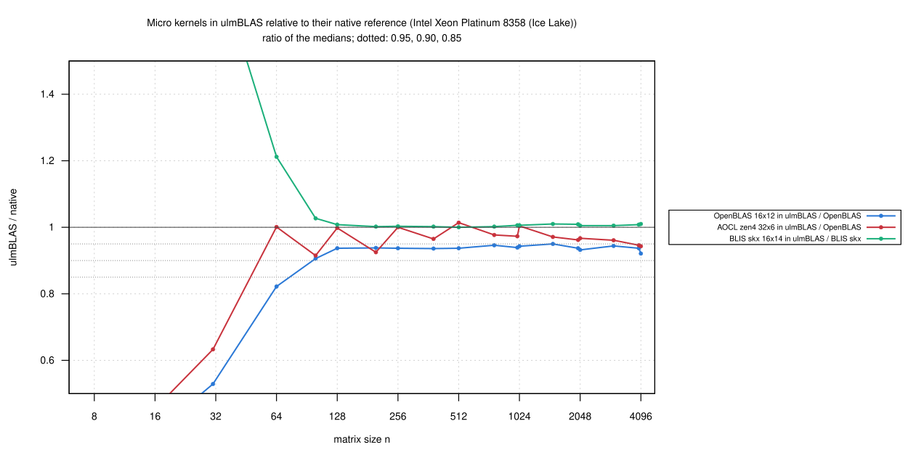

# Intel Xeon Platinum 8358 (Ice Lake): OpenBLAS's DGEMM kernel inside ulmBLAS (2026-10-27)

Can ulmBLAS reach OpenBLAS's DGEMM performance on Ice Lake with OpenBLAS's
own micro kernel?  I measured the kernel `skylakex_16x12` (the SKYLAKEX
DGEMM kernel of OpenBLAS 0.3.34, 16 x 12 tiles; only its addressing of B is
adapted to ulmBLAS's packed panels) inside ulmBLAS with OpenBLAS's block
sizes (MC/KC/NC = 192/384/8640), on an exclusive `cpu_il` node.

- in the same rounds: native OpenBLAS, oneMKL, native BLIS skx, and
  ulmBLAS with its own AVX/FMA kernel, BLIS skx 16 x 14 and AOCL zen4 32 x
  6
- this is the baseline, without tuning
- what OpenBLAS executes:
  [investigations/2026-10-bwunicluster3/openblas](../../investigations/2026-10-bwunicluster3/openblas/README.md)

## Results

n = m = k >= 1000 (8 sizes, medians of 3 rounds):

| Variant | GFLOP/s | Reference | / reference: median (min … max) |
|---|---:|---|---|
| ulmBLAS + OpenBLAS SKYLAKEX 16 x 12 (192/384/8640) | 87.9-93.4 | native OpenBLAS | **0.938** (0.921 … 0.950) |
| ulmBLAS + AOCL zen4 32 x 6 (96/512/4002) | 90.4-95.0 | native OpenBLAS | **0.964** (0.943 … 1.004) |
| ulmBLAS + BLIS skx 16 x 14 (224/256/3752) | 77.5-82.4 | native BLIS skx | 1.007 (1.005 … 1.010) |
| ulmBLAS, own AVX/FMA 6 x 8 | 48.0-49.3 | | |
| native OpenBLAS 0.3.34 (SKYLAKEX) | 93.2-99.4 | | |
| oneMKL 2025.0.1 | 91.3-98.3 | | |
| native BLIS 2.0 skx | 77.0-81.8 | | |

| n | OpenBLAS kernel in ulmBLAS | native OpenBLAS | ratio |
|---:|---:|---:|---:|
| 1000 | 89.4 | 95.2 | 0.939 |
| 1024 | 87.9 | 93.2 | 0.943 |
| 1500 | 92.0 | 96.9 | 0.950 |
| 2000 | 91.4 | 97.5 | 0.937 |
| 2048 | 88.6 | 95.1 | 0.932 |
| 3000 | 93.4 | 98.9 | 0.944 |
| 4000 | 93.1 | 99.4 | 0.937 |
| 4096 | 88.3 | 95.9 | 0.921 |

- **OpenBLAS's kernel in ulmBLAS reaches 0.92 to 0.95 of native
  OpenBLAS**
  - the target of at least 0.90 is reached, the 0.95 I aimed at not;
    slower at every size
  - 1.13 times as fast as BLIS skx in ulmBLAS: the kernel is the main
    reason why OpenBLAS beats BLIS on this CPU
- **AOCL's Zen 4 kernel in ulmBLAS comes closer to native OpenBLAS** than
  OpenBLAS's own kernel (0.964 vs. 0.938)
  - so the gap is not a limit of ulmBLAS's GEMM as such
  - candidates: how ulmBLAS calls the kernel (once per 16 x 12 tile, full
    tiles at the edges) and what OpenBLAS's driver does that ulmBLAS does
    not (B packed in chunks of 12 columns interleaved with the first kernel
    calls, balanced remainder blocks)
  - tuning iteration 1
    ([016-2026-10-27-uc3-icelake-openblas-kernel-prof](../016-2026-10-27-uc3-icelake-openblas-kernel-prof/README.md))
    found: the kernel alone reaches 100 GFLOP/s inside ulmBLAS; one call per
    tile costs 2 to 3%, the separate packing phase the rest
- **Small sizes**: native OpenBLAS and MKL are faster for n <= 199 (n = 7:
  9.9 vs. 2.0 GFLOP/s; OpenBLAS has small-matrix kernels for SKYLAKEX); the
  OpenBLAS kernel in ulmBLAS reaches 0.82 to 0.95 of native OpenBLAS for n
  = 64 ... 768
- BLIS skx in ulmBLAS and the own AVX/FMA kernel reproduce
  [012-2026-10-26-uc3-icelake-blis-kernels](../012-2026-10-26-uc3-icelake-blis-kernels/README.md)
- 462 measurements, every first result checked up to 2e8 multiply-adds,
  none wrong; `verify-*` for n = 1000 ... 4096: no violation
- the kernel passes the ulmBLAS test suite on this CPU type
  ([kernels/tests](../../investigations/2026-10-bwunicluster3/kernels/tests/README.md))

## Setup and method

- **Node** `uc2n650` (`cpu_il`, exclusive), Slurm job 8007220; core 3,
  NUMA node 0
- **ulmBLAS** c0d9c06 for the OpenBLAS kernel (`ARCHFLAGS="-mavx -mfma
  -mavx512f -DULMBLAS_DGEMM_UKERNEL_openblas_skylakex_16x12"`), f530d1a for
  the others (the programs of campaign 012); GCC 14.2, `-O3`
- **References**: as in
  [010-2026-10-26-uc3-icelake-dgemm](../010-2026-10-26-uc3-icelake-dgemm/README.md)
- `bench2.c` (7 samples >= 0.2 s, median, first result checked), square n
  = 7 ... 4096 and thin shapes, 3 rounds, 7 programs in rotated order
  (`source/kernels-bench.sbatch`); load average 1.0; 28 minutes
- summaries: `python3 source/summarize-kernels.py
  openblas-skylakex=openblas,skx=blis-auto,zen4=openblas,avx=blis-auto`
  (reference for the OpenBLAS and AOCL kernels: native OpenBLAS; for skx:
  native BLIS skx)

## Figures

<!-- BEGIN FIGURES (generated by make add_benchmark_result) -->

<!-- END FIGURES -->
