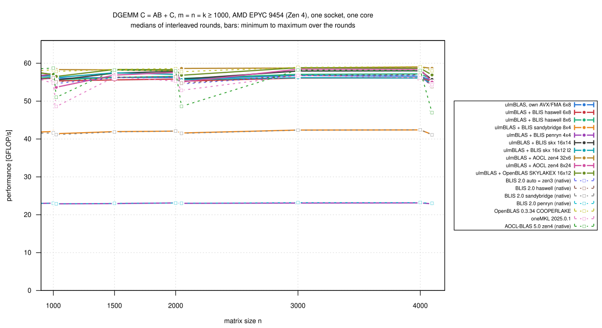
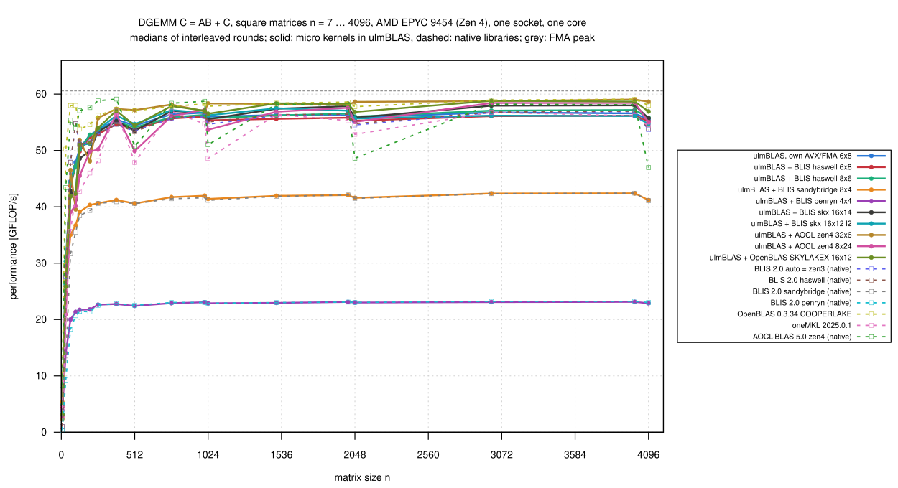
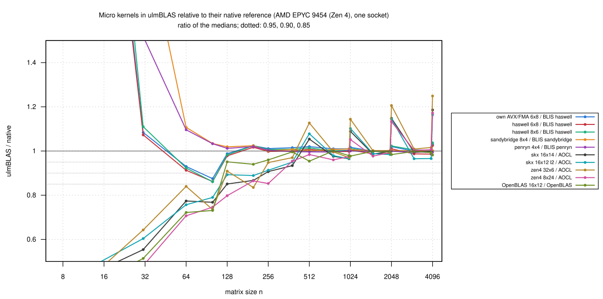

# AMD EPYC 9454 (Zen 4): the micro kernels inside ulmBLAS, one socket (2026-10-27)

**Preliminary, with weaker isolation.**  Exclusive nodes of the Zen 4
partition `cpu` were not expected for days (scheduler estimate 2026-10-28
to 2026-10-30), so I ran on **one socket** of a shared node; the exclusive
campaign is still queued.

- socket 1 of `uc3n002`: all 48 cores and 96 threads (CPUs 48-95,
  144-191), `--sockets-per-node=1 --cores-per-socket=48
  --cpus-per-task=96 --distribution=block:block`, not `--exclusive`
- the measured process bound to CPU 51 and its NUMA node 4
- other jobs ran on socket 0 all the time (node load average 22 to 44)
- the socket has its own L3 (8 CCDs of 32 MiB), memory controllers and
  power budget; shared were the OS, I/O and the links between the sockets

I measured all BLIS and AOCL kernels a Zen 4 core can run and the
OpenBLAS-derived kernel inside ulmBLAS (their default block sizes) against
native BLIS (`auto` = zen3, haswell, sandybridge, penryn), OpenBLAS 0.3.34
(COOPERLAKE, the same SKYLAKEX DGEMM kernel), oneMKL 2025.0.1 and AOCL-BLAS
5.0 (zen4, `bli_dgemm_zen4_asm_32x6`).  `zen5_8x24` is missing (this build,
f530d1a, had the AOCL 5.0 version with a defective beta test).

## Results

n = m = k >= 1000 (8 sizes, medians of 3 rounds); FMA peak of the core
60.5 GFLOP/s with ymm and with zmm:

| Variant | GFLOP/s | Reference | / reference: median (min … max) |
|---|---:|---|---|
| ulmBLAS + AOCL zen4 32 x 6 | 57.0-59.0 | native AOCL (same kernel) | 1.013 (0.970 … 1.249) |
| ulmBLAS + AOCL zen4 8 x 24 | 53.7-58.4 | native AOCL | 1.004 (0.975 … 1.172) |
| ulmBLAS + OpenBLAS SKYLAKEX 16 x 12 | 56.5-58.8 | native OpenBLAS (same kernel) | 0.988 (0.977 … 0.999) |
| ulmBLAS + BLIS skx 16 x 14 | 55.5-58.0 | native AOCL (no native BLIS skx on Zen 4) | 0.998 (0.965 … 1.186) |
| ulmBLAS + BLIS skx 16 x 12 l2 | 54.7-57.5 | native AOCL | 0.986 (0.965 … 1.164) |
| ulmBLAS, own AVX/FMA 6 x 8 | 55.5-56.8 | native BLIS haswell | 1.004 (0.993 … 1.030) |
| ulmBLAS + BLIS haswell 6 x 8 | 55.2-56.2 | native BLIS haswell | 0.993 (0.986 … 1.025) |
| ulmBLAS + BLIS haswell 8 x 6 | 55.7-57.2 | native BLIS haswell | 1.004 (0.998 … 1.037) |
| ulmBLAS + BLIS sandybridge 8 x 4 | 41.2-42.4 | native BLIS sandybridge | 1.002 (0.999 … 1.009) |
| ulmBLAS + BLIS penryn 4 x 4 | 22.9-23.1 | native BLIS penryn | 0.998 (0.994 … 1.002) |
| native OpenBLAS 0.3.34 | 57.8-59.1 | | |
| native AOCL-BLAS 5.0 | 47.0-58.7 | | |
| native BLIS 2.0 auto (zen3) | 53.7-56.9 | | |
| oneMKL 2025.0.1 | 48.6-56.8 | | |

- **Every kernel inside ulmBLAS reaches its native reference** (medians
  0.986 to 1.013)
  - the OpenBLAS-derived kernel 0.988 of native OpenBLAS (Ice Lake: 0.938)
- **The FMA throughput limits everything**
  - Zen 4 executes 512-bit FMAs in two passes, so AVX-512 does not raise
    the peak (60.5 GFLOP/s with ymm and zmm)
  - the AVX-512 kernels are only 0 to 4% faster than the AVX2/FMA ones;
    the fastest, AOCL zen4 32 x 6, reaches 0.94 to 0.98 of the peak
  - native BLIS 2.0 has no Zen 4 configuration (`auto` selects zen3 with
    the haswell 6 x 8 kernel)
- **Powers of two**: native AOCL reaches only 47.0 to 51.0 GFLOP/s at n =
  1024, 2048, 4096 (58 elsewhere; these are the maxima of the ratios to
  AOCL); AOCL's kernel inside ulmBLAS has no such dip
- MKL is 3 to 16% slower than OpenBLAS
- kernels without FMA: sandybridge 8 x 4 0.75, penryn 4 x 4 0.41 of the
  AVX/FMA kernels
- 1122 measurements, every first result checked up to 2e8 multiply-adds,
  none wrong; `verify-*` for n = 1000 ... 4096 (17 programs): no violation
- all kernels pass the ulmBLAS test suite on this CPU type
  ([kernels/tests](../../investigations/2026-10-bwunicluster3/kernels/tests/README.md))

## Setup and method

- **Allocation**: `uc3n002`, socket 1, Slurm job 8009214
  (`source/kernels-bench-socket.sbatch`)
- **CPU**: 2 x AMD EPYC 9454 (Zen 4), `amd-pstate` passive, governor
  performance, boost on; CPU 51 at 3.3 to 4.2 GHz before the runs
- **ulmBLAS**: f530d1a (own AVX/FMA, BLIS and AOCL kernels) and c0d9c06
  (OpenBLAS-derived kernel), GCC 14.2, `-O3`, flags as on Ice Lake
- **Native libraries** built on Zen 4 nodes: BLIS 2.0, OpenBLAS 0.3.34
  (COOPERLAKE); oneMKL and AOCL-BLAS from the modules
- `bench2.c` (7 samples >= 0.2 s, median, first result checked), square n
  = 7 ... 4096 and thin shapes, 3 rounds, 17 programs in rotated order; 89
  minutes
- summaries: `python3 source/summarize-kernels.py
  haswell=blis-haswell,sandybridge=blis-sandybridge,penryn=blis-penryn,skx=aocl,zen4=aocl,openblas-skylakex=openblas,avx=blis-haswell`

## Figures

<!-- BEGIN FIGURES (generated by make add_benchmark_result) -->

<!-- END FIGURES -->
