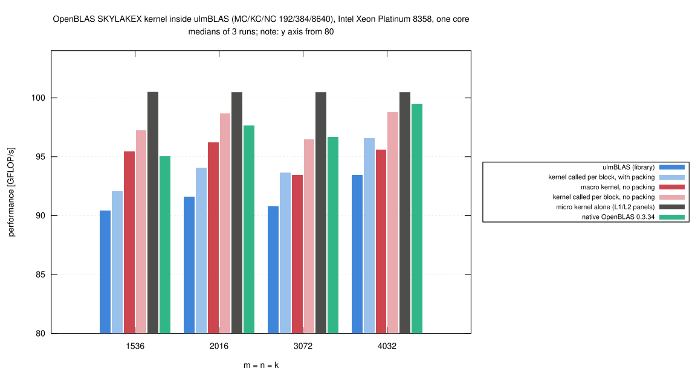

# Intel Xeon Platinum 8358: where the OpenBLAS kernel loses time inside ulmBLAS (2026-10-27)

Tuning iteration 1 (diagnosis) after
[014-2026-10-27-uc3-icelake-openblas-kernel](../014-2026-10-27-uc3-icelake-openblas-kernel/README.md),
where OpenBLAS's SKYLAKEX DGEMM kernel inside ulmBLAS reached 0.92 to 0.95
of native OpenBLAS for n >= 1000.  Is the gap in the kernel (or its
adapter), in the packing, or in the way ulmBLAS calls the kernel?

## Method

- `prof.cc` of campaign
  [003-2026-10-25-macbook-m5-profile](../003-2026-10-25-macbook-m5-profile/README.md)
  (unchanged): ulmBLAS's GEMM driver with timers
  - `lib` (the library call), `inst` (time in packing B, packing A, macro
    kernel), `nopack` (macro kernel without packing), `kern` (micro kernel
    alone on packed panels in cache), `cblas` (native OpenBLAS in the same
    program)
- `prof-ob.cc` adds `macro` and `macronopack`: one call of OpenBLAS's
  kernel function per packed MC x NC block, as OpenBLAS's driver does,
  instead of one call per 16 x 12 tile
  - only for m % 16 = 0 and n % 12 = 0 (the adapted B addressing covers
    the 16 x 12 path only), hence n = 1536, 2016, 3072, 4032
  - results checked against ulmBLAS::gemm (`mcheck-*.txt`: identical)
- block sizes 192/384/8640, exclusive `cpu_il` node, core 3
  - job 8009299 (`prof`, n = 1000, 1536, 2000, 4000, 2 runs, also BLIS skx
    16 x 14), job 8009801 (`prof-ob`, 3 runs)

## Results

GFLOP/s, medians of 3 runs (`data/summary/stages.csv`):

| n | ulmBLAS (library) | per block, with packing | macro kernel, no packing | per block, no packing | micro kernel alone | native OpenBLAS |
|---:|---:|---:|---:|---:|---:|---:|
| 1536 | 90.4 | 92.1 | 95.5 | 97.3 | 100.5 | 95.0 |
| 2016 | 91.6 | 94.1 | 96.2 | 98.7 | 100.5 | 97.7 |
| 3072 | 90.8 | 93.7 | 93.5 | 96.5 | 100.5 | 96.7 |
| 4032 | 93.4 | 96.6 | 95.6 | 98.8 | 100.5 | 99.5 |

- **The kernel is not the problem**: alone it reaches 99.6 to 100.5
  GFLOP/s inside ulmBLAS (0.95 of the zmm FMA peak of 105.2), more than
  native OpenBLAS in total
- **Calling it once per tile costs 1.9 to 3.3%**
  - one call per block is 1.019 to 1.033 times as fast as ulmBLAS's macro
    kernel, with or without packing
  - with per-block calls ulmBLAS would reach 0.963 to 0.971 of native
    OpenBLAS instead of 0.938 to 0.952
- **The rest is packing**
  - without packing the per-block variant is as fast as native OpenBLAS
    with its packing (0.993 to 1.023)
  - ulmBLAS spends 2.1% (n = 4000) to 6.0% (n = 1000) in packing, as a
    separate phase
  - OpenBLAS packs B in chunks of 12 columns interleaved with the first
    kernel calls
    ([analysis](../../investigations/2026-10-bwunicluster3/openblas/README.md)),
    which can overlap the memory accesses of packing with computation
- **BLIS skx 16 x 14 has the same structure**: kernel alone 87.4 to 87.5
  GFLOP/s, macro kernel without packing 82.5 to 84.4, library 78.7 to 82.2

In short: OpenBLAS's kernel delivers OpenBLAS's performance inside
ulmBLAS.  What ulmBLAS lacks are two properties of OpenBLAS's driver:
calling the kernel for a whole block and packing B interleaved with the
computation.  Both concern ulmBLAS's GEMM driver, shared by all kernels;
they are the candidates for the next iterations.

## Files

- `data/raw/prof-8009299/`, `data/raw/profob-8009801/`: outputs of the
  programs (`PROGRAM-N-RUN.txt`; columns: mode, order, MC, KC, NC, m, n, k,
  GFLOP/s, time per call, fractions packB, packA, mgemm, other)
- `data/runs.csv`, `data/summary/breakdown.csv`, `data/summary/stages.csv`:
  generated by `source/prof2csv.py` (run in this directory)
- `logs/`: build logs (programs and checksums) and run logs of both jobs
- `source/`: `prof.cc`, `packvar.h` (of 003-2026-10-25-macbook-m5-profile),
  `prof-ob.cc`, `prof.sbatch`, `prof-ob.sbatch`, `prof2csv.py`

## Figures

<!-- BEGIN FIGURES (generated by make add_benchmark_result) -->

<!-- END FIGURES -->
