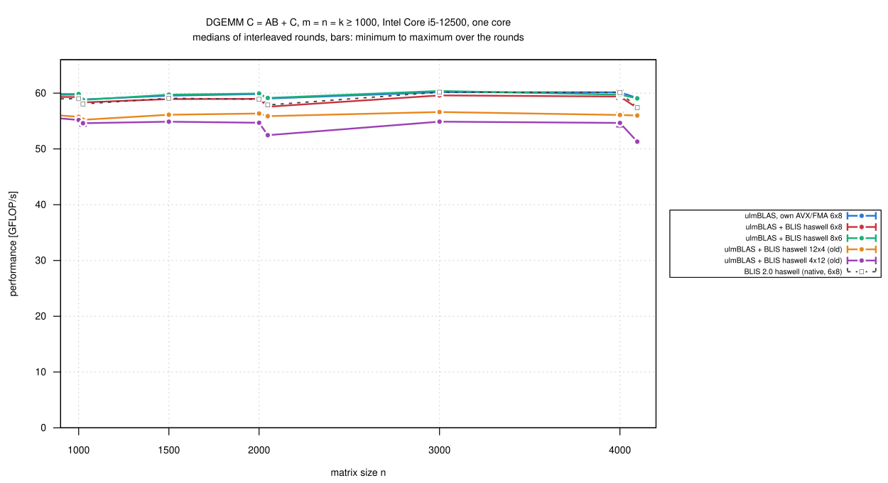
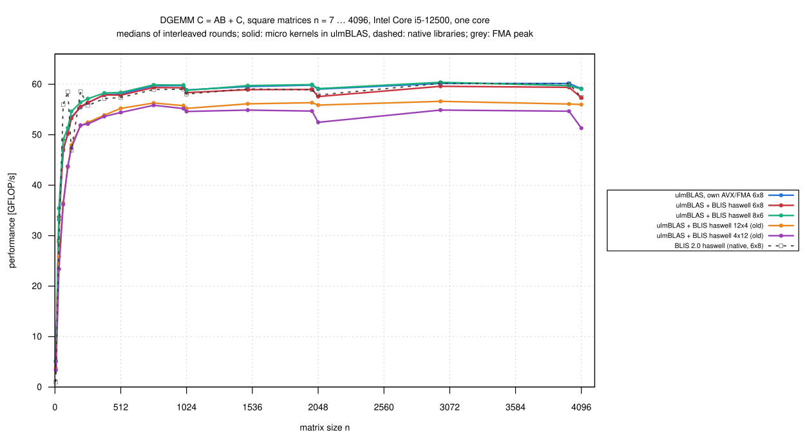
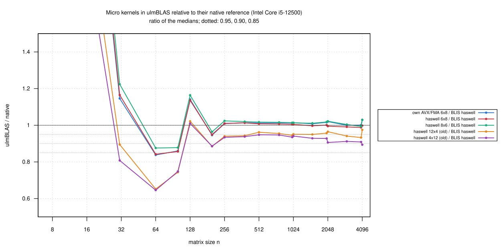

# Intel Core i5-12500: the old BLIS haswell kernels 12x4 and 4x12 inside ulmBLAS (2026-10-27)

The BLIS 0.x kernels `bli_dgemm_haswell_asm_12x4` and `_4x12` (BLIS 2.0
`kernels/haswell/3/old/`, AVX2/FMA) are neither built nor used by BLIS 2.0.
I vendored them with local labels (`ulmblas/level3/ukernel/blis/README.md`)
and measured them inside ulmBLAS 782af7e with the haswell block sizes
(72/256/4080), in the same rounds as the haswell 6 x 8 and 8 x 6 kernels
inside ulmBLAS, ulmBLAS's own AVX/FMA kernel and native BLIS 2.0 haswell
(6 x 8; no native BLIS uses the old kernels).

## Results

n = m = k >= 1000 (8 sizes, medians of 3 rounds), relative to native BLIS
haswell:

| Variant | Kernel | GFLOP/s | / BLIS haswell: median (min … max) |
|---|---|---:|---|
| ulmBLAS + BLIS haswell 12 x 4 (old) | 3 ymm x 4 accumulators per k: 3 loads of A, 4 broadcasts of B | 55.2-56.6 | 0.950 (0.933 … 0.975) |
| ulmBLAS + BLIS haswell 4 x 12 (old) | 4 broadcasts of A, 3 loads of B | 51.3-55.2 | 0.920 (0.894 … 0.941) |
| ulmBLAS + BLIS haswell 6 x 8 | 6 broadcasts of A, 2 loads of B | 57.3-59.6 | 0.998 (0.988 … 1.005) |
| ulmBLAS + BLIS haswell 8 x 6 | 2 loads of A, 6 broadcasts of B | 58.8-60.4 | 1.013 (0.994 … 1.029) |
| ulmBLAS, own AVX/FMA 6 x 8 (MC 288) | | 58.9-60.2 | 1.013 (1.000 … 1.030) |
| native BLIS 2.0 haswell (6 x 8) | | | 1 |

- **The old kernels reach 0.92 to 0.95 of native BLIS** with its current
  kernel, and they work correctly inside ulmBLAS (test suite on this CPU,
  also with ASan/UBSan, and on the Xeon Platinum 8358 and EPYC 9454:
  [kernels/tests](../../investigations/2026-10-bwunicluster3/kernels/tests/README.md))
- **The number of loads does not explain the difference**: both have 12
  accumulators like the current kernels and need 7 loads or broadcasts per
  12 FMAs (the current ones 8)
  - not investigated: BLIS replaced these kernels by 6 x 8 and 8 x 6
  - no tuning; they stay as additional selectable variants
- the other variants reproduce
  [011-2026-10-26-heim-blis-kernels](../011-2026-10-26-heim-blis-kernels/README.md)
  within 1%
- 396 measurements, none wrong; `verify-*` for n = 1000 ... 4096: no
  violation

## Setup and method

- heim (Intel Core i5-12500), core 3, ulmBLAS 782af7e with GCC 12.2 (flags
  in `logs/compile-commands.txt`); native BLIS haswell is the program of
  campaign 001
- `bench2.c` (7 samples >= 0.2 s, median, first result checked), square n
  = 7 ... 4096 and thin shapes, 3 rounds, 6 programs in rotated order
  (`source/kernels-heim-iter.sh`)
- the first measurement still had the builds in the load average (4.6);
  28 minutes
- summaries: `python3 source/summarize-kernels.py
  haswell=blis-haswell,avx=blis-haswell`

## Figures

<!-- BEGIN FIGURES (generated by make add_benchmark_result) -->

<!-- END FIGURES -->
