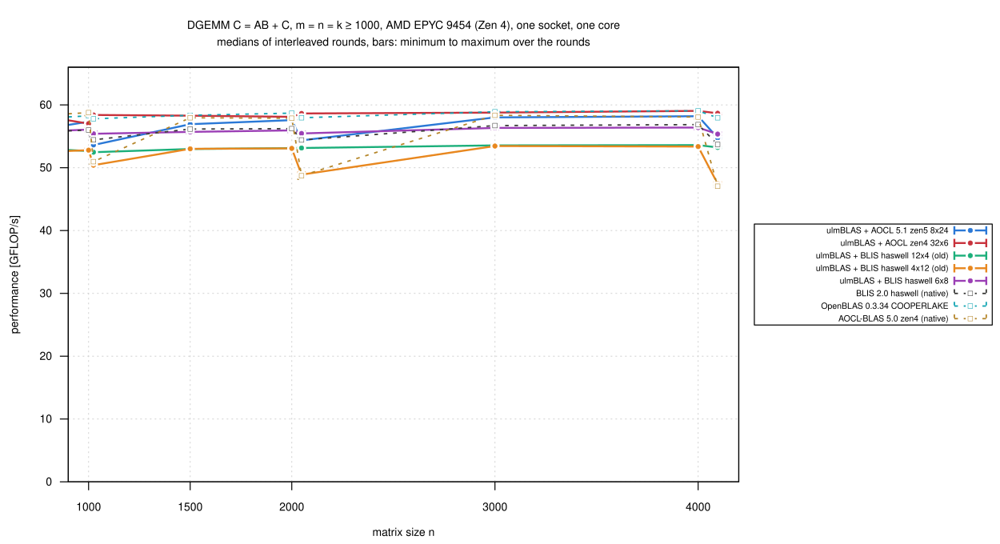
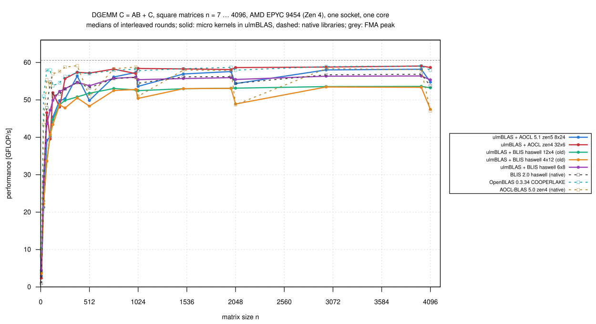
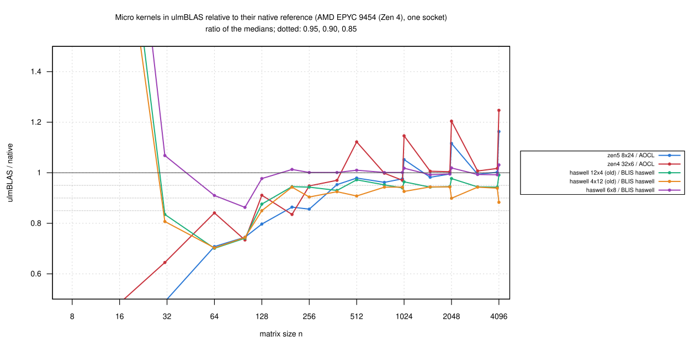

# AMD EPYC 9454 (Zen 4): zen5 8x24 and the old haswell kernels inside ulmBLAS, one socket (2026-10-27)

**Preliminary, with weaker isolation**, as
[015-2026-10-27-uc3-zen4-kernels-socket](../015-2026-10-27-uc3-zen4-kernels-socket/README.md):
socket 1 of `uc3n002` (CPUs 48-95, 144-191), other jobs on the other
socket (node load average 28 to 41), process bound to CPU 51 and NUMA node
4; Slurm job 8016286.

I measured the kernels added after campaign 015 (`zen5_8x24` of AOCL-BLAS
5.1, the BLIS 0.x kernels `haswell_12x4` and `haswell_4x12`) inside
ulmBLAS 782af7e with their default block sizes, in the same rounds as AOCL
zen4 32 x 6 and BLIS haswell 6 x 8 inside ulmBLAS, native BLIS haswell,
OpenBLAS (COOPERLAKE) and AOCL-BLAS (zen4).

## Results

n = m = k >= 1000 (8 sizes, medians of 3 rounds); FMA peak 60.5 GFLOP/s:

| Variant | GFLOP/s | Reference | / reference: median (min … max) |
|---|---:|---|---|
| ulmBLAS + AOCL 5.1 zen5 8 x 24 | 53.6-58.2 | native AOCL | 0.999 (0.976 … 1.163) |
| ulmBLAS + AOCL zen4 32 x 6 | 57.0-59.0 | native AOCL | 1.012 (0.970 … 1.247) |
| ulmBLAS + BLIS haswell 12 x 4 (old) | 52.5-53.6 | native BLIS haswell | 0.945 (0.940 … 0.991) |
| ulmBLAS + BLIS haswell 4 x 12 (old) | 47.5-53.5 | native BLIS haswell | 0.941 (0.883 … 0.944) |
| ulmBLAS + BLIS haswell 6 x 8 | 55.4-56.4 | native BLIS haswell | 0.998 (0.992 … 1.031) |
| native OpenBLAS 0.3.34 | 57.8-59.1 | | |
| native AOCL-BLAS 5.0 | 47.1-58.8 | | |

- **zen5 8 x 24 is as fast as native AOCL** on Zen 4 (median 0.999), but
  slightly slower than AOCL's Zen 4 kernel inside ulmBLAS at most sizes
  - the maxima of the ratios are the powers of two, where native AOCL dips
- **The old haswell kernels**: 0.945 and 0.941 of native BLIS haswell (Ice
  Lake: 0.947, 0.911; Core i5-12500: 0.950, 0.920)
- the programs of campaign 015 reproduce it within 1%
- 528 measurements, none wrong; `verify-*`: no violation

## Setup and method

- as in campaign 015 (`source/kernels-bench-socket.sbatch`); ulmBLAS
  782af7e for the new kernels, f530d1a for the others, GCC 14.2
- summaries: `python3 source/summarize-kernels.py
  haswell=blis-haswell,zen4=aocl,zen5=aocl`
- 38 minutes

## Figures

<!-- BEGIN FIGURES (generated by make add_benchmark_result) -->

<!-- END FIGURES -->
