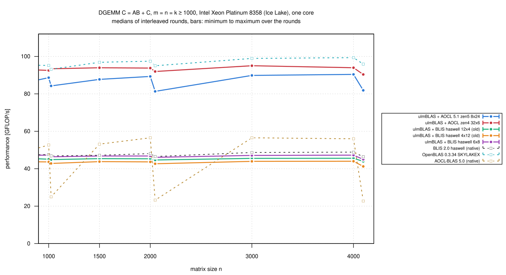
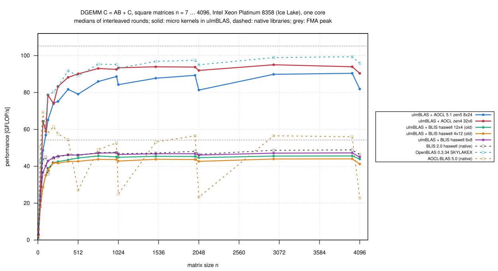
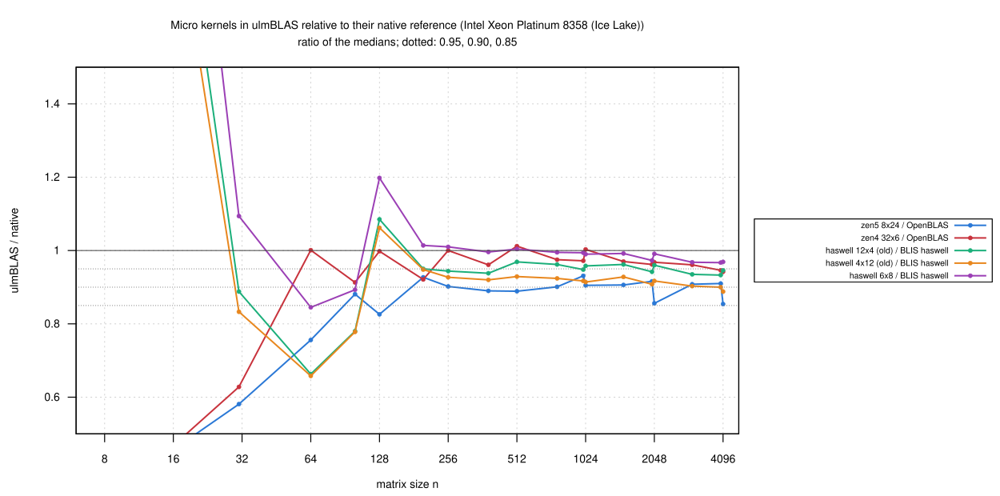

# Intel Xeon Platinum 8358 (Ice Lake): zen5 8x24 and the old haswell kernels inside ulmBLAS (2026-10-27)

I measured the kernels added after campaign
[012-2026-10-26-uc3-icelake-blis-kernels](../012-2026-10-26-uc3-icelake-blis-kernels/README.md)
inside ulmBLAS 782af7e with their default block sizes, on an exclusive
`cpu_il` node (core 3, NUMA node 0):

- `zen5_8x24` from AOCL-BLAS 5.1 (`bli_dgemm_avx512_asm_8x24`; the 5.0
  version has a defective test for beta = 0)
- the BLIS 0.x kernels `haswell_12x4` and `haswell_4x12`
  (`kernels/haswell/3/old/`)
- in the same rounds: AOCL zen4 32 x 6 and BLIS haswell 6 x 8 inside
  ulmBLAS (the programs of campaign 012), native BLIS haswell, OpenBLAS
  and AOCL-BLAS

## Results

n = m = k >= 1000 (8 sizes, medians of 3 rounds):

| Variant | Block sizes | GFLOP/s | Reference | / reference: median (min … max) |
|---|---|---:|---|---|
| ulmBLAS + AOCL 5.1 zen5 8 x 24 | 120/512/2016 | 81.3-90.4 | native OpenBLAS | 0.907 (0.854 … 0.931) |
| ulmBLAS + AOCL zen4 32 x 6 | 96/512/4002 | 90.4-95.0 | native OpenBLAS | 0.965 (0.942 … 1.003) |
| ulmBLAS + BLIS haswell 12 x 4 (old) | 72/256/4080 | 43.9-45.6 | native BLIS haswell | 0.947 (0.933 … 0.962) |
| ulmBLAS + BLIS haswell 4 x 12 (old) | 72/256/4080 | 41.2-44.0 | native BLIS haswell | 0.911 (0.888 … 0.928) |
| ulmBLAS + BLIS haswell 6 x 8 | 72/256/4080 | 45.0-47.3 | native BLIS haswell | 0.982 (0.967 … 0.994) |
| native OpenBLAS 0.3.34 | | 93.1-99.4 | | |
| native AOCL-BLAS 5.0 (zen4 32 x 6) | | 22.7-56.5 | | |

- **zen5 8 x 24** (the DGEMM kernel of AOCL's Zen 5 configuration) works
  on Ice Lake and reaches 0.91 of OpenBLAS, less than AOCL's Zen 4 kernel
  (0.965)
  - it has 24 zmm accumulators like zen4 32 x 6, but a row-preferring 8 x
    24 tile: ulmBLAS stores C column major, so the kernel transposes the
    tile in registers before storing it
  - block sizes of AOCL's zen5 configuration; no tuning attempted
- **The old haswell kernels**: 0.947 and 0.911 of native BLIS haswell (on
  heim 0.950 and 0.920,
  [017-2026-10-27-heim-blis-kernels-old](../017-2026-10-27-heim-blis-kernels-old/README.md))
- the programs of campaign 012 reproduce their values within 1%
- 528 measurements, every first result checked up to 2e8 multiply-adds,
  none wrong; `verify-*` for n = 1000 ... 4096: no violation
- all kernels pass the test suite on this CPU type
  ([kernels/tests](../../investigations/2026-10-bwunicluster3/kernels/tests/README.md))

## Setup and method

- Slurm job 8016285, node `uc2n723` (exclusive); ulmBLAS 782af7e (the new
  kernels, `source/kernels-build.sbatch`) and f530d1a, GCC 14.2
- `bench2.c` (7 samples >= 0.2 s, median, first result checked), square n
  = 7 ... 4096 and thin shapes, 3 rounds, 8 programs in rotated order
  (`source/kernels-bench.sbatch`); 40 minutes
- the load average still had the previous job at the start (22.7, down to
  1.0 in 3 minutes): round 1 of the first program (zen5 8 x 24) deviates by
  up to 3.4% at small sizes, less than 1% for n >= 1000
- summaries: `python3 source/summarize-kernels.py
  haswell=blis-haswell,zen4=openblas,zen5=openblas` (reference for the
  AOCL kernels is native OpenBLAS, since native AOCL is no reference on
  this Intel CPU, see campaign 010)

## Figures

<!-- BEGIN FIGURES (generated by make add_benchmark_result) -->

<!-- END FIGURES -->
