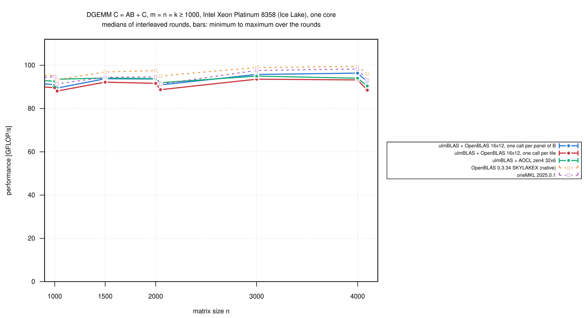
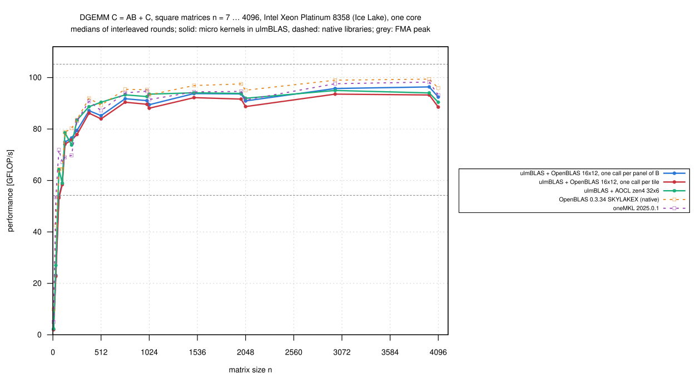
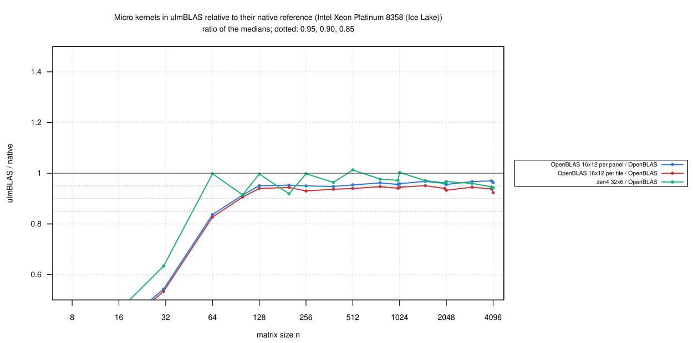

# Intel Xeon Platinum 8358 (Ice Lake): OpenBLAS's kernel inside ulmBLAS, one call per panel of B (2026-10-27)

Tuning iteration 2 of OpenBLAS's SKYLAKEX DGEMM kernel inside ulmBLAS
([ulmblas/level3/ukernel/openblas](../../ulmblas/level3/ukernel/openblas/README.md)).

- **Hypothesis** (from the diagnosis
  [016-2026-10-27-uc3-icelake-openblas-kernel-prof](../016-2026-10-27-uc3-icelake-openblas-kernel-prof/README.md)):
  one call per 16 x 12 tile costs 2 to 3% against one call for many tiles,
  as OpenBLAS's driver does it
- **Change** (968e250, one factor): the macro kernel `mgemm` computes all
  full 16-row tiles of a panel of B with one kernel call (m = 16 tiles, n
  = 12); partial tiles, block sizes (192, 384, 8640 as in OpenBLAS) and
  packing unchanged
- measured in the same rounds as the per-tile build of
  [014-2026-10-27-uc3-icelake-openblas-kernel](../014-2026-10-27-uc3-icelake-openblas-kernel/README.md)
  (c0d9c06), on an exclusive `cpu_il` node (core 3, NUMA node 0)

## Results

n = m = k >= 1000 (8 sizes, medians of 3 rounds):

| Variant | GFLOP/s | / native OpenBLAS: median (min … max) |
|---|---:|---|
| ulmBLAS + OpenBLAS 16 x 12, one call per panel of B (968e250) | 89.5-96.4 | **0.962** (0.956 … 0.970) |
| ulmBLAS + OpenBLAS 16 x 12, one call per tile (c0d9c06) | 88.1-93.6 | 0.940 (0.923 … 0.951) |
| ulmBLAS + AOCL zen4 32 x 6 | 90.4-95.0 | 0.965 (0.942 … 1.003) |
| native OpenBLAS 0.3.34 | 93.3-99.4 | |
| oneMKL 2025.0.1 | 91.3-98.3 | |

- **The hypothesis holds: one call per panel of B is 1.023 times as
  fast** (1.015 to 1.044) for n >= 1000
  - faster at every size and shape (1.009 to 1.047; thin k = 32 ... 256:
    1.020 to 1.032)
  - ulmBLAS with OpenBLAS's kernel now reaches 0.962 of native OpenBLAS
    (target: within 5%) and 0.985 of oneMKL
- the per-tile build reproduces campaign 014 (0.940 vs. 0.938)
- **The remaining 4% is the packing of B**: OpenBLAS packs B in chunks of
  12 columns interleaved with the first kernel calls, ulmBLAS packs the
  whole block of B first
  ([analysis](../../investigations/2026-10-bwunicluster3/openblas/README.md))
- for small matrices native OpenBLAS uses separate kernels
  (`dgemm_small_kernel_*`; n = 7: 0.21, n = 64: 0.84 of OpenBLAS)
- 330 measurements, every first result checked up to 2e8 multiply-adds,
  none wrong; `verify-*` for n = 1000 ... 4096: no violation
- 968e250 passes the test suite on Ice Lake and Zen 4
  ([kernels/tests](../../investigations/2026-10-bwunicluster3/kernels/tests/README.md))

## Setup and method

- Slurm job 8016696, node `uc2n858` (exclusive)
- ulmBLAS 968e250 and c0d9c06, both `ARCHFLAGS="-mavx -mfma -mavx512f
  -DULMBLAS_DGEMM_UKERNEL_openblas_skylakex_16x12"`; f530d1a for AOCL zen4
  32 x 6; GCC 14.2
- `bench2.c` (7 samples >= 0.2 s, median, first result checked), square n
  = 7 ... 4096 and thin shapes, 3 rounds, 5 programs in rotated order
  (`source/kernels-bench.sbatch`); load average 0.3 to 1.0; 19 minutes
- summaries: `python3 source/summarize-kernels.py
  openblas-skylakex_16x12=openblas,zen4=openblas`

## Figures

<!-- BEGIN FIGURES (generated by make add_benchmark_result) -->

<!-- END FIGURES -->
