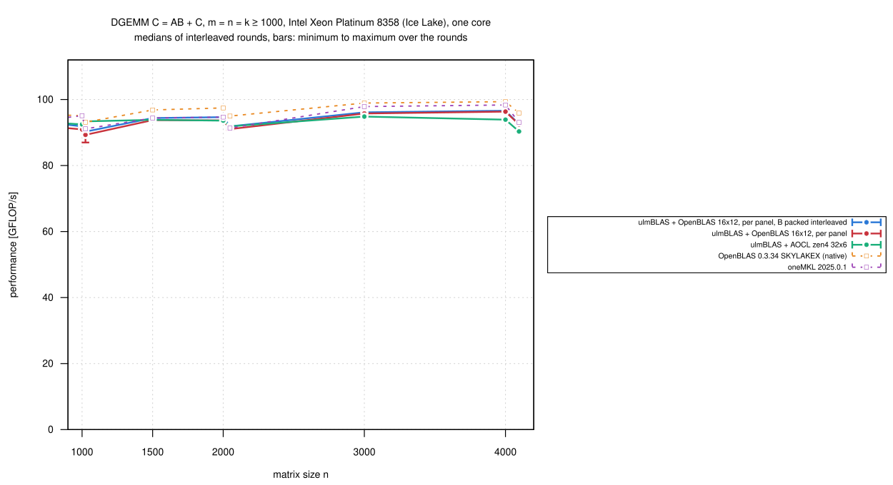
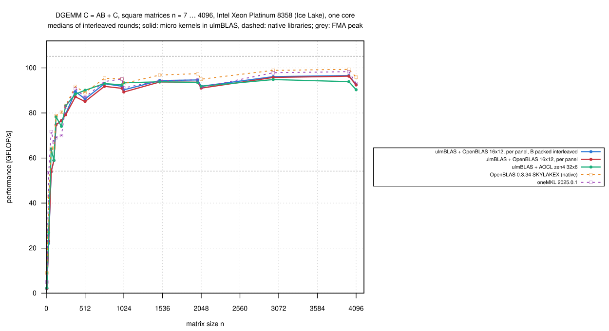
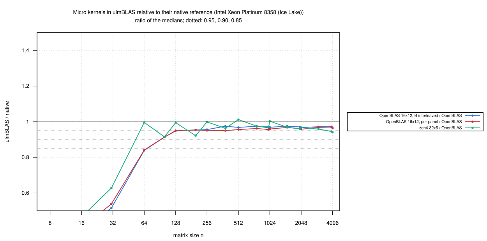

# Intel Xeon Platinum 8358 (Ice Lake): OpenBLAS's kernel inside ulmBLAS, B packed interleaved (2026-10-27)

Tuning iteration 3, the last, of OpenBLAS's SKYLAKEX DGEMM kernel inside
ulmBLAS
([ulmblas/level3/ukernel/openblas](../../ulmblas/level3/ukernel/openblas/README.md)).

- **Hypothesis** (from the
  [diagnosis](../016-2026-10-27-uc3-icelake-openblas-kernel-prof/README.md)
  and the [analysis of OpenBLAS's driver](../../investigations/2026-10-bwunicluster3/openblas/README.md)):
  after iteration 2
  ([020-2026-10-27-uc3-icelake-openblas-kernel-panel](../020-2026-10-27-uc3-icelake-openblas-kernel-panel/README.md),
  0.962 of OpenBLAS) the gap is the packing of B, which ulmBLAS does for
  the whole block first, while OpenBLAS packs B in chunks interleaved with
  the kernel calls for the first block of A
- **Change** (ac2d97e, one factor): for the first block of A, DGEMM packs
  each panel of 12 columns of B and computes it right away; packed layout,
  kernel calls, block sizes and packing code unchanged
- measured in the same rounds as iteration 2 (968e250), exclusive
  `cpu_il` node (core 3, NUMA node 0)

## Results

n = m = k >= 1000 (8 sizes, medians of 3 rounds):

| Variant | GFLOP/s | / native OpenBLAS: median (min … max) |
|---|---:|---|
| ulmBLAS + OpenBLAS 16 x 12, B packed interleaved (ac2d97e) | 90.3-96.6 | **0.970** (0.965 … 0.975) |
| ulmBLAS + OpenBLAS 16 x 12, iteration 2 (968e250) | 89.3-96.3 | 0.963 (0.956 … 0.970) |
| ulmBLAS + AOCL zen4 32 x 6 | 90.3-94.8 | 0.964 (0.942 … 1.003) |
| native OpenBLAS 0.3.34 | 93.1-99.3 | |
| oneMKL 2025.0.1 | 91.1-98.3 | |

- **The hypothesis holds only in part**: packing B interleaved is 1.008
  times as fast (1.001 to 1.011) for n >= 1000
  - up to 1.027 for n = 384 ... 768; thin k = 32 ... 256: 0.999 to 1.005
  - ulmBLAS with OpenBLAS's kernel reaches 0.970 of native OpenBLAS and
    0.992 of oneMKL
- **Most of the remaining 3% is not the order of packing and computing**
  - not measured; candidates: the packing itself (OpenBLAS uses copy
    kernels for SKYLAKEX, ulmBLAS generic C++; 2 to 6% of the time in the
    diagnosis) and OpenBLAS's balanced remainders of k and m
- **n <= 31: the interleaved variant is 4 to 5% slower** (n = 7: 1.95 to
  2.05 vs. 2.06 to 2.07 GFLOP/s; n = 31: rounds overlap), not slower from
  n = 64
  - these matrices are a single partial panel of B; not investigated
- iteration 2 reproduces its campaign (0.963 vs. 0.962)
- 330 measurements, every first result checked up to 2e8 multiply-adds,
  none wrong; `verify-*` for n = 1000 ... 4096: no violation
- ac2d97e passes the test suite on Ice Lake and Zen 4
  ([kernels/tests](../../investigations/2026-10-bwunicluster3/kernels/tests/README.md))

## The three tuning iterations

| Iteration | Change | / native OpenBLAS (n ≥ 1000) |
|---|---|---|
| 1 ([014-2026-10-27-uc3-icelake-openblas-kernel](../014-2026-10-27-uc3-icelake-openblas-kernel/README.md)) | OpenBLAS's kernel inside ulmBLAS, OpenBLAS's block sizes, one call per tile | 0.938 |
| 2 ([…-panel](../020-2026-10-27-uc3-icelake-openblas-kernel-panel/README.md)) | one call per panel of B | 0.962 |
| 3 (this campaign) | B packed interleaved with the first block of A | 0.970 |

## Setup and method

- Slurm job 8016952, node `uc2n630` (exclusive)
- ulmBLAS ac2d97e and 968e250, both `ARCHFLAGS="-mavx -mfma -mavx512f
  -DULMBLAS_DGEMM_UKERNEL_openblas_skylakex_16x12"`; f530d1a for AOCL zen4
  32 x 6; GCC 14.2
- `bench2.c` (7 samples >= 0.2 s, median, first result checked), square n
  = 7 ... 4096 and thin shapes, 3 rounds, 5 programs in rotated order
  (`source/kernels-bench.sbatch`); load average 0.3 to 1.0; 19 minutes
- summaries: `python3 source/summarize-kernels.py
  openblas-skylakex_16x12=openblas,zen4=openblas`

## Figures

<!-- BEGIN FIGURES (generated by make add_benchmark_result) -->

<!-- END FIGURES -->
