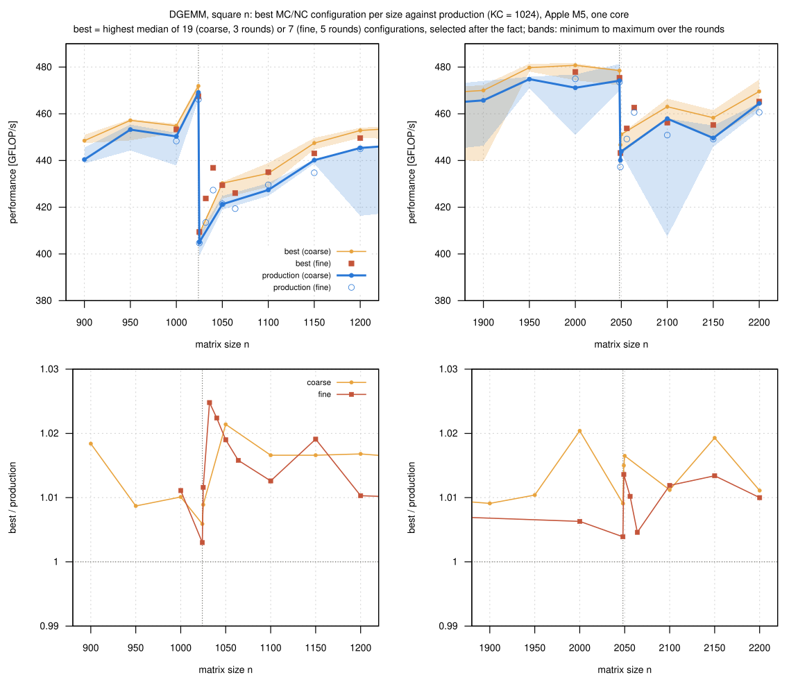
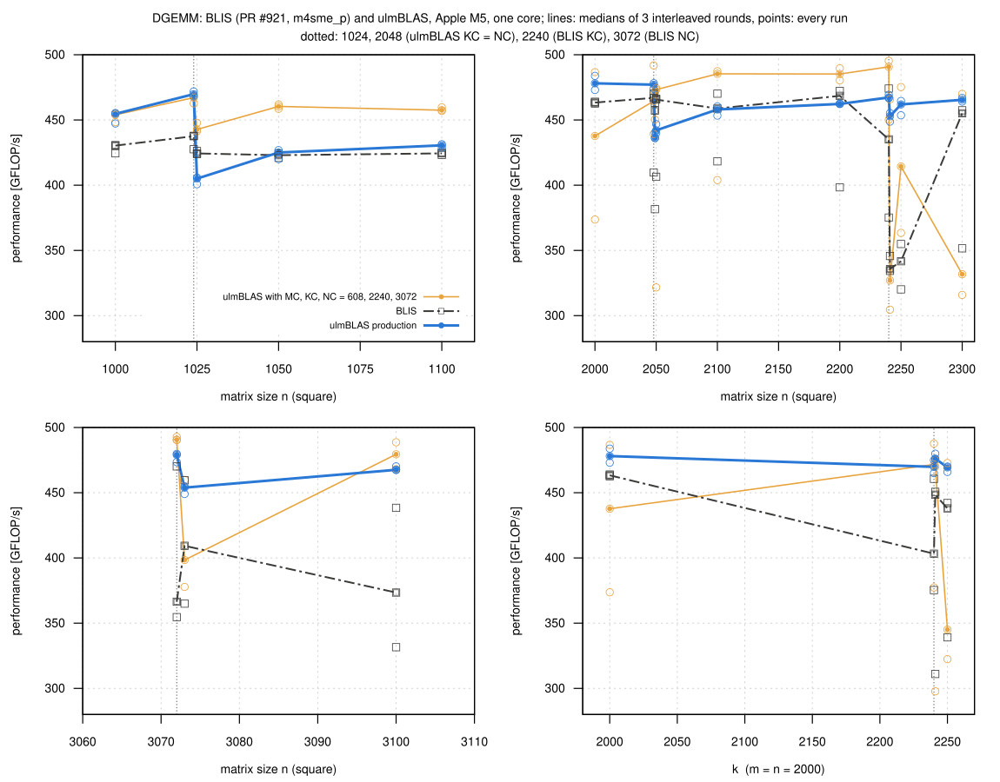
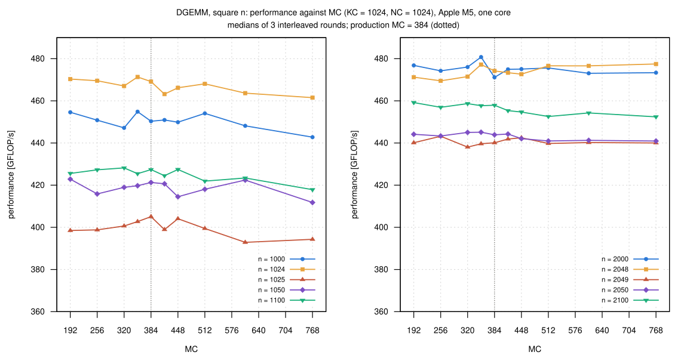
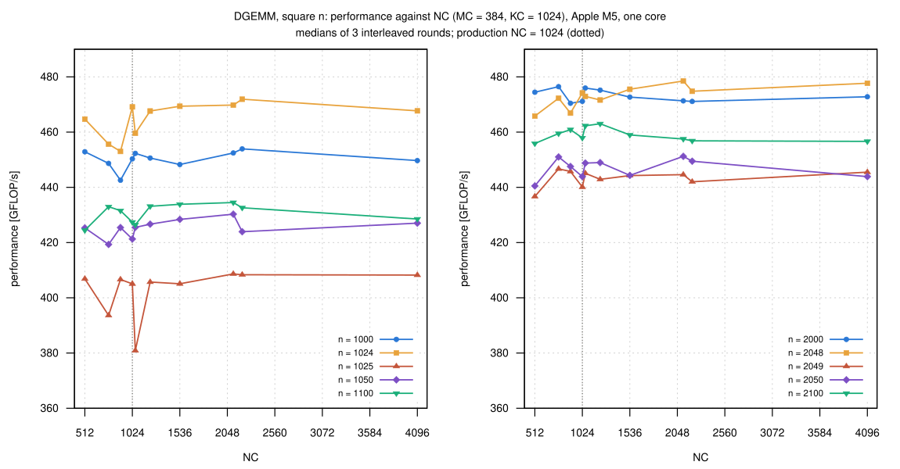
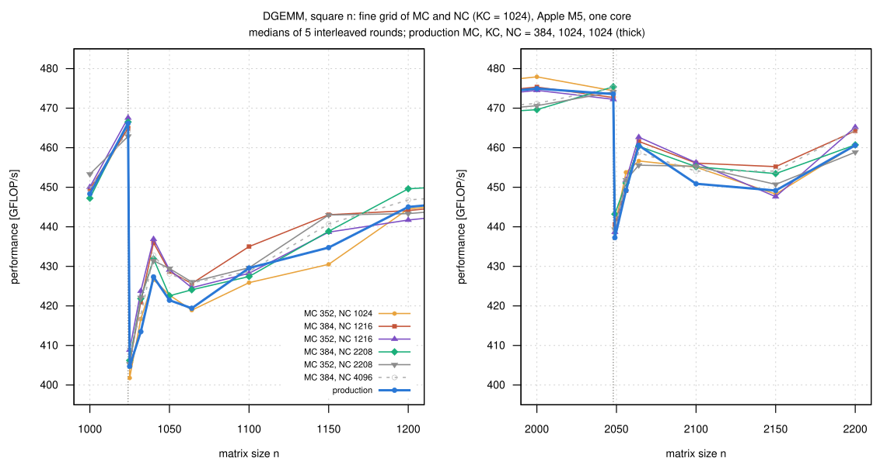
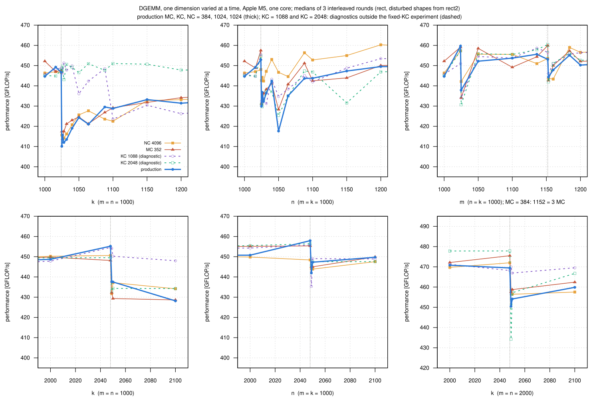
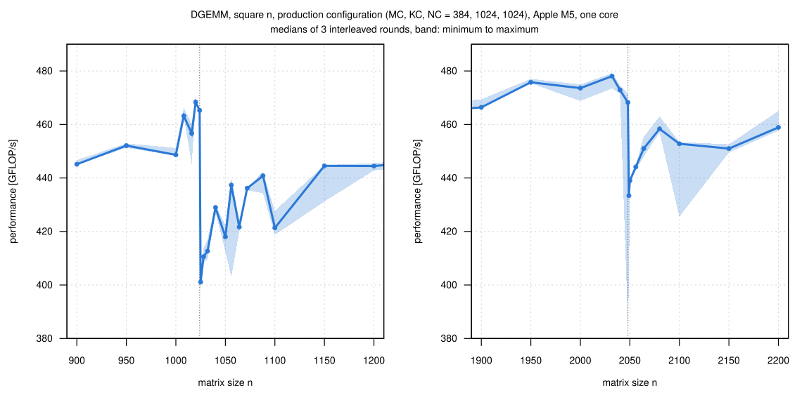

# DGEMM blocking on the Apple M5: the drops after n = 1024 and 2048, MC and NC, and BLIS

The SME2 backend loses 6 to 7% from n = 1000 to 1050 and from 2000 to
2050 (campaign
[007-2026-10-26-macbook-m5-sme-small](../007-2026-10-26-macbook-m5-sme-small/README.md),
item 4 of its sweep), while BLIS pull request #921 shows no step at 2050.
I wanted to know where the drops come from.  This is an experiment, not an
optimization: production (master 21197f2) is unchanged, every
configuration is a build of that commit with other block sizes.

- main experiment: MC and NC varied, KC = 1024 (production) fixed
- two builds with KC = 1088 and 2048 are diagnostics: they only test where
  the drop sits
- measurements 2026-10-26 19:49 to 2026-10-27 12:01; the tables use 19:49
  to 07:02 (see [Method](#method))

## Short answer

- **The drops come from the k direction**
  - with KC = 1024, k = 1025 gives the blocks 1024 + 1; the extra k block
    costs a roughly fixed 200 to 420 µs at m = n = 1000, as much as 50 to
    90 further columns of k
  - a second n block costs less (n = 1025: -5%, of which NC >= n recovers
    3 points)
- **MC and NC do not remove the drops**
  - all 26 configurations lose 12 to 15% from n = 1024 to 1025 and 6 to 8%
    from 2048 to 2049
  - the best MC/NC are at most 1 to 2.5% faster than production, mostly
    noise
- **BLIS has the same kind of step at other sizes**: its KC = 2240 and NC
  = 3072, and it does not merge remainder blocks in this configuration
  ([BLIS](#blis-pr-921-why-it-has-no-step-at-1050-and-2050))
- **ulmBLAS with BLIS's block sizes has no step at 1025 and 2049 either**
  (5 to 9% faster than production there), but it is no free replacement:
  slower for small m (campaign 005) and, like BLIS, switching between a
  fast and a slow state from run to run for n >= 2000

## Baseline: the SME2 GEMM of ulmBLAS (master 21197f2)

| | double, SME2 (`USE_SME`) |
|---|---|
| micro kernel | MR × NR = 32 × 16 in the eight 8 × 8 tiles ZA0.D … ZA7.D (SVL 512 bit), eight FMOPA per k (`ulmblas/level3/ukernel/sme/ugemm.tcc`; derived from the BLIS kernel `bli_dgemm_armsme_int_4SVLx2SVL`, see below) |
| block sizes | MC = 384, KC = 1024, NC = 1024 (`ulmblas/config/blocksize.h`) |
| loop order (`ulmblas/level3/gemm.tcc`) | j: n in blocks of NC → l: k in blocks of KC → pack B (kc × nc) → i: m in blocks of MC → pack A (mc × kc) → macro kernel: tiles MR × NR (jr outer, ir inner), one micro kernel call per tile |
| remainders | full blocks, then one smaller remainder block at the end, in m, n and k; no balancing, no merging |
| packing | B once per (n, k) block; A once per (m, k) block *of every n block*, i.e. n_blocks times in total |
| accumulation over k | every micro kernel call loads its tile of C into ZA, adds the products of its k block and stores the tile: C passes through ZA once per k block |
| partial tiles | handled in the micro kernel with predicates (no extra buffer) |

For square n the number of k blocks and of micro kernel calls jumps at
1025 and 2049 (`data/summary/*.csv`, columns `k_blocks`, `ukernel_calls`,
from `source/decomp.py`; BLIS's counts checked against BLIS itself):

| n | m blocks | n blocks | k blocks | calls | A packed | BLIS PR #921: m blocks | k blocks | calls |
|---:|---|---|---|---:|---:|---|---|---:|
| 1000 | 384 + 384 + 232 | 1000 | 1000 | 2016 | 1× | 608 + 392 | 1000 | 2016 |
| 1024 | 384 + 384 + 256 | 1024 | 1024 | 2048 | 1× | 608 + 416 | 1024 | 2048 |
| 1025 | 384 + 384 + 257 | 1024 + 1 | 1024 + 1 | 4290 | 2× | 608 + 417 | 1025 | 2145 |
| 1050 | 384 + 384 + 282 | 1024 + 26 | 1024 + 26 | 4356 | 2× | 608 + 442 | 1050 | 2178 |
| 1100 | 384 + 384 + 332 | 1024 + 76 | 1024 + 76 | 4830 | 2× | 608 + 492 | 1100 | 2415 |
| 2000 | 5 × 384 + 80 | 1024 + 976 | 1024 + 976 | 15750 | 2× | 3 × 608 + 176 | 2000 | 7875 |
| 2048 | 5 × 384 + 128 | 1024 + 1024 | 1024 + 1024 | 16384 | 2× | 3 × 608 + 224 | 2048 | 8192 |
| 2049 | 5 × 384 + 129 | 1024 + 1024 + 1 | 1024 + 1024 + 1 | 25155 | 3× | 3 × 608 + 225 | 2049 | 8385 |
| 2050 | 5 × 384 + 130 | 1024 + 1024 + 2 | 1024 + 1024 + 2 | 25155 | 3× | 3 × 608 + 226 | 2050 | 8385 |
| 2100 | 5 × 384 + 180 | 1024 + 1024 + 52 | 1024 + 1024 + 52 | 26136 | 3× | 3 × 608 + 276 | 2100 | 8712 |

(BLIS: one n block for n <= 3072, A packed once.)

## 1. Reproduction (production)

`data/summary/repro.csv`, 33 square sizes, 3 interleaved rounds:

| n | GFLOP/s | µs per call | | n | GFLOP/s | µs per call |
|---:|---:|---:|---|---:|---:|---:|
| 1000 | 448.6 | 4458 | | 2000 | 473.6 | 33785 |
| 1024 | 465.3 | 4616 | | 2048 | 468.2 | 36692 |
| **1025** | **401.1** | 5370 | | **2049** | **433.4** | 39699 |
| 1028 | 410.6 | 5292 | | 2050 | 439.0 | 39247 |
| 1032 | 412.7 | 5327 | | 2056 | 444.1 | 39138 |
| 1040 | 429.0 | 5245 | | 2064 | 451.0 | 38991 |
| 1050 | 418.0 | 5539 | | 2080 | 458.4 | 39266 |
| 1100 | 421.4 | 6318 | | 2100 | 452.8 | 40907 |
| 1200 | 444.5 | 7776 | | 2200 | 458.9 | 46405 |

- the drops sit exactly after 1024 and 2048 (-13.8% and -7.4%): one more
  row and column cost 754 µs (16%) and 3007 µs (8%)
- they recover slowly (1200: still -4.5% against 1024)
- between 1024 and 1200 the curve is not monotone (1056: 437, 1064: 422,
  1072: 436, 1100: 421; see Noise)

## 2. MC and NC (KC = 1024 fixed)

- **Coarse grid** (`coarse.csv`, `coarse_mc.svg`, `coarse_nc.svg`): 19
  configurations x 18 square sizes (n = 900 ... 1200, 1900 ... 2200 in
  steps of 50, and 1024, 1025, 2048, 2049) x 3 rounds
  - MC = 192, 256, 320, 352, 384, 416, 448, 512, 608, 768 with NC = 1024
    (352 gives three balanced blocks for n of about 1050)
  - NC = 512, 768, 896, 1024, 1056, 1216, 1536, 2112, 2208, 4096 with MC =
    384 (1056 and 1216: one block for n <= 1056 or 1216; 2112: two balanced
    blocks for n of about 2100; 2208, 4096: one block for all n <= 2200)
- **Fine grid** (`fine.csv`, `fine.svg`): MC in {352, 384} x NC in {1024,
  1216, 2208}, and NC = 4096, at 18 sizes with finer steps after 1024 and
  2048, 5 rounds

Ratios to production, medians (+ / -: clearly faster / slower, otherwise
noise; coarse grid, 3 rounds, all 19 configurations in `coarse.csv`):

| configuration | 1000 | 1024 | 1025 | 1050 | 1100 | 1150 | 1200 | 2000 | 2048 | 2049 | 2050 | 2100 | 2200 |
|---|---|---|---|---|---|---|---|---|---|---|---|---|---|
| MC 192 | 1.010 | 1.003 | 0.984 | 1.004 | 0.996 | 0.993 | 1.005 | 1.012 | 0.994 | 1.000 | 1.000 | 1.003 | 0.991 |
| MC 352 | 1.010+ | 1.005 | 0.994 | 0.996 | 0.995 | 0.987 | 1.000 | 1.020 | 1.006 | 0.999 | 1.003 | 1.000 | 1.002 |
| MC 512 | 1.008 | 0.998 | 0.986 | 0.992 | 0.987 | 0.997 | 0.993 | 1.010 | 1.005 | 0.999 | 0.993 | 0.988 | 0.994 |
| MC 768 | 0.983 | 0.984− | 0.974− | 0.978− | 0.978− | 0.977 | 0.983 | 1.005 | 1.007 | 1.000 | 0.993 | 0.988 | 0.997 |
| NC 512 | 1.006 | 0.991 | 1.004 | 1.010 | 0.993 | 0.993 | 0.996 | 1.007 | 0.982− | 0.992 | 0.992 | 0.996 | 0.992 |
| NC 896 | 0.983 | 0.966− | 1.004 | 1.010 | 1.010 | 1.006 | 1.004 | 0.999 | 0.985 | 1.013 | 1.008 | 1.006 | 1.010 |
| NC 1216 | 1.001 | 0.997 | 1.002 | 1.013+ | 1.013 | 1.012+ | 1.003 | 1.009 | 0.995 | 1.006 | 1.011+ | 1.011 | 1.007 |
| NC 2112 | 1.005 | 1.001 | 1.009 | 1.021 | 1.017 | 0.998 | 1.017+ | 1.000 | 1.009 | 1.010+ | 1.016 | 0.999 | 0.995 |
| NC 4096 | 0.999 | 0.997 | 1.008 | 1.014 | 1.003 | 1.017+ | 1.009 | 1.004 | 1.007 | 1.012 | 1.000 | 0.997 | 1.001 |
| production (GFLOP/s) | 450.3 | 469.1 | 405.1 | 421.3 | 427.4 | 440.1 | 445.4 | 471.1 | 474.2 | 440.1 | 443.9 | 457.9 | 464.4 |

Geometric means of the ratios over the sizes:

| | n = 900 … 1200 | n = 1900 … 2200 |
|---|---|---|
| coarse: MC 192 … 512 (NC 1024) | 0.995 to 1.001 | 0.997 to 1.004 |
| coarse: MC 608, 768 | 0.990, 0.979 (2 and 5 of 9 sizes clearly slower) | 0.998, 0.999 |
| coarse: NC 512, 768, 896 | 0.993 to 0.999 (NC 896: 3 clearly slower) | 0.994 to 1.005 |
| coarse: NC 1056 … 4096 | 0.993 to 1.008 | 1.003 to 1.005 |
| fine (5 rounds): NC 1216, 2208, 4096 (MC 352 or 384) | 1.006 to 1.010 (at most 2 of 10 sizes clearly faster) | 1.000 to 1.005 (none clearly) |
| fine: MC 352, NC 1024 | 0.998 | 1.003 |

- the best configuration per size (`best.csv`, `best.svg`) is 0.3 to 2.5%
  faster than production, but it is picked after the fact from many noisy
  medians and so biased upwards
- only 9 of 36 size/grid pairs are clearly faster, by 1.0 to 2.5%; the
  winner changes from size to size and between the grids

## 3. One dimension at a time

`rect.csv`, `rect2.csv`, `rect.svg`; production, NC = 4096 (one n block),
MC = 352, and the diagnostics KC = 1088 and 2048; 3 rounds.

**k varied, m = n = 1000** (only the k blocks change).  Delta t:
production minus KC = 2048 in µs per call, the cost of the second k block:

(+ / -: clearly faster / slower than production.)

- **The drop follows KC**
  - KC = 1024: -8.2% from k = 1024 to 1025, 4 to 8% lower up to 1200
  - KC = 1088: no drop for k = 1025 ... 1088; it appears at 1100 = 1088 +
    12
  - KC = 2048: no drop up to 2048; it appears at 2049 (433.1, as low as
    production)
  - MC = 352 and NC = 4096 drop exactly like production
- **An extra k block has a roughly fixed cost**: 205 to 421 µs at m = n =
  1000 whether it holds 1 or 176 values of k, as much as 45 to 95 columns
  of k at full speed (4.48 µs each); largest for the thinnest blocks (k =
  1 ... 8: 350 to 421 µs; k >= 64: 205 to 250)
- per extra k block ulmBLAS makes one more pass over C through ZA (2016
  more kernel calls, 8 MB of C read and written again), packs a thin A and
  B block and enters streaming mode 2016 more times; the measurements do
  not separate these parts
  - *hypothesis*: the pass over C dominates (16 MB in 205 to 421 µs is 38
    to 78 GB/s), and very thin blocks cannot hide the tile load and store
    behind their few FMOPA steps

**n varied, m = k = 1000** (one k block; the n blocks change, and with them
how often A is packed).  Delta t: production minus NC = 4096:

| n | n blocks (production) | production | µs per call | NC 4096 | Δt [µs] | KC 2048 |
|---:|---|---:|---:|---:|---:|---:|
| 1000 | 1000 | 444.7 | 4498 | 446.3 | 16 | 445.1 |
| 1024 | 1024 | 452.9 | 4522 | 448.1 | −49 | 454.7 |
| **1025** | 1024 + 1 | **429.9** | 4768 | 442.6+ | 136 | 431.0 |
| 1026 | 1024 + 2 | 436.8 | 4698 | 444.2+ | 78 | 429.7 |
| 1032 | 1024 + 8 | 436.4 | 4730 | 447.2+ | 114 | 437.3 |
| 1040 | 1024 + 16 | 442.3 | 4702 | 453.0+ | 111 | 437.2 |
| 1050 | 1024 + 26 | 417.6 | 5028 | 446.7 | 327 | 425.4 |
| 1064 | 1024 + 40 | 435.1 | 4891 | 444.6+ | 104 | 435.0 |
| 1100 | 1024 + 76 | 443.8 | 4958 | 452.8+ | 99 | 446.9 |
| 1200 | 1024 + 176 | 449.5 | 5339 | 460.3 | 125 | 446.9 |
| 2048 | 1024 + 1024 | 457.9 | 8945 | 448.4 | | 456.4 |
| 2049 | 1024 + 1024 + 1 | 442.0 | 9272 | 444.0 | | 445.7 |

- a second n block costs 5% at n = 1025 (453 -> 430), less than a second
  k block (8%)
- NC = 4096 (A packed once) is clearly faster at 6 of 11 sizes n = 1025
  ... 1200, by about 80 to 140 µs (2 to 3%); at n = 1050 the production
  median is low (spread 9%), the 327 µs are not representative
- even with NC = 4096, n = 1025 is 1.3% slower than 1024 (+61 µs): 32 more
  kernel calls on single-column tiles cost about as much as 32 full tiles;
  this padding is the same for all configurations
- *interpretation* (not measured separately): the ~100 µs are the second
  packing of A (8 MB read and written) plus one more pass of the macro
  kernel over A for a thin block of columns

**m varied, n = k = 1000** (only the m blocks and the tile rows change;
rect2 for m >= 1024):

| m | m blocks (production) | tile rows | production | µs per call | NC 4096 | MC 352 | KC 2048 |
|---:|---|---:|---:|---:|---:|---:|---:|
| 1000 | 384 + 384 + 232 | 32 | 444.7 | 4498 | 446.3 | 452.2+ | 445.1 |
| 1024 | 384 + 384 + 256 | 32 | 459.7 | 4456 | 457.3 | 459.1 | 457.3 |
| 1025 | 384 + 384 + 257 | 33 | 437.9 | 4682 | 442.1 | 434.1 | 430.7 |
| 1050 | 384 + 384 + 282 | 33 | 452.2 | 4644 | 455.6 | 458.5 | 455.9 |
| 1100 | 384 + 384 + 332 | 35 | 453.7 | 4849 | 455.5 | 449.2 | 455.5 |
| 1136 | 384 + 384 + 368 | 36 | 455.6 | 4987 | 451.0 | 454.4 | 457.8 |
| 1152 | 384 + 384 + 384 | 36 | 453.1 | 5085 | 453.5 | 459.9 | 460.5 |
| **1153** | 384 + 384 + 384 + 1 | 37 | **444.3** | 5190 | 443.7 | 442.7 | 442.0 |
| 1160 | 384 + 384 + 384 + 8 | 37 | 447.9 | 5180 | 443.4 | 450.0 | 451.0 |
| 1184 | 384 + 384 + 384 + 32 | 37 | 455.1 | 5203 | 459.0 | 457.3 | 456.2 |
| 1200 | 384 + 384 + 384 + 48 | 38 | 450.3 | 5330 | 456.6 | 452.1 | 452.6 |
| 2000 | 5 × 384 + 80 | 63 | 467.4 | 8557 | 467.6 | 463.0 | 460.8 |

- **no step at the MC boundary itself**: 1152 -> 1153 adds an m block of
  one row and one tile row: -1.9% (+105 µs); 1024 -> 1025 adds only a tile
  row: -4.7% (+226 µs)
- a tile row of 32 rows costs about 140 µs at full speed, so both steps
  have the size of the padding (*interpretation*); the m direction costs
  padding, not blocking
- no configuration differs clearly from production for m >= 1024
- the 1025 medians of three configurations contain one disturbed run; with
  rounds 2 and 3 only the picture is the same (-4.3% at 1025, -2.5% at
  1153)

**k varied, m = n = 2000** (rect2).  Delta t: production minus KC = 1088
(which splits k = 2049 ... 2100 into 1088 + 961 ... 1012; KC = 2048 into
2048 + 1 ... 52):

| k | k blocks (production) | production | µs per call | KC 1088 | Δt [µs] | KC 2048 | MC 352 | NC 4096 |
|---:|---|---:|---:|---:|---:|---:|---:|---:|
| 2000 | 1024 + 976 | 470.8 | 33984 | 471.3 | 32 | 477.8 | 472.1 | 469.8 |
| 2048 | 1024 + 1024 | 469.5 | 34900 | 468.2 | −95 | 477.9 | 475.5 | 472.0 |
| **2049** | 1024 + 1024 + 1 | **450.5** | 36386 | 470.0+ | 1507 | 434.3 | 457.6 | 458.5 |
| 2050 | 1024 + 1024 + 2 | 454.1 | 36114 | 466.9 | 991 | 457.2 | 458.8 | 456.5 |
| 2100 | 1024 + 1024 + 52 | 459.9 | 36532 | 469.5+ | 752 | 466.8 | 462.4 | 457.5 |

- **the same at the second boundary**: production loses 4.0% from k = 2048
  to 2049 (+1486 µs for one column)
- KC = 1088 has no drop and is clearly faster at 2049 (+4.3%) and 2100
  (+2.1%); KC = 2048 drops like production (434.3; spread 18%); MC = 352
  and NC = 4096 do not change the drop
- the third k block costs 752 to 1507 µs; C has 32 MB, so that is 42 to 85
  GB/s, the range found at m = n = 1000

**Square sizes combine these effects.**

- n = 1025: the k split (8.2%), the second n block (about 3 points, which
  NC >= n recovers) and the padding of one more tile row (3 to 5%) and
  column (about 1.3%) are of the size of the measured 13 to 14% (measured on
  different shapes, so they need not add exactly)
- n = 2049: the third k block is the largest part (-4.0%; C now 33.6 MB,
  more than L2), plus the third n block and less padding
- NC >= n removes only the n part: at most +1 to 2% at 1025 ... 1200,
  nothing at 2049
- the direct test, ulmBLAS with BLIS's block sizes (one k block up to
  2240), has no step at 1025 and 2049 apart from the padding (BLIS
  section)

## Noise

- spread = (max - min over the rounds) / median; median spread: repro
  1.2%, coarse 1.5%, fine 2.2%, rect 2.9% (shapes not measured again:
  2.0%; rect2: 4.3%)
- single slow rounds of 10 to 20% occur everywhere (coarse, NC = 1056 at n
  = 1025: 357 to 413 GFLOP/s; repro 2048: one round 386 instead of 470), so
  the tables use medians and the verdict needs non-overlapping ranges
- differences of 1 to 2% are mostly noise, and the "best" of a grid is
  biased upwards
- the non-monotone pattern between 1024 and 1200 appears in all 7
  configurations of the fine grid (1064 lower than 1040 and 1100), so it is
  not noise; its cause was not investigated (k and n remainders change
  together in square shapes)

## BLIS PR #921: why it has no step at 1050 and 2050

The BLIS of all M5 campaigns: PR #921 (fork Luislo1/blis, commit
235ef8ec097c43ab8299c89071af1b5b5e180843, version 3.0), `-t no m4sme_p`,
Apple clang (campaign 006).  Source references are to that commit.

**Configuration, checked at run time** (`source/blis-probe.c`, linked
against the same `libblis.a` as `bench2-blis-sme`; it prints the selected
configuration and block sizes and wraps the double gemm micro kernel to
count calls by (m, n, k); `data/blis-probe.txt`):

- configuration `m4sme_p` (the only one built; the binary contains only
  `bli_cntx_init_m4sme_p` and the `armsme` kernels)
- double: MR = 32, NR = 16, MC = 608, KC = 2240, NC = 3072, each maximum =
  default
- the small-matrix (sup) path is never taken: MT = NT = KT = 0
  (`frame/base/bli_cntx.h` line 186; the reference values of
  `ref_kernels/bli_cntx_ref.c` lines 410-412, unchanged by `m4sme_p`)
- micro kernel `bli_dgemm_armsme_int_4SVLx2SVL`
  (`kernels/armsme/3/bli_gemm_armsme_int_2SVLx2SVL.c` line 825), packing
  `bli_dpackm_armsme_int_4SVLx2SVL`
  (`kernels/armsme/1m/bli_packm_armsme_int_d4SVLx2SVL.c` line 247),
  registered in `config/m4sme_p/bli_cntx_init_m4sme_p.c` lines 45-78
- the call counts equal the decomposition for all 14 probed shapes (1050^3:
  2178 calls, 2050^3: 8385; ulmBLAS 4356 and 25155)

**Remainders.**  BLIS can merge a small remainder into the previous block
when the maximum block size exceeds the default (`bli_determine_blocksize`,
`frame/base/bli_blksz.c` line 236).  `m4sme_p` uses `bli_blksz_init_easy`
(line 119), which sets maximum = default, so the merging is inactive in m,
n and k.  Checked: 2241^3 gives the k blocks 2240 + 1 (9800 extra calls
with k = 1), 3073 x 1000 x 1000 edge tiles with m = 1, 1000 x 3073 x 1000
with n = 1.

**Loop order and algorithm are those of ulmBLAS** (`bli_gemm_cntl.c`: NC
-> KC -> pack B -> MC -> pack A -> macro kernel -> micro kernel):

| | ulmBLAS (production) | BLIS PR #921 (`m4sme_p`) |
|---|---|---|
| MR × NR, micro kernel | 32 × 16, eight FMOPA per k | 32 × 16, eight FMOPA per k (ulmBLAS's kernel is derived from it) |
| MC, KC, NC (default = maximum) | 384, 1024, 1024 | 608, 2240, 3072 |
| remainders | last block smaller, no merging | the same (maximum = default) |
| A packed | once per n block | once per n block |
| C over k | through ZA once per k block | the same: the kernel zeroes ZA, accumulates its k block and updates C = βC + α·ZA (line 847 ff., 991 ff.) |
| partial tiles | predicated in the kernel | through a temporary tile (`GEMM_UKR_SETUP_CT_AMBI`, `frame/include/bli_edge_case_macro_defs.h`, line 82) |
| first k, n boundary | 1024 | 2240 (k), 3072 (n) |

So for n <= 2240 BLIS has a single k block and a single n block: nothing
changes at 1024 or 2048.  Its curve is smooth there because its boundaries
are elsewhere, not because it handles remainders differently.

**Archived data** (sweep of campaign 007, step 50): BLIS 2000 -> 2050:
458.8 -> 462.2 (no step), 2200 -> 2250: 467.5 -> 452.2 (-3.3%, after its
KC), 3050 -> 3100: -0.9% (after its NC); but also 1000 -> 1050: 430.7 ->
419.0 (-2.7%), where nothing in its blocking changes.

**Focused run** (`blis.csv`, `blis.svg`; rounds 1 to 3, 2026-10-27 06:26 to
06:40, load average 2.2 to 3.2): BLIS PR #921, production, and ulmBLAS with
BLIS's block sizes 608/2240/3072 (same kernel, loop order and code, so this
isolates the block sizes), at 21 shapes.  Medians of 3 rounds (min-max in
parentheses; + / - vs. production):

| m × n × k | production | ulmBLAS 608/2240/3072 | BLIS PR #921 | k blocks: production | 608/2240/3072 and BLIS |
|---|---:|---:|---:|---|---|
| 1000³ | 454.7 | 454.0 (448–455) | 430.3 (424–431) − | 1000 | 1000 |
| 1024³ | 469.8 | 467.1 (463–468) | 437.6 (428–438) − | 1024 | 1024 |
| 1025³ | 405.0 | 442.7 (441–448) + | 424.4 (424–426) + | 1024 + 1 | 1025 |
| 1050³ | 425.1 | 460.4 (459–462) + | 423.0 (421–424) | 1024 + 26 | 1050 |
| 1100³ | 430.6 | 457.5 (457–460) + | 424.4 (423–425) − | 1024 + 76 | 1100 |
| 2000³ | 478.1 | 437.7 (374–487) | 463.3 (463–464) − | 1024 + 976 | 2000 |
| 2000 × 2000 × 2240 | 469.8 | 471.7 (377–488) | 403.3 (375–461) − | 1024 + 1024 + 192 | 2240 |
| 2000 × 2000 × 2241 | 476.1 | 470.0 (298–475) − | 448.5 (311–451) − | 1024 + 1024 + 193 | 2240 + 1 |
| 2000 × 2000 × 2250 | 469.4 | 345.1 (322–473) | 438.0 (339–442) − | 1024 + 1024 + 202 | 2240 + 10 |
| 2048³ | 477.0 | 464.5 (439–492) | 466.9 (410–470) − | 1024 + 1024 | 2048 |
| 2049³ | 436.3 | 470.7 (450–472) + | 457.2 (382–463) | 1024 + 1024 + 1 | 2049 |
| 2050³ | 442.1 | 473.3 (322–474) | 465.6 (406–466) | 1024 + 1024 + 2 | 2050 |
| 2100³ | 458.1 | 485.4 (404–487) | 458.8 (418–470) | 1024 + 1024 + 52 | 2100 |
| 2200³ | 462.3 | 485.2 (480–490) + | 468.5 (398–472) | 1024 + 1024 + 152 | 2200 |
| 2240³ | 467.3 | 490.8 (450–495) | 435.1 (375–474) | 1024 + 1024 + 192 | 2240 |
| 2241³ | 452.9 | 327.0 (305–466) | 335.7 (334–346) − | 1024 + 1024 + 193 | 2240 + 1 |
| 2250³ | 461.9 | 414.4 (363–475) | 341.7 (320–355) − | 1024 + 1024 + 202 | 2240 + 10 |
| 2300³ | 465.5 | 331.8 (316–470) | 455.1 (352–457) − | 1024 + 1024 + 252 | 2240 + 60 |
| 3072³ | 479.0 | 490.6 (490–493) + | 366.5 (355–470) − | 1024 + 1024 + 1024 | 2240 + 832 |
| 3073³ | 453.9 | 398.4 (378–460) | 409.3 (365–460) | 1024 + 1024 + 1024 + 1 | 2240 + 833 |
| 3100³ | 467.6 | 479.5 (468–489) | 373.5 (332–438) − | 1024 + 1024 + 1024 + 28 | 2240 + 860 |

- **with BLIS's block sizes ulmBLAS has no step at 1025 and 2049**
  - 1024^3 -> 1025^3: 467.1 -> 442.7 (-5.2%; production -13.8%); 2048^3 ->
    2049^3: 464.5 -> 470.7 (production -8.5%)
  - clearly faster than production at 1025, 1050, 1100, 2049 and 2200, by 5
    to 9%
  - the remaining -5.2% at 1025 is the padding (4.7% more tile work)
  - this is the direct evidence: the steps at 1025 and 2049 belong to the
    block size 1024
- **BLIS itself** loses 3.0% from 1024^3 to 1025^3 (the padding; its edge
  tiles go through a temporary tile) and has no step at 2049; at 1000 ...
  1100 it is 4 to 8% slower than ulmBLAS with the same block sizes (not
  investigated)
- **two states for n >= 2000**: ulmBLAS 608/2240/3072 and BLIS switch from
  run to run between a fast (about 460 to 495 GFLOP/s) and a slow state
  (about 300 to 400)
  - 13 and 11 of 63 runs are below 0.85 of the best run; production 0 of
    63, interleaved in the same minutes
  - in 9 of the 13 and 9 of the 11 slow runs the samples agree within 2%,
    so the state is fixed per process
  - *hypothesis, not tested*: the placement of the much larger packing
    buffers (A block 10.9 MB, B panel 55 MB, against 3.1 and 8.4 MB) in the
    16 MB L2 or the TLB
  - so the medians of these two configurations are unreliable for n >=
    2000; the maxima fall by 2 to 7% after BLIS's own boundaries (2240,
    3072), consistent with an extra k or n block; the step-50 sweep (-3.3%
    at 2250, -0.9% at 3100) is the better estimate
- rounds 4 to 7 (07:02 to 12:01) ran while other jobs started and stopped
  and are not used (kept in `data/raw/blis-r4/`)

## Answers

*Hypotheses* are marked; everything else is measured.

**MC and NC (KC = 1024 fixed)**

- *Do other MC or NC remove the drops?*  No: all 26 configurations lose
  12 to 15% at 1025 and 6 to 8% at 2049.
- *Does the optimum depend on the size?*  The winner changes, but its
  advantage is small and mostly noise (9 of 36 pairs clearly faster by 1.0
  to 2.5%).  Systematic: NC >= n +0.6 to +1.0% for n <= 1200, MC = 768 2%
  slower there.
- *Do balanced remainders help?*  Not measurably in m and n (MC = 352, NC
  = 2112 within the noise or at most 2% faster); a small m remainder costs
  only its padding.  In k, a remainder of 1 to 176 costs 200 to 420 µs;
  enlarging the previous block (KC = 1088, 2048) removes the drop.
  Balanced k blocks were not tested.
- *Are the drops dominated by KC?*  Yes: the drop follows KC in the k
  sweeps, and ulmBLAS with KC = 2240 has no step at 1025 and 2049.  A
  second n block costs about 100 µs (2 to 3%), an m remainder only its
  padding.  *Hypothesis:* the extra pass of C through ZA dominates (38 to
  85 GB/s effective).
- *What do smaller blocks cost?*  MC = 192 ... 352: nothing measurable;
  NC = 512, 768, 896: 0.993 to 0.999 (NC = 896 at 1024: -3.4%); MC = 768
  costs 2% for n <= 1200.
- *Could a simple dynamic rule beat fixed blocking?*  For MC and NC no (at
  most 1 to 2%, unstable).  For KC probably yes, *to be tested*: merging a
  small k remainder into the previous block, or one k block up to a limit,
  would remove the drop; the measurements bound the gain at about 4 to 9%
  just above 1024 and 2048.  Known risks: KC = 2240 is up to 24% slower for
  small m
  ([005-2026-10-25-macbook-m5-sme-blocksizes](../005-2026-10-25-macbook-m5-sme-blocksizes/README.md)),
  and the slow state above.  Not implemented (as requested).

**BLIS**

- configuration (checked at run time): `m4sme_p`, 32 x 16, MC = 608, KC =
  2240, NC = 3072, maximum = default, no sup path, kernel
  `bli_dgemm_armsme_int_4SVLx2SVL`
- remainders as in ulmBLAS: full blocks, then one smaller one; merging
  inactive; edge tiles through a temporary tile
- for n = 1000 ... 2100 BLIS has one k and one n block, ulmBLAS 2 or 3 of
  each: 2 to 3 times as many kernel calls and passes of C
- evidence: the call counts match for 14 shapes; ulmBLAS with BLIS's block
  sizes loses its steps (+9.3% and +7.9% at 1025 and 2049); BLIS has steps
  after its own boundaries
- no adaptivity in this configuration, although the framework supports it
  (maximum block sizes, sup thresholds)
- not verified: the mechanism of the cost of a k block; the cause of the
  slow state; why BLIS is 4 to 8% slower at n of about 1000; whether its
  -2.7% from 1000 to 1050 is only padding; the non-monotone pattern
  between 1056 and 1100

## Method

- `source/run.sh`, as in campaigns 006 and 007: per round and shape all
  configurations one after the other, each in its own program run
  - `bench2 5 1 m n k`: column major, alpha = beta = 1, one thread, warm-up
    >= 0.3 s, 5 samples >= 0.2 s, median
  - random order per round and shape; the order of the shapes alternates
  - thermal guard: 3 s pause, nominal before and after
  - production is in every experiment as the control

| experiment | configurations | shapes | rounds | runs | session (2026-10-26/27) |
|---|---|---|---:|---:|---|
| repro | production | 33 squares | 3 | 99 | 19:49-19:57 |
| coarse | 19 (MC or NC varied) | 18 squares | 3 | 1026 | 20:01-21:18 |
| fine | 7 | 18 squares | 5 | 630 | 21:21-22:08 |
| rect | 5 (incl. 2 KC diagnostics) | 53 (m, n or k varied) | 3 | 795 | 22:08-23:07 |
| rect2 | the same 5 | 18 of the 53, measured again | 3 (rounds 2-4) | 270 of 360 | round 1 23:42-06:12 (not used), 2-3 06:12-06:26, 4 06:41-07:02 |
| blis | BLIS, production, ulmBLAS with 608/2240/3072 | 21 | 3 (rounds 1-3) | 189 of 441 | 1-3 06:26-06:40, 4-7 07:02-12:01 (not used) |

- 3428 program runs, 3009 used; the thermal guard discarded 2 (BLIS at
  3073^3); no wrong result; NEON peak between the used rounds 67.3 to 71.0
  GFLOP/s
- *clear*: the slowest round of the faster configuration beats the fastest
  of the other and the medians differ by at least 1%

**Disturbed runs.**  The thermal guard does not see other jobs.

- rect: the runs started between 22:23 and 22:34 (154 runs) were up to 2.5
  times slower (1136 x 1000 x 1000: 114 instead of 447 to 455 GFLOP/s);
  rect2 measured those 18 shapes again, and the tables use rect2 for them
  (rect is kept unchanged)
- the first blis attempt was stopped in round 2 because of other load
  (`data/logs/blis-aborted/`); rect2 and blis then ran with a load gate
  (`LOADMAX = 4`), which cannot stop jobs that start during a run
- three blocks of rounds are not used (decided per round from the logs;
  kept with `used = 0`)
  - rect2 round 1 (23:42 to 06:12): load average up to 20 to 45, peak at
    the start 28.8 instead of 67 to 71; round 4 (06:41 to 07:02) replaces
    it, with 5 clearly low single runs and a sample spread of 3.1% (rounds
    2, 3: 1.7 to 1.8%); rounds 2 and 3 alone give the same conclusions
  - blis rounds 4 to 7: sample spread 4.2 to 5.2% (elsewhere 0.7 to 3.1%),
    production had 4 slow runs (2000^3: 182 GFLOP/s), none in rounds 1 to 3;
    these rounds measure the load, not the two states

**Builds** (`source/build-config.sh`): each configuration from a fresh
`git archive` of 21197f2 with only MC, KC, NC for double replaced (`make
cblas ARCHFLAGS=-mcpu=apple-m4`, Apple clang 21.0.0, `-O3`).  Before
linking, `source/blocks.cc` must print `USE_SME MC ... KC ... NC ... MR 32
NR 16` with the requested values.  `data/logs/configs/*.txt` record commit,
block sizes, compile command and the SHA-256 of library and programs; all
24 libraries differ.

**Correctness.**  bench2 checks only up to 2e8 multiply-adds, so
`source/verify-full.c` checks *all* elements of C against a naive product
(bound 4 (k + 2) eps (sum |a b| + |c|)) for every configuration at 10
shapes around the boundaries, and 2241^3 for the fine grid and the
diagnostics: 221 checks, no violation.  The check catches errors: a build
with `-ffp-contract=off` gives nonzero error/bound ratios, a library that
skips the last column 1050 violations.  The BLIS probe checks its 14
shapes too.

## Reproduction

On an Apple M5 (macOS 26, Apple clang, Python 3, Gnuplot):

    S=source; B=/some/work/dir
    # programs peak, thermal and bench2-blis-sme from campaign
    # 006-2026-10-25-macbook-m5-sme-square into B
    sh $S/build-config.sh $B /path/to/ulmBLAS 21197f2 384_1024_1024 352_1024_1024 ...
    for v in ...; do $B/verify-b$v 1024_1024_1024 1025_1025_1025 ...; done
    VARIANTS=b384_1024_1024 SHAPES="1000_1000_1000 ..." ROUNDS=3 sh $S/run.sh $B repro
    VARIANTS="b192_1024_1024 ..." SHAPES="..." sh $S/run.sh $B coarse
    sh $S/chain.sh $B          # fine, rect (and blis, see above)
    sh $S/chain2.sh $B         # rect2, blis
    sh $S/chain3.sh $B         # rect2 round 4, blis rounds 4-7 (directories rect2-r4, blis-r4)
    # BLIS probe (libblis.a and headers of the BLIS build in R)
    clang -O2 -mcpu=apple-m4 -I$R/include/blis $S/blis-probe.c $R/lib/libblis.a -lm -lpthread -o blis-probe
    ./blis-probe 1000_1000_1000 1024_1024_1024 ...
    # summary: copy B/E/res/* to data/raw/E/, then in this directory
    python3 $S/summarize.py

Configuration lists and shapes: `data/logs/*/run`, `data/logs/*/run.order`,
`source/chain*.sh`; the block decomposition of a shape: `python3
source/decomp.py 1050_1050_1050 384_1024_1024 608_2240_3072`.

## Files

- `data/raw/E/CONFIG-m_n_k-ROUND.txt`: bench2 output per program run; E =
  repro, coarse, fine, rect, rect2, blis, rect2-r4, blis-r4, blis-aborted;
  CONFIG = `bMC_KC_NC` or `blis-sme`
- `data/runs.csv`: one line per program run (`used` = 0: not used)
- `data/summary/E.csv`: medians, spreads, ratios, verdicts and block
  decompositions; `best.csv`; `rect-used.csv` (rect with rect2 shapes
  replaced)
- `data/verify/`, `data/blis-probe.txt`: correctness checks, BLIS probe
- `data/logs/`: run logs, orders, discards, checksums, session logs, build
  records (`configs/`), `configurations.txt`
- `source/`: build, run and summary scripts, `bench2.c`, `verify-full.c`,
  `blis-probe.c`, `decomp.py`, thermal guard
- `plots/`: Gnuplot scripts and figures (linear axes)

## Figures

<!-- BEGIN FIGURES (generated by make add_benchmark_result) -->

<!-- END FIGURES -->
