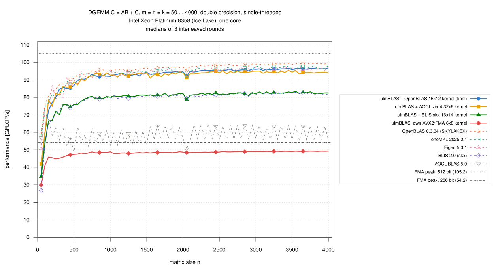
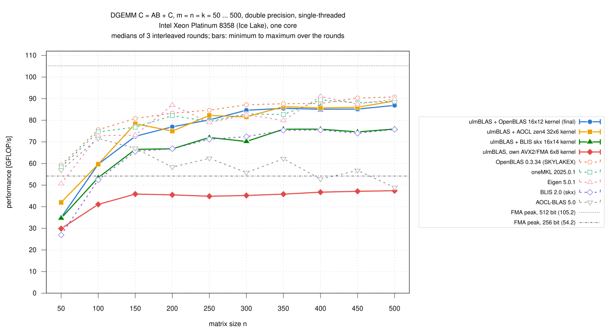
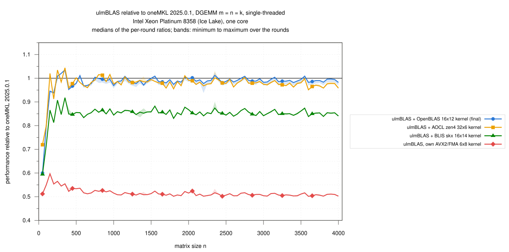
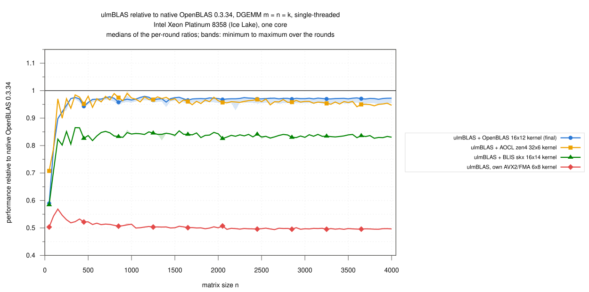
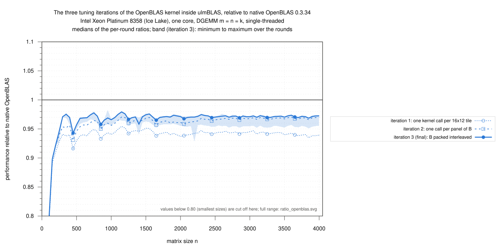

# Intel Xeon Platinum 8358 (Ice Lake): single-threaded DGEMM, n = 50 … 4000, ulmBLAS and five other libraries (2026-10-27)

After the kernel campaigns 012 to 021 I compared single-threaded DGEMM on
one core of an Intel Xeon Platinum 8358 in one job: four builds of ulmBLAS
with different micro kernels (plus the three tuning iterations of the
OpenBLAS kernel) against native OpenBLAS, oneMKL, BLIS, AOCL-BLAS and
Eigen, on one exclusive node, interleaved over 3 rounds.

C <- A B + C (alpha = beta = 1), double, column major, no transposition,
m = n = k = 50, 100, ..., 4000 (80 sizes).  Every variant is its own curve.

## Results

- **Large matrices (n >= 1000): ulmBLAS with OpenBLAS's kernel is within 3%
  of OpenBLAS**
  - 92.0 to 96.7 GFLOP/s: 0.971 of OpenBLAS, 0.989 of oneMKL, 0.995 of
    Eigen, 1.168 times BLIS, 1.67 times AOCL-BLAS, 1.95 times its own AVX2
    kernel
  - the kernel is the same as in OpenBLAS; the remaining 3% is the code
    around it (packing, remainders; see campaign 021)
  - maximum 96.7 GFLOP/s = 91.9% of the 512-bit FMA peak; OpenBLAS's
    maximum 99.46 = 94.6%
- **OpenBLAS is the fastest at 73 of 80 sizes**, Eigen at 7 (n = 200, 400,
  600, 800, 1000, 1200, 1600); no ulmBLAS build is the fastest anywhere
- **ulmBLAS with BLIS's skx kernel is as fast as BLIS** (1.006, 0.991 to
  1.017): the 16 x 14 kernel itself is the limit on this CPU, about 84% of
  OpenBLAS
- **ulmBLAS's own kernel** uses 256-bit registers, stays below the 256-bit
  peak (54.2 GFLOP/s) and is half as fast as OpenBLAS
- **AOCL's zen4 kernel is 1.64 times as fast inside ulmBLAS as inside
  AOCL-BLAS** on this Intel CPU; AOCL-BLAS is tuned for AMD (it selects the
  "Genoa" model here), so this says nothing about AOCL on AMD hardware
- **Small matrices are ulmBLAS's weak range**: for n <= 200 all ulmBLAS
  builds are clearly behind OpenBLAS, oneMKL and Eigen, about 60% of
  OpenBLAS at n = 50; the fixed costs per call (packing whole panels, block
  loops) weigh more, and ulmBLAS has no small-matrix path on x86-64 yet
- **Tuning iterations** of the OpenBLAS kernel, n >= 1000, ratio to
  OpenBLAS: iteration 1 0.943 (0.935 to 0.954), iteration 2 0.967 (0.956 to
  0.971), iteration 3 0.971 (0.958 to 0.979)

### Crossovers

"Faster" and "slower" mean in every one of the 3 rounds; "mixed": the
rounds disagree.

- **ulmBLAS (final) vs. OpenBLAS**: slower at all 80 sizes
  - 0.59 at n = 50, 0.79 at 100, 0.90 to 0.95 for n = 150 ... 250
  - always >= 0.95 from n = 500, >= 0.96 from n = 1450
- **vs. oneMKL**: faster at 5 sizes (n = 300, 350, 550, 2350, 3550), mixed
  at 12, slower at 63; 0.60 at n = 50, 0.80 at 100, 0.95 to 1.04 for n >=
  250
- **vs. Eigen**: faster at 6, mixed at 32, slower at 42, among them most
  multiples of 100 (for n >= 1000 Eigen has a median of 96.5 GFLOP/s at
  multiples of 100, 95.0 at odd multiples of 50)
- **vs. BLIS**: faster at all 80 sizes
- **OpenBLAS kernel vs. AOCL zen4 kernel in ulmBLAS**: faster at 22,
  slower at 16, mixed at 42; zen4 ahead at n = 50 (42.0 vs. 35.0 GFLOP/s),
  the OpenBLAS kernel for all n >= 3600
- **oneMKL vs. OpenBLAS**: slower at 77, mixed at 3 (n = 400, 600, 650)
- **Eigen vs. OpenBLAS**: faster at 5 (n = 200, 400, 600, 800, 1000),
  mixed at 2, slower at 73
- **AOCL-BLAS** alternates with n: for n >= 1000 a median of 63.5 GFLOP/s at
  odd multiples of 50 and 56.1 at multiples of 100, the same as on another
  node in campaign 019 (ratio 1.000 to 1.002)

### GFLOP/s by size range

Medians over the sizes of the range (min ... max), then the median ratio
to OpenBLAS / oneMKL:

| Variant | n = 50 … 250 | n = 300 … 500 | n = 550 … 1000 | n = 1050 … 2000 | n = 2050 … 4000 |
|---|---|---|---|---|---|
| ulmBLAS + OpenBLAS 16x12 (final) | 72.6 (35.0 … 80.2) · 0.90 / 0.94 | 85.2 (84.6 … 86.9) · 0.97 / 0.98 | 91.8 (89.9 … 93.2) · 0.97 / 0.99 | 93.6 (92.2 … 94.7) · 0.97 / 0.99 | 95.9 (92.4 … 96.7) · 0.97 / 0.99 |
| ulmBLAS + AOCL zen4 32x6 | 75.0 (42.0 … 82.3) · 0.90 / 0.91 | 86.0 (81.6 … 89.0) · 0.98 / 0.98 | 92.2 (87.2 … 94.0) · 0.97 / 0.98 | 93.3 (91.0 … 94.7) · 0.97 / 0.99 | 94.3 (91.4 … 95.5) · 0.96 / 0.98 |
| ulmBLAS + BLIS skx 16x14 | 66.5 (34.7 … 72.0) · 0.80 / 0.81 | 75.9 (70.2 … 76.0) · 0.84 / 0.85 | 79.5 (75.9 … 80.7) · 0.84 / 0.86 | 81.3 (80.4 … 82.3) · 0.84 / 0.86 | 82.4 (78.8 … 83.4) · 0.83 / 0.85 |
| ulmBLAS, own AVX2/FMA 6x8 | 44.8 (29.9 … 45.9) · 0.54 / 0.55 | 46.7 (45.2 … 47.4) · 0.52 / 0.54 | 48.4 (47.6 … 48.9) · 0.51 / 0.52 | 48.4 (47.8 … 49.0) · 0.50 / 0.51 | 49.1 (48.4 … 49.3) · 0.50 / 0.51 |
| OpenBLAS 0.3.34 | 80.8 (59.3 … 84.7) · 1 / 1.02 | 87.8 (87.2 … 90.8) · 1 / 1.03 | 94.9 (92.8 … 95.7) · 1 / 1.02 | 96.4 (95.4 … 97.5) · 1 / 1.02 | 98.9 (95.5 … 99.5) · 1 / 1.02 |
| oneMKL 2025.0.1 | 76.8 (58.4 … 82.2) · 0.98 / 1 | 88.1 (82.7 … 89.4) · 0.98 / 1 | 93.0 (88.8 … 94.9) · 0.98 / 1 | 94.7 (92.2 … 97.0) · 0.98 / 1 | 96.6 (92.4 … 98.2) · 0.98 / 1 |
| Eigen 5.0.1 | 73.1 (50.7 … 87.1) · 0.93 / 0.98 | 87.6 (79.9 … 91.0) · 0.97 / 1.00 | 92.9 (88.0 … 95.9) · 0.98 / 1.00 | 94.5 (91.8 … 97.0) · 0.98 / 1.00 | 96.1 (92.6 … 98.0) · 0.97 / 1.00 |
| BLIS 2.0 (skx) | 65.6 (26.9 … 71.2) · 0.80 / 0.81 | 75.4 (72.4 … 75.8) · 0.84 / 0.85 | 79.2 (77.1 … 80.2) · 0.84 / 0.86 | 80.6 (79.5 … 81.6) · 0.83 / 0.85 | 81.9 (79.5 … 82.9) · 0.83 / 0.85 |
| AOCL-BLAS 5.0 | 62.4 (57.0 … 71.6) · 0.83 / 0.87 | 55.8 (48.9 … 62.2) · 0.63 / 0.65 | 56.7 (51.7 … 63.2) · 0.60 / 0.61 | 58.0 (52.8 … 64.3) · 0.60 / 0.61 | 56.6 (50.5 … 64.5) · 0.58 / 0.59 |

### Large matrices, n >= 1000 (61 sizes)

| Variant | GFLOP/s | / OpenBLAS | / oneMKL |
|---|---|---|---|
| ulmBLAS + OpenBLAS 16x12 (final) | 92.0 … 96.7 | 0.971 (0.958 … 0.979) | 0.989 (0.969 … 1.012) |
| ulmBLAS + AOCL zen4 32x6 | 91.0 … 95.5 | 0.960 (0.941 … 0.977) | 0.979 (0.951 … 1.010) |
| ulmBLAS + BLIS skx 16x14 | 78.8 … 83.4 | 0.837 (0.825 … 0.854) | 0.853 (0.831 … 0.882) |
| ulmBLAS, own AVX2/FMA 6x8 | 47.8 … 49.3 | 0.498 (0.494 … 0.514) | 0.509 (0.502 … 0.524) |
| OpenBLAS 0.3.34 | 92.2 … 99.5 (max 99.46 = 94.6% of the 512-bit FMA peak) | 1 | |
| oneMKL 2025.0.1 | 92.2 … 98.2 | 0.980 (0.962 … 0.997) | 1 |
| Eigen 5.0.1 | 91.8 … 98.0 | 0.974 (0.956 … 1.007) | 0.996 (0.978 … 1.019) |
| BLIS 2.0 (skx) | 79.4 … 82.9 | 0.831 (0.818 … 0.853) | 0.849 (0.828 … 0.884) |
| AOCL-BLAS 5.0 | 50.5 … 64.5 | 0.582 (0.529 … 0.666) | 0.592 (0.547 … 0.689) |

### Correctness and repeatability

- 2640 measurements (11 variants x 80 sizes x 3 rounds), none missing, **no
  wrong result**; `verify-*`: 11 files, **no violation**
- spread of the 3 rounds per size: median 0.02 to 0.45% for all variants
  except iteration 3 (1.7%), whose round 2 is 1.8% slower at almost every
  size (n = 4000: 94.9 vs. 96.8 and 96.7) without any visible cause; the
  median is not affected
- at the sizes shared with campaigns
  [019](../019-2026-10-27-uc3-icelake-kernels-k4/README.md),
  [020](../020-2026-10-27-uc3-icelake-openblas-kernel-panel/README.md) and
  [021](../021-2026-10-27-uc3-icelake-openblas-kernel-interleave/README.md)
  (other nodes) OpenBLAS, oneMKL, AOCL-BLAS and ulmBLAS with the OpenBLAS
  and AOCL kernels agree within 0.996 to 1.003

## Variants

| Variant (label in the figures) | Library and micro kernel | Build |
|---|---|---|
| ulmBLAS + OpenBLAS 16x12 kernel (final) | ulmBLAS 71f1ce1, OpenBLAS's SKYLAKEX `dgemm_kernel` 16 x 12 (AVX-512), tuning iteration 3 (panel calls, B packed interleaved) | `-mavx -mfma -mavx512f -DULMBLAS_DGEMM_UKERNEL_openblas_skylakex_16x12` |
| iteration 2 (ratio figures only) | same, without interleaved packing of B | + `-DULMBLAS_DGEMM_NO_INTERLEAVE` |
| iteration 1 (ratio figures only) | same, one kernel call per 16 x 12 tile | + `-DULMBLAS_DGEMM_NO_PANEL -DULMBLAS_DGEMM_NO_INTERLEAVE` |
| ulmBLAS + AOCL zen4 32x6 kernel | ulmBLAS 71f1ce1, `bli_dgemm_zen4_asm_32x6` from AOCL-BLAS 5.0 (AVX-512) | `-mavx -mfma -mavx512f -DULMBLAS_DGEMM_UKERNEL_blis_zen4_32x6` |
| ulmBLAS + BLIS skx 16x14 kernel | ulmBLAS 71f1ce1, `bli_dgemm_skx_asm_16x14` from BLIS 2.0 (AVX-512) | `-mavx -mfma -mavx512f -DULMBLAS_DGEMM_UKERNEL_blis_skx_16x14` |
| ulmBLAS, own AVX2/FMA 6x8 kernel | ulmBLAS 71f1ce1, its own 6 x 8 kernel (256-bit registers) | `-mavx -mfma` |
| OpenBLAS 0.3.34 (SKYLAKEX) | built from source, configuration `NO_AFFINITY SKYLAKEX SINGLE_THREADED` | static |
| oneMKL 2025.0.1 | cluster installation, `mkl_sequential`, LP64; code path reported by `MKL_VERBOSE`: AVX-512 | static |
| BLIS 2.0 (skx) | built from source, `auto` configuration, selects `skx` (16 x 14, MC/KC/NC 240/256/3752) | static |
| AOCL-BLAS 5.0 | cluster installation (AOCC build); on this Intel CPU it selects `zen4`, model Genoa (32 x 6, MC/KC/NC 128/512/4002) | static |
| Eigen 5.0.1 | header only, `C.noalias() += A*B`, Eigen's own AVX-512 kernels | `g++ -std=c++17 -O3 -DNDEBUG -march=native` |

- all ulmBLAS builds are revision 71f1ce1; `ULMBLAS_DGEMM_NO_PANEL` and
  `ULMBLAS_DGEMM_NO_INTERLEAVE` restore the code paths of iteration 1
  (campaign 014) and of 968e250 (checked against campaigns 020 and 021)
- ulmBLAS with `g++ -O3 -std=c++11` and the flags above (no
  `-march=native`); the BLAS libraries through `cblas_dgemm` from
  `bench2.c` (`gcc -O2`), Eigen through its C++ API
- GCC 14.2.0 for everything except AOCL-BLAS (prebuilt with AOCC)
- the dispatch of the libraries was recorded on the node
  (`logs/system.txt`: `BLIS_ARCH_DEBUG`, `MKL_VERBOSE`,
  `openblas_get_config`, `SimdInstructionSetsInUse`)

**Eigen** has no `dgemm`: the benchmark times `C.noalias() += A*B` on
column-major `Eigen::Matrix<double, Dynamic, Dynamic>` objects, the same
operation as `cblas_dgemm(ColMajor, NoTrans, NoTrans, ...)`.

- the product is compiled into the program (`-march=native`: AVX-512); no
  library call, no argument checks, no run-time dispatch
- `noalias()`: no temporary; an empty `asm` after each product keeps the
  compiler from merging or dropping products
- same values and the same check of the first result as `bench2.c`
  (`source/bench-eigen.cpp`); it does not compile with `EIGEN_USE_BLAS`,
  `EIGEN_USE_MKL_ALL` or OpenMP

## Method

- **Node**: Slurm job 8018008 on `uc2n752` (`cpu_il`, exclusive): 2 x Xeon
  Platinum 8358, 32 cores per socket, 2.6 GHz, turbo on, governor
  `performance`, SMT on, THP `always`; RHEL 9.6
  - CPU 3 with memory on NUMA node 0 (`numactl --physcpubind=3
    --membind=0`); the other 127 CPUs idle
- **One thread** everywhere (environment variables; OpenBLAS built
  single-threaded, MKL sequential, Eigen without OpenMP)
- **Timing** (`bench2.c`, `bench-eigen.cpp`): warm-up >= 0.3 s, 7 samples
  >= 0.2 s (n = 50: about 47000 calls per sample, n = 500: 73, n >= 2550:
  1), median
- **Rounds**: 3, every variant once over all 80 sizes per round, order
  rotated; median over the rounds, bands min to max; ratios within a round
- **Peak** before and after (identical after 3.6 hours): 105.19 GFLOP/s
  with 512-bit, 54.20 with 256-bit FMAs
- **Correctness**: first result of every size against a naive product up
  to 2e8 multiply-adds (n <= 550); for n = 600 ... 4000 `verify-large.c`
  and `verify-eigen.cpp` check 2000 random elements per size against long
  double sums
  - the library code of 71f1ce1 is that of ac2d97e, which passes `make
    check` on Ice Lake and Zen 4; the builds for iterations 1 and 2 were
    checked only by this campaign
- 08:26 to 11:55 (verification until 12:05), load average 1.0, CPU 37 to
  43 C

## Limitations

- one node, one core, single-threaded; threading was not measured
- only square m = n = k in steps of 50, no transposition, alpha = beta = 1;
  thin and small shapes behave differently (e.g. n <= 31 in campaign 021)
- hot caches: a sample repeats the call on the same operands, which favors
  all variants alike but is not what a single call in an application sees
- one compiler and one build per library; AOCL-BLAS and oneMKL are
  prebuilt; Eigen with `-march=native`, ulmBLAS with explicit flags
- turbo on, as in normal use; one busy core on an idle node may clock
  higher than under full load

## Files

- `data/raw/main-VARIANT-ROUND.txt` (`m n k beta median min max calls
  check`), `verify-VARIANT.txt`, `peak-*.txt`
- `data/runs.csv`; `data/summary/dgemm.csv`, `ratios.csv`, `ranges.csv`
- `logs/`: `system.txt`, `run.log`, `conditions.csv`, `programs.sha256`,
  `failures.txt`; `logs/build/`: builds of the references and of every
  ulmBLAS variant (job 8018006)
- `source/`: `full-build.sbatch`, `full-bench.sbatch`, `bench2.c`,
  `bench-eigen.cpp`, `verify-large.c`, `verify-eigen.cpp`,
  `summarize-full.py`; the reference libraries were built by `build.sbatch`
  of the [investigation](../../investigations/2026-10-bwunicluster3/README.md)
  (job 8001178)
- summaries: `python3 source/summarize-full.py`; figures: `make
  add_benchmark_result BENCHMARK_DIR=benchmark_results/NAME`

## Figures

<!-- BEGIN FIGURES (generated by make add_benchmark_result) -->

<!-- END FIGURES -->
