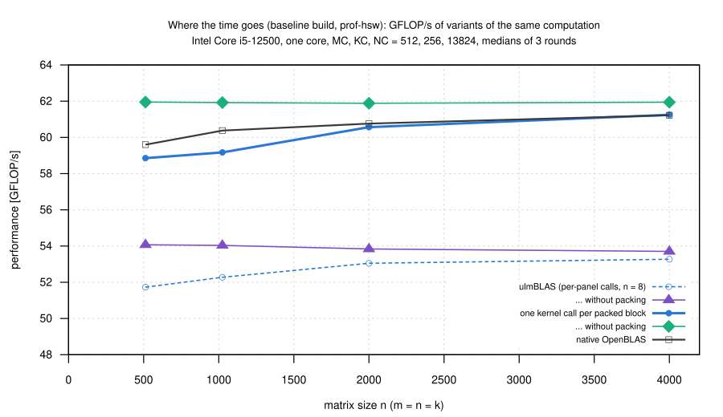
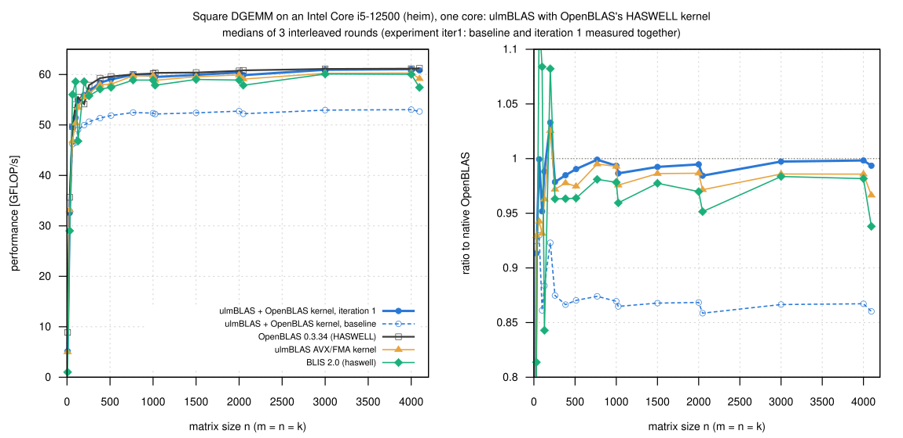

# OpenBLAS's HASWELL DGEMM kernel inside ulmBLAS on an Intel Core i5-12500 (heim)

Measured 2026-10-27, 14:08 to 15:41 (tests from 13:04): I integrated
OpenBLAS's HASWELL DGEMM kernel as a selectable micro kernel of ulmBLAS
(commit 59120c5), tested it, compared it with native OpenBLAS, native BLIS
and ulmBLAS's own AVX2/FMA kernels, profiled the overhead and made one
tuning iteration (commit ae96628).

## Summary

- **Baseline: 0.86 to 0.87 of native OpenBLAS** for n >= 256, although
  both run the same machine code
  - the kernel was called as the SKYLAKEX kernel before, once per 8-column
    panel of B
- **The profile located the gap**
  - packing takes only 1 to 4% of the time
  - the macro kernel runs at the rate of the kernel's **4 x 8** path; the
    kernel computes **4 x 12** tiles only when one call covers at least 24
    columns
- **Iteration 1: one kernel call per packed block** (and B packed
  interleaved in groups of 24 columns), as OpenBLAS's driver does
  - **0.984 to 0.999 of native OpenBLAS** for n >= 256, 14 to 16% faster
    than before
  - within 1% except at the powers of two 1024 and 2048 (1.4 to 1.6%)
- **n <= 128 stays behind** (0.58 at n = 7, 0.91 at 31, 0.95 at 100); that
  belongs to the separate small-matrix investigation
- no further tuning (see [Further iterations](#further-iterations))

## Setup

- **CPU**: Intel Core i5-12500 (Alder Lake, 6 cores, 12 threads, AVX2/FMA,
  no AVX-512), every run on core 3 (its sibling 2 idle); `intel_pstate`,
  governor `powersave`, turbo on
- **Software**: Debian 12, Linux 6.1, GCC 12.2.0, GNU as 2.40
- **ulmBLAS**: `make cblas ARCHFLAGS=...` (code of 59120c5 for the
  baseline, ae96628 for iteration 1), `-std=c++11 -O3 -fomit-frame-pointer`
- **OpenBLAS** 0.3.34, built for campaign 001 (target `HASWELL`, no
  `DYNAMIC_ARCH`); P, Q, R = 512, 256, 13824
- **BLIS** 2.0 haswell (campaign 001)

**The same kernel code in both** (`data/logs/*/logs/kernel-identity.txt`):
native OpenBLAS reports `HASWELL`, its build assembles
`dgemm_kernel_4x8_haswell.S` as `dgemm_kernel.o`, and the `.text` section
of that object and of `haswell_4x8.o` in ulmBLAS are **byte-identical**
(28076 bytes, SHA-256 b3b73ae3...).

| Variant | Library, ARCHFLAGS |
|---|---|
| `openblas` | native OpenBLAS 0.3.34 (HASWELL) |
| `ulmblas-openblas-haswell_4x8` (baseline, 59120c5) / `-iter1` (ae96628) | ulmBLAS with `-mavx -mavx2 -mfma -DULMBLAS_DGEMM_UKERNEL_openblas_haswell_4x8`, MC, KC, NC = 512, 256, 13824 |
| `ulmblas-avx` | ulmBLAS's own AVX/FMA kernel (6 × 8, MC = 288), `-mavx -mfma` |
| `ulmblas-blis-haswell_6x8` | ulmBLAS with BLIS's haswell 6 × 8 kernel and MC = 288 (experiment base only) |
| `blis` | native BLIS 2.0 (haswell, 6 × 8) |

## Method

- `source/obhsw-heim.sh`, as in campaign
  [017-2026-10-27-heim-blis-kernels-old](../017-2026-10-27-heim-blis-kernels-old/README.md):
  all variants in every round, order rotated, 3 rounds
- `bench2`: one call checked against a naive product (up to 2e8
  multiply-adds), warm-up >= 0.3 s, 7 samples >= 0.2 s, median; column
  major, NoTrans, alpha = beta = 1, one thread
- `verify-large`: 2000 elements of C against long double sums for n =
  1000 ... 4096, 0 violations
- a gate starts a run only when no other process is runnable and the load
  is below 1.8; load, temperature and frequency logged before each run;
  the machine was otherwise idle
- experiments: **base** (5 variants, 14:08 to 14:32), **prof** (14:54 to
  15:05), **iter1** (iteration 1 with the baseline program, OpenBLAS, BLIS,
  ulmBLAS AVX/FMA, 15:17 to 15:41)
- median spread over the rounds 0.16% (base) and 0.18% (iter1); one
  OpenBLAS round at n = 64 and 100 was 28% slower in base (medians not
  affected); the baseline reproduces in iter1 within 0.3%, OpenBLAS within
  0.2%
- *clear* (+ / -): the ranges do not overlap and the medians differ by at
  least 1%

## Results

GFLOP/s, medians of 3 rounds, experiment iter1 (`data/summary/iter1.csv`;
base: `base.csv`), ratio to native OpenBLAS:

| m × n × k | OpenBLAS | ulmBLAS + kernel, iteration 1 | ratio | ulmBLAS + kernel, baseline | ratio | ulmBLAS AVX/FMA | ratio | BLIS haswell | ratio |
|---|---:|---:|---:|---:|---:|---:|---:|---:|---:|
| 7³ | 8.9 | 5.1 | 0.576− | 5.1 | 0.579− | 5.0 | 0.566− | 1.0 | 0.113− |
| 31³ | 35.7 | 32.6 | 0.913− | 33.0 | 0.924− | 33.1 | 0.929− | 29.0 | 0.813− |
| 64³ | 49.7 | 49.6 | 0.999 | 46.2 | 0.929− | 46.8 | 0.942− | 56.0 | 1.128+ |
| 100³ | 54.0 | 51.4 | 0.951− | 46.5 | 0.861− | 50.3 | 0.931− | 58.6 | 1.084+ |
| 128³ | 55.5 | 54.9 | 0.988− | 49.1 | 0.883− | 53.5 | 0.962− | 46.8 | 0.842− |
| 199³ | 54.1 | 55.9 | 1.033+ | 50.0 | 0.923− | 55.5 | 1.025+ | 58.6 | 1.082+ |
| 256³ | 57.9 | 56.7 | 0.978− | 50.6 | 0.874− | 56.3 | 0.971− | 55.8 | 0.963− |
| 384³ | 59.3 | 58.4 | 0.984− | 51.4 | 0.866− | 58.0 | 0.977− | 57.1 | 0.963− |
| 512³ | 59.6 | 59.0 | 0.990 | 51.9 | 0.870− | 58.1 | 0.974− | 57.5 | 0.963− |
| 768³ | 60.0 | 60.0 | 0.999 | 52.5 | 0.874− | 59.7 | 0.995 | 58.9 | 0.981− |
| 1000³ | 60.2 | 59.8 | 0.993 | 52.3 | 0.869− | 59.8 | 0.992 | 58.9 | 0.978− |
| 1024³ | 60.3 | 59.5 | 0.986− | 52.2 | 0.864− | 58.9 | 0.975− | 57.9 | 0.959− |
| 1500³ | 60.4 | 59.9 | 0.992 | 52.4 | 0.867− | 59.6 | 0.986− | 59.0 | 0.977− |
| 2000 × 2000 × 32 | 55.9 | 56.4 | 1.010+ | 51.3 | 0.918− | 52.7 | 0.943− | 49.2 | 0.880− |
| 2000 × 2000 × 128 | 60.6 | 60.4 | 0.996 | 52.5 | 0.866− | 58.9 | 0.971− | 52.1 | 0.859− |
| 2000 × 2000 × 256 | 60.8 | 60.6 | 0.996 | 52.9 | 0.869− | 60.0 | 0.986− | 59.7 | 0.982− |
| 2000³ | 60.7 | 60.4 | 0.994 | 52.7 | 0.868− | 59.9 | 0.986− | 58.9 | 0.969− |
| 2048³ | 60.8 | 59.9 | 0.984− | 52.2 | 0.858− | 59.1 | 0.971− | 57.9 | 0.951− |
| 3000³ | 61.1 | 60.9 | 0.997 | 52.9 | 0.866− | 60.2 | 0.985− | 60.1 | 0.983− |
| 4000 × 4000 × 64 | 59.6 | 60.0 | 1.006 | 52.5 | 0.880− | 57.7 | 0.968− | 55.2 | 0.926− |
| 4000³ | 61.2 | 61.1 | 0.998 | 53.0 | 0.867− | 60.3 | 0.985− | 60.0 | 0.981− |
| 4096³ | 61.2 | 60.8 | 0.993 | 52.7 | 0.860− | 59.2 | 0.966− | 57.4 | 0.938− |

- **Baseline: 0.86 to 0.87 of OpenBLAS** for n >= 256 (52 to 53 instead of
  60 to 61 GFLOP/s), below ulmBLAS's own kernel (0.97 to 0.99) and BLIS
  (0.94 to 0.98)
- **Iteration 1: 0.984 to 0.999** for n >= 256 and the thin shapes
  - noise at 11 of 16 shapes, clearly slower at 256^3, 384^3, 1024^3 and
    2048^3, clearly faster at 2000 x 2000 x 32
  - 1.12 to 1.16 times the baseline, faster than ulmBLAS's own kernel from
    n = 64 on
  - remaining gap: 1.4% at 1024^3, 1.6% at 2048^3, 2.2% at 256^3
- **n <= 128**: 0.58 (n = 7), 0.91 (31), 1.00 (64), 0.95 (100), 0.99 (128)
  of OpenBLAS; BLIS is the fastest at 64, 100 and 199

## Where the time goes (profile)

`source/prof-hsw.cc` (`prof-ob.cc` of campaign
[016-2026-10-27-uc3-icelake-openblas-kernel-prof](../016-2026-10-27-uc3-icelake-openblas-kernel-prof/README.md)
for this kernel), linked with the baseline build, block sizes 512, 256,
13824, 3 rounds (`source/prof-heim.sh`, `prof.csv`, `profile.svg`).
Modes: `lib`, `inst` (packing fractions), `nopack`, `macro` (one call per
packed block, as OpenBLAS), `macronopack`, `kern` (the per-tile kernel on
panels in cache), `cblas` (native OpenBLAS).

| n | lib | inst: pack B, pack A | nopack | macro | macronopack | kern (4 × 8 tile) | OpenBLAS |
|---:|---:|---|---:|---:|---:|---:|---:|
| 512 | 51.7 | 1.8%, 2.5% | 54.1 | 58.9 | 62.0 | 53.6 | 59.6 |
| 1024 | 52.3 | 1.3%, 1.9% | 54.0 | 59.2 | 61.9 | 53.5 | 60.4 |
| 2000 | 53.0 | 0.9%, 0.7% | 53.8 | 60.6 | 61.9 | 53.5 | 60.8 |
| 4000 | 53.3 | 0.5%, 0.4% | 53.7 | 61.2 | 61.9 | 53.5 | 61.2 |

- the baseline's macro kernel cannot exceed the 4 x 8 rate (53.5 to 54.1
  without any packing)
- with the same packing, one call per block reaches native OpenBLAS (61.2
  at n = 4000) and is 0.4 to 2% below it for smaller n
- the 4 x 12 path is used only for groups of 24 columns in one call
  - 4 x 8: 8 accumulators, per k 2 loads of B and 4 broadcasts of A for 8
    FMAs
  - 4 x 12: 12 accumulators, 3 loads and 4 broadcasts for 12 FMAs
- `macro` gives exactly the result of ulmBLAS's GEMM (`macrocheck`:
  difference 0)

## Iteration 1: one kernel call per packed block (ae96628)

- kernels marked `ULMBLAS_BLIS_DGEMM_BLOCKCALL` (`select.h`; HASWELL) are
  called by `mgemm` once for all full tiles of a block (`ugemm_block`,
  `MgemmBlock`); partial tiles use the per-tile adapter
- DGEMM packs B interleaved with the first block of A in groups of
  `ULMBLAS_BLIS_DGEMM_INTERLEAVE_PANELS` = 3 panels (24 columns; OpenBLAS:
  `3*GEMM_UNROLL_N`)
- result: 0.86 to 0.87 -> 0.98 to 1.00 of OpenBLAS
- tests: `make check` of `openblas-haswell_4x8`, `-small`, `-kc600`,
  `testcase06`, `blis-haswell_6x8`, `-small`: 1026 PASS, 0 FAIL; with
  ASan/UBSan (the three haswell_4x8 configurations): 516 PASS

## Further iterations

Not made.  The remaining differences for n >= 256 are 0.1 to 2.2%, mostly
noise.  Packing takes 0.9 to 4.3% of ulmBLAS's time for n <= 2000, so the
rest at the powers of two is most likely in packing (a hypothesis; I did
not measure OpenBLAS's copy routines).  Small n is a separate question.

## Loop nesting: OpenBLAS and ulmBLAS

What the measured programs execute for single-threaded `cblas_dgemm`
(column major, NoTrans/NoTrans), read from the sources: OpenBLAS 0.3.34
(`interface/gemm.c` -> `driver/level3/level3.c`, no threads,
`CORE=HASWELL`, `kernel/x86_64/dgemm_kernel_4x8_haswell.S`) and ulmBLAS
(`gemm.tcc`, `mgemm.tcc`, `blis/ugemm.h`).  Block sizes: OpenBLAS P = 512,
Q = 256, R = 13824, ulmBLAS MC = 512, KC = 256, NC = 13824 (the same);
MR x NR = 4 x 8 in both.

### 1. Frame algorithm (blocking over m, n, k)

OpenBLAS (`level3.c`, lines 305–417; beta is applied to all of C
before the loops if beta ≠ 1, `BETA_OPERATION`):

```c
for (js = 0; js < n; js += R)                  // n blocks, min_j <= R
  for (ls = 0; ls < k; ls += min_l) {          // k blocks
    min_l = (k-ls >= 2Q) ? Q : (k-ls > Q ? ceil((k-ls)/2, 4) : k-ls);
    min_i = (m >= 2P) ? P : (m > P ? ceil(m/2, 4) : m);    // first m block
    l1stride = (min_i < m) ? 1 : 0;            // 0: a single m block
    pack A[0:min_i, ls:ls+min_l] -> sa          // ICOPY (gemm_ncopy_4)
    for (jjs = js; jjs < js+min_j; jjs += min_jj) {   // B interleaved
      min_jj = (rest >= 24) ? 24 : (rest > 8 ? 8 : rest);
      pack B[ls:ls+min_l, jjs:jjs+min_jj] -> sb + min_l*(jjs-js)*l1stride  // OCOPY (ncopy_8)
      kernel(min_i, min_jj, min_l, alpha, sa, sb + ..., C[0, jjs])
    }
    for (is = min_i; is < m; is += min_i) {    // remaining m blocks
      min_i = (m-is >= 2P) ? P : (m-is > P ? ceil((m-is)/2, 4) : m-is);
      pack A[is:is+min_i, ls:ls+min_l] -> sa
      kernel(min_i, min_j, min_l, alpha, sa, sb, C[is, js])   // whole block
    }
  }
```

ulmBLAS (`gemm.tcc`; beta is applied in the first k block, `beta_`):

```c
for (j = 0; j < nb; ++j)                       // n blocks of NC
  for (l = 0; l < kb; ++l) {                   // k blocks of KC, last one smaller
    if (!interleave) pack B[l, j] -> B_         // kc x nc
    for (i = 0; i < mb; ++i) {                 // m blocks of MC, last one smaller
      pack A[i, l] -> A_                        // mc x kc
      if (interleave && i == 0)
        for (jr = 0; jr < nc; jr += NI) {      // NI = NR (baseline), 3*NR (iteration 1)
          pack B[l, j][:, jr:jr+NI] -> B_ + jr*kc
          mgemm(mc, NI, kc, A_, B_ + jr*kc, C[0, j*NC+jr])
        }
      else
        mgemm(mc, nc, kc, A_, B_, C[i*MC, j*NC])
    }
  }
```

The loop order is the same (n blocks → k blocks → m blocks, B packed
once per (n, k) block and interleaved with the first m block, A once per
(m, k) block).  Two differences in the block sizes: OpenBLAS splits a
remainder of k between Q and 2Q into **two balanced blocks** (k = 300:
152 + 148; ulmBLAS: 256 + 44), and likewise m between P and 2P (m = 600:
300 + 300; ulmBLAS: 512 + 88).  For the shapes of this campaign this
concerns only k (e.g. k = 2000: OpenBLAS 6 × 256 + 232 + 232, ulmBLAS
7 × 256 + 208); m and n remainders below P and R are single blocks in
both.  A third difference: if there is only one m block (m ≤ P = 512),
OpenBLAS packs every 24-column group of B to the **same** place
(`l1stride = 0`), because B is not needed again; the packed B of a call
(24 × k ≤ 48 KiB) then stays in L1/L2.  ulmBLAS always packs the whole
block of B side by side (kc × nc).

### 2. Macro kernel (loops over the micro tiles)

OpenBLAS: `dgemm_kernel_4x8_haswell.S` **is** the macro kernel; it is
called with a whole block (min_i × min_jj or min_i × min_j):

```c
kernel(m, n, k, alpha, sa, sb, C, ldc):
  for (j = 0; j + 24 <= n; j += 24) {          // two halves of 12 columns
    copy 12 columns of B (panel j/8 and half of the next) -> stack buffer
    for (i = 0; i + 4 <= m; i += 4)  tile 4x12(k)     // + rows 2, 1
    copy the next 12 columns -> stack buffer
    for (i = 0; i + 4 <= m; i += 4)  tile 4x12(k)
  }
  for (; j + 8 <= n; j += 8)                   // remaining panels, B read in place
    for (i = 0; i + 4 <= m; i += 4)  tile 4x8(k)
  ... 4, 2, 1 columns
```

ulmBLAS `mgemm` (baseline: one kernel call per panel of B, n = 8):

```c
for (j = 0; j < np; ++j)                       // panels of NR = 8 columns
  if (panel full) kernel(4*(mc/4), 8, kc, ..., A_, B_ + j*kc*8, C[0, j*8])
                                                // inside: for i: tile 4x8(kc)
  for (i = full tiles done; i < mp; ++i)       // partial tiles per tile
    ugemm(mr, nr, kc, ...)
```

ulmBLAS `mgemm` (iteration 1: one call per block, as OpenBLAS):

```c
kernel(4*(mc/4), 8*(nc/8), kc, ..., A_, B_, C)   // all full tiles at once
for (partial tiles) ugemm(mr, nr, kc, ...)
```

Both are "panel of B outer, tiles of A inner" (j outer, i inner).  The
panel call of the baseline does not change this nesting, but it fixes
n = 8 per call, and the kernel's 4 × 12 path needs n ≥ 24 in **one**
call: with n = 8 every tile is computed by the 4 × 8 path (8
accumulators, per k 2 loads of B and 4 broadcasts of A for 8 FMAs,
instead of 12 accumulators, 3 loads and 4 broadcasts for 12 FMAs).  The
block call of iteration 1 changes the tile shape to that of OpenBLAS
(4 × 12 for groups of 24 columns); it also moves the copy of B into the
kernel's stack buffer from "never" (the 4 × 8 path reads B in place) to
"once per 12 columns and call", as in OpenBLAS.

### Reuse of packed panels and traffic of C

- Packed A (sa, A_, mc × kc ≤ 512 × 256 doubles = 1 MiB, in L2): reused
  for all panels of B of the block; in OpenBLAS's first m block for all
  24-column groups.
- Packed B (sb, B_, kc × nc): reused for all m blocks of an (n, k) block
  (OpenBLAS with a single m block: not kept, see above);
  one 8-column panel (16 KiB) or one 12-column copy (24 KiB, on the stack)
  stays in L1 while the tiles of the block pass through it.
- C: each k block reads and writes every element of the block once (the
  kernel adds alpha·A·B to C in its SAVE macros, both libraries);
  with k = 2000 and Q = KC = 256 that is 8 passes over C.  beta: OpenBLAS
  scales C once before the loops (beta ≠ 1), ulmBLAS in the first k block
  (in the adapter, before the kernel call).  For beta = 1 (all measurements)
  neither touches C additionally.

### Does the loop order explain the gap?

No.

- the frame algorithms have the same loop order, block sizes and reuse
- the baseline's gap comes from the call granularity of the macro kernel,
  i.e. the tile shape the kernel uses: with the same packing and loops, one
  call per block instead of per panel raises ulmBLAS from 52 to 53 to 59
  to 61 GFLOP/s (OpenBLAS 60 to 61)
- the balanced k blocks and the reuse of a small B buffer for a single m
  block differ, but concern only the last two k blocks and m <= 512; not
  changed
- a possible alternative, not tried: balanced k and m remainders as in
  OpenBLAS (campaign 022 found that balancing m and n does not help on the
  M5; k was not tested)

## Correctness tests of the integration (59120c5)

`data/logs/tests/`, `make check` on heim (GCC 12.2, gfortran 12.2):

| Run | Configurations | Result |
|---|---|---|
| `check-summary.txt` | `openblas-haswell_4x8`, `-small`, `testcase06` | 516 PASS, 0 FAIL |
| `check-kc600-summary.txt` | `openblas-haswell_4x8-kc600` (KC = 600: the adapter splits k > 256) | 176 PASS, 0 FAIL |
| `check-san-summary.txt` | the three haswell_4x8 configurations, `-O1 -fsanitize=address,undefined --param asan-stack=0` | 516 PASS, 0 FAIL, no sanitizer report |
| `valgrind-*.txt` | numeric tests of the three configurations under valgrind 3.19 memcheck (it checks the loads and stores of the assembly code too, unlike the sanitizers) | 145 tests each, 0 errors, no leaks |
| `iter1-check-summary.txt`, `iter1-san-summary.txt` | iteration 1, see above | 1026 PASS / 516 PASS, 0 FAIL |
| `quick-check-summary.txt` | iteration 1 with the final `gemm.tcc`, `make check-numeric` | 586 PASS, 0 FAIL |

## Reproduction

On heim, with the OpenBLAS and BLIS builds of campaign 001 in `REFS`:

    sh source/obhsw-heim.sh SRC W/base \
        ulmblas-avx="-mavx -mfma" \
        ulmblas-blis-haswell_6x8="-mavx -mfma -DULMBLAS_DGEMM_UKERNEL_blis_haswell_6x8 -DULMBLAS_DGEMM_MC=288" \
        ulmblas-openblas-haswell_4x8="-mavx -mavx2 -mfma -DULMBLAS_DGEMM_UKERNEL_openblas_haswell_4x8"
    g++ -I$SRC -c $SRC/ulmblas/level3/ukernel/openblas/asm/haswell_4x8.S
    g++ -std=c++17 -O3 -fomit-frame-pointer -I$SRC -mavx -mavx2 -mfma \
        -DULMBLAS_DGEMM_UKERNEL_openblas_haswell_4x8 source/prof-hsw.cc haswell_4x8.o -o W/prof/prof-hsw
    (the same with -DWITH_CBLAS -I$REFS/openblas/include ... libopenblas.a -o prof-hsw-cblas)
    sh source/prof-heim.sh W/prof
    EXTRA="ulmblas-openblas-haswell_4x8-base=W/base/bench-ulmblas-openblas-haswell_4x8 ulmblas-avx=W/base/bench-ulmblas-avx" \
        sh source/obhsw-heim.sh SRC1 W/iter1 ulmblas-openblas-haswell_4x8-iter1="-mavx -mavx2 -mfma -DULMBLAS_DGEMM_UKERNEL_openblas_haswell_4x8"
    # copy W/E/res to data/raw/E (prof: data/raw/prof), then here:
    python3 source/summarize.py

## Files

- `data/raw/E/main-VARIANT-ROUND.txt` (m n k beta median min max calls
  check), `verify-VARIANT.txt`; `data/raw/prof/`
- `data/runs.csv`, `data/summary/base.csv`, `iter1.csv`, `prof.csv`
- `data/logs/E/logs/`: system, builds, checksums, kernel identity, run
  log, conditions; `data/logs/tests/`: correctness tests
- `source/`: `obhsw-heim.sh`, `prof-heim.sh`, `bench2.c`,
  `verify-large.c`, `prof-hsw.cc`, `packvar.h`, `summarize.py`
- `plots/`: `square.svg`, `profile.svg`

## Figures

<!-- BEGIN FIGURES (generated by make add_benchmark_result) -->





<!-- END FIGURES -->
