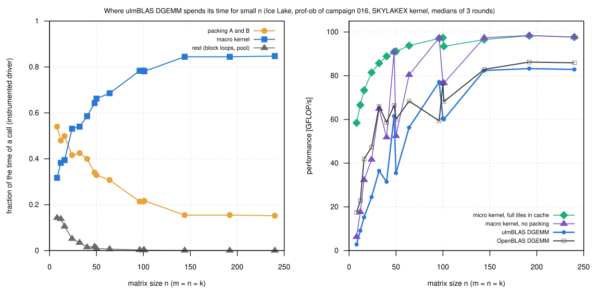
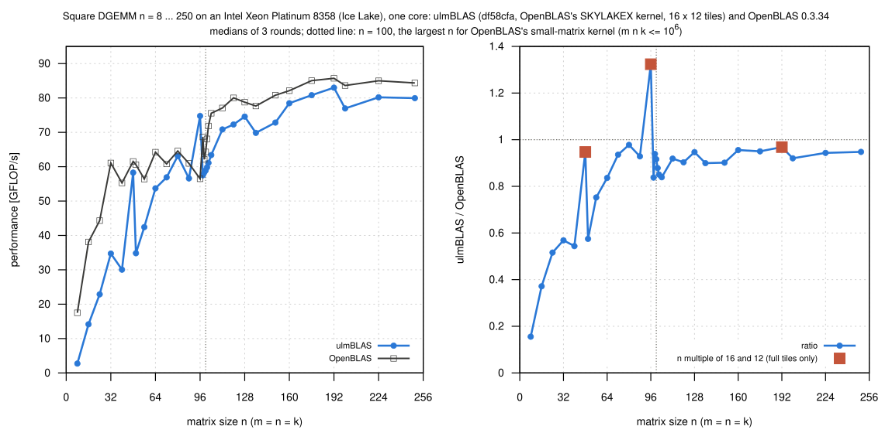

# Where ulmBLAS DGEMM spends its time for small matrices on Ice Lake

Measured 2026-10-27, 15:52 to 16:07, in two jobs on exclusive `cpu_il`
nodes.  In campaign
[023-2026-10-27-uc3-icelake-dgemm-single-thread](../023-2026-10-27-uc3-icelake-dgemm-single-thread/README.md)
ulmBLAS (with OpenBLAS's SKYLAKEX kernel) was clearly behind OpenBLAS for n
<= 200 (0.59 at n = 50, 0.79 at 100, 0.92 at 200).  Before changing
anything I measured where the time goes: a finer sweep n = 8 ... 250 and a
breakdown into packing, macro kernel and the rest.  ulmBLAS is unchanged.

## Summary (measured)

- **Edge tiles**: the gap depends on n mod 16 and n mod 12 (tile 16 x 12)
  much more than on n
  - full tiles only: close to OpenBLAS (n = 48: 0.95, 96: 1.32, 192: 0.97)
  - partial tiles in both directions: far behind (n = 40: 0.54, 50: 0.58,
    136: 0.90, 200: 0.92)
  - ulmBLAS computes a partial tile as a full 16 x 12 tile into a buffer:
    without packing its macro kernel reaches 52.5 GFLOP/s at n = 50 and
    76.7 at n = 100/101, against 91 to 98 with full tiles (useful fraction
    of the computed tiles: 0.83 at n = 100, 0.65 at n = 50)
- **Packing** takes 54% of the time at n = 8, 40 to 50% at n = 12 ... 40,
  31 to 34% at 48 ... 64, 21% at 100 and 15% at n >= 144
  - for n <= 16 packing alone takes longer than OpenBLAS's whole call (n =
    8: 0.28 vs. 0.06 µs)
- **OpenBLAS's path**: OpenBLAS 0.3.34 (SKYLAKEX) calls a separate
  small-matrix kernel without packing for NN with m n k <= 1e6
  (`dgemm_small_kernel_nn_skylakex.c`, permit function
  `dgemm_small_kernel_permit_skylakex.c`), here for n <= 100
  - it makes OpenBLAS fast for n <= 64 (6.4 times ulmBLAS at n = 8)
  - around n = 100 it is slower than OpenBLAS's normal driver: 64.3
    GFLOP/s at 100, 68.1 at 101, 71.8 at 102, 75.6 at 104 (100/101 is the
    switch)
  - so the gap for n = 101 ... 200 comes from edge tiles and packing, not
    from another algorithm in OpenBLAS
- **Fixed costs are small**: the memory pool 8 ns per call; block loops
  and the rest 14% at n = 8 (0.05 µs), 2% at n = 48

*Hypotheses for the next step (not measured):*

- a packing-free direct path for small m n k (as ulmBLAS has for NEON and
  OpenBLAS for SKYLAKEX) would address packing and the small path for n up
  to about 64
- narrower kernel calls for edge tiles instead of full tiles through a
  buffer (OpenBLAS's kernels have paths for 8, 4, 2, 1 rows and fewer
  columns) would address the edge tiles
- the same two effects appear on an AVX2 CPU with OpenBLAS's HASWELL kernel
  (4 x 8 tiles, no small-matrix kernel there), see
  [026-2026-10-27-heim-small-dgemm](../026-2026-10-27-heim-small-dgemm/README.md)

## Setup

- **Machine**: Intel Xeon Platinum 8358 (Ice Lake-SP, 2 x 32 cores,
  AVX-512), one exclusive node per job (uc2n630, uc2n816); core 3 and its
  NUMA node, one process at a time, governor `performance`; RHEL 9.6, GCC
  14.2.0
- **ulmBLAS** df58cfa (master), `make cblas ARCHFLAGS="-mavx -mfma
  -mavx512f -DULMBLAS_DGEMM_UKERNEL_openblas_skylakex_16x12"` (campaign 023,
  iteration 3), MC, KC, NC = 192, 384, 8640
- **OpenBLAS** 0.3.34, the build of campaign 023 (SKYLAKEX,
  single-threaded, static)

**Sweep** (`source/small-icelake.sbatch`, job 8026489): `bench2` of
campaign 023 (first result checked, warm-up >= 0.3 s, 7 samples >= 0.2 s,
median), n = 8 ... 250 (30 sizes, around 100 in steps of 1), alpha = beta
= 1, 3 rounds, the two libraries alternating.  0 wrong results; spread of
the rounds below 1% for most sizes, at most 3.6% (n >= 16).

**Profile** (jobs 8026489 and 8026592): `prof-ob.cc` of campaign
[016-2026-10-27-uc3-icelake-openblas-kernel-prof](../016-2026-10-27-uc3-icelake-openblas-kernel-prof/README.md),
block sizes 192, 384, 8640, 3 rounds.

- modes: `lib`, `inst` (time fractions), `nopack`, `kern` (micro kernel on
  full tiles in cache), `pool`, `cblas` (native OpenBLAS in the same
  program); `check`: same result as ulmBLAS's GEMM (difference 0)
- the timers of `inst` add 0.08 µs per call (n = 8: 0.436 instead of 0.362
  us), so its fractions are approximate for n <= 16
- OpenBLAS's rate in the profile program differs from `bench2` at n = 96
  and 100 (59.4 and 76.5 instead of 56.5 and 64.3; its small kernel is
  sensitive to where the operands lie); the sweep is the reference

## Sweep (`data/summary/sweep.csv`, `sweep.svg`)

GFLOP/s, medians of 3 rounds:

| n | n mod 16, mod 12 | ulmBLAS | OpenBLAS | OpenBLAS path | ratio | µs ulmBLAS | µs OpenBLAS |
|---:|---|---:|---:|---|---:|---:|---:|
| 8 | 8, 8 | 2.72 | 17.49 | small | 0.155 | 0.377 | 0.059 |
| 16 | 0, 4 | 14.15 | 38.10 | small | 0.371 | 0.579 | 0.215 |
| 24 | 8, 0 | 22.87 | 44.31 | small | 0.516 | 1.209 | 0.624 |
| 32 | 0, 8 | 34.73 | 61.08 | small | 0.568 | 1.887 | 1.073 |
| 40 | 8, 4 | 30.05 | 55.27 | small | 0.543 | 4.259 | 2.316 |
| 48 | 0, 0 | 58.28 | 61.52 | small | 0.947 | 3.795 | 3.595 |
| 50 | 2, 2 | 34.83 | 60.58 | small | 0.574 | 7.178 | 4.127 |
| 56 | 8, 8 | 42.43 | 56.41 | small | 0.752 | 8.277 | 6.227 |
| 64 | 0, 4 | 53.71 | 64.23 | small | 0.836 | 9.762 | 8.163 |
| 72 | 8, 0 | 56.90 | 60.81 | small | 0.935 | 13.119 | 12.276 |
| 80 | 0, 8 | 63.13 | 64.57 | small | 0.977 | 16.220 | 15.859 |
| 88 | 8, 4 | 56.60 | 60.96 | small | 0.928 | 24.081 | 22.359 |
| 96 | 0, 0 | 74.76 | 56.48 | small | 1.323 | 23.668 | 31.326 |
| 98 | 2, 2 | 57.51 | 68.66 | small | 0.837 | 32.733 | 27.417 |
| 99 | 3, 3 | 58.33 | 62.13 | small | 0.938 | 33.267 | 31.235 |
| 100 | 4, 4 | 58.92 | 64.30 | small | 0.916 | 33.946 | 31.104 |
| 101 | 5, 5 | 59.81 | 68.09 | driver | 0.878 | 34.455 | 30.262 |
| 102 | 6, 6 | 61.10 | 71.84 | driver | 0.850 | 34.739 | 29.544 |
| 104 | 8, 8 | 63.39 | 75.55 | driver | 0.839 | 35.492 | 29.776 |
| 112 | 0, 4 | 70.84 | 77.08 | driver | 0.919 | 39.664 | 36.451 |
| 120 | 8, 0 | 72.28 | 80.03 | driver | 0.903 | 47.816 | 43.182 |
| 128 | 0, 8 | 74.58 | 78.77 | driver | 0.946 | 56.236 | 53.245 |
| 136 | 8, 4 | 69.85 | 77.66 | driver | 0.899 | 72.023 | 64.783 |
| 150 | 6, 6 | 72.84 | 80.80 | driver | 0.901 | 92.669 | 83.537 |
| 160 | 0, 4 | 78.47 | 82.12 | driver | 0.955 | 104.391 | 99.754 |
| 176 | 0, 8 | 80.81 | 85.04 | driver | 0.950 | 134.933 | 128.215 |
| 192 | 0, 0 | 83.00 | 85.72 | driver | 0.968 | 170.562 | 165.132 |
| 200 | 8, 8 | 76.95 | 83.62 | driver | 0.920 | 207.916 | 191.337 |
| 224 | 0, 8 | 80.19 | 85.00 | driver | 0.943 | 280.327 | 264.460 |
| 250 | 10, 10 | 79.95 | 84.36 | driver | 0.947 | 390.869 | 370.432 |

## Breakdown (`data/summary/prof.csv`, `prof.svg`)

GFLOP/s and time per call, medians of 3 rounds; fractions from `inst`:

| n | ulmBLAS (lib) | µs | packing (B + A) | macro kernel | rest | macro kernel without packing | micro kernel, full tiles | OpenBLAS (same driver program) | µs |
|---:|---:|---:|---:|---:|---:|---:|---:|---:|---:|
| 8 | 2.8 | 0.362 | 54% | 32% | 14% | 6.3 | 58.4 | 17.4 | 0.059 |
| 12 | 9.1 | 0.378 | 48% | 38% | 14% | 17.7 | 66.6 | 22.9 | 0.151 |
| 16 | 15.2 | 0.538 | 50% | 39% | 11% | 32.3 | 73.3 | 41.9 | 0.195 |
| 24 | 24.5 | 1.129 | 42% | 53% | 5% | 41.7 | 81.5 | 47.3 | 0.584 |
| 32 | 36.5 | 1.796 | 42% | 54% | 3% | 64.9 | 85.7 | 66.0 | 0.994 |
| 40 | 31.5 | 4.066 | 40% | 59% | 2% | 51.8 | 88.9 | 58.6 | 2.183 |
| 48 | 61.5 | 3.595 | 34% | 64% | 2% | 90.8 | 91.0 | 66.4 | 3.330 |
| 50 | 35.5 | 7.045 | 33% | 66% | 1% | 52.5 | 91.1 | 60.1 | 4.162 |
| 64 | 56.3 | 9.314 | 31% | 69% | 1% | 80.4 | 93.8 | 68.4 | 7.666 |
| 96 | 77.2 | 22.934 | 21% | 78% | 0% | 97.3 | 97.1 | 59.4 | 29.799 |
| 100 | 60.5 | 33.065 | 21% | 78% | 0% | 76.7 | 97.4 | 76.5 | 26.156 |
| 101 | 60.1 | 34.312 | 22% | 78% | 0% | 76.6 | 93.4 | 68.1 | 30.240 |
| 144 | 82.4 | 72.491 | 15% | 84% | 0% | 97.4 | 96.5 | 82.9 | 72.020 |
| 192 | 83.3 | 170.020 | 15% | 84% | 0% | 98.4 | 98.3 | 86.2 | 164.150 |
| 240 | 82.9 | 333.650 | 15% | 85% | 0% | 97.7 | 97.7 | 85.9 | 321.870 |

## Files

- `data/raw/run-JOB/`: `sweep-VARIANT-ROUND.txt` (bench2: m n k beta median
  min max calls check), `prof-N-ROUND.txt`, `cblas-N-ROUND.txt` (prof-ob:
  mode order L2 KC L3 m n k GFLOPS t_call packB packA mgemm other),
  `check-N.txt`.
- `data/sweep.csv`, `data/summary/sweep.csv`, `data/summary/prof.csv`
  (`source/summarize.py`).
- `data/logs/run-JOB/`: build (commands, `openblas_get_corename`, symbols,
  checksums), system, run log, job output.
- `source/`: `small-icelake.sbatch`, `bench2.c`, `prof-ob.cc`, `packvar.h`,
  `summarize.py`.

Reproduction: clone ulmBLAS to `$W/small/ulmBLAS`, copy `source/` to
`$W/small/source`, then
`sbatch -p cpu_il -J small-icelake source/small-icelake.sbatch df58cfa` and
`SIZES="8 16" PROFN="8 12 16 24 32 40 50 64" sbatch -p cpu_il -J small-icelake --time=00:20:00 source/small-icelake.sbatch df58cfa`;
copy `run-JOB/res` to `data/raw/run-JOB` and run `python3 source/summarize.py`.

## Figures

<!-- BEGIN FIGURES (generated by make add_benchmark_result) -->

<!-- END FIGURES -->
