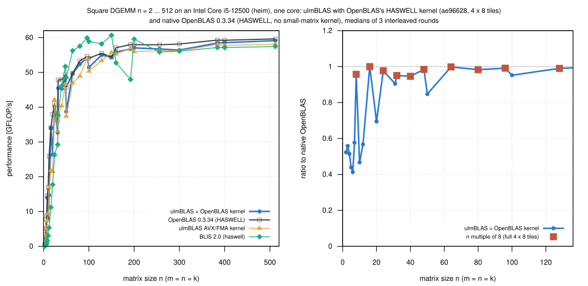

# Small DGEMM on an Intel Core i5-12500 (heim): ulmBLAS with OpenBLAS's HASWELL kernel

Measured 2026-10-27, 15:50 to 16:01, on heim.  This complements the Ice
Lake analysis
[025-2026-10-27-uc3-icelake-small-dgemm-profile](../025-2026-10-27-uc3-icelake-small-dgemm-profile/README.md)
on a CPU where native OpenBLAS has **no** small-matrix kernel (HASWELL
does not define `DGEMM_SMALL_M_PERMIT`, so every DGEMM goes through the
packing driver) and where ulmBLAS and OpenBLAS run the same kernel machine
code (campaign 024).

- programs of experiment iter1 of
  [024-2026-10-27-heim-openblas-haswell-kernel](../024-2026-10-27-heim-openblas-haswell-kernel/README.md):
  ulmBLAS ae96628 with OpenBLAS's HASWELL kernel, ulmBLAS's own AVX/FMA
  kernel, native OpenBLAS 0.3.34 (HASWELL) and BLIS 2.0 (haswell)
- square n = 2 ... 512 (31 sizes), method of campaign 024
  (`source/obhsw-heim.sh` with `SIZES=small`: core 3, idle gate, warm-up,
  7 samples >= 0.2 s, median, 3 rounds with rotated order; first result
  checked: 0 wrong)

## Results

- **Full 4 x 8 tiles (n a multiple of 8): 0.95 to 1.00 of OpenBLAS** from
  n = 8 on (n = 8: 0.96, 16: 1.00, 24: 0.98, 32: 0.95, 48: 0.98, 64: 1.00)
- **Partial tiles cost much more at small n** (n = 10: 0.47, 12: 0.57, 20:
  0.70, 31: 0.91, 50: 0.85, 100: 0.95)
- **n <= 7** (a single partial tile): about 0.03 to 0.08 µs more per call
  (n = 2: 0.064 instead of 0.034 µs)
- **n >= 128**: 0.97 to 1.00 regardless of n mod 8

In short: same algorithm, same kernel, so the small-matrix gap on this CPU
comes from ulmBLAS's handling of partial tiles and a fixed cost per call,
the effects found on Ice Lake, here without a small-matrix kernel in
OpenBLAS.

GFLOP/s, medians of 3 rounds; ratio to OpenBLAS (+ / -: clearly faster /
slower, i.e. the ranges do not overlap and the medians differ by at least
1%):

| n | n mod 8, mod 4 | OpenBLAS | µs | ulmBLAS + OpenBLAS kernel | µs | ratio | ulmBLAS AVX/FMA | ratio | BLIS | ratio |
|---:|---|---:|---:|---:|---:|---:|---:|---:|---:|---:|
| 2 | 2, 2 | 0.48 | 0.034 | 0.25 | 0.064 | 0.523− | 0.26 | 0.552− | 0.03 | 0.056− |
| 3 | 3, 3 | 1.38 | 0.039 | 0.77 | 0.070 | 0.558− | 0.80 | 0.574− | 0.09 | 0.062− |
| 4 | 4, 0 | 3.38 | 0.038 | 1.74 | 0.074 | 0.514− | 1.73 | 0.513− | 0.22 | 0.065− |
| 5 | 5, 1 | 5.10 | 0.049 | 2.24 | 0.112 | 0.438− | 3.10 | 0.608− | 0.39 | 0.076− |
| 6 | 6, 2 | 7.76 | 0.056 | 3.20 | 0.135 | 0.412− | 5.32 | 0.686− | 0.75 | 0.096− |
| 7 | 7, 3 | 8.90 | 0.077 | 5.14 | 0.134 | 0.577− | 5.04 | 0.565− | 1.01 | 0.113− |
| 8 | 0, 0 | 14.52 | 0.071 | 13.90 | 0.074 | 0.957− | 7.41 | 0.510− | 1.72 | 0.118− |
| 10 | 2, 2 | 16.97 | 0.118 | 7.93 | 0.252 | 0.466− | 9.43 | 0.555− | 3.05 | 0.179− |
| 12 | 4, 0 | 25.90 | 0.133 | 14.69 | 0.235 | 0.567− | 17.00 | 0.656− | 5.36 | 0.206− |
| 16 | 0, 0 | 34.06 | 0.240 | 34.06 | 0.241 | 0.999 | 21.86 | 0.641− | 11.20 | 0.328− |
| 20 | 4, 0 | 37.96 | 0.421 | 26.37 | 0.607 | 0.694− | 21.50 | 0.566− | 17.74 | 0.467− |
| 24 | 0, 0 | 41.11 | 0.672 | 40.17 | 0.688 | 0.977 | 42.15 | 1.025 | 26.33 | 0.640− |
| 31 | 7, 3 | 36.11 | 1.650 | 32.66 | 1.824 | 0.904− | 33.10 | 0.916− | 29.23 | 0.809− |
| 32 | 0, 0 | 47.83 | 1.370 | 45.45 | 1.442 | 0.950− | 37.41 | 0.782− | 37.77 | 0.789− |
| 40 | 0, 0 | 47.87 | 2.674 | 45.29 | 2.826 | 0.946− | 40.38 | 0.843− | 46.15 | 0.964− |
| 48 | 0, 0 | 49.28 | 4.488 | 48.51 | 4.559 | 0.984− | 46.60 | 0.945− | 51.70 | 1.049+ |
| 50 | 2, 2 | 45.70 | 5.471 | 38.71 | 6.458 | 0.847− | 37.38 | 0.817− | 48.51 | 1.061+ |
| 64 | 0, 0 | 49.75 | 10.539 | 49.66 | 10.557 | 0.998 | 46.96 | 0.944− | 56.24 | 1.130+ |
| 80 | 0, 0 | 53.30 | 19.212 | 52.38 | 19.551 | 0.982− | 48.91 | 0.917− | 57.54 | 1.079+ |
| 96 | 0, 0 | 54.62 | 32.395 | 54.14 | 32.684 | 0.991 | 54.06 | 0.989− | 59.92 | 1.097+ |
| 100 | 4, 0 | 54.05 | 37.001 | 51.46 | 38.864 | 0.952− | 50.32 | 0.931− | 58.86 | 1.089+ |
| 128 | 0, 0 | 55.52 | 75.539 | 54.98 | 76.293 | 0.990 | 53.38 | 0.961− | 58.20 | 1.048+ |
| 150 | 6, 2 | 54.40 | 124.081 | 54.35 | 124.200 | 0.999 | 55.72 | 1.024+ | 60.67 | 1.115+ |
| 160 | 0, 0 | 57.09 | 143.500 | 55.85 | 146.673 | 0.978− | 55.26 | 0.968− | 52.76 | 0.924− |
| 192 | 0, 0 | 58.00 | 244.074 | 56.72 | 249.586 | 0.977− | 56.96 | 0.982− | 47.96 | 0.826− |
| 200 | 0, 0 | 57.95 | 276.076 | 57.05 | 280.466 | 0.984− | 55.99 | 0.966− | 59.55 | 1.027+ |
| 256 | 0, 0 | 57.94 | 579.154 | 56.72 | 591.612 | 0.978− | 56.24 | 0.970− | 55.85 | 0.964− |
| 300 | 4, 0 | 58.15 | 928.601 | 56.42 | 957.057 | 0.970− | 56.25 | 0.967− | 56.10 | 0.964− |
| 384 | 0, 0 | 59.28 | 1910.232 | 58.45 | 1937.422 | 0.986− | 58.00 | 0.978− | 57.15 | 0.964− |
| 400 | 0, 0 | 59.24 | 2160.666 | 58.54 | 2186.390 | 0.988− | 57.74 | 0.974− | 57.13 | 0.964− |
| 512 | 0, 0 | 59.64 | 4501.156 | 59.12 | 4540.211 | 0.991 | 58.12 | 0.974− | 57.45 | 0.963− |

## Files

- `data/raw/small/small-VARIANT-ROUND.txt`: bench2 output (m n k beta
  median min max calls check).
- `data/runs.csv`, `data/summary/small.csv` (`source/summarize.py` of
  campaign 024 without its profile part).
- `data/logs/small/`: system, program checksums (the programs of campaign
  024, experiment iter1), kernel identity, run log, conditions.
- `source/`: `obhsw-heim.sh`, `bench2.c`, `verify-large.c`,
  `summarize.py`.

Reproduction (on heim, W = the work directory of campaign 024):

    SIZES=small EXTRA="ulmblas-openblas-haswell_4x8-iter1=W/iter1/bench-ulmblas-openblas-haswell_4x8-iter1 ulmblas-avx=W/iter1/bench-ulmblas-avx" \
        sh source/obhsw-heim.sh SRC W/small
    # copy W/small/res to data/raw/small, then: python3 source/summarize.py

## Figures

<!-- BEGIN FIGURES (generated by make add_benchmark_result) -->

<!-- END FIGURES -->
