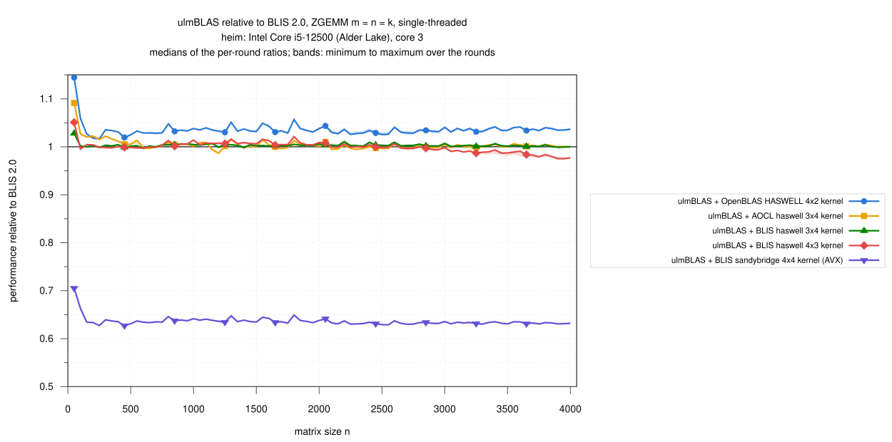
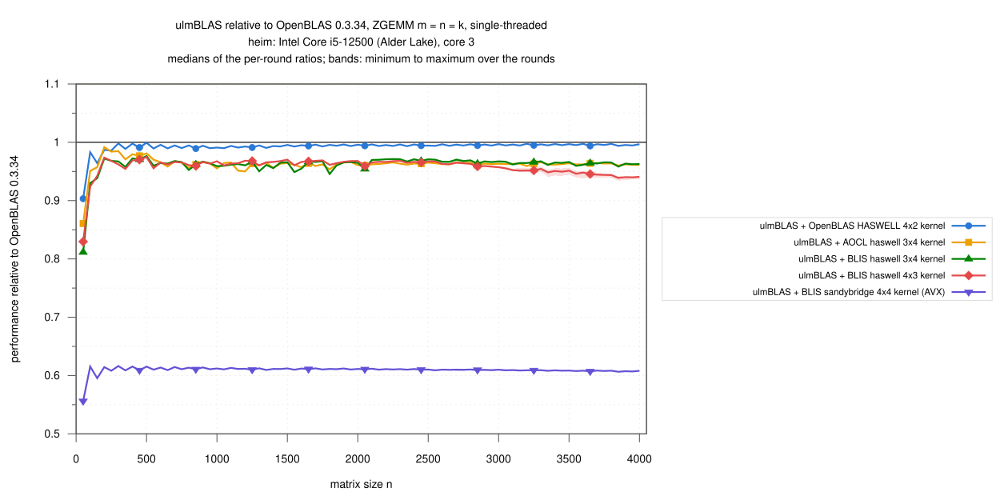
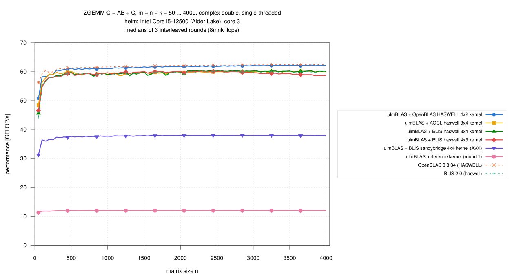

# heim (Intel Core i5-12500): single-threaded ZGEMM, n = 50 … 4000, vendored micro kernels inside ulmBLAS (2026-10-28)

My first complex double campaign: the ZGEMM micro kernels of BLIS,
AOCL-BLAS and OpenBLAS inside ulmBLAS (selected with
`-DULMBLAS_ZGEMM_UKERNEL_...`, `ulmblas/level3/ukernel/blis/select_z.h`)
against native OpenBLAS and BLIS on one core of heim, interleaved over 3
rounds.  Does each kernel inside ulmBLAS reach the library it comes from?

C <- A B + C (alpha = beta = 1), complex double, column major, no
transposition, m = n = k = 50, 100, ..., 4000 (80 sizes), 8 m n k flops per
call.

## Results

- **Every kernel inside ulmBLAS reaches the library it comes from** (n >=
  1000)
  - OpenBLAS's HASWELL kernel: 0.995 of native OpenBLAS
  - BLIS haswell 3x4: 1.003 of native BLIS (the same kernel)
  - BLIS 4x3 and AOCL's version of 3x4: 0.999 and 1.001 of BLIS
- **OpenBLAS's kernel is the fastest ZGEMM kernel on this machine**
  - 3.1% faster than BLIS's haswell 3x4 (median per-size ratio, n >= 1000)
  - so ulmBLAS with it is the first choice for complex double on heim
- **Small matrices** (n = 50 ... 250)
  - with the OpenBLAS kernel 0.98 of OpenBLAS (median; 0.90 at n = 50)
  - the BLIS kernels 0.94 to 0.96, like native BLIS (0.94)
- **Other kernels**
  - 4x3 loses 1.4% against 3x4 for n >= 3000 (median ratio 0.986; 1.001
    for n = 1000 ... 2950), with MC = 36 forced by MR = 4 and NR = 3
  - sandybridge (AVX without FMA) 0.61 of OpenBLAS
  - the portable reference kernel 0.19
- 22 runs, 1760 measurements, none missing, **no wrong result**, all
  commands succeeded
- spread of the rounds per size: median 0.04 to 0.32%, at most 1.3%

### Large matrices, n >= 1000 (61 sizes)

| Variant | GFLOP/s | / OpenBLAS | / BLIS |
|---|---|---|---|
| ulmBLAS + OpenBLAS HASWELL 4x2 | 61.07 … 62.30 | 0.995 (0.990 … 0.997) | 1.034 (1.026 … 1.057) |
| ulmBLAS + AOCL haswell 3x4 | 58.73 … 60.23 | 0.963 (0.950 … 0.966) | 1.001 (0.987 … 1.016) |
| ulmBLAS + BLIS haswell 3x4 | 58.73 … 60.41 | 0.965 (0.946 … 0.971) | 1.003 (0.999 … 1.011) |
| ulmBLAS + BLIS haswell 4x3 | 58.65 … 60.24 | 0.963 (0.939 … 0.970) | 0.999 (0.975 … 1.021) |
| ulmBLAS + BLIS sandybridge 4x4 | 37.67 … 38.03 | 0.610 (0.607 … 0.613) | 0.634 (0.629 … 0.649) |
| ulmBLAS, reference kernel (round 1) | 12.02 … 12.06 | 0.194 (0.193 … 0.195) | 0.201 (0.199 … 0.206) |
| OpenBLAS 0.3.34 (HASWELL) | 61.62 … 62.47 | 1 | 1.040 (1.031 … 1.061) |
| BLIS 2.0 (haswell) | 58.49 … 60.33 | 0.961 (0.942 … 0.970) | 1 |

### GFLOP/s by size range

Medians over the sizes of the range (min ... max), then the median ratio
to OpenBLAS / BLIS:

| Variant | n = 50 … 250 | n = 300 … 500 | n = 550 … 1000 | n = 1050 … 2000 | n = 2050 … 4000 |
|---|---|---|---|---|---|
| ulmBLAS + OpenBLAS HASWELL 4x2 | 58.32 (50.77 … 59.13) · 0.98 / 1.03 | 60.72 (60.40 … 61.23) · 1.00 / 1.03 | 61.05 (60.78 … 61.18) · 0.99 / 1.03 | 61.56 (61.07 … 61.88) · 0.99 / 1.03 | 62.05 (61.72 … 62.30) · 0.99 / 1.03 |
| ulmBLAS + AOCL haswell 3x4 | 57.93 (48.41 … 59.19) · 0.96 / 1.02 | 59.78 (59.34 … 60.09) · 0.98 / 1.01 | 59.29 (58.75 … 59.55) · 0.96 / 1.00 | 59.61 (58.73 … 60.01) · 0.96 / 1.00 | 60.02 (59.66 … 60.23) · 0.96 / 1.00 |
| ulmBLAS + BLIS haswell 3x4 | 56.78 (45.61 … 58.08) · 0.94 / 1.00 | 59.21 (58.53 … 59.81) · 0.97 / 1.00 | 59.19 (58.51 … 59.51) · 0.96 / 1.00 | 59.56 (58.73 … 60.01) · 0.96 / 1.00 | 60.21 (59.26 … 60.41) · 0.97 / 1.00 |
| ulmBLAS + BLIS haswell 4x3 | 57.03 (46.63 … 58.11) · 0.94 / 1.00 | 58.99 (58.32 … 59.71) · 0.97 / 1.00 | 59.27 (58.66 … 59.65) · 0.96 / 1.00 | 59.87 (59.24 … 60.15) · 0.97 / 1.01 | 59.60 (58.65 … 60.24) · 0.96 / 0.99 |
| ulmBLAS + BLIS sandybridge 4x4 | 36.47 (31.27 … 36.67) · 0.61 / 0.63 | 37.39 (37.20 … 37.70) · 0.61 / 0.64 | 37.65 (37.43 … 37.80) · 0.61 / 0.64 | 37.87 (37.67 … 38.01) · 0.61 / 0.64 | 37.98 (37.88 … 38.03) · 0.61 / 0.63 |
| ulmBLAS, reference kernel (round 1) | 11.82 (11.33 … 11.91) · 0.20 / 0.21 | 12.00 (11.99 … 12.04) · 0.20 / 0.20 | 12.03 (12.00 … 12.05) · 0.20 / 0.20 | 12.04 (12.03 … 12.06) · 0.19 / 0.20 | 12.05 (12.03 … 12.06) · 0.19 / 0.20 |
| OpenBLAS 0.3.34 (HASWELL) | 59.69 (56.23 … 60.51) · 1 / 1.06 | 61.09 (60.68 … 61.27) · 1 / 1.03 | 61.48 (61.30 … 61.70) · 1 / 1.04 | 61.95 (61.69 … 62.15) · 1 / 1.04 | 62.34 (62.10 … 62.47) · 1 / 1.04 |
| BLIS 2.0 (haswell) | 56.81 (44.35 … 58.15) · 0.94 / 1 | 58.97 (58.42 … 59.73) · 0.97 / 1 | 59.11 (58.27 … 59.39) · 0.96 / 1 | 59.43 (58.49 … 59.86) · 0.96 / 1 | 60.06 (59.14 … 60.33) · 0.96 / 1 |

## Variants

| Variant (label in the figures) | Library and micro kernel | Build flags of ulmBLAS |
|---|---|---|
| ulmBLAS + OpenBLAS HASWELL 4x2 kernel | `zgemm_kernel_4x2_haswell.c` of OpenBLAS 0.3.34 (NN variant), one call per packed block; MC, KC, NC = 192, 192, 4096 | `-mavx -mavx2 -mfma -DULMBLAS_ZGEMM_UKERNEL_openblas_haswell_4x2` |
| ulmBLAS + AOCL haswell 3x4 kernel | `bli_zgemm_haswell_asm_3x4` of AOCL-BLAS 5.1 (BLIS 0.x interface); 12, 566, 256 | `-mavx -mfma -DULMBLAS_ZGEMM_UKERNEL_blis_aocl_haswell_3x4` |
| ulmBLAS + BLIS haswell 3x4 kernel | `bli_zgemm_haswell_asm_3x4` of BLIS 2.0; 192, 256, 4080 | `-mavx -mfma -DULMBLAS_ZGEMM_UKERNEL_blis_haswell_3x4` |
| ulmBLAS + BLIS haswell 4x3 kernel | `bli_zgemm_haswell_asm_4x3` of BLIS 2.0; 36, 256, 4080 | `-mavx -mfma -DULMBLAS_ZGEMM_UKERNEL_blis_haswell_4x3` |
| ulmBLAS + BLIS sandybridge 4x4 kernel | `bli_zgemm_sandybridge_asm_4x4` of BLIS 2.0 (AVX, no FMA); 64, 192, 4096 | `-mavx -mfma -DULMBLAS_ZGEMM_UKERNEL_blis_sandybridge_4x4` |
| ulmBLAS, reference kernel | ulmBLAS's portable C++ kernel (no complex double kernel of its own on x86-64); round 1 only | `-mavx -mfma` |
| OpenBLAS 0.3.34 (HASWELL) | built from source, `NO_AFFINITY HASWELL SINGLE_THREADED` (`zgemm_kernel_4x2_haswell.c`) | static |
| BLIS 2.0 (haswell) | built from source, configuration `haswell`; ZGEMM with `bli_zgemm_haswell_asm_3x4`, MR, NR, MC, KC, NC = 3, 4, 192, 256, 4080 (method native) | static |

- the kernel of every ulmBLAS library is recorded by its symbols
  (`logs/compile-commands.txt`)
- the native libraries are those of campaign
  [024](../024-2026-10-27-heim-openblas-haswell-kernel/README.md)
  - OpenBLAS reports the core HASWELL and contains `zgemm_kernel_n.o` etc.
    of that target (`logs/kernel-identity.txt`)
  - the BLIS probe did not compile during the campaign; I repeated it on
    2026-10-28 with the corrected `source/kernel-info.c` against the same
    library (SHA-256 checked, `logs/kernel-identity-blis.txt`)
- ulmBLAS: commit 0e75bee with one difference that does not change the
  computation (`Kernel<T>::name()` in `xugemm.h`, for reporting only), `g++
  -O3 -std=c++11` (GCC 12.2.0); all programs call `cblas_zgemm` from
  `source/benchx.c` (`gcc -O2`)
- the tests of the kernels (commit 80dd437, also ASan/UBSan and valgrind)
  pass on heim

## Method

- **Machine**: heim, Intel Core i5-12500, Debian 12, Linux 6.1, governor
  powersave, turbo on; every run pinned to core 3, its sibling and the rest
  idle
- **Load gate**: a run starts only when no other process is runnable and
  the load average is below 1.8 (`logs/conditions.csv`: load 0.92 to 1.70,
  37 to 44 C, one session)
- **Timing** (`benchx.c`): one call checked against long double sums for
  400 random elements of C (also the warm-up, at least 0.3 s), then 3
  samples >= 0.2 s, median
- **Rounds**: 3, order rotated; the reference kernel in round 1 only;
  median over the rounds, bands min to max; ratios within a round
- 2026-10-27 17:56 to 2026-10-28 00:09 (CET)

## Limitations

- one machine, one core; square sizes with alpha = beta = 1 only
- the AOCL kernel comes from AOCL-BLAS 5.1; there is no native AOCL-BLAS
  on heim
- the BLIS kernel identity was determined after the campaign (same
  library file)

## Files

| File | Contents |
|---|---|
| `data/raw/z-VARIANT-ROUND.txt` | output of `benchx` per variant and round (m n k median min max calls err/bound check) |
| `data/runs.csv` | all measurements |
| `data/summary/gemm.csv` | per size and variant: median, minimum, maximum over the rounds (GFLOP/s) |
| `data/summary/ratios.csv` | ratios of the ulmBLAS variants to OpenBLAS and BLIS per size |
| `data/summary/ranges.csv` | the tables above |
| `logs/` | system, compile commands and kernel symbols, kernel identity of the native libraries, conditions, run log, build logs, checksums |
| `source/` | `benchx.c`, `xbench-heim.sh` (campaign script), `start-z-heim.sh` (invocation), `kernel-info.c` (probe, corrected version), `summarize-campaign.py` (data/ from data/raw/) |

## Figures

<!-- BEGIN FIGURES (generated by make add_benchmark_result) -->

<!-- END FIGURES -->
