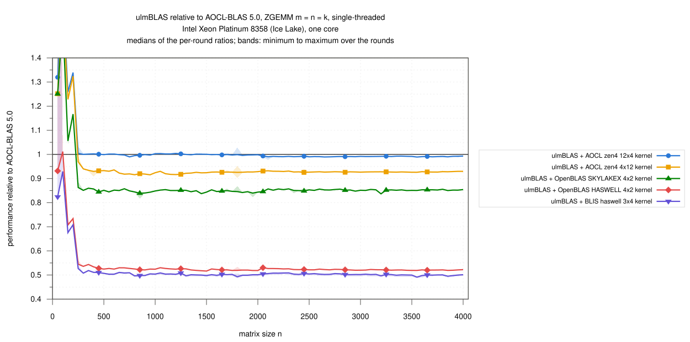
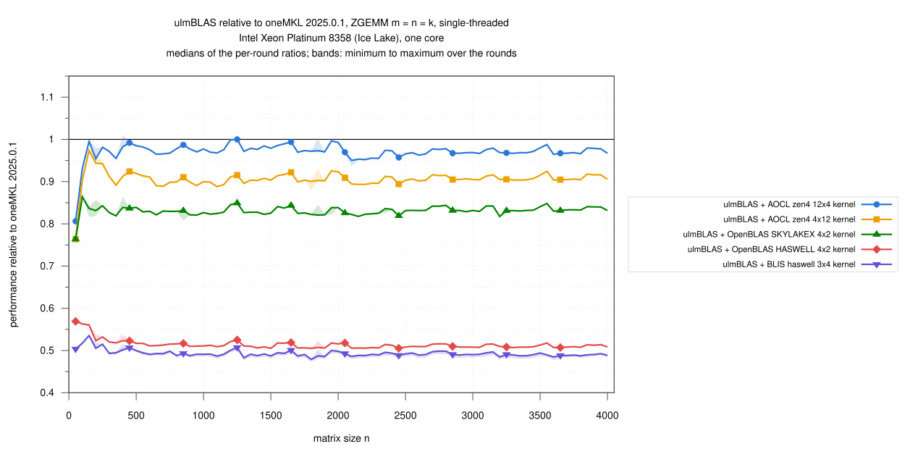
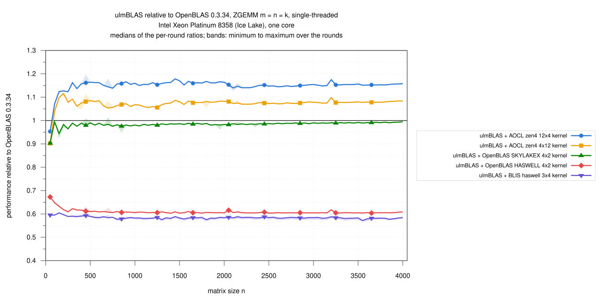
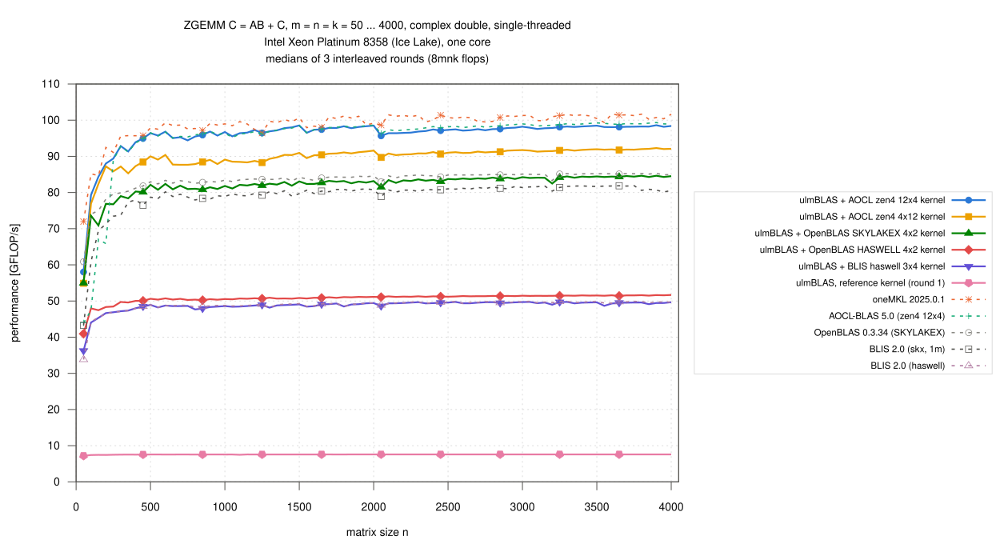

# Intel Xeon Platinum 8358 (Ice Lake): single-threaded ZGEMM, n = 50 … 4000, vendored micro kernels inside ulmBLAS and five libraries (2026-10-28)

My first complex double campaign on Ice Lake: the ZGEMM micro kernels of
AOCL-BLAS, OpenBLAS and BLIS inside ulmBLAS (selected with
`-DULMBLAS_ZGEMM_UKERNEL_...`, `ulmblas/level3/ukernel/blis/select_z.h`)
against oneMKL, AOCL-BLAS, OpenBLAS and BLIS (two configurations), in one
job on an exclusive node, interleaved over 3 rounds.

C <- A B + C (alpha = beta = 1), complex double, column major, no
transposition, m = n = k = 50, 100, ..., 4000 (80 sizes), 8 m n k flops per
call.

## Results

- **AOCL's zen4 12x4 kernel gives the fastest ulmBLAS ZGEMM on Ice Lake**
  (n >= 1000)
  - 95.5 to 98.6 GFLOP/s
  - 0.970 of oneMKL, 0.992 of native AOCL-BLAS (the same kernel)
  - 1.153 times OpenBLAS, 1.206 times BLIS (skx, 1m)
- **Small matrices**
  - native AOCL-BLAS is slow for n <= 200 on this CPU (44 to 67 GFLOP/s);
    ulmBLAS with the same kernel is 1.26 to 1.67 times as fast there and
    equal from n = 250 on
  - against oneMKL ulmBLAS reaches 0.81 (n = 50) to 0.99 for n <= 250
- **Every kernel inside ulmBLAS reaches its native library where both
  exist**
  - OpenBLAS's SKYLAKEX kernel 0.987 of OpenBLAS
  - BLIS's haswell 3x4 0.998 of BLIS haswell (same kernel)
  - AOCL's zen4 12x4 0.992 of AOCL-BLAS
- **Other kernels**
  - 12x4 is 1.07 times as fast as 4x12 (MC = 36 for 4x12)
  - OpenBLAS's AVX2 kernel is 1.04 times BLIS's haswell 3x4; both are
    about half of the AVX-512 kernels
  - the reference kernel reaches 0.075 of oneMKL
- **BLIS 2.0 (skx)** computes ZGEMM with its DGEMM kernel (1m) and reaches
  0.956 of OpenBLAS; without an AVX-512 complex kernel in BLIS, ulmBLAS's
  candidates from BLIS are the AVX2 kernels
- 31 runs, 2480 measurements, none missing, **no wrong result**, all
  commands succeeded
- spread of the rounds per size: median 0.01 to 1.4%, at most 3.0%, except
  one AOCL-BLAS run at n = 50 (round 2: 10.7 instead of 43.9 and 44.0
  GFLOP/s; the median is not affected)

### Large matrices, n >= 1000 (61 sizes)

| Variant | GFLOP/s | / oneMKL | / AOCL-BLAS | / OpenBLAS |
|---|---|---|---|---|
| ulmBLAS + AOCL zen4 12x4 | 95.53 … 98.60 | 0.970 (0.950 … 1.000) | 0.992 (0.989 … 1.004) | 1.153 (1.139 … 1.178) |
| ulmBLAS + AOCL zen4 4x12 | 88.28 … 92.29 | 0.905 (0.888 … 0.925) | 0.927 (0.916 … 0.932) | 1.077 (1.056 … 1.098) |
| ulmBLAS + OpenBLAS SKYLAKEX 4x2 | 81.11 … 84.64 | 0.832 (0.817 … 0.849) | 0.851 (0.837 … 0.857) | 0.987 (0.977 … 0.995) |
| ulmBLAS + OpenBLAS HASWELL 4x2 | 50.47 … 51.67 | 0.509 (0.505 … 0.525) | 0.521 (0.516 … 0.530) | 0.605 (0.603 … 0.617) |
| ulmBLAS + BLIS haswell 3x4 | 48.17 … 49.75 | 0.490 (0.479 … 0.507) | 0.502 (0.491 … 0.509) | 0.583 (0.572 … 0.589) |
| ulmBLAS, reference kernel (round 1) | 7.48 … 7.58 | 0.075 (0.074 … 0.078) | 0.077 (0.076 … 0.079) | 0.089 (0.089 … 0.091) |
| oneMKL 2025.0.1 | 96.46 … 101.69 | 1 | 1.025 (1.002 … 1.042) | 1.189 (1.153 … 1.213) |
| AOCL-BLAS 5.0 (zen4 12x4) | 95.19 … 99.34 | 0.976 (0.960 … 0.998) | 1 | 1.161 (1.146 … 1.183) |
| OpenBLAS 0.3.34 (SKYLAKEX) | 82.95 … 85.29 | 0.841 (0.825 … 0.867) | 0.861 (0.845 … 0.872) | 1 |
| BLIS 2.0 (skx, 1m) | 78.89 … 81.90 | 0.804 (0.791 … 0.823) | 0.824 (0.808 … 0.837) | 0.956 (0.944 … 0.965) |
| BLIS 2.0 (haswell) | 48.15 … 49.92 | 0.492 (0.479 … 0.509) | 0.504 (0.492 … 0.511) | 0.585 (0.575 … 0.594) |

### GFLOP/s by size range

Medians over the sizes of the range (min ... max), then the median ratio
to oneMKL / AOCL-BLAS / OpenBLAS:

| Variant | n = 50 … 250 | n = 300 … 500 | n = 550 … 1000 | n = 1050 … 2000 | n = 2050 … 4000 |
|---|---|---|---|---|---|
| ulmBLAS + AOCL zen4 12x4 | 84.36 (58.02 … 89.39) · 0.95 / 1.32 / 1.12 | 93.92 (91.36 … 96.41) · 0.98 / 1.00 / 1.16 | 95.75 (94.42 … 96.85) · 0.98 / 1.00 / 1.16 | 97.60 (95.53 … 98.54) · 0.98 / 1.00 / 1.16 | 97.84 (95.67 … 98.60) · 0.97 / 0.99 / 1.15 |
| ulmBLAS + AOCL zen4 4x12 | 82.39 (54.90 … 87.23) · 0.94 / 1.25 / 1.08 | 87.31 (85.31 … 90.00) · 0.91 / 0.93 / 1.08 | 88.17 (87.67 … 90.39) · 0.90 / 0.92 / 1.07 | 90.37 (88.28 … 91.59) · 0.90 / 0.93 / 1.08 | 91.52 (89.69 … 92.29) · 0.91 / 0.93 / 1.08 |
| ulmBLAS + OpenBLAS SKYLAKEX 4x2 | 73.60 (54.96 … 76.86) · 0.84 / 1.17 / 0.96 | 80.10 (78.39 … 82.13) · 0.84 / 0.85 / 0.99 | 81.01 (80.76 … 82.38) · 0.83 / 0.85 / 0.98 | 82.49 (81.11 … 83.22) · 0.83 / 0.85 / 0.98 | 84.08 (81.47 … 84.64) · 0.83 / 0.85 / 0.99 |
| ulmBLAS + OpenBLAS HASWELL 4x2 | 47.96 (40.94 … 48.47) · 0.56 / 0.73 / 0.63 | 50.03 (49.59 … 50.61) · 0.52 / 0.53 / 0.62 | 50.39 (50.23 … 50.73) · 0.51 / 0.53 / 0.61 | 50.85 (50.47 … 51.15) · 0.51 / 0.52 / 0.61 | 51.41 (51.08 … 51.67) · 0.51 / 0.52 / 0.60 |
| ulmBLAS + BLIS haswell 3x4 | 45.33 (36.24 … 46.89) · 0.52 / 0.71 / 0.59 | 47.99 (47.18 … 48.92) · 0.50 / 0.51 / 0.59 | 48.52 (47.67 … 48.75) · 0.49 / 0.50 / 0.58 | 48.90 (48.17 … 49.43) · 0.49 / 0.50 / 0.58 | 49.53 (48.59 … 49.75) · 0.49 / 0.50 / 0.58 |
| ulmBLAS, reference kernel (round 1) | 7.44 (7.18 … 7.49) · 0.09 / 0.11 / 0.10 | 7.54 (7.52 … 7.56) · 0.08 / 0.08 / 0.09 | 7.56 (7.55 … 7.56) · 0.08 / 0.08 / 0.09 | 7.57 (7.48 … 7.58) · 0.08 / 0.08 / 0.09 | 7.58 (7.58 … 7.58) · 0.07 / 0.08 / 0.09 |
| oneMKL 2025.0.1 | 85.18 (71.95 … 92.46) · 1 / 1.40 / 1.15 | 95.72 (95.61 … 97.86) · 1 / 1.02 / 1.18 | 98.59 (97.19 … 99.28) · 1 / 1.02 / 1.19 | 99.43 (96.46 … 101.15) · 1 / 1.02 / 1.19 | 101.02 (98.66 … 101.69) · 1 / 1.02 / 1.19 |
| AOCL-BLAS 5.0 (zen4 12x4) | 65.86 (43.94 … 88.99) · 0.71 / 1 / 0.84 | 93.69 (91.20 … 96.52) · 0.98 / 1 / 1.16 | 95.97 (95.09 … 96.94) · 0.98 / 1 / 1.16 | 97.60 (95.19 … 98.61) · 0.98 / 1 / 1.16 | 98.63 (96.32 … 99.34) · 0.98 / 1 / 1.16 |
| OpenBLAS 0.3.34 (SKYLAKEX) | 75.01 (60.87 … 79.58) · 0.87 / 1.19 / 1 | 81.20 (79.89 … 82.97) · 0.85 / 0.86 / 1 | 82.94 (82.38 … 83.43) · 0.84 / 0.86 / 1 | 83.89 (83.03 … 84.60) · 0.84 / 0.86 / 1 | 84.97 (82.95 … 85.29) · 0.84 / 0.86 / 1 |
| BLIS 2.0 (skx, 1m) | 69.44 (43.27 … 73.45) · 0.77 / 1.04 / 0.91 | 77.32 (73.72 … 78.72) · 0.80 / 0.81 / 0.95 | 78.81 (77.94 … 80.19) · 0.80 / 0.82 / 0.95 | 80.22 (79.00 … 81.01) · 0.80 / 0.82 / 0.96 | 81.11 (78.89 … 81.90) · 0.80 / 0.82 / 0.96 |
| BLIS 2.0 (haswell) | 45.45 (33.82 … 46.93) · 0.52 / 0.70 / 0.59 | 47.95 (47.11 … 48.96) · 0.50 / 0.51 / 0.59 | 48.69 (48.23 … 48.85) · 0.49 / 0.51 / 0.59 | 49.09 (48.15 … 49.46) · 0.49 / 0.50 / 0.58 | 49.68 (48.86 … 49.92) · 0.49 / 0.50 / 0.58 |

## Variants

| Variant (label in the figures) | Library and micro kernel | Build flags of ulmBLAS |
|---|---|---|
| ulmBLAS + AOCL zen4 12x4 kernel | `bli_zgemm_zen4_asm_12x4` of AOCL-BLAS 5.1 (AVX-512); MC, KC, NC = 60, 512, 2004 | `-mavx -mfma -mavx512f -mavx512dq -DULMBLAS_ZGEMM_UKERNEL_blis_zen4_12x4` |
| ulmBLAS + AOCL zen4 4x12 kernel | `bli_zgemm_zen4_asm_4x12` of AOCL-BLAS 5.1 (AVX-512); 36, 512, 2004 | `... -DULMBLAS_ZGEMM_UKERNEL_blis_zen4_4x12` |
| ulmBLAS + OpenBLAS SKYLAKEX 4x2 kernel | `zgemm_kernel_4x2_skylakex.c` of OpenBLAS 0.3.34 (NN variant), one call per packed block; 256, 128, 4096 | `... -DULMBLAS_ZGEMM_UKERNEL_openblas_skylakex_4x2` |
| ulmBLAS + OpenBLAS HASWELL 4x2 kernel | `zgemm_kernel_4x2_haswell.c` of OpenBLAS 0.3.34 (AVX2); 192, 192, 4096 | `-mavx -mavx2 -mfma -DULMBLAS_ZGEMM_UKERNEL_openblas_haswell_4x2` |
| ulmBLAS + BLIS haswell 3x4 kernel | `bli_zgemm_haswell_asm_3x4` of BLIS 2.0 (AVX2); 192, 256, 4080 | `-mavx -mfma -DULMBLAS_ZGEMM_UKERNEL_blis_haswell_3x4` |
| ulmBLAS, reference kernel | ulmBLAS's portable C++ kernel (no complex double kernel of its own on x86-64); round 1 only | `-mavx -mfma` |
| oneMKL 2025.0.1 | cluster installation, `mkl_sequential`, LP64; code path reported by `MKL_VERBOSE`: AVX-512 | static |
| AOCL-BLAS 5.0 | cluster installation (AOCC build); on this CPU it selects `zen4` and uses `bli_zgemm_zen4_asm_12x4`, MR, NR, MC, KC, NC = 12, 4, 60, 512, 2004 (method native) | static |
| OpenBLAS 0.3.34 (SKYLAKEX) | built from source, `NO_AFFINITY SKYLAKEX SINGLE_THREADED` | static |
| BLIS 2.0 (skx, 1m) | built from source, `auto` configuration, selects `skx`; skx has no optimized complex kernel (the ZGEMM kernel is the reference implementation, 4 x 4), so BLIS computes ZGEMM with the induced method 1m and the DGEMM kernel `bli_dgemm_skx_asm_16x14` (16, 14, 240, 256, 3752) | static |
| BLIS 2.0 (haswell) | built from source, configuration `haswell`: `bli_zgemm_haswell_asm_3x4`, 3, 4, 192, 256, 4080 (method native) | static |

- the native libraries are those of campaign
  [023](../023-2026-10-27-uc3-icelake-dgemm-single-thread/README.md)
- the kernel of every ulmBLAS library is recorded by its symbols
  (`logs/compile-commands.txt`); OpenBLAS's core and MKL's code path in
  `logs/kernel-identity.txt`
- the BLIS and AOCL probes did not compile during the campaign; I repeated
  them on 2026-10-28 with the corrected `source/kernel-info.c` on another
  node against the same library files (job 8039650,
  `source/zprobe-uc3.sbatch`, `logs/kernel-identity-blis-aocl.txt`)
- the kernel ulmBLAS takes from AOCL is that of AOCL-BLAS 5.1; native
  AOCL-BLAS is 5.0
- ulmBLAS: commit 0e75bee with one difference that does not change the
  computation (`Kernel<T>::name()`, for reporting only), `g++ -O3
  -std=c++11` (GCC 14.2.0); all programs call `cblas_zgemm` from
  `source/benchx.c` (`gcc -O2`)
- the tests of the kernels (commit 80dd437, 16 configurations, also
  ASan/UBSan) pass on Ice Lake

## Method

- **Node**: Slurm job 8028076 on `uc2n791` (`cpu_il`, exclusive), 2 x
  Xeon Platinum 8358, 2.6 GHz, turbo on, governor `performance`, SMT on;
  RHEL 9.6
  - every run on CPU 3 with memory on NUMA node 0; load average 0.97 to
    1.07 before the runs
- **One thread** everywhere (environment variables; OpenBLAS built
  single-threaded, MKL sequential)
- **Timing** (`benchx.c`): one call checked against long double sums for
  400 random elements of C (also the warm-up, at least 0.3 s), then 3
  samples >= 0.2 s, median
- **Rounds**: 3, order rotated; the reference kernel in round 1 only;
  median over the rounds, bands min to max; ratios within a round
- 2026-10-27 17:56 to 2026-10-28 00:54 (CET)

## Limitations

- one node, one core; square sizes with alpha = beta = 1 only
- the vendored AOCL kernels come from AOCL-BLAS 5.1, native AOCL-BLAS is
  5.0
- the kernel identities of native BLIS and AOCL-BLAS were determined
  after the campaign on another node (same library files)

## Files

| File | Contents |
|---|---|
| `data/raw/z-VARIANT-ROUND.txt` | output of `benchx` per variant and round (m n k median min max calls err/bound check) |
| `data/runs.csv` | all measurements |
| `data/summary/gemm.csv` | per size and variant: median, minimum, maximum over the rounds (GFLOP/s) |
| `data/summary/ratios.csv` | ratios of the ulmBLAS variants to oneMKL, AOCL-BLAS, OpenBLAS and BLIS per size |
| `data/summary/ranges.csv` | the tables above |
| `logs/` | system, compile commands and kernel symbols, kernel identity of the native libraries, conditions, run log, build logs, checksums |
| `source/` | `benchx.c`, `xbench-uc3.sbatch` (job script), `submit-z-icelake.sh` (invocation), `kernel-info.c` (probe, corrected version), `zprobe-uc3.sbatch` (probe job), `summarize-campaign.py` (data/ from data/raw/) |

## Figures

<!-- BEGIN FIGURES (generated by make add_benchmark_result) -->

<!-- END FIGURES -->
