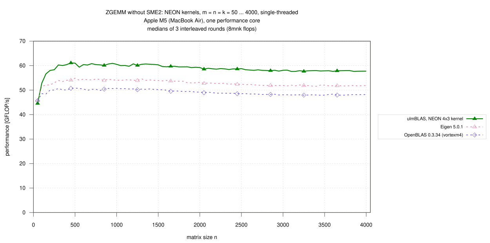
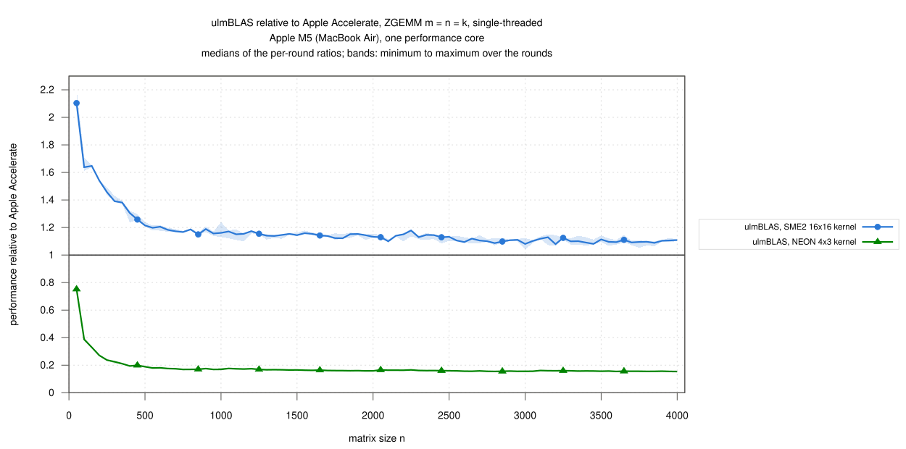
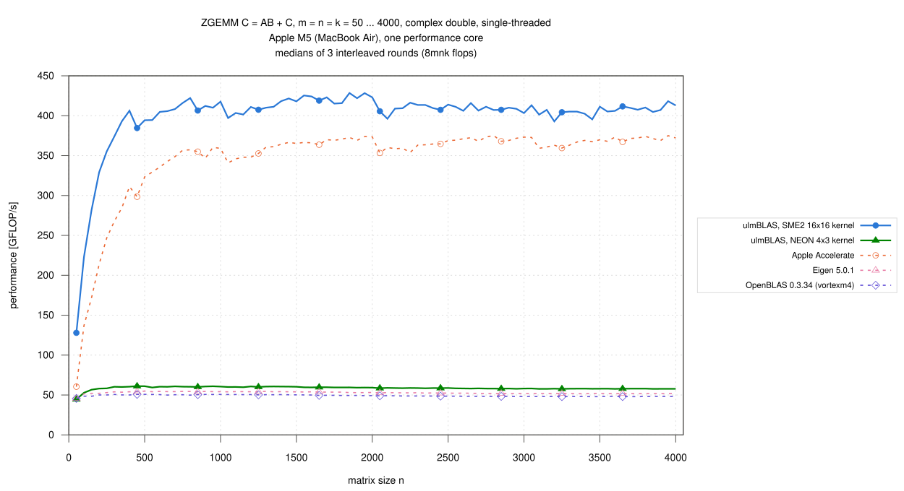

# Apple M5 (MacBook Air): single-threaded ZGEMM, n = 50 … 4000, ulmBLAS's NEON and SME2 kernels (2026-10-28)

My first complex double campaign on Apple silicon: ulmBLAS's own ZGEMM
kernels for NEON (4 x 3) and SME2 (16 x 16, with streaming-mode packing)
against Apple Accelerate, OpenBLAS and Eigen on one performance core of an
Apple M5, interleaved over 3 rounds under the thermal guard of campaign
[022](../022-2026-10-27-macbook-m5-sme-blocking/README.md).

C <- A B + C (alpha = beta = 1), complex double, column major, no
transposition, m = n = k = 50, 100, ..., 4000 (80 sizes), 8 m n k flops per
call.

## Results

- **The SME2 kernel is faster than Accelerate at every size**
  - 1.08 to 2.10 times as fast (medians per size), at least 1.04 in every
    round
  - 1.123 for n >= 1000 (393 to 428 GFLOP/s)
  - 1.64 for n = 50 ... 250
- **The NEON kernel is the fastest NEON implementation**: 1.20 times
  OpenBLAS and 1.11 times Eigen for n >= 1000 (57.6 to 60.7 GFLOP/s)
- **SME2 is 6.5 to 7.2 times as fast as NEON** for n >= 500
- **SME2 drops after n = 1000 and 2000** (417.6 GFLOP/s at n = 1000, 397.1
  at 1050; 423.0 at 2000, 405.6 at 2050), consistent with the steps at
  multiples of KC = 1024 found for DGEMM in campaign 022 (not analyzed
  here)
- 1200 measurements (5 variants x 80 sizes x 3 rounds), none missing, **no
  wrong result**, all commands succeeded
- spread of the rounds per size: median 0.5 to 0.7% for NEON, Eigen and
  OpenBLAS, 1.8% for Accelerate, 2.7% for SME2, at most 3.9 to 8.9%; the
  medians of the three rounds for n >= 1000 differ by less than 1% for
  every variant

### Large matrices, n >= 1000 (61 sizes)

| Variant | GFLOP/s | / Accelerate | / OpenBLAS |
|---|---|---|---|
| ulmBLAS, SME2 16x16 | 392.88 … 428.45 | 1.123 (1.079 … 1.178) | 8.426 (7.850 … 8.712) |
| ulmBLAS, NEON 4x3 | 57.64 … 60.71 | 0.160 (0.154 … 0.176) | 1.203 (1.184 … 1.211) |
| Apple Accelerate | 340.86 … 375.25 | 1 | 7.535 (6.735 … 7.820) |
| Eigen 5.0.1 | 51.58 … 54.61 | 0.143 (0.138 … 0.158) | 1.077 (1.066 … 1.088) |
| OpenBLAS 0.3.34 (vortexm4) | 47.94 … 50.71 | 0.133 (0.128 … 0.148) | 1 |

### GFLOP/s by size range

Medians over the sizes of the range (min ... max), then the median ratio
to Accelerate / OpenBLAS:

| Variant | n = 50 … 250 | n = 300 … 500 | n = 550 … 1000 | n = 1050 … 2000 | n = 2050 … 4000 |
|---|---|---|---|---|---|
| ulmBLAS, SME2 16x16 | 281.88 (127.92 … 355.22) · 1.64 / 5.80 | 393.10 (373.98 … 406.28) · 1.30 / 7.76 | 409.20 (394.57 … 422.14) · 1.18 / 8.12 | 418.14 (397.11 … 428.45) · 1.15 / 8.39 | 407.45 (392.88 … 418.20) · 1.11 / 8.46 |
| ulmBLAS, NEON 4x3 | 56.64 (44.58 … 58.32) · 0.33 / 1.16 | 60.42 (60.05 … 61.12) · 0.20 / 1.20 | 60.42 (59.39 … 60.94) · 0.17 / 1.20 | 59.74 (59.21 … 60.71) · 0.17 / 1.20 | 57.99 (57.64 … 58.92) · 0.16 / 1.20 |
| Apple Accelerate | 171.95 (60.44 … 246.79) · 1 / 3.54 | 298.49 (267.64 … 323.38) · 1 / 6.00 | 351.84 (329.39 … 360.39) · 1 / 6.97 | 365.64 (340.86 … 373.83) · 1 / 7.30 | 368.42 (353.35 … 375.25) · 1 / 7.63 |
| Eigen 5.0.1 | 52.10 (45.75 … 53.02) · 0.30 / 1.06 | 54.04 (53.51 … 54.87) · 0.18 / 1.07 | 54.21 (53.94 … 54.49) · 0.15 / 1.07 | 53.93 (52.95 … 54.61) · 0.15 / 1.08 | 51.93 (51.58 … 52.93) · 0.14 / 1.08 |
| OpenBLAS 0.3.34 (vortexm4) | 48.54 (45.66 … 50.03) · 0.28 / 1 | 50.68 (50.06 … 50.83) · 0.17 / 1 | 50.45 (49.86 … 50.71) · 0.14 / 1 | 50.15 (49.18 … 50.60) · 0.14 / 1 | 48.20 (47.94 … 49.18) · 0.13 / 1 |

## Variants

| Variant (label in the figures) | Library and micro kernel | Build |
|---|---|---|
| ulmBLAS, SME2 16x16 kernel | ulmBLAS 4fcbe80, `sme/zgemm.tcc` (16 x 16, real and imaginary parts in ZA0 … ZA7, FMOPA/FMOPS) with streaming-mode packing `sme/zpack.tcc`; MC, KC, NC = 384, 1024, 1024 | `make cblas ARCHFLAGS=-mcpu=apple-m4` |
| ulmBLAS, NEON 4x3 kernel | ulmBLAS 4fcbe80, `neon/zgemm.tcc` (4 x 3, 24 accumulators); 192, 512, 4080 | `make cblas` (default on AArch64) |
| Apple Accelerate | macOS 26.6, `cblas_zgemm` of the system's `libBLAS.dylib`, `VECLIB_MAXIMUM_THREADS=1` | `-framework Accelerate` |
| OpenBLAS 0.3.34 (vortexm4) | Homebrew, `DYNAMIC_ARCH`, core `vortexm4`, `OPENBLAS_NUM_THREADS=1` | dynamic |
| Eigen 5.0.1 | Homebrew, header only, `C.noalias() += A*B` (Eigen's own NEON kernels, no OpenMP) | `c++ -std=c++14 -O3 -mcpu=native` |

- ulmBLAS: Apple clang 21.0.0 (`-O3 -std=c++11`); the library sources of
  both builds are those of commit 4fcbe80 (checked file by file)
- the kernel each build selects is recorded by `ulmblas-kernels`
  (`logs/kernels-*.txt`: complex double `sme`, 16 x 16 and `neon`, 4 x 3),
  the library each program calls by `benchx -i` (`logs/identity-*.txt`)
- the BLAS libraries are called through `cblas_zgemm` from
  `source/benchx.c` (`cc -O2`), Eigen through `source/bench-eigen.cpp`
- the tests of the kernels (`make check` with NEON and SME2, also with
  small block sizes and ASan/UBSan) pass on this machine

## Method

- **Machine**: MacBook Air, Apple M5 (4 performance, 6 efficiency cores,
  32 GB), macOS 26.6, on mains power; QoS class user-interactive
  (performance cores)
  - not otherwise idle: load average 1.7 to 3.5 before the sizes
    (`logs/conditions.csv`)
- **Thermal guard** (`source/guard.sh`, `thermal.m`)
  - a run starts only in the nominal thermal state with load average below
    4, after a pause of 10 s
  - it counts only if the state is still nominal afterwards; otherwise it
    is repeated (at most 3 tries)
  - 58 runs were repeated, none needed a third try (`logs/discards.txt`)
  - FMA throughput of the core (`source/peak.c`): 61.4 to 67.2 GFLOP/s
    before the sizes
- **Timing** (`benchx.c`, `bench-eigen.cpp`): one program run per size:
  one call checked against long double sums for 400 random elements of C
  (also the warm-up, at least 0.3 s), then 3 samples >= 0.2 s, median
- **Rounds**: 3; per round and size the variants in random order (seeded
  with round and size); median over the rounds, bands min to max; ratios
  within a round
- 2026-10-27 22:35 to 2026-10-28 08:17 (CET)

## Limitations

- one machine, one core, a MacBook Air without active cooling that was not
  otherwise idle (load average up to 3.5); the thermal guard discards runs
  that end in a higher thermal state, but cannot exclude every influence
  of other processes
- square sizes with alpha = beta = 1 only; Accelerate only with
  `VECLIB_MAXIMUM_THREADS=1`

## Files

| File | Contents |
|---|---|
| `data/raw/z-VARIANT-ROUND.txt` | output of `benchx` / `bench-eigen` per variant and round (m n k median min max calls err/bound check) |
| `data/runs.csv` | all measurements |
| `data/summary/gemm.csv` | per size and variant: median, minimum, maximum over the rounds (GFLOP/s) |
| `data/summary/ratios.csv` | ratios of the ulmBLAS variants to Accelerate and OpenBLAS per size |
| `data/summary/ranges.csv` | the tables above |
| `logs/` | system, compile commands, kernels of the ulmBLAS builds, library identity of the programs, run log, conditions per size, discarded runs, build logs, checksums |
| `source/` | `zbench-mac.sh` (campaign script), `guard.sh`, `thermal.m`, `peak.c` (thermal guard, FMA throughput), `benchx.c`, `bench-eigen.cpp`, `ulmblas-kernels.cc`, `summarize-campaign.py` (data/ from data/raw/) |

## Figures

<!-- BEGIN FIGURES (generated by make add_benchmark_result) -->

<!-- END FIGURES -->
