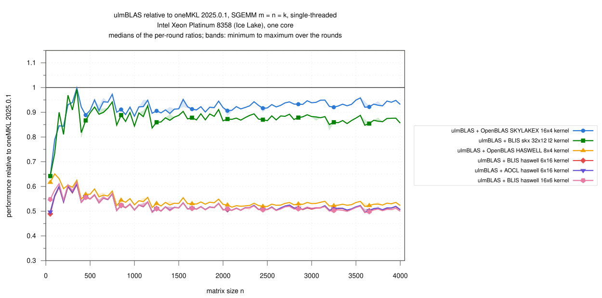
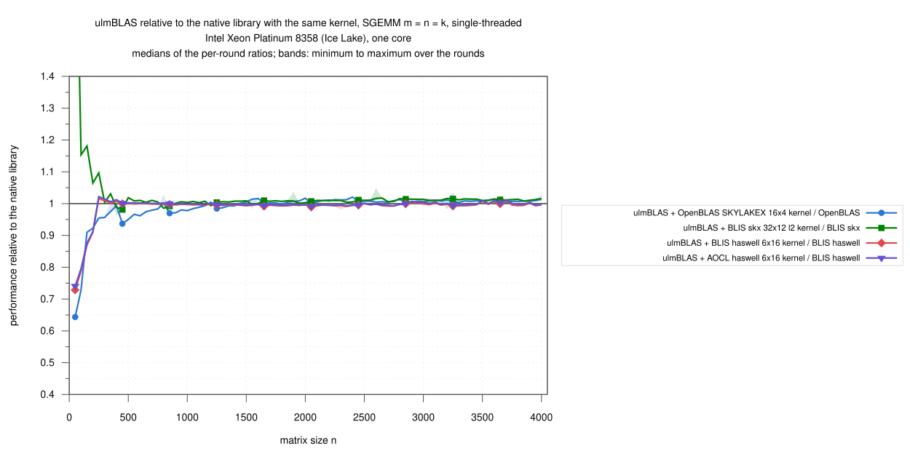
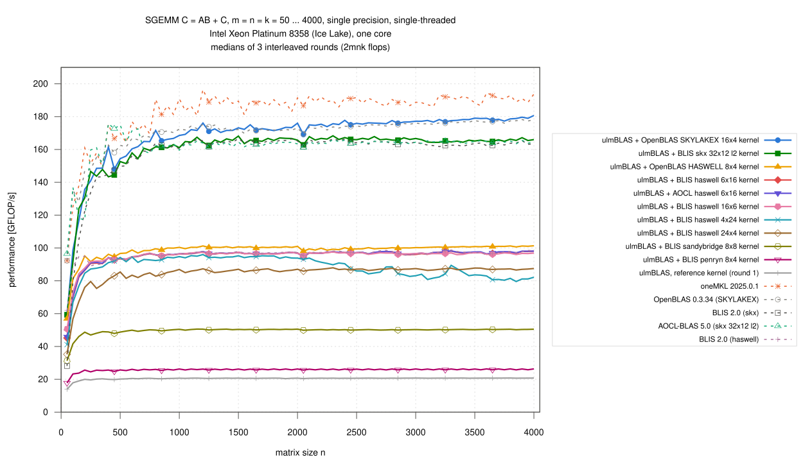

# Intel Xeon Platinum 8358 (Ice Lake): single-threaded SGEMM, n = 50 … 4000, vendored micro kernels inside ulmBLAS and five libraries (2026-10-28)

The first single precision campaign on Ice Lake: the SGEMM micro kernels
of BLIS, AOCL-BLAS and OpenBLAS inside ulmBLAS (selected with
`-DULMBLAS_SGEMM_UKERNEL_...`, `ulmblas/level3/ukernel/blis/select_s.h`)
against oneMKL, OpenBLAS, AOCL-BLAS and BLIS (two configurations), in one
job on an exclusive node, interleaved over 3 rounds.

C <- A B + C (alpha = beta = 1), float, column major, no transposition,
m = n = k = 50, 100, ..., 4000 (80 sizes), 2 m n k flops per call.

## Results

- **OpenBLAS's SKYLAKEX kernel gives the fastest ulmBLAS SGEMM** (n >=
  1000)
  - 168.5 to 180.7 GFLOP/s
  - 1.007 of native OpenBLAS (the same kernel)
  - 0.925 of oneMKL, 1.065 times BLIS skx
- **BLIS's skx 32x12 l2 kernel inside ulmBLAS**
  - 161 to 168 GFLOP/s, 1.010 of native BLIS skx (same kernel, same block
    sizes)
  - 1.011 of AOCL-BLAS, which uses the same kernel on this CPU
  - 0.95 of the OpenBLAS kernel inside ulmBLAS
- **oneMKL is the fastest library**: 181 to 196 GFLOP/s, 1.087 times
  OpenBLAS
- **The AVX2 kernels reach about half of the AVX-512 kernels**
  - OpenBLAS HASWELL 8x4 is the fastest of them, 98 to 101 GFLOP/s
  - BLIS haswell 6x16 inside ulmBLAS: 0.995 of native BLIS haswell (same
    kernel); AOCL's version of it 0.997, the transposed 16x6 0.996
  - **4x24 drops for n >= 2450**: 80 to 87 instead of 94 to 96 GFLOP/s,
    in all three rounds; 24x4 does not (85 to 88 throughout); not
    investigated
- **Without FMA**: sandybridge 8x8 (AVX) 50 GFLOP/s, penryn 8x4 (SSE3)
  26; the reference kernel 20.7, 0.109 of oneMKL
- **Small matrices** (n <= 250)
  - ulmBLAS's AVX-512 kernels reach 0.81 to 0.84 of oneMKL (median over
    the range); at n = 50 59 GFLOP/s against 92 for oneMKL and OpenBLAS
  - native BLIS skx is slow at n = 50 (28 GFLOP/s); ulmBLAS with the same
    kernel 2.1 times as fast
  - AOCL-BLAS is the fastest library for n = 300 … 500 (1.02 of oneMKL)
    and falls to 0.86 to 0.91 above
- 46 runs, 3680 measurements, none missing, **no wrong result**, all
  commands succeeded
- spread of the rounds per size: median 0.17%, at most 3.6%

### Large matrices, n >= 1000 (61 sizes)

Ratios: medians of the per-round ratios over the sizes (min … max).

| Variant | GFLOP/s | / oneMKL | / OpenBLAS | / BLIS skx |
|---|---|---|---|---|
| ulmBLAS + OpenBLAS SKYLAKEX 16x4 | 168.5 … 180.7 | 0.925 (0.884 … 0.958) | 1.007 (0.978 … 1.021) | 1.065 (1.032 … 1.105) |
| ulmBLAS + BLIS skx 32x12 l2 | 161.1 … 168.3 | 0.876 (0.837 … 0.927) | 0.948 (0.929 … 0.976) | 1.010 (0.993 … 1.017) |
| ulmBLAS + OpenBLAS HASWELL 8x4 | 98.0 … 101.3 | 0.528 (0.515 … 0.556) | 0.572 (0.567 … 0.591) | 0.612 (0.596 … 0.625) |
| ulmBLAS + AOCL haswell 6x16 | 94.6 … 98.2 | 0.512 (0.496 … 0.538) | 0.557 (0.546 … 0.569) | 0.591 (0.584 … 0.604) |
| ulmBLAS + BLIS haswell 6x16 | 94.5 … 98.1 | 0.511 (0.495 … 0.537) | 0.556 (0.545 … 0.568) | 0.590 (0.583 … 0.604) |
| ulmBLAS + BLIS haswell 16x6 | 95.2 … 97.6 | 0.509 (0.495 … 0.538) | 0.555 (0.541 … 0.569) | 0.589 (0.583 … 0.600) |
| ulmBLAS + BLIS haswell 4x24 | 79.6 … 96.0 | 0.466 (0.418 … 0.526) | 0.505 (0.448 … 0.554) | 0.539 (0.485 … 0.590) |
| ulmBLAS + BLIS haswell 24x4 | 85.0 … 87.9 | 0.458 (0.442 … 0.479) | 0.497 (0.486 … 0.509) | 0.529 (0.516 … 0.541) |
| ulmBLAS + BLIS sandybridge 8x8 | 49.9 … 50.6 | 0.265 (0.257 … 0.280) | 0.287 (0.282 … 0.296) | 0.306 (0.301 … 0.314) |
| ulmBLAS + BLIS penryn 8x4 | 25.6 … 26.4 | 0.137 (0.133 … 0.143) | 0.149 (0.146 … 0.153) | 0.159 (0.155 … 0.164) |
| ulmBLAS, reference kernel (round 1) | 20.4 … 20.8 | 0.109 (0.105 … 0.114) | 0.118 (0.116 … 0.121) | 0.125 (0.123 … 0.128) |
| oneMKL 2025.0.1 | 180.7 … 196.5 | 1 | 1.087 (1.047 … 1.121) | 1.153 (1.087 … 1.193) |
| OpenBLAS 0.3.34 (SKYLAKEX) | 169.5 … 178.3 | 0.920 (0.892 … 0.955) | 1 | 1.060 (1.030 … 1.091) |
| BLIS 2.0 (skx) | 160.5 … 166.7 | 0.868 (0.838 … 0.920) | 0.943 (0.917 … 0.971) | 1 |
| AOCL-BLAS 5.0 (skx 32x12 l2) | 159.6 … 166.1 | 0.865 (0.834 … 0.914) | 0.939 (0.921 … 0.959) | 0.997 (0.984 … 1.019) |
| BLIS 2.0 (haswell) | 95.4 … 98.7 | 0.513 (0.491 … 0.539) | 0.559 (0.541 … 0.571) | 0.592 (0.581 … 0.608) |

### GFLOP/s by size range

Median over the sizes of the range · median ratio to oneMKL:

| Variant | n = 50 … 250 | n = 300 … 500 | n = 550 … 1000 | n = 1050 … 2000 | n = 2050 … 4000 |
|---|---|---|---|---|---|
| ulmBLAS + OpenBLAS SKYLAKEX 16x4 | 116.6 · 0.84 | 148.6 · 0.92 | 165.1 · 0.92 | 172.2 · 0.92 | 177.2 · 0.93 |
| ulmBLAS + BLIS skx 32x12 l2 | 124.0 · 0.81 | 144.4 · 0.90 | 160.8 · 0.90 | 165.6 · 0.88 | 165.9 · 0.87 |
| ulmBLAS + OpenBLAS HASWELL 8x4 | 87.0 · 0.62 | 94.7 · 0.57 | 98.8 · 0.55 | 100.4 · 0.53 | 100.2 · 0.53 |
| ulmBLAS + AOCL haswell 6x16 | 82.9 · 0.56 | 92.9 · 0.56 | 95.9 · 0.53 | 96.7 · 0.51 | 97.3 · 0.51 |
| ulmBLAS + BLIS haswell 6x16 | 82.3 · 0.56 | 92.8 · 0.56 | 95.8 · 0.53 | 96.6 · 0.51 | 97.2 · 0.51 |
| ulmBLAS + BLIS haswell 16x6 | 84.3 · 0.58 | 92.7 · 0.56 | 95.8 · 0.53 | 96.6 · 0.51 | 96.7 · 0.51 |
| ulmBLAS + BLIS haswell 4x24 | 76.8 · 0.54 | 91.1 · 0.55 | 92.9 · 0.52 | 94.5 · 0.50 | 84.3 · 0.45 |
| ulmBLAS + BLIS haswell 24x4 | 67.3 · 0.47 | 81.0 · 0.50 | 83.8 · 0.47 | 86.2 · 0.46 | 87.1 · 0.46 |
| ulmBLAS + BLIS sandybridge 8x8 | 46.0 · 0.33 | 48.8 · 0.29 | 49.9 · 0.28 | 50.4 · 0.27 | 50.2 · 0.26 |
| ulmBLAS + BLIS penryn 8x4 | 23.8 · 0.17 | 25.6 · 0.15 | 25.9 · 0.14 | 26.0 · 0.14 | 26.0 · 0.14 |
| ulmBLAS, reference kernel (round 1) | 19.0 · 0.14 | 20.1 · 0.12 | 20.5 · 0.12 | 20.6 · 0.11 | 20.7 · 0.11 |
| oneMKL 2025.0.1 | 137.9 · 1.00 | 166.7 · 1.00 | 179.2 · 1.00 | 188.5 · 1.00 | 190.1 · 1.00 |
| OpenBLAS 0.3.34 (SKYLAKEX) | 135.5 · 0.98 | 158.1 · 0.96 | 169.3 · 0.94 | 172.2 · 0.91 | 175.6 · 0.92 |
| BLIS 2.0 (skx) | 105.0 · 0.76 | 145.1 · 0.88 | 159.8 · 0.90 | 164.9 · 0.87 | 163.8 · 0.87 |
| AOCL-BLAS 5.0 (skx 32x12 l2) | 118.0 · 1.04 | 172.7 · 1.02 | 162.2 · 0.91 | 163.4 · 0.87 | 164.5 · 0.86 |
| BLIS 2.0 (haswell) | 89.2 · 0.67 | 92.8 · 0.56 | 95.8 · 0.53 | 97.1 · 0.52 | 97.5 · 0.51 |

## Variants

| Variant (label in the figures) | Library and micro kernel | Build flags of ulmBLAS |
|---|---|---|
| ulmBLAS + OpenBLAS SKYLAKEX 16x4 kernel | `sgemm_kernel_16x4_skylakex_3.c` of OpenBLAS 0.3.34 (AVX-512), one call per packed block; MC, KC, NC = 448, 448, 4096 | `-mavx -mfma -mavx512f -DULMBLAS_SGEMM_UKERNEL_openblas_skylakex_16x4` |
| ulmBLAS + BLIS skx 32x12 l2 kernel | `bli_sgemm_skx_asm_32x12_l2` of BLIS 2.0 (AVX-512); 480, 384, 3072 | `-mavx -mfma -mavx512f -DULMBLAS_SGEMM_UKERNEL_blis_skx_32x12_l2` |
| ulmBLAS + OpenBLAS HASWELL 8x4 kernel | `sgemm_kernel_8x4_haswell_2.c` of OpenBLAS 0.3.34 (AVX2), one call per packed block; 320, 320, 4096 | `-mavx -mavx2 -mfma -DULMBLAS_SGEMM_UKERNEL_openblas_haswell_8x4` |
| ulmBLAS + AOCL haswell 6x16 kernel | `bli_sgemm_haswell_asm_6x16` of AOCL-BLAS 5.1 (AVX2); 144, 256, 4080 (zen3) | `-mavx -mfma -DULMBLAS_SGEMM_UKERNEL_blis_aocl_haswell_6x16` |
| ulmBLAS + BLIS haswell 6x16 kernel | `bli_sgemm_haswell_asm_6x16` of BLIS 2.0 (AVX2); 144, 256, 4080 (BLIS: MC 168, not a multiple of 16) | `-mavx -mfma -DULMBLAS_SGEMM_UKERNEL_blis_haswell_6x16` |
| ulmBLAS + BLIS haswell 16x6 kernel | `bli_sgemm_haswell_asm_16x6`; 96, 256, 4080 | `... -DULMBLAS_SGEMM_UKERNEL_blis_haswell_16x6` |
| ulmBLAS + BLIS haswell 4x24 / 24x4 kernel | `bli_sgemm_haswell_asm_4x24`, `_24x4` (BLIS 0.x interface); 168, 256, 4080 | `... -DULMBLAS_SGEMM_UKERNEL_blis_haswell_4x24` / `_24x4` |
| ulmBLAS + BLIS sandybridge 8x8 kernel | `bli_sgemm_sandybridge_asm_8x8` (AVX); 128, 384, 4096 | `-mavx -DULMBLAS_SGEMM_UKERNEL_blis_sandybridge_8x8` |
| ulmBLAS + BLIS penryn 8x4 kernel | `bli_sgemm_penryn_asm_8x4` (SSE3); 768, 384, 4096 | `-msse3 -DULMBLAS_SGEMM_UKERNEL_blis_penryn_8x4` |
| ulmBLAS, reference kernel | ulmBLAS's portable C++ kernel (no single precision kernel of its own on x86-64); round 1 only | `-mavx -mfma` |
| oneMKL 2025.0.1 | cluster installation, `mkl_sequential`, LP64; code path reported by `MKL_VERBOSE`: AVX-512 | static |
| OpenBLAS 0.3.34 (SKYLAKEX) | built from source, `NO_AFFINITY SKYLAKEX SINGLE_THREADED`; P, Q = 448, 448 | static |
| BLIS 2.0 (skx) | built from source, `auto` configuration, selects `skx`: `bli_sgemm_skx_asm_32x12_l2`, 32, 12, 480, 384, 3072 (method native) | static |
| AOCL-BLAS 5.0 | cluster installation (AOCC build); selects `zen4` on this CPU and uses `bli_sgemm_skx_asm_32x12_l2`, MR, NR, MC, KC, NC = 32, 12, 512, 480, 6144 (method native) | static |
| BLIS 2.0 (haswell) | built from source, configuration `haswell`: `bli_sgemm_haswell_asm_6x16`, 6, 16, 168, 256, 4080 | static |

- the native libraries are those of campaign
  [028](../028-2026-10-28-uc3-icelake-zgemm/README.md); their kernels and
  block sizes are in `logs/kernel-identity.txt`
- the kernel of every ulmBLAS library is recorded by its symbols
  (`logs/compile-commands.txt`)
- ulmBLAS: commit 8a39314 (master e07c484 plus the x86 CGEMM kernels; the
  SGEMM code is that of master), `g++ -O3 -std=c++11` (GCC 14.2.0); all
  programs call `cblas_sgemm` from `source/benchx.c` (`gcc -O2`)
- the tests of the SGEMM kernels (also ASan/UBSan) pass on Ice Lake

## Method

- **Node**: Slurm job 8050788 on `uc2n645` (`cpu_il`, exclusive), 2 x
  Xeon Platinum 8358, 2.6 GHz, turbo on, governor `performance`, SMT on;
  RHEL 9.6
  - every run on CPU 3 with memory on NUMA node 0; load average 0.90 to
    1.07 before the runs
- **One thread** everywhere (environment variables; OpenBLAS built
  single-threaded, MKL sequential)
- **Timing** (`benchx.c`): one call checked against long double sums for
  400 random elements of C (also the warm-up, at least 0.3 s), then 3
  samples >= 0.2 s, median
- **Rounds**: 3, order rotated; the reference kernel in round 1 only;
  median over the rounds, bands min to max; ratios within a round
- 2026-10-28 18:50 to 21:14 (CET)

## Limitations

- one node, one core; square sizes with alpha = beta = 1 only
- the vendored AOCL kernel comes from AOCL-BLAS 5.1, native AOCL-BLAS is
  5.0
- no native library uses the 4x24, 24x4 or 16x6 kernels or OpenBLAS's
  HASWELL kernel on this CPU, so there is no same-kernel reference for
  them

## Files

| File | Contents |
|---|---|
| `data/raw/s-VARIANT-ROUND.txt` | output of `benchx` per variant and round (m n k median min max calls err/bound check) |
| `data/runs.csv` | all measurements |
| `data/summary/gemm.csv` | per size and variant: median, minimum, maximum over the rounds (GFLOP/s) |
| `data/summary/ratios.csv` | ratios of the ulmBLAS variants to oneMKL, OpenBLAS, BLIS skx, BLIS haswell and AOCL-BLAS per size |
| `data/summary/ranges.csv` | the tables above |
| `logs/` | system, compile commands and kernel symbols, kernel identity of the native libraries, conditions, run log, build logs, checksums |
| `source/` | `benchx.c`, `xbench-uc3.sbatch` (job script), `submit-s-icelake.sh` (invocation), `kernel-info.c` (probe), `summarize-campaign.py` (data/ from data/raw/: `python3 source/summarize-campaign.py data/raw data s mkl,openblas,blis-auto,blis-haswell,aocl`) |

## Figures

<!-- BEGIN FIGURES (generated by make add_benchmark_result) -->

<!-- END FIGURES -->
