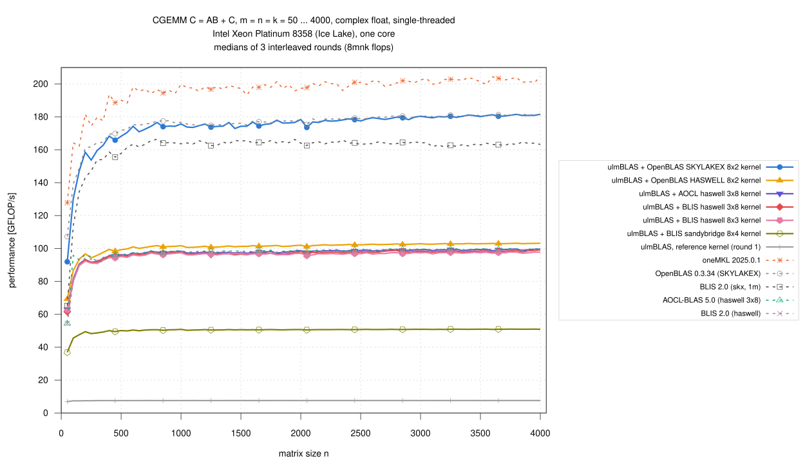
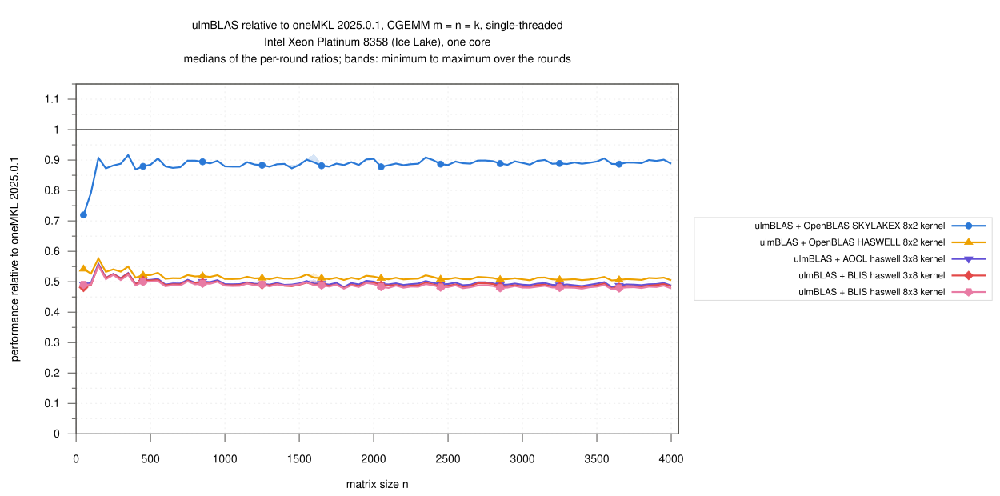
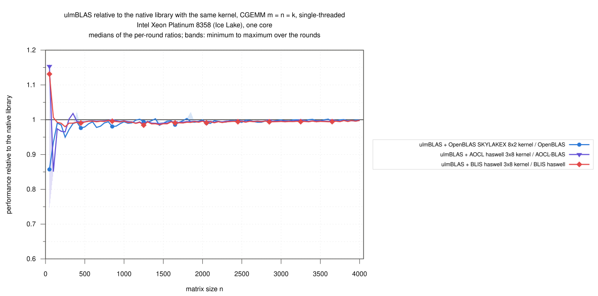

# Intel Xeon Platinum 8358 (Ice Lake): single-threaded CGEMM, n = 50 … 4000, vendored micro kernels inside ulmBLAS and five libraries (2026-10-29)

The complex float campaign on Ice Lake: the CGEMM micro kernels of BLIS,
AOCL-BLAS and OpenBLAS inside ulmBLAS (selected with
`-DULMBLAS_CGEMM_UKERNEL_...`, `ulmblas/level3/ukernel/blis/select_c.h`)
against oneMKL, OpenBLAS, AOCL-BLAS and BLIS (two configurations), in one
job on an exclusive node, interleaved over 3 rounds.

C <- A B + C (alpha = beta = 1), complex float, column major, no
transposition, m = n = k = 50, 100, ..., 4000 (80 sizes), 8 m n k flops
per call.

## Results

- **OpenBLAS's SKYLAKEX kernel gives the fastest ulmBLAS CGEMM** (n >=
  1000)
  - 172.9 to 181.6 GFLOP/s
  - 0.997 of native OpenBLAS (the same kernel)
  - 0.888 of oneMKL, which is the fastest library (193 to 204 GFLOP/s)
- **The BLIS and AOCL kernels inside ulmBLAS reach their native library**
  - BLIS haswell 3x8: 0.994 of native BLIS haswell (same kernel)
  - AOCL's version of haswell 3x8: 0.996 of native AOCL-BLAS
- **No AVX-512 complex float kernel in BLIS and AOCL-BLAS**
  - BLIS 2.0 skx computes CGEMM with its SGEMM kernel (induced method 1m):
    164 GFLOP/s, 0.92 of OpenBLAS
  - AOCL-BLAS selects `zen4` on this CPU, which registers the AVX2 kernel
    haswell 3x8: 99 GFLOP/s; OpenBLAS's kernel inside ulmBLAS is 1.80
    times as fast
- **The AVX2 kernels** reach about half of the AVX-512 kernel: OpenBLAS
  HASWELL 8x2 102 GFLOP/s, BLIS haswell 3x8 and 8x3 97 to 98; sandybridge
  8x4 (AVX, no FMA) 51; the reference kernel 7.6
- **Small matrices** (n <= 250): ulmBLAS with OpenBLAS's kernel reaches
  0.87 of oneMKL and 0.95 of OpenBLAS (median over the range); at n = 50
  0.72 of oneMKL
- 34 runs, 2720 measurements, none missing, **no wrong result**, all
  commands succeeded
- spread of the rounds per size: median 0.08%, at most 3.1%, except one
  AOCL-BLAS run at n = 50 (56%; the median is not affected)

### Large matrices, n >= 1000 (61 sizes)

Ratios: medians of the per-round ratios over the sizes (min … max).

| Variant | GFLOP/s | / oneMKL | / OpenBLAS | / BLIS haswell |
|---|---|---|---|---|
| ulmBLAS + OpenBLAS SKYLAKEX 8x2 | 172.9 … 181.6 | 0.888 (0.873 … 0.909) | 0.997 (0.984 … 1.004) | 1.813 (1.773 … 1.846) |
| ulmBLAS + OpenBLAS HASWELL 8x2 | 100.6 … 103.2 | 0.510 (0.504 … 0.524) | 0.571 (0.567 … 0.579) | 1.040 (1.029 … 1.050) |
| ulmBLAS + AOCL haswell 3x8 | 97.0 … 99.6 | 0.492 (0.482 … 0.503) | 0.551 (0.545 … 0.558) | 1.004 (0.991 … 1.006) |
| ulmBLAS + BLIS haswell 3x8 | 96.1 … 99.2 | 0.488 (0.478 … 0.498) | 0.546 (0.539 … 0.555) | 0.994 (0.984 … 0.998) |
| ulmBLAS + BLIS haswell 8x3 | 95.7 … 97.9 | 0.484 (0.476 … 0.498) | 0.541 (0.536 … 0.553) | 0.987 (0.978 … 0.992) |
| ulmBLAS + BLIS sandybridge 8x4 | 50.3 … 51.0 | 0.254 (0.249 … 0.261) | 0.283 (0.280 … 0.289) | 0.516 (0.512 … 0.521) |
| ulmBLAS, reference kernel (round 1) | 7.6 … 7.6 | 0.038 (0.037 … 0.040) | 0.042 (0.042 … 0.043) | 0.077 (0.077 … 0.078) |
| oneMKL 2025.0.1 | 193.4 … 204.5 | 1 | 1.121 (1.098 … 1.135) | 2.036 (1.988 … 2.081) |
| OpenBLAS 0.3.34 (SKYLAKEX) | 174.8 … 181.8 | 0.892 (0.881 … 0.911) | 1 | 1.821 (1.784 … 1.845) |
| BLIS 2.0 (skx, 1m) | 161.7 … 166.3 | 0.820 (0.796 … 0.857) | 0.915 (0.898 … 0.946) | 1.667 (1.638 … 1.703) |
| AOCL-BLAS 5.0 (haswell 3x8) | 97.7 … 100.0 | 0.495 (0.485 … 0.507) | 0.553 (0.546 … 0.563) | 1.008 (1.004 … 1.010) |
| BLIS 2.0 (haswell) | 97.2 … 99.4 | 0.491 (0.480 … 0.503) | 0.549 (0.542 … 0.560) | 1 |

### GFLOP/s by size range

Median over the sizes of the range · median ratio to oneMKL:

| Variant | n = 50 … 250 | n = 300 … 500 | n = 550 … 1000 | n = 1050 … 2000 | n = 2050 … 4000 |
|---|---|---|---|---|---|
| ulmBLAS + OpenBLAS SKYLAKEX 8x2 | 147.1 · 0.87 | 165.8 · 0.89 | 174.3 · 0.89 | 175.1 · 0.89 | 179.9 · 0.89 |
| ulmBLAS + OpenBLAS HASWELL 8x2 | 93.5 · 0.54 | 98.4 · 0.52 | 101.1 · 0.52 | 101.3 · 0.51 | 102.7 · 0.51 |
| ulmBLAS + AOCL haswell 3x8 | 90.7 · 0.51 | 95.3 · 0.51 | 97.6 · 0.50 | 97.6 · 0.49 | 99.1 · 0.49 |
| ulmBLAS + BLIS haswell 3x8 | 89.9 · 0.51 | 95.1 · 0.50 | 97.1 · 0.49 | 96.8 · 0.49 | 98.1 · 0.49 |
| ulmBLAS + BLIS haswell 8x3 | 89.6 · 0.51 | 94.3 · 0.50 | 96.4 · 0.49 | 96.7 · 0.49 | 97.3 · 0.48 |
| ulmBLAS + BLIS sandybridge 8x4 | 47.6 · 0.28 | 49.5 · 0.26 | 50.5 · 0.26 | 50.6 · 0.26 | 50.9 · 0.25 |
| ulmBLAS, reference kernel (round 1) | 7.4 · 0.04 | 7.6 · 0.04 | 7.6 · 0.04 | 7.6 · 0.04 | 7.6 · 0.04 |
| oneMKL 2025.0.1 | 164.2 · 1.00 | 188.6 · 1.00 | 195.9 · 1.00 | 197.9 · 1.00 | 201.4 · 1.00 |
| OpenBLAS 0.3.34 (SKYLAKEX) | 148.6 · 0.89 | 169.5 · 0.90 | 176.1 · 0.90 | 176.1 · 0.89 | 180.4 · 0.89 |
| BLIS 2.0 (skx, 1m) | 134.6 · 0.79 | 155.6 · 0.83 | 163.8 · 0.84 | 164.4 · 0.83 | 163.7 · 0.81 |
| AOCL-BLAS 5.0 (haswell 3x8) | 95.0 · 0.55 | 96.0 · 0.51 | 97.8 · 0.50 | 98.4 · 0.50 | 99.4 · 0.49 |
| BLIS 2.0 (haswell) | 90.6 · 0.52 | 96.0 · 0.51 | 97.3 · 0.50 | 97.8 · 0.49 | 98.6 · 0.49 |

## Variants

| Variant (label in the figures) | Library and micro kernel | Build flags of ulmBLAS |
|---|---|---|
| ulmBLAS + OpenBLAS SKYLAKEX 8x2 kernel | `cgemm_kernel_8x2_skylakex.c` of OpenBLAS 0.3.34 (AVX-512), one call per packed block; MC, KC, NC = 384, 192, 4096 | `-mavx -mfma -mavx512f -DULMBLAS_CGEMM_UKERNEL_openblas_skylakex_8x2` |
| ulmBLAS + OpenBLAS HASWELL 8x2 kernel | `cgemm_kernel_8x2_haswell.c` of OpenBLAS 0.3.34 (AVX2), one call per packed block; 256, 256, 4096 | `-mavx -mavx2 -mfma -DULMBLAS_CGEMM_UKERNEL_openblas_haswell_8x2` |
| ulmBLAS + AOCL haswell 3x8 kernel | `bli_cgemm_haswell_asm_3x8` of AOCL-BLAS 5.1 (AVX2, BLIS 0.x interface); 144, 256, 4080 (zen3, zen4) | `-mavx -mfma -DULMBLAS_CGEMM_UKERNEL_blis_aocl_haswell_3x8` |
| ulmBLAS + BLIS haswell 3x8 kernel | `bli_cgemm_haswell_asm_3x8` of BLIS 2.0 (AVX2); 72, 256, 4080 (BLIS: MC 75, not a multiple of 8) | `-mavx -mfma -DULMBLAS_CGEMM_UKERNEL_blis_haswell_3x8` |
| ulmBLAS + BLIS haswell 8x3 kernel | `bli_cgemm_haswell_asm_8x3`; 48, 256, 4080 | `... -DULMBLAS_CGEMM_UKERNEL_blis_haswell_8x3` |
| ulmBLAS + BLIS sandybridge 8x4 kernel | `bli_cgemm_sandybridge_asm_8x4` (AVX); 96, 256, 4096 | `-mavx -DULMBLAS_CGEMM_UKERNEL_blis_sandybridge_8x4` |
| ulmBLAS, reference kernel | ulmBLAS's portable C++ kernel (no complex float kernel of its own on x86-64); round 1 only | `-mavx -mfma` |
| oneMKL 2025.0.1 | cluster installation, `mkl_sequential`, LP64; code path reported by `MKL_VERBOSE`: AVX-512 | static |
| OpenBLAS 0.3.34 (SKYLAKEX) | built from source, `NO_AFFINITY SKYLAKEX SINGLE_THREADED` | static |
| BLIS 2.0 (skx, 1m) | built from source, `auto` configuration, selects `skx`; no optimized complex kernel (reference 4 x 8), so CGEMM runs with the induced method 1m and the SGEMM kernel `bli_sgemm_skx_asm_32x12_l2` | static |
| AOCL-BLAS 5.0 | cluster installation (AOCC build); selects `zen4` and uses `bli_cgemm_haswell_asm_3x8`, MR, NR, MC, KC, NC = 3, 8, 144, 256, 4080 (method native) | static |
| BLIS 2.0 (haswell) | built from source, configuration `haswell`: `bli_cgemm_haswell_asm_3x8`, 3, 8, 75, 256, 4080 | static |

- the native libraries are those of campaign
  [028](../028-2026-10-28-uc3-icelake-zgemm/README.md); their kernels and
  block sizes are in `logs/kernel-identity.txt`
- the kernel of every ulmBLAS library is recorded by its symbols
  (`logs/compile-commands.txt`)
- ulmBLAS: commit 8a39314 (the x86 CGEMM kernels, as on master since
  1e15e78), `g++ -O3 -std=c++11` (GCC 14.2.0); all programs call
  `cblas_cgemm` from `source/benchx.c` (`gcc -O2`)
- the tests of the CGEMM kernels (also ASan/UBSan for the OpenBLAS kernels)
  pass on Ice Lake

## Method

- **Node**: Slurm job 8050789 on `uc2n823` (`cpu_il`, exclusive), 2 x
  Xeon Platinum 8358, 2.6 GHz, turbo on, governor `performance`, SMT on;
  RHEL 9.6
  - every run on CPU 3 with memory on NUMA node 0; load average 0.75 to
    1.10 before the runs
- **One thread** everywhere (environment variables; OpenBLAS built
  single-threaded, MKL sequential)
- **Timing** (`benchx.c`): one call checked against long double sums for
  400 random elements of C (also the warm-up, at least 0.3 s), then 3
  samples >= 0.2 s, median
- **Rounds**: 3, order rotated; the reference kernel in round 1 only;
  median over the rounds, bands min to max; ratios within a round
- 2026-10-28 18:47 to 2026-10-29 00:35 (CET)

## Limitations

- one node, one core; square sizes with alpha = beta = 1 only
- the vendored AOCL kernel comes from AOCL-BLAS 5.1, native AOCL-BLAS is
  5.0

## Files

| File | Contents |
|---|---|
| `data/raw/c-VARIANT-ROUND.txt` | output of `benchx` per variant and round (m n k median min max calls err/bound check) |
| `data/runs.csv` | all measurements |
| `data/summary/gemm.csv` | per size and variant: median, minimum, maximum over the rounds (GFLOP/s) |
| `data/summary/ratios.csv` | ratios of the ulmBLAS variants to oneMKL, OpenBLAS, BLIS skx, BLIS haswell and AOCL-BLAS per size |
| `data/summary/ranges.csv` | the tables above |
| `logs/` | system, compile commands and kernel symbols, kernel identity of the native libraries, conditions, run log, build logs, checksums |
| `source/` | `benchx.c`, `xbench-uc3.sbatch` (job script), `submit-c-icelake.sh` (invocation), `kernel-info.c` (probe), `summarize-campaign.py` (data/ from data/raw/: `python3 source/summarize-campaign.py data/raw data c mkl,openblas,blis-auto,blis-haswell,aocl`) |

## Figures

<!-- BEGIN FIGURES (generated by make add_benchmark_result) -->

<!-- END FIGURES -->
