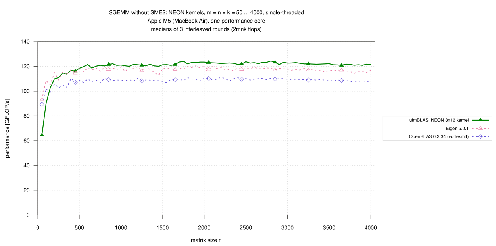
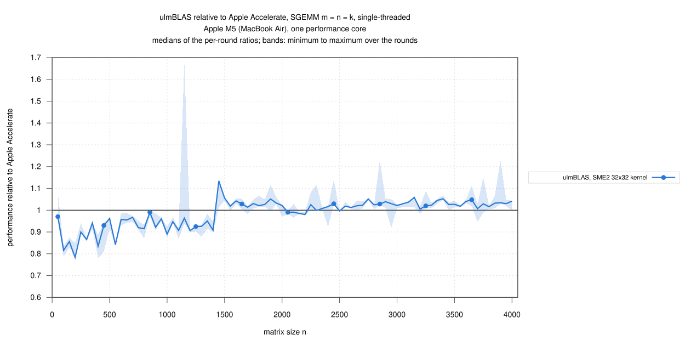
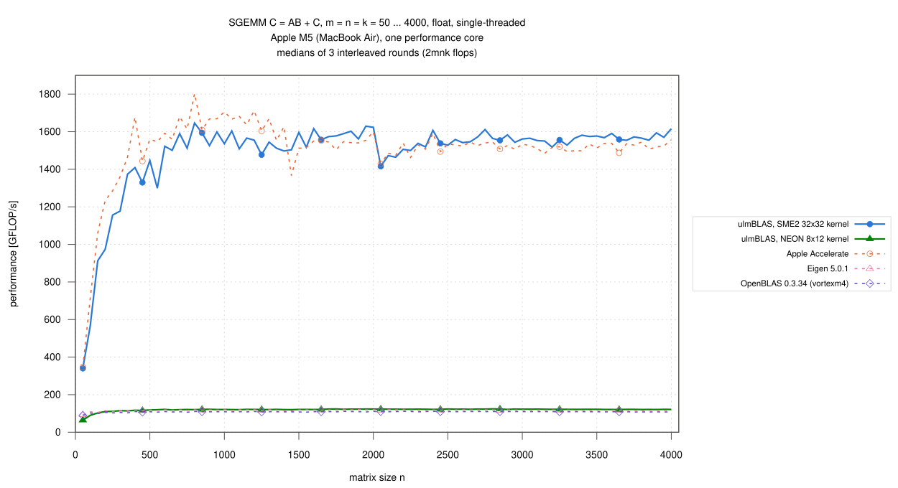

# Apple M5 (MacBook Air): single-threaded SGEMM, n = 50 … 4000, ulmBLAS's NEON and SME2 kernels (2026-10-29)

My first float campaign on Apple silicon: ulmBLAS's own SGEMM kernels for
NEON (8 x 12) and SME2 (32 x 32, with streaming-mode packing) against
Apple Accelerate, OpenBLAS and Eigen on one performance core of an Apple
M5, interleaved over 3 rounds under the thermal guard of campaign
[022](../022-2026-10-27-macbook-m5-sme-blocking/README.md).  Same method
and programs as the ZGEMM campaign
[029](../029-2026-10-28-macbook-m5-zgemm/README.md).

C <- A B + C (alpha = beta = 1), float, column major, no transposition,
m = n = k = 50, 100, ..., 4000 (80 sizes), 2 m n k flops per call.

## Results

- **For large matrices the SME2 kernel is about as fast as Accelerate**
  - 1.023 for n >= 1000 (median of the per-size ratios; 1416 to 1629
    GFLOP/s)
  - from n = 1450 on 1.026, ahead at 46 of the 52 sizes (at least 0.980)
  - Accelerate is faster up to n = 1400: 0.92 (0.78 … 0.99), and reaches
    its highest values there (1803 GFLOP/s at n = 800); at n = 1450 it
    drops from 1627 to 1366 GFLOP/s and stays near 1500 to 1550
- **Small matrices: Accelerate is faster**, 0.86 for n = 50 … 250 (0.78 at
  n = 200, 0.97 at n = 50)
- **The NEON kernel is the fastest NEON implementation**: 1.118 times
  OpenBLAS and 1.04 times Eigen for n >= 1000 (120 to 124 GFLOP/s)
- **SME2 is 10.8 to 13.7 times as fast as NEON** for n >= 500
- 1200 measurements (5 variants x 80 sizes x 3 rounds), none missing, **no
  wrong result**, all commands succeeded
- spread of the rounds per size: median 1.5 to 2.3% for NEON, Eigen,
  OpenBLAS and Accelerate, 3.3% for SME2; single outliers up to 44%
  (Accelerate, n = 1150); the medians of the three rounds for n >= 1000
  differ by at most 1.5% for every variant

### Large matrices, n >= 1000 (61 sizes)

| Variant | GFLOP/s | / Accelerate | / OpenBLAS |
|---|---|---|---|
| ulmBLAS, SME2 32x32 | 1415.82 … 1629.47 | 1.023 (0.890 … 1.134) | 14.278 (12.878 … 14.935) |
| ulmBLAS, NEON 8x12 | 120.08 … 124.35 | 0.080 (0.071 … 0.089) | 1.118 (1.099 … 1.142) |
| Apple Accelerate | 1366.44 … 1711.12 | 1 | 13.983 (12.594 … 15.660) |
| Eigen 5.0.1 | 112.93 … 120.53 | 0.077 (0.069 … 0.083) | 1.076 (1.045 … 1.100) |
| OpenBLAS 0.3.34 (vortexm4) | 107.02 … 111.29 | 0.072 (0.064 … 0.079) | 1 |

### GFLOP/s by size range

Medians over the sizes of the range (min ... max), then the median ratio
to Accelerate / OpenBLAS:

| Variant | n = 50 … 250 | n = 300 … 500 | n = 550 … 1000 | n = 1050 … 2000 | n = 2050 … 4000 |
|---|---|---|---|---|---|
| ulmBLAS, SME2 32x32 | 912.92 (340.03 … 1156.46) · 0.86 / 9.12 | 1373.72 (1177.23 … 1446.94) · 0.93 / 12.57 | 1530.90 (1299.39 … 1645.97) · 0.94 / 14.04 | 1563.67 (1477.03 … 1629.47) · 1.02 / 14.28 | 1557.19 (1415.82 … 1615.91) · 1.02 / 14.29 |
| ulmBLAS, NEON 8x12 | 102.65 (64.50 … 111.06) · 0.10 / 1.03 | 116.24 (113.85 … 118.46) · 0.08 / 1.08 | 120.88 (118.64 … 122.14) · 0.07 / 1.11 | 121.46 (120.08 … 124.02) · 0.08 / 1.12 | 122.19 (120.85 … 124.35) · 0.08 / 1.12 |
| Apple Accelerate | 1060.62 (347.28 … 1285.43) · 1 / 10.75 | 1464.47 (1359.93 … 1677.24) · 1 / 14.12 | 1640.88 (1546.30 … 1802.61) · 1 / 15.17 | 1553.16 (1366.44 … 1711.12) · 1 / 14.18 | 1523.36 (1429.62 … 1591.36) · 1 / 13.88 |
| Eigen 5.0.1 | 108.65 (93.12 … 115.05) · 0.10 / 1.07 | 115.80 (113.39 … 118.15) · 0.08 / 1.08 | 118.22 (115.74 … 119.61) · 0.07 / 1.08 | 118.37 (112.93 … 120.53) · 0.08 / 1.08 | 117.36 (114.28 … 119.92) · 0.08 / 1.07 |
| OpenBLAS 0.3.34 (vortexm4) | 101.87 (89.48 … 105.91) · 0.09 / 1 | 107.22 (103.11 … 110.37) · 0.07 / 1 | 109.00 (106.68 … 110.55) · 0.07 / 1 | 109.07 (107.02 … 111.04) · 0.07 / 1 | 109.50 (107.72 … 111.29) · 0.07 / 1 |

## Variants

| Variant (label in the figures) | Library and micro kernel | Build |
|---|---|---|
| ulmBLAS, SME2 32x32 kernel | ulmBLAS 9cf736f, `sme/sgemm.tcc` (32 x 32 in the four tiles ZA0.S … ZA3.S, FMOPA) with streaming-mode packing `sme/spack.tcc`; MC, KC, NC = 512, 2048, 1024 | `make cblas ARCHFLAGS=-mcpu=apple-m4` |
| ulmBLAS, NEON 8x12 kernel | ulmBLAS 9cf736f, `neon/sgemm.tcc` (8 x 12, 24 accumulators); 960, 1024, 4080 | `make cblas` (default on AArch64) |
| Apple Accelerate | macOS 26.6, `cblas_sgemm` of the system's `libBLAS.dylib`, `VECLIB_MAXIMUM_THREADS=1` | `-framework Accelerate` |
| OpenBLAS 0.3.34 (vortexm4) | Homebrew, `DYNAMIC_ARCH`, core `vortexm4`, `OPENBLAS_NUM_THREADS=1` | dynamic |
| Eigen 5.0.1 | Homebrew, header only, `C.noalias() += A*B` (Eigen's own NEON kernels, no OpenMP) | `c++ -std=c++14 -O3 -mcpu=native` |

- ulmBLAS: Apple clang 21.0.0 (`-O3 -std=c++11`); the library sources of
  both builds are those of commit 9cf736f (checked file by file)
- the kernel each build selects is recorded by `ulmblas-kernels`
  (`logs/kernels-*.txt`: float `sme`, 32 x 32 and `neon`, 8 x 12), the
  library each program calls by `benchx -i` (`logs/identity-*.txt`)
- the BLAS libraries are called through `cblas_sgemm` from
  `source/benchx.c` (`cc -O2`), Eigen through `source/bench-eigen.cpp`

## Method

- **Machine**: MacBook Air, Apple M5 (4 performance, 6 efficiency cores,
  32 GB), macOS 26.6, on mains power; QoS class user-interactive
  (performance cores)
  - not otherwise idle: load average 1.7 to 4.6 before the sizes
    (`logs/conditions.csv`)
- **Thermal guard** (`source/guard.sh`, `thermal.m`)
  - a run starts only in the nominal thermal state with load average below
    4, after a pause of 10 s
  - it counts only if the state is still nominal afterwards; otherwise it
    is repeated (at most 3 tries)
  - 1 run was repeated (`logs/discards.txt`)
  - FMA throughput of the core (`source/peak.c`): 62.2 to 67.1 GFLOP/s
    before the sizes
- **Timing** (`benchx.c`, `bench-eigen.cpp`): one program run per size:
  one call checked against long double sums for 400 random elements of C
  (also the warm-up, at least 0.3 s), then 3 samples >= 0.2 s, median
- **Rounds**: 3; per round and size the variants in random order (seeded
  with round and size); median over the rounds, bands min to max; ratios
  within a round
- 2026-10-28 19:30 to 2026-10-29 04:54 (CET); in round 2 nothing was
  measured between 22:02 and 02:18 (after n = 1750), the guard waited

## Limitations

- one machine, one core, a MacBook Air without active cooling that was not
  otherwise idle; the thermal guard discards runs that end in a higher
  thermal state, but cannot exclude every influence of other processes
- square sizes with alpha = beta = 1 only; Accelerate only with
  `VECLIB_MAXIMUM_THREADS=1`
- the drop of Accelerate at n = 1450 and the loss of the SME2 kernel for
  smaller sizes are not analyzed here

## Files

| File | Contents |
|---|---|
| `data/raw/s-VARIANT-ROUND.txt` | output of `benchx` / `bench-eigen` per variant and round (m n k median min max calls err/bound check) |
| `data/runs.csv` | all measurements |
| `data/summary/gemm.csv` | per size and variant: median, minimum, maximum over the rounds (GFLOP/s) |
| `data/summary/ratios.csv` | ratios of the ulmBLAS variants to Accelerate and OpenBLAS per size |
| `data/summary/ranges.csv` | the tables above |
| `logs/` | system, compile commands, kernels of the ulmBLAS builds, library identity of the programs, run log, conditions per size, discarded runs, build logs, checksums |
| `source/` | `xbench-mac.sh` (campaign script, `PREC=s`), `guard.sh`, `thermal.m`, `peak.c` (thermal guard, FMA throughput), `benchx.c`, `bench-eigen.cpp`, `ulmblas-kernels.cc`, `summarize-campaign.py` (data/ from data/raw/) |

## Figures

## Figures

<!-- BEGIN FIGURES (generated by make add_benchmark_result) -->

<!-- END FIGURES -->
