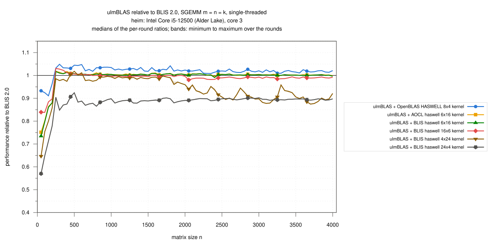
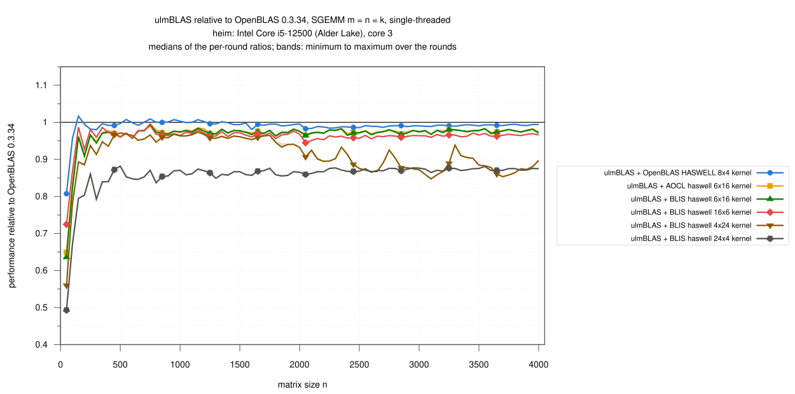
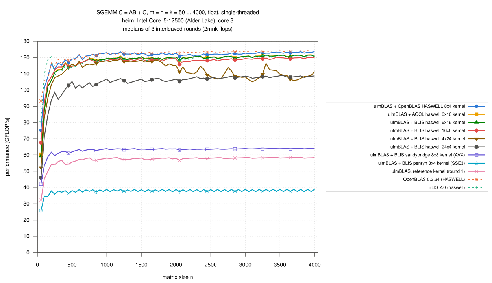

# heim (Intel Core i5-12500): single-threaded SGEMM, n = 50 … 4000, vendored micro kernels inside ulmBLAS (2026-10-28)

The SGEMM micro kernels of BLIS, AOCL-BLAS and OpenBLAS inside ulmBLAS
(selected with `-DULMBLAS_SGEMM_UKERNEL_...`,
`ulmblas/level3/ukernel/blis/select_s.h`) against native OpenBLAS and
BLIS on one core of heim, interleaved over 3 rounds.  The AVX2
counterpart of the Ice Lake campaign
[030](../030-2026-10-28-uc3-icelake-sgemm/README.md), with the method of
the ZGEMM campaign [027](../027-2026-10-28-heim-zgemm/README.md).

C <- A B + C (alpha = beta = 1), float, column major, no transposition,
m = n = k = 50, 100, ..., 4000 (80 sizes), 2 m n k flops per call.

## Results

- **Every kernel inside ulmBLAS reaches the library it comes from** (n >=
  1000)
  - OpenBLAS's HASWELL 8x4 kernel: 0.992 of native OpenBLAS
  - BLIS haswell 6x16: 1.002 of native BLIS (the same kernel); AOCL's
    version of 6x16 1.003 of BLIS
- **OpenBLAS's kernel is the fastest SGEMM kernel on this machine**
  - 120.6 to 123.5 GFLOP/s, 1.019 of BLIS haswell 6x16 (median per-size
    ratio, n >= 1000)
  - native OpenBLAS is 0.8% ahead of it
- **Small matrices** (n = 50 ... 250)
  - with the OpenBLAS kernel 0.98 of OpenBLAS (median); at n = 50 0.81
    (75.2 against 93.3 GFLOP/s; OpenBLAS has its own small-matrix SGEMM
    kernels, `sgemm_small_kernel_*` in `logs/kernel-identity.txt`)
  - native BLIS is the fastest library there (1.03 of OpenBLAS); the BLIS
    kernels inside ulmBLAS reach 0.86 of it (0.73 at n = 50, 0.88 at
    n = 200; not analyzed here)
- **Other kernels**
  - 16x6 0.991 and 24x4 0.894 of BLIS
  - 4x24 is close to 6x16 up to n = 2000 (115 to 118 GFLOP/s) and then
    drops to 105 to 116 GFLOP/s (0.88 of OpenBLAS for n = 2050 ... 4000),
    as on Ice Lake (campaign 030)
  - sandybridge 8x8 (AVX without FMA) 0.52 and penryn 8x4 (SSE3) 0.31 of
    OpenBLAS
  - the portable reference kernel 0.47 of OpenBLAS (58 GFLOP/s): for float
    the compiler vectorizes it with `-mavx -mfma` far better than for the
    complex types (ZGEMM campaign 027: 0.19)
- 31 runs, 2480 measurements, none missing, **no wrong result**, all
  commands succeeded
- spread of the rounds per size: median 0.04 to 0.28%, at most 1.4%

### Large matrices, n >= 1000 (61 sizes)

| Variant | GFLOP/s | / OpenBLAS | / BLIS |
|---|---|---|---|
| ulmBLAS + OpenBLAS HASWELL 8x4 | 120.58 … 123.54 | 0.992 (0.981 … 1.007) | 1.019 (1.008 … 1.042) |
| ulmBLAS + AOCL haswell 6x16 | 118.30 … 121.67 | 0.976 (0.964 … 0.985) | 1.003 (0.996 … 1.010) |
| ulmBLAS + BLIS haswell 6x16 | 118.34 … 121.51 | 0.975 (0.963 … 0.984) | 1.002 (0.991 … 1.009) |
| ulmBLAS + BLIS haswell 16x6 | 115.82 … 120.20 | 0.964 (0.945 … 0.979) | 0.991 (0.980 … 1.001) |
| ulmBLAS + BLIS haswell 4x24 | 105.06 … 119.14 | 0.903 (0.847 … 0.974) | 0.928 (0.875 … 0.997) |
| ulmBLAS + BLIS haswell 24x4 | 104.14 … 108.78 | 0.870 (0.849 … 0.881) | 0.894 (0.879 … 0.902) |
| ulmBLAS + BLIS sandybridge 8x8 | 63.02 … 64.11 | 0.517 (0.513 … 0.525) | 0.531 (0.526 … 0.543) |
| ulmBLAS + BLIS penryn 8x4 | 37.29 … 38.87 | 0.312 (0.303 … 0.316) | 0.319 (0.309 … 0.329) |
| ulmBLAS, reference kernel (round 1) | 56.74 … 58.62 | 0.470 (0.462 … 0.481) | 0.484 (0.479 … 0.493) |
| OpenBLAS 0.3.34 (HASWELL) | 121.58 … 124.23 | 1 | 1.028 (1.017 … 1.047) |
| BLIS 2.0 (haswell) | 117.81 … 121.45 | 0.973 (0.955 … 0.983) | 1 |

### GFLOP/s by size range

Medians over the sizes of the range (min ... max), then the median ratio
to OpenBLAS / BLIS:

| Variant | n = 50 … 250 | n = 300 … 500 | n = 550 … 1000 | n = 1050 … 2000 | n = 2050 … 4000 |
|---|---|---|---|---|---|
| ulmBLAS + OpenBLAS HASWELL 8x4 | 108.05 (75.22 … 116.02) · 0.98 / 0.93 | 116.95 (115.34 … 119.05) · 0.99 / 1.03 | 121.48 (118.73 … 122.94) · 1.00 / 1.03 | 122.09 (120.95 … 123.38) · 0.99 / 1.02 | 122.46 (120.58 … 123.54) · 0.99 / 1.02 |
| ulmBLAS + AOCL haswell 6x16 | 102.47 (60.52 … 110.92) · 0.91 / 0.86 | 114.47 (112.53 … 116.86) · 0.97 / 1.01 | 118.46 (114.86 … 119.47) · 0.97 / 1.00 | 119.64 (118.83 … 120.91) · 0.98 / 1.00 | 120.67 (118.30 … 121.67) · 0.98 / 1.00 |
| ulmBLAS + BLIS haswell 6x16 | 102.09 (59.31 … 110.76) · 0.91 / 0.86 | 114.31 (112.27 … 116.35) · 0.97 / 1.01 | 118.38 (114.94 … 119.34) · 0.97 / 1.00 | 119.45 (118.84 … 120.40) · 0.97 / 1.00 | 120.63 (118.34 … 121.51) · 0.97 / 1.00 |
| ulmBLAS + BLIS haswell 16x6 | 104.87 (67.58 … 112.48) · 0.93 / 0.88 | 114.19 (114.14 … 116.24) · 0.97 / 1.01 | 117.92 (115.00 … 118.86) · 0.97 / 1.00 | 118.76 (117.87 … 119.66) · 0.97 / 1.00 | 119.07 (115.82 … 120.20) · 0.96 / 0.99 |
| ulmBLAS + BLIS haswell 4x24 | 94.91 (52.19 … 107.56) · 0.89 / 0.80 | 111.89 (108.58 … 115.99) · 0.95 / 0.98 | 116.12 (113.88 … 118.00) · 0.96 / 0.99 | 117.48 (114.76 … 119.14) · 0.96 / 0.99 | 109.03 (105.06 … 116.36) · 0.88 / 0.91 |
| ulmBLAS + BLIS haswell 24x4 | 84.45 (45.97 … 98.75) · 0.80 / 0.71 | 100.46 (94.18 … 105.25) · 0.84 / 0.88 | 103.35 (101.04 … 106.73) · 0.85 / 0.88 | 105.90 (104.14 … 107.19) · 0.86 / 0.89 | 107.84 (105.35 … 108.78) · 0.87 / 0.90 |
| ulmBLAS + BLIS sandybridge 8x8 | 58.80 (42.25 … 61.75) · 0.52 / 0.51 | 62.00 (61.00 … 62.26) · 0.52 / 0.54 | 63.30 (62.40 … 63.92) · 0.52 / 0.54 | 63.64 (63.26 … 63.93) · 0.52 / 0.53 | 63.80 (63.02 … 64.11) · 0.52 / 0.53 |
| ulmBLAS + BLIS penryn 8x4 | 34.67 (25.74 … 37.85) · 0.32 / 0.32 | 37.74 (36.27 … 38.05) · 0.32 / 0.33 | 38.06 (37.07 … 38.74) · 0.31 / 0.33 | 38.13 (37.37 … 38.77) · 0.31 / 0.32 | 38.07 (37.29 … 38.87) · 0.31 / 0.32 |
| ulmBLAS, reference kernel (round 1) | 49.88 (32.13 … 54.10) · 0.46 / 0.42 | 55.65 (54.25 … 56.75) · 0.47 / 0.49 | 57.28 (56.32 … 58.20) · 0.47 / 0.49 | 57.82 (57.09 … 58.39) · 0.47 / 0.48 | 58.19 (56.74 … 58.62) · 0.47 / 0.48 |
| OpenBLAS 0.3.34 (HASWELL) | 106.28 (93.26 … 116.65) · 1 / 0.97 | 118.90 (115.81 … 119.56) · 1 / 1.04 | 121.40 (118.46 … 122.60) · 1 / 1.03 | 122.64 (121.58 … 123.43) · 1 / 1.03 | 123.69 (122.66 … 124.23) · 1 / 1.03 |
| BLIS 2.0 (haswell) | 109.74 (80.63 … 120.44) · 1.03 / 1 | 113.48 (111.08 … 114.84) · 0.96 / 1 | 117.93 (114.42 … 118.90) · 0.97 / 1 | 119.23 (117.81 … 120.22) · 0.97 / 1 | 120.44 (118.27 … 121.45) · 0.97 / 1 |

## Variants

| Variant (label in the figures) | Library and micro kernel | Build flags of ulmBLAS |
|---|---|---|
| ulmBLAS + OpenBLAS HASWELL 8x4 kernel | `sgemm_kernel_8x4_haswell_2.c` of OpenBLAS 0.3.34 (AVX2), one call per packed block; MC, KC, NC = 320, 320, 4096 | `-mavx -mavx2 -mfma -DULMBLAS_SGEMM_UKERNEL_openblas_haswell_8x4` |
| ulmBLAS + AOCL haswell 6x16 kernel | `bli_sgemm_haswell_asm_6x16` of AOCL-BLAS 5.1 (AVX2); 144, 256, 4080 | `-mavx -mfma -DULMBLAS_SGEMM_UKERNEL_blis_aocl_haswell_6x16` |
| ulmBLAS + BLIS haswell 6x16 kernel | `bli_sgemm_haswell_asm_6x16` of BLIS 2.0 (AVX2); 144, 256, 4080 (BLIS: MC 168, not a multiple of 16) | `-mavx -mfma -DULMBLAS_SGEMM_UKERNEL_blis_haswell_6x16` |
| ulmBLAS + BLIS haswell 16x6 kernel | `bli_sgemm_haswell_asm_16x6`; 96, 256, 4080 | `... -DULMBLAS_SGEMM_UKERNEL_blis_haswell_16x6` |
| ulmBLAS + BLIS haswell 4x24 / 24x4 kernel | `bli_sgemm_haswell_asm_4x24`, `_24x4` (BLIS 0.x interface); 168, 256, 4080 | `... -DULMBLAS_SGEMM_UKERNEL_blis_haswell_4x24` / `_24x4` |
| ulmBLAS + BLIS sandybridge 8x8 kernel (AVX) | `bli_sgemm_sandybridge_asm_8x8` (AVX); 128, 384, 4096 | `-mavx -DULMBLAS_SGEMM_UKERNEL_blis_sandybridge_8x8` |
| ulmBLAS + BLIS penryn 8x4 kernel (SSE3) | `bli_sgemm_penryn_asm_8x4` (SSE3); 768, 384, 4096 | `-msse3 -DULMBLAS_SGEMM_UKERNEL_blis_penryn_8x4` |
| ulmBLAS, reference kernel | ulmBLAS's portable C++ kernel (no single precision kernel of its own on x86-64); round 1 only | `-mavx -mfma` |
| OpenBLAS 0.3.34 (HASWELL) | built from source, `NO_AFFINITY HASWELL SINGLE_THREADED` (`sgemm_kernel_8x4_haswell_2.c`); P, Q = 320, 320 | static |
| BLIS 2.0 (haswell) | built from source, configuration `haswell`: `bli_sgemm_haswell_asm_6x16`, MR, NR, MC, KC, NC = 6, 16, 168, 256, 4080 (method native) | static |

- the kernel of every ulmBLAS library is recorded by its symbols
  (`logs/compile-commands.txt`)
- the native libraries are those of campaign
  [024](../024-2026-10-27-heim-openblas-haswell-kernel/README.md); their
  kernels and block sizes are in `logs/kernel-identity.txt`
- ulmBLAS: commit 47bd8f1 (checked file by file), `g++ -O3 -std=c++11`
  (GCC 12.2.0); all programs call `cblas_sgemm` from `source/benchx.c`
  (`gcc -O2`)
- the tests of the SGEMM kernels (also ASan/UBSan) were run on Ice Lake
  (campaign 030); on heim every measurement checks 400 elements of C

## Method

- **Machine**: heim, Intel Core i5-12500, Debian 12, Linux 6.1, governor
  powersave, turbo on; every run pinned to core 3, its sibling and the rest
  idle
- **Load gate**: a run starts only when no other process is runnable and
  the load average is below 1.8 (`logs/conditions.csv`: load 0.78 to 1.62, 36 to 40 C, one session)
- **Timing** (`benchx.c`): one call checked against long double sums for
  400 random elements of C (also the warm-up, at least 0.3 s), then 3
  samples >= 0.2 s, median
- **Rounds**: 3, order rotated; the reference kernel in round 1 only;
  median over the rounds, bands min to max; ratios within a round
- 2026-10-28 22:31 to 2026-10-29 00:03 (CET)

## Limitations

- one machine, one core; square sizes with alpha = beta = 1 only
- the AOCL kernel comes from AOCL-BLAS 5.1; there is no native AOCL-BLAS
  on heim
- the drop of the 4x24 kernel for n > 2000 is not analyzed here

## Files

| File | Contents |
|---|---|
| `data/raw/s-VARIANT-ROUND.txt` | output of `benchx` per variant and round (m n k median min max calls err/bound check) |
| `data/runs.csv` | all measurements |
| `data/summary/gemm.csv` | per size and variant: median, minimum, maximum over the rounds (GFLOP/s) |
| `data/summary/ratios.csv` | ratios of the ulmBLAS variants to OpenBLAS and BLIS per size |
| `data/summary/ranges.csv` | the tables above |
| `logs/` | system, compile commands and kernel symbols, kernel identity of the native libraries (OpenBLAS and BLIS), conditions, run log, build logs, checksums |
| `source/` | `benchx.c`, `xbench-heim.sh` (campaign script), `start-sc-heim.sh` (invocation of this and the CGEMM campaign), `kernel-info.c` (probe), `summarize-campaign.py` (data/ from data/raw/) |

## Figures

## Figures

<!-- BEGIN FIGURES (generated by make add_benchmark_result) -->

<!-- END FIGURES -->
