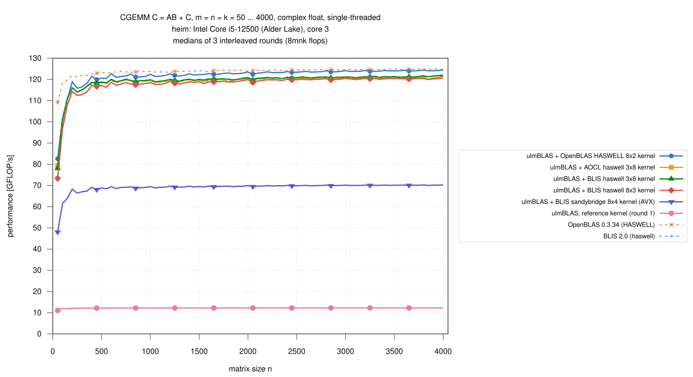
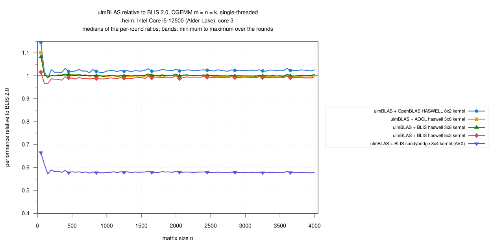
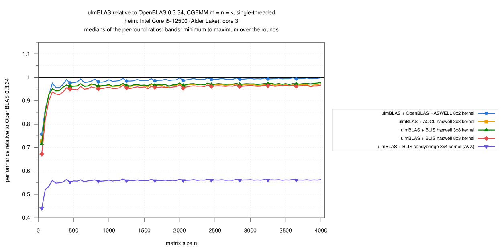

# heim (Intel Core i5-12500): single-threaded CGEMM, n = 50 … 4000, vendored micro kernels inside ulmBLAS (2026-10-29)

The CGEMM micro kernels of BLIS, AOCL-BLAS and OpenBLAS inside ulmBLAS
(selected with `-DULMBLAS_CGEMM_UKERNEL_...`,
`ulmblas/level3/ukernel/blis/select_c.h`) against native OpenBLAS and
BLIS on one core of heim, interleaved over 3 rounds.  The AVX2
counterpart of the Ice Lake campaign
[031](../031-2026-10-29-uc3-icelake-cgemm/README.md), with the method of
the ZGEMM campaign [027](../027-2026-10-28-heim-zgemm/README.md).

C <- A B + C (alpha = beta = 1), complex float, column major, no
transposition, m = n = k = 50, 100, ..., 4000 (80 sizes), 8 m n k flops per
call.

## Results

- **Every kernel inside ulmBLAS reaches the library it comes from** (n >=
  1000)
  - OpenBLAS's HASWELL 8x2 kernel: 0.992 of native OpenBLAS
  - BLIS haswell 3x8: 1.001 of native BLIS (the same kernel); AOCL's
    version of 3x8 0.998 of BLIS
- **OpenBLAS's kernel is the fastest CGEMM kernel on this machine**
  - 121.4 to 124.5 GFLOP/s, 1.022 of BLIS haswell 3x8 (median per-size
    ratio, n >= 1000)
- **Small matrices** (n = 50 ... 250)
  - with the OpenBLAS kernel 0.92 of OpenBLAS (median; 0.76 at n = 50,
    82.7 against 109.2 GFLOP/s)
  - the BLIS kernels 0.90 to 0.93, like native BLIS (0.93)
- **Other kernels**
  - 8x3 0.992 of BLIS
  - sandybridge 8x4 (AVX without FMA) 0.56 of OpenBLAS
  - the portable reference kernel 0.10 (12.3 GFLOP/s)
- 22 runs, 1760 measurements, none missing, **no wrong result**, all
  commands succeeded
- spread of the rounds per size: median 0.04 to 0.19%, at most 0.7%

### Large matrices, n >= 1000 (61 sizes)

| Variant | GFLOP/s | / OpenBLAS | / BLIS |
|---|---|---|---|
| ulmBLAS + OpenBLAS HASWELL 8x2 | 121.39 … 124.45 | 0.992 (0.983 … 0.998) | 1.022 (1.017 … 1.032) |
| ulmBLAS + AOCL haswell 3x8 | 118.67 … 121.48 | 0.968 (0.958 … 0.974) | 0.998 (0.991 … 1.005) |
| ulmBLAS + BLIS haswell 3x8 | 118.87 … 121.98 | 0.971 (0.963 … 0.978) | 1.001 (0.996 … 1.008) |
| ulmBLAS + BLIS haswell 8x3 | 117.67 … 120.73 | 0.962 (0.951 … 0.968) | 0.992 (0.986 … 0.999) |
| ulmBLAS + BLIS sandybridge 8x4 | 68.81 … 70.29 | 0.561 (0.557 … 0.566) | 0.579 (0.576 … 0.585) |
| ulmBLAS, reference kernel (round 1) | 12.22 … 12.28 | 0.099 (0.098 … 0.099) | 0.102 (0.101 … 0.103) |
| OpenBLAS 0.3.34 (HASWELL) | 123.13 … 124.94 | 1 | 1.031 (1.026 … 1.040) |
| BLIS 2.0 (haswell) | 118.80 … 121.66 | 0.970 (0.962 … 0.975) | 1 |

### GFLOP/s by size range

Medians over the sizes of the range (min ... max), then the median ratio
to OpenBLAS / BLIS:

| Variant | n = 50 … 250 | n = 300 … 500 | n = 550 … 1000 | n = 1050 … 2000 | n = 2050 … 4000 |
|---|---|---|---|---|---|
| ulmBLAS + OpenBLAS HASWELL 8x2 | 110.66 (82.65 … 118.88) · 0.92 / 1.02 | 119.97 (116.46 … 121.45) · 0.98 / 1.02 | 121.41 (120.43 … 122.74) · 0.98 / 1.02 | 122.43 (121.39 … 123.50) · 0.99 / 1.02 | 123.81 (122.44 … 124.45) · 0.99 / 1.02 |
| ulmBLAS + AOCL haswell 3x8 | 111.11 (79.43 … 116.00) · 0.93 / 1.00 | 118.17 (115.14 … 118.77) · 0.96 / 1.00 | 119.38 (118.45 … 120.00) · 0.96 / 1.00 | 119.62 (118.67 … 120.48) · 0.96 / 1.00 | 120.63 (119.19 … 121.48) · 0.97 / 1.00 |
| ulmBLAS + BLIS haswell 3x8 | 111.03 (78.09 … 116.05) · 0.93 / 1.00 | 118.21 (115.04 … 118.78) · 0.96 / 1.00 | 119.41 (118.25 … 120.13) · 0.96 / 1.00 | 120.02 (118.87 … 120.86) · 0.97 / 1.00 | 121.08 (119.84 … 121.98) · 0.97 / 1.00 |
| ulmBLAS + BLIS haswell 8x3 | 107.99 (73.41 … 114.28) · 0.90 / 0.98 | 116.71 (112.87 … 117.11) · 0.95 / 0.99 | 117.82 (116.38 … 118.66) · 0.95 / 0.99 | 118.82 (117.67 … 119.86) · 0.96 / 0.99 | 120.15 (118.53 … 120.73) · 0.96 / 0.99 |
| ulmBLAS + BLIS sandybridge 8x4 | 63.99 (48.02 … 68.28) · 0.53 / 0.59 | 68.00 (67.01 … 69.12) · 0.55 / 0.58 | 69.08 (68.46 … 69.47) · 0.56 / 0.58 | 69.50 (68.81 … 69.96) · 0.56 / 0.58 | 70.02 (69.44 … 70.29) · 0.56 / 0.58 |
| ulmBLAS, reference kernel (round 1) | 11.98 (11.11 … 12.16) · 0.10 / 0.11 | 12.19 (12.15 … 12.22) · 0.10 / 0.10 | 12.23 (12.18 … 12.25) · 0.10 / 0.10 | 12.25 (12.22 … 12.27) · 0.10 / 0.10 | 12.27 (12.25 … 12.28) · 0.10 / 0.10 |
| OpenBLAS 0.3.34 (HASWELL) | 119.85 (109.21 … 121.91) · 1 / 1.07 | 122.56 (121.84 … 123.38) · 1 / 1.04 | 123.54 (122.89 … 123.84) · 1 / 1.03 | 123.86 (123.13 … 124.47) · 1 / 1.04 | 124.61 (124.05 … 124.94) · 1 / 1.03 |
| BLIS 2.0 (haswell) | 111.83 (72.16 … 115.86) · 0.93 / 1 | 117.70 (114.72 … 118.37) · 0.96 / 1 | 119.39 (118.06 … 120.06) · 0.97 / 1 | 119.74 (118.80 … 120.30) · 0.97 / 1 | 121.05 (119.94 … 121.66) · 0.97 / 1 |

## Variants

| Variant (label in the figures) | Library and micro kernel | Build flags of ulmBLAS |
|---|---|---|
| ulmBLAS + OpenBLAS HASWELL 8x2 kernel | `cgemm_kernel_8x2_haswell.c` of OpenBLAS 0.3.34 (AVX2), one call per packed block; MC, KC, NC = 256, 256, 4096 | `-mavx -mavx2 -mfma -DULMBLAS_CGEMM_UKERNEL_openblas_haswell_8x2` |
| ulmBLAS + AOCL haswell 3x8 kernel | `bli_cgemm_haswell_asm_3x8` of AOCL-BLAS 5.1 (AVX2, BLIS 0.x interface); 144, 256, 4080 | `-mavx -mfma -DULMBLAS_CGEMM_UKERNEL_blis_aocl_haswell_3x8` |
| ulmBLAS + BLIS haswell 3x8 kernel | `bli_cgemm_haswell_asm_3x8` of BLIS 2.0 (AVX2); 72, 256, 4080 (BLIS: MC 75, not a multiple of 8) | `-mavx -mfma -DULMBLAS_CGEMM_UKERNEL_blis_haswell_3x8` |
| ulmBLAS + BLIS haswell 8x3 kernel | `bli_cgemm_haswell_asm_8x3`; 48, 256, 4080 | `... -DULMBLAS_CGEMM_UKERNEL_blis_haswell_8x3` |
| ulmBLAS + BLIS sandybridge 8x4 kernel (AVX) | `bli_cgemm_sandybridge_asm_8x4` (AVX); 96, 256, 4096 | `-mavx -DULMBLAS_CGEMM_UKERNEL_blis_sandybridge_8x4` |
| ulmBLAS, reference kernel | ulmBLAS's portable C++ kernel (no complex float kernel of its own on x86-64); round 1 only | `-mavx -mfma` |
| OpenBLAS 0.3.34 (HASWELL) | built from source, `NO_AFFINITY HASWELL SINGLE_THREADED` (`cgemm_kernel_8x2_haswell.c`); P, Q = 256, 256 | static |
| BLIS 2.0 (haswell) | built from source, configuration `haswell`: `bli_cgemm_haswell_asm_3x8`, MR, NR, MC, KC, NC = 3, 8, 75, 256, 4080 (method native) | static |

- the kernel of every ulmBLAS library is recorded by its symbols
  (`logs/compile-commands.txt`)
- the native libraries are those of campaign
  [024](../024-2026-10-27-heim-openblas-haswell-kernel/README.md); their
  kernels and block sizes are in `logs/kernel-identity.txt`
- ulmBLAS: commit 47bd8f1 (checked file by file), `g++ -O3 -std=c++11`
  (GCC 12.2.0); all programs call `cblas_cgemm` from `source/benchx.c`
  (`gcc -O2`)
- the tests of the CGEMM kernels (also ASan/UBSan and valgrind) pass on
  heim

## Method

- **Machine**: heim, Intel Core i5-12500, Debian 12, Linux 6.1, governor
  powersave, turbo on; every run pinned to core 3, its sibling and the rest
  idle
- **Load gate**: a run starts only when no other process is runnable and
  the load average is below 1.8 (`logs/conditions.csv`: load 0.78 to 1.57, 36 to 40 C, one session)
- **Timing** (`benchx.c`): one call checked against long double sums for
  400 random elements of C (also the warm-up, at least 0.3 s), then 3
  samples >= 0.2 s, median
- **Rounds**: 3, order rotated; the reference kernel in round 1 only;
  median over the rounds, bands min to max; ratios within a round
- 2026-10-29 00:04 to 03:39 (CET)
  - from 01:15 to 01:16 I compiled and ran a short GPU test on core 0
    (nice 19) while the BLIS haswell 8x3 kernel was measured in round 1
  - its round 1 differs from rounds 2 and 3 by at most 0.3% for n >= 2500

## Limitations

- one machine, one core; square sizes with alpha = beta = 1 only
- the AOCL kernel comes from AOCL-BLAS 5.1; there is no native AOCL-BLAS
  on heim

## Files

| File | Contents |
|---|---|
| `data/raw/c-VARIANT-ROUND.txt` | output of `benchx` per variant and round (m n k median min max calls err/bound check) |
| `data/runs.csv` | all measurements |
| `data/summary/gemm.csv` | per size and variant: median, minimum, maximum over the rounds (GFLOP/s) |
| `data/summary/ratios.csv` | ratios of the ulmBLAS variants to OpenBLAS and BLIS per size |
| `data/summary/ranges.csv` | the tables above |
| `logs/` | system, compile commands and kernel symbols, kernel identity of the native libraries (OpenBLAS and BLIS), conditions, run log, build logs, checksums |
| `source/` | `benchx.c`, `xbench-heim.sh` (campaign script), `start-sc-heim.sh` (invocation of this and the SGEMM campaign), `kernel-info.c` (probe), `summarize-campaign.py` (data/ from data/raw/) |

## Figures

## Figures

<!-- BEGIN FIGURES (generated by make add_benchmark_result) -->

<!-- END FIGURES -->
