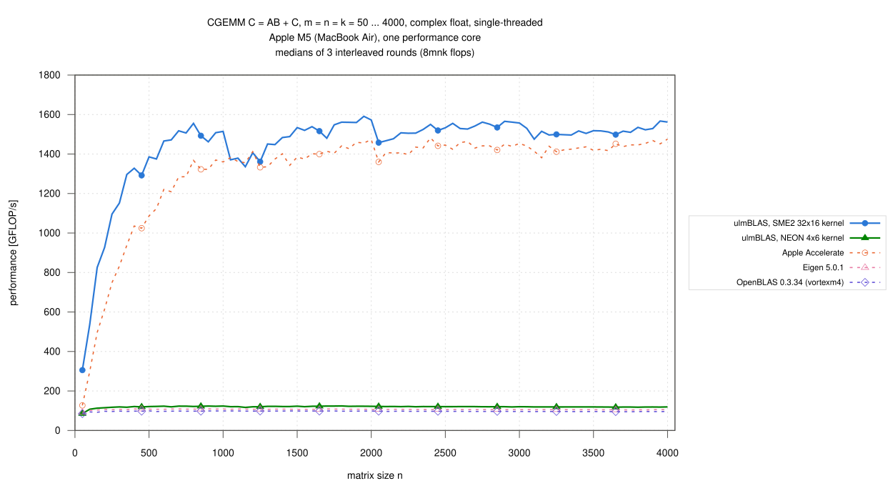
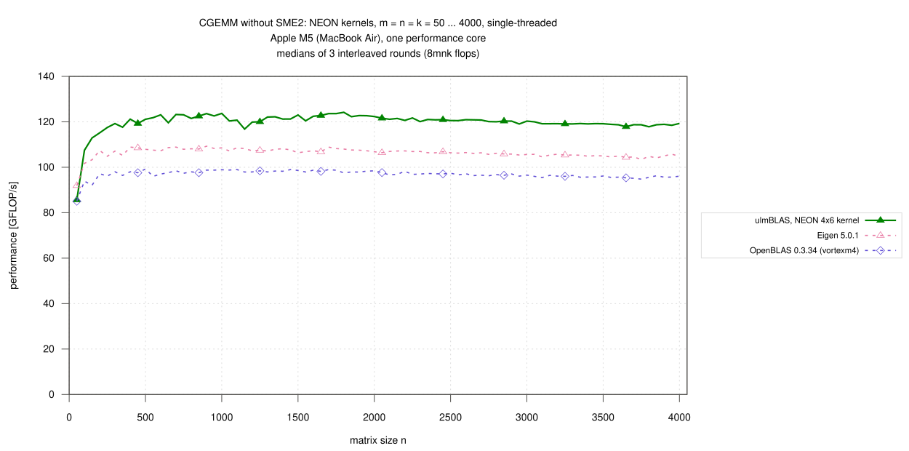
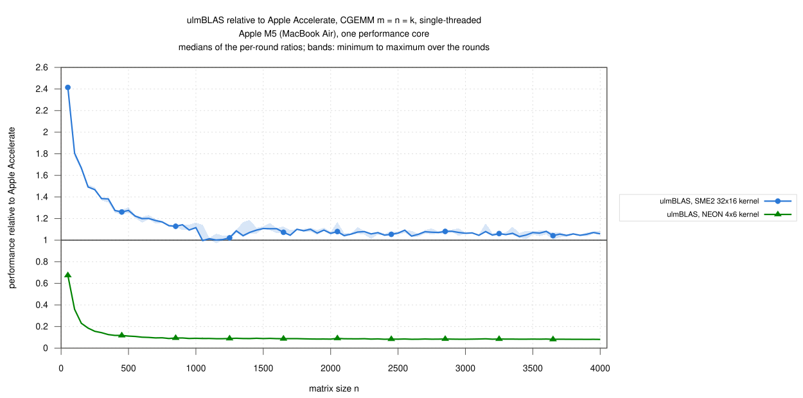

# Apple M5 (MacBook Air): single-threaded CGEMM, n = 50 … 4000, ulmBLAS's NEON and SME2 kernels (2026-10-29)

The complex float campaign on Apple silicon: ulmBLAS's own CGEMM kernels
for NEON (4 x 6) and SME2 (32 x 16, with streaming-mode packing) against
Apple Accelerate, OpenBLAS and Eigen on one performance core of an Apple
M5, interleaved over 3 rounds under the thermal guard of campaign
[022](../022-2026-10-27-macbook-m5-sme-blocking/README.md).  Same method
and programs as the ZGEMM campaign
[029](../029-2026-10-28-macbook-m5-zgemm/README.md) and the SGEMM campaign
[032](../032-2026-10-29-macbook-m5-sgemm/README.md).

C <- A B + C (alpha = beta = 1), complex float, column major, no
transposition, m = n = k = 50, 100, ..., 4000 (80 sizes), 8 m n k flops
per call.

## Results

- **The SME2 kernel is faster than Accelerate for all sizes but one**
  - 1.065 for n >= 1000 (median of the per-size ratios, 0.996 … 1.116;
    1336 to 1591 GFLOP/s); only at n = 1050 is Accelerate ahead (0.996)
  - 1.06 for n = 2050 … 4000
- **Small matrices: the SME2 kernel is much faster**, 1.67 for n = 50 …
  250 (2.41 at n = 50, 1.47 at n = 250), 1.27 for n = 300 … 500, 1.16
  for n = 550 … 1000
- **The NEON kernel is the fastest NEON implementation**: 1.24 times
  OpenBLAS and 1.14 times Eigen for n >= 1000 (117 to 124 GFLOP/s)
- **SME2 is 11.3 to 13.2 times as fast as NEON** for n >= 500
- 1200 measurements (5 variants x 80 sizes x 3 rounds), none missing, **no
  wrong result**, all commands succeeded; 5 runs were discarded by the
  thermal guard and repeated
- spread of the rounds per size: median 1.6 to 3.1%, single outliers up to
  13.5% (Accelerate, n = 1050); the medians of the three rounds for
  n >= 1000 differ by at most 1.5% for every variant

### Large matrices, n >= 1000 (61 sizes)

| Variant | GFLOP/s | / Accelerate | / OpenBLAS |
|---|---|---|---|
| ulmBLAS, SME2 32x16 | 1335.83 … 1591.02 | 1.065 (0.996 … 1.116) | 15.739 (13.831 … 16.380) |
| ulmBLAS, NEON 4x6 | 116.80 … 124.19 | 0.084 (0.081 … 0.091) | 1.243 (1.214 … 1.261) |
| Apple Accelerate | 1332.96 … 1482.12 | 1 | 14.756 (13.552 … 15.360) |
| Eigen 5.0.1 | 103.44 … 108.88 | 0.074 (0.071 … 0.081) | 1.097 (1.085 … 1.111) |
| OpenBLAS 0.3.34 (vortexm4) | 94.78 … 98.98 | 0.068 (0.065 … 0.074) | 1 |

### GFLOP/s by size range

Medians over the sizes of the range (min ... max), then the median ratio
to Accelerate / OpenBLAS:

| Variant | n = 50 … 250 | n = 300 … 500 | n = 550 … 1000 | n = 1050 … 2000 | n = 2050 … 4000 |
|---|---|---|---|---|---|
| ulmBLAS, SME2 32x16 | 825.58 (305.66 … 1095.76) · 1.67 / 8.95 | 1296.36 (1151.80 … 1385.55) · 1.27 / 13.22 | 1499.69 (1374.97 … 1555.19) · 1.16 / 15.10 | 1502.27 (1335.83 … 1591.02) · 1.07 / 15.27 | 1518.74 (1457.69 … 1567.16) · 1.06 / 15.81 |
| ulmBLAS, NEON 4x6 | 112.92 (85.62 … 117.51) · 0.23 / 1.18 | 119.28 (117.64 … 121.17) · 0.12 / 1.23 | 122.84 (119.59 … 123.70) · 0.09 / 1.25 | 122.24 (116.80 … 124.19) · 0.09 / 1.24 | 119.64 (117.83 … 121.70) · 0.08 / 1.24 |
| Apple Accelerate | 496.26 (126.99 … 748.79) · 1 / 5.39 | 1024.41 (832.77 … 1086.33) · 1 / 10.42 | 1304.00 (1123.84 … 1369.69) · 1 / 13.32 | 1400.39 (1332.96 … 1473.56) · 1 / 14.13 | 1436.99 (1359.95 … 1482.12) · 1 / 14.88 |
| Eigen 5.0.1 | 103.31 (91.92 … 107.39) · 0.21 / 1.10 | 107.91 (105.22 … 108.89) · 0.11 / 1.10 | 108.21 (107.27 … 109.28) · 0.08 / 1.10 | 107.50 (106.37 … 108.88) · 0.08 / 1.09 | 105.69 (103.44 … 107.21) · 0.07 / 1.10 |
| OpenBLAS 0.3.34 (vortexm4) | 93.89 (85.05 … 97.17) · 0.19 / 1 | 98.02 (96.41 … 99.23) · 0.10 / 1 | 97.82 (96.01 … 98.90) · 0.07 / 1 | 98.32 (97.53 … 98.98) · 0.07 / 1 | 96.31 (94.78 … 98.22) · 0.07 / 1 |

## Variants

| Variant (label in the figures) | Library and micro kernel | Build |
|---|---|---|
| ulmBLAS, SME2 32x16 kernel | ulmBLAS 9cf736f, `sme/cgemm.tcc` (32 x 16, real parts in ZA0.S, ZA1.S, imaginary parts in ZA2.S, ZA3.S; FMOPA/FMOPS) with streaming-mode packing `sme/cpack.tcc`; MC, KC, NC = 384, 1024, 1024 | `make cblas ARCHFLAGS=-mcpu=apple-m4` |
| ulmBLAS, NEON 4x6 kernel | ulmBLAS 9cf736f, `neon/cgemm.tcc` (4 x 6, 24 real and imaginary accumulators); 384, 1024, 4080 | `make cblas` (default on AArch64) |
| Apple Accelerate | macOS 26.6, `cblas_cgemm` of the system's `libBLAS.dylib`, `VECLIB_MAXIMUM_THREADS=1` | `-framework Accelerate` |
| OpenBLAS 0.3.34 (vortexm4) | Homebrew, `DYNAMIC_ARCH`, core `vortexm4`, `OPENBLAS_NUM_THREADS=1` | dynamic |
| Eigen 5.0.1 | Homebrew, header only, `C.noalias() += A*B` (Eigen's own NEON kernels, no OpenMP) | `c++ -std=c++14 -O3 -mcpu=native` |

- ulmBLAS: Apple clang 21.0.0 (`-O3 -std=c++11`); the library sources of
  both builds are those of commit 9cf736f (checked file by file)
- the kernel each build selects is recorded by `ulmblas-kernels`
  (`logs/kernels-*.txt`: complex float `sme`, 32 x 16 and `neon`, 4 x 6),
  the library each program calls by `benchx -i` (`logs/identity-*.txt`)
- the BLAS libraries are called through `cblas_cgemm` from
  `source/benchx.c` (`cc -O2`), Eigen through `source/bench-eigen.cpp`

## Method

- **Machine**: MacBook Air, Apple M5 (4 performance, 6 efficiency cores,
  32 GB), macOS 26.6, on mains power; QoS class user-interactive
  (performance cores)
  - not otherwise idle: load average 1.9 to 11.2 before the sizes
    (`logs/conditions.csv`)
- **Thermal guard** (`source/guard.sh`, `thermal.m`)
  - a run starts only in the nominal thermal state with load average below
    4, after a pause of 10 s
  - it counts only if the state is still nominal afterwards; otherwise it
    is repeated (at most 3 tries)
  - 5 runs were repeated (`logs/discards.txt`)
  - FMA throughput of the core (`source/peak.c`): 59.2 to 66.8 GFLOP/s
    before the sizes
- **Timing** (`benchx.c`, `bench-eigen.cpp`): one program run per size:
  one call checked against long double sums for 400 random elements of C
  (also the warm-up, at least 0.3 s), then 3 samples >= 0.2 s, median
- **Rounds**: 3; per round and size the variants in random order (seeded
  with round and size); median over the rounds, bands min to max; ratios
  within a round
- 2026-10-29 04:59 to 17:20 (CET); the guard waited between 05:53 and
  06:16 (round 1, after n = 1150), 08:00 and 11:57 (round 2, after
  n = 1300), 12:06 and 14:20 (round 2, after n = 1800) and 16:27 and 16:50
  (round 3, after n = 3150)

## Limitations

- one machine, one core, a MacBook Air without active cooling that was not
  otherwise idle; the thermal guard discards runs that end in a higher
  thermal state, but cannot exclude every influence of other processes
- square sizes with alpha = beta = 1 only; Accelerate only with
  `VECLIB_MAXIMUM_THREADS=1`

## Files

| File | Contents |
|---|---|
| `data/raw/c-VARIANT-ROUND.txt` | output of `benchx` / `bench-eigen` per variant and round (m n k median min max calls err/bound check) |
| `data/runs.csv` | all measurements |
| `data/summary/gemm.csv` | per size and variant: median, minimum, maximum over the rounds (GFLOP/s) |
| `data/summary/ratios.csv` | ratios of the ulmBLAS variants to Accelerate and OpenBLAS per size |
| `data/summary/ranges.csv` | the tables above |
| `logs/` | system, compile commands, kernels of the ulmBLAS builds, library identity of the programs, run log, conditions per size, discarded runs, build logs, checksums |
| `source/` | `xbench-mac.sh` (campaign script, `PREC=c`), `guard.sh`, `thermal.m`, `peak.c` (thermal guard, FMA throughput), `benchx.c`, `bench-eigen.cpp`, `ulmblas-kernels.cc`, `summarize-campaign.py` (data/ from data/raw/) |

## Figures

## Figures

<!-- BEGIN FIGURES (generated by make add_benchmark_result) -->

<!-- END FIGURES -->
