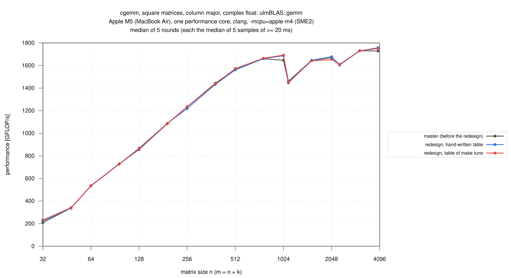
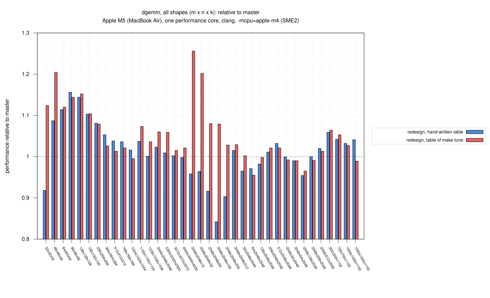
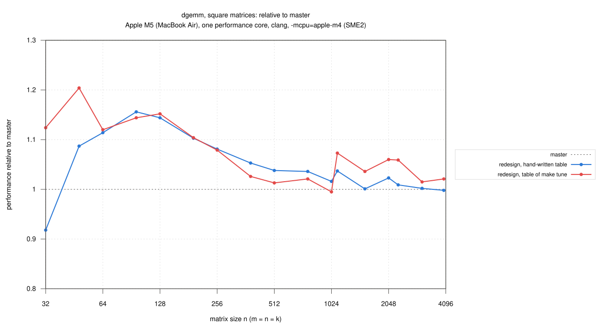
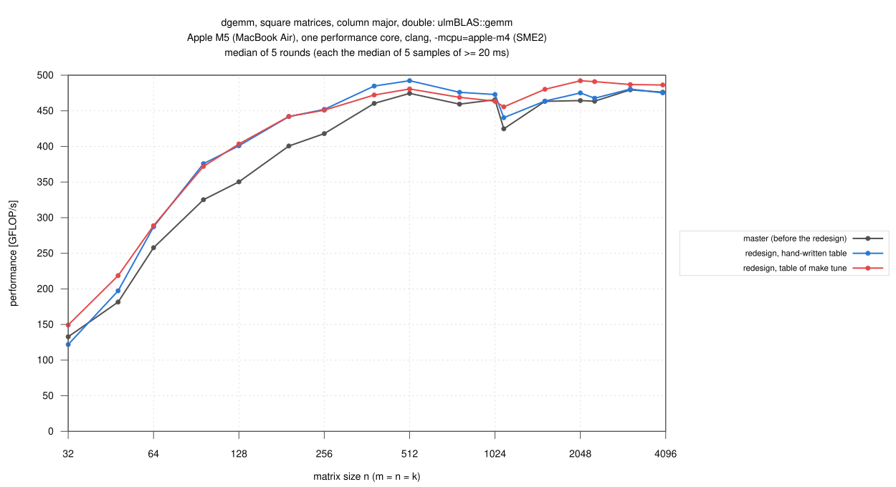
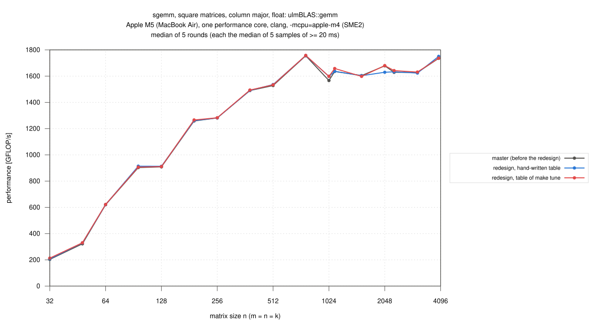
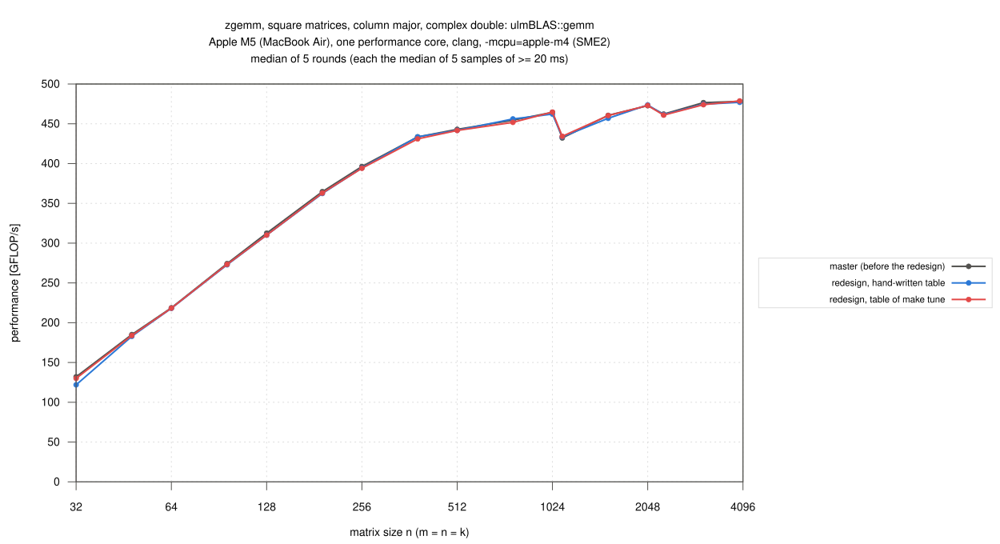

# GEMM (general matrix-matrix multiplication) with run-time selection on the Apple M5

ulmBLAS::gemm of master against the redesign of gemm (branch
feature/gemm-redesign): the wrapper asks gemmSelect for a plan, the first
entry of a selection table that applies to the problem
(ulmblas/level3/gemm/select.h).

- master: origin/master 0807e78e
- generic: redesign f7d8bbc5, the hand-written table of the build
  (ULMBLAS_PLATFORM=generic): DGEMM (double precision GEMM) with the SME2 (Scalable Matrix
  Extension 2) macro kernel in one
  streaming section per block, prefetching of C for k >= 384 and C >= 3.5
  MB (megabytes); the other types one entry, as master
- tuned: redesign f7d8bbc5, the table of make tune for the Apple M5
  (ulmblas/level3/gemm/tables/apple-m5-double.h, rules fitted to the
  measurements; DGEMM only)

## Measurement

- MacBook Air M5, one performance core, clang, -O3 -mcpu=apple-m4 (SME2).
- Program: [selbench.cc](source/selbench.cc), one per variant (master and
  the redesign compiled from their headers); per shape 5 samples of at
  least 20 ms after one untimed call, the median.
- [run-mac.sh](source/run-mac.sh): 5 rounds; per round and type a program
  run per variant, the order of the variants rotated per round; every run
  under the thermal and load guard of campaign 022 (thermal state nominal,
  1-minute load below 2.5).  Load average during the runs 1.6 to 2.3
  (other processes on the machine).
- Value: median over the 5 rounds.  Column major, alpha = beta = 1.
- Shapes: squares n = 32 ... 4000 (all types); dgemm also m = n = 2048 with
  k = 16 ... 512, m or n = 32 ... 512 with the other two 2048, and m = n =
  300 ... 1500 with k = 1100 (just above the block size KC = 1024 of the k dimension).

## Results

- dgemm, squares (tuned / master): 1.08 to 1.20 for n = 48 ... 256, 0.995
  to 1.03 for n = 384 ... 1024, 1.02 to 1.07 for n = 1100 ... 4000.
- dgemm, m = n = 2048, small k: 1.26 (k = 16), 1.20 (32), 1.08 (64, 128).
- dgemm, slower: 64 x 2048 x 2048 (0.955), 2048 x 128 x 2048 (0.965),
  1500 x 1500 x 1100 (0.989).
- n = 384 ... 768: the hand-written table 1.04 to 1.05, the tuned one 1.01
  to 1.03: make tune prefetches C too early there (its measurement runs the
  candidates alternately on the same operands).
- sgemm, cgemm, zgemm (one table entry, as master): tuned / master
  1.00 to 1.05 (float), 0.99 to 1.11 (complex float), 0.98 to 1.00 (complex double);
  n = 32 is noisy in all types (0.78 to 2.7 between rounds).

Plots: [d_square](plots/d_square.svg), [d_square_ratio](plots/d_square_ratio.svg),
[d_shapes_ratio](plots/d_shapes_ratio.svg), [s_square](plots/s_square.svg),
[c_square](plots/c_square.svg), [z_square](plots/z_square.svg).

## dgemm, all shapes

GFLOP/s (billions of floating-point operations per second; median of 5
rounds) and relative to master.

| shape (m x n x k) | master | generic | tuned | generic / master | tuned / master |
|---|---:|---:|---:|---:|---:|
| 32x32x32 | 132.8 | 121.9 | 149.3 | 0.918 | 1.124 |
| 48x48x48 | 181.5 | 197.3 | 218.6 | 1.087 | 1.204 |
| 64x64x64 | 257.8 | 287.1 | 288.8 | 1.114 | 1.120 |
| 96x96x96 | 325.2 | 375.8 | 372.0 | 1.156 | 1.144 |
| 128x128x128 | 350.3 | 400.9 | 403.5 | 1.144 | 1.152 |
| 192x192x192 | 400.6 | 441.9 | 442.1 | 1.103 | 1.104 |
| 256x256x256 | 418.0 | 452.0 | 450.9 | 1.081 | 1.079 |
| 384x384x384 | 460.4 | 484.8 | 472.2 | 1.053 | 1.026 |
| 512x512x512 | 474.5 | 492.3 | 480.7 | 1.038 | 1.013 |
| 768x768x768 | 459.4 | 476.0 | 468.9 | 1.036 | 1.021 |
| 1024x1024x1024 | 465.6 | 472.9 | 463.5 | 1.016 | 0.995 |
| 1100x1100x1100 | 424.7 | 440.4 | 455.6 | 1.037 | 1.073 |
| 1536x1536x1536 | 463.3 | 463.7 | 480.2 | 1.001 | 1.036 |
| 2048x2048x2048 | 464.4 | 475.1 | 492.2 | 1.023 | 1.060 |
| 2300x2300x2300 | 463.5 | 467.7 | 491.0 | 1.009 | 1.059 |
| 3072x3072x3072 | 479.5 | 480.5 | 486.9 | 1.002 | 1.015 |
| 4000x4000x4000 | 476.1 | 475.2 | 486.3 | 0.998 | 1.021 |
| 2048x2048x16 | 99.9 | 95.7 | 125.5 | 0.958 | 1.256 |
| 2048x2048x32 | 176.2 | 169.8 | 211.8 | 0.964 | 1.202 |
| 2048x2048x64 | 275.8 | 252.5 | 298.0 | 0.916 | 1.080 |
| 2048x2048x128 | 363.6 | 306.3 | 392.4 | 0.842 | 1.079 |
| 2048x2048x256 | 419.4 | 378.7 | 431.0 | 0.903 | 1.028 |
| 2048x2048x512 | 451.6 | 458.2 | 464.9 | 1.015 | 1.029 |
| 32x2048x2048 | 216.3 | 208.8 | 216.7 | 0.965 | 1.002 |
| 64x2048x2048 | 299.9 | 291.3 | 286.3 | 0.971 | 0.955 |
| 128x2048x2048 | 370.6 | 363.9 | 369.9 | 0.982 | 0.998 |
| 256x2048x2048 | 417.5 | 422.0 | 426.2 | 1.011 | 1.021 |
| 512x2048x2048 | 440.3 | 454.5 | 449.6 | 1.032 | 1.021 |
| 2048x32x2048 | 249.4 | 249.1 | 247.5 | 0.999 | 0.992 |
| 2048x64x2048 | 332.8 | 329.5 | 329.5 | 0.990 | 0.990 |
| 2048x128x2048 | 401.0 | 382.7 | 387.0 | 0.954 | 0.965 |
| 2048x256x2048 | 441.7 | 441.5 | 437.8 | 1.000 | 0.991 |
| 2048x512x2048 | 451.5 | 460.5 | 457.3 | 1.020 | 1.013 |
| 300x300x1100 | 416.7 | 441.2 | 443.5 | 1.059 | 1.064 |
| 700x700x1100 | 428.5 | 446.7 | 451.0 | 1.042 | 1.053 |
| 1000x1000x1100 | 428.7 | 442.5 | 440.4 | 1.032 | 1.027 |
| 1500x1500x1100 | 439.4 | 457.2 | 434.5 | 1.041 | 0.989 |

## Figures

<!-- BEGIN FIGURES (generated by make add_benchmark_result) -->

<!-- END FIGURES -->
