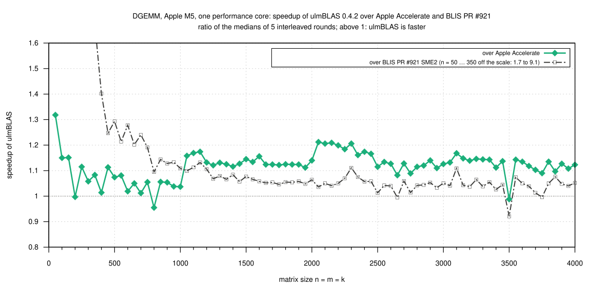
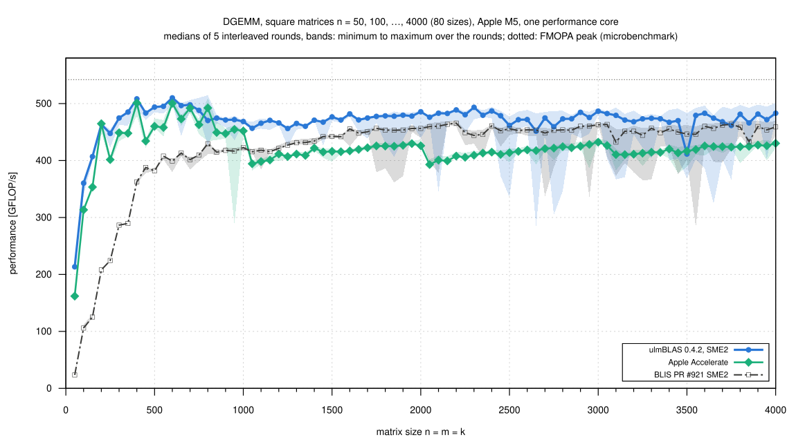

# DGEMM sweep n = 50 … 4000 on the Apple M5: ulmBLAS 0.4.2, Accelerate, BLIS

The sweep of campaign
[007](../007-2026-10-26-macbook-m5-sme-small/README.md) (DGEMM, double
precision general matrix-matrix product, square matrices n = 50, 100, …,
4000, one performance core) repeated with release 0.4.2: the SME2
(Scalable Matrix Extension 2) backend with the run-time selection of
gemmSelect and the SME2 macro kernel (since 0.4.1, campaign
[039](../039-2026-11-15-macbook-m5-gemm-select/README.md)).  The plot of
this campaign replaces the one of 007 in the top-level README.

- ulmBLAS: tag v0.4.2 (0d1ba02c), `make cblas ARCHFLAGS=-mcpu=apple-m4`,
  `ULMBLAS_NUM_THREADS=1`
- Apple Accelerate (macOS 26.6), `VECLIB_MAXIMUM_THREADS=1`
- BLIS (BLAS-like Library Instantiation Software; BLAS: Basic Linear
  Algebra Subprograms) pull request #921 with SME2 kernels, configuration
  m4sme_p, the commit of campaign 006 (235ef8ec)

## Measurement

- MacBook Air, Apple M5 (4 performance and 6 efficiency cores), macOS 26.6
  (25G72), Apple clang 21.0.0, on AC power.
- Programs: [build-sweep.sh](source/build-sweep.sh); the benchmark program
  [bench2.c](source/bench2.c) of campaign 006 (one `cblas_dgemm` call
  timed repeatedly: warm-up of at least 0.3 s, then 5 samples of at least
  0.2 s, the median; column major, no transposition, alpha = beta = 1).
  The thread of bench2 runs with the quality of service "user
  interactive", that is on a performance core.
- [compare.sh](source/compare.sh) as in 007: 5 rounds; per round and size
  one program run per library, in a random order per round and size; the
  order of the sizes alternates between rounds.  Every run under the
  thermal guard of 007 ([guard.sh](source/guard.sh), pause 3 s, thermal
  state nominal before and after the run): 0 runs discarded, thermal state
  nominal throughout.
- 1200 runs from 2026-11-23 21:40:50 to 23:14:59.  No load guard: the
  1-minute load average was 1.3 to 5.1 (other processes on the machine).
  The libraries are interleaved, so they are measured under the same
  conditions; absolute values may be slightly lower than on an idle
  machine.
- bench2 compares with a naive product for the small sizes: 165 runs
  checked, all correct; the others are unchecked (correctness of large n:
  the checks of the release).
- Value: median over the 5 rounds; bands in the plot: minimum to maximum
  over the rounds.  Clear (faster/slower): the slowest round of the faster
  library is faster than the fastest round of the other and the medians
  differ by at least 1 %; otherwise noise.
- Summary: [summarize-sweep.py](source/summarize-sweep.py) →
  [data/summary/squares.csv](data/summary/squares.csv); every run in
  [data/runs.csv](data/runs.csv), the output of bench2 in
  [data/raw/bench2-output.txt](data/raw/bench2-output.txt).

## Results

ulmBLAS 0.4.2 relative to Accelerate (ratio of the medians):

- clearly faster for 50 of the 80 sizes, clearly slower for none;
  median 1.125
- n = 50 … 250: 1.00 to 1.32 (n = 200: 0.997, noise)
- n = 300 … 1000: 0.955 (n = 800, noise) to 1.11, median 1.05
- n = 1050 … 4000: 0.99 (n = 3500, noise) to 1.21, median 1.13
- up to 510 GFLOP/s (billions of floating-point operations per second;
  n = 600), 94 % of the FMOPA (floating-point outer product and
  accumulate) peak of 542 GFLOP/s measured in campaign 004; Accelerate up
  to 501 GFLOP/s (n = 400)

ulmBLAS 0.4.2 relative to BLIS pull request #921: clearly faster for 41
sizes, clearly slower for none; 1.7 to 9.1 for n ≤ 350, median 1.05 for n
≥ 1050 (0.92 at n = 3500, noise).

Against campaign 007 (2026-10-26, same programs for Accelerate and BLIS):
Accelerate is unchanged (median 0.997, 0.93 to 1.01); ulmBLAS 0.4.2
relative to the ulmBLAS of 007 (b38f3d5): 1.12 to 1.51 for n ≤ 300
(median 1.28), 0.99 to 1.15 for n = 350 … 950 (median 1.09), 0.86 (n =
3500) to 1.08 for n ≥ 1000 (median 1.01).  In 007 Accelerate was faster
for n = 36 … 850.

Plots: [sweep](plots/sweep.svg), [sweep_ratio](plots/sweep_ratio.svg).

## Reproduction

On an Apple M5 (macOS 26, Apple clang, Gnuplot for the plots):

    sh source/build-sweep.sh B /path/to/ulmBLAS
    SHAPES="$(seq 50 50 4000 | sed 's/.*/&_&_&/')" ROUNDS=5 PAUSE=3 sh source/compare.sh B
    python3 source/summarize-sweep.py B/res data

## Figures

<!-- BEGIN FIGURES (generated by make add_benchmark_result) -->

<!-- END FIGURES -->
