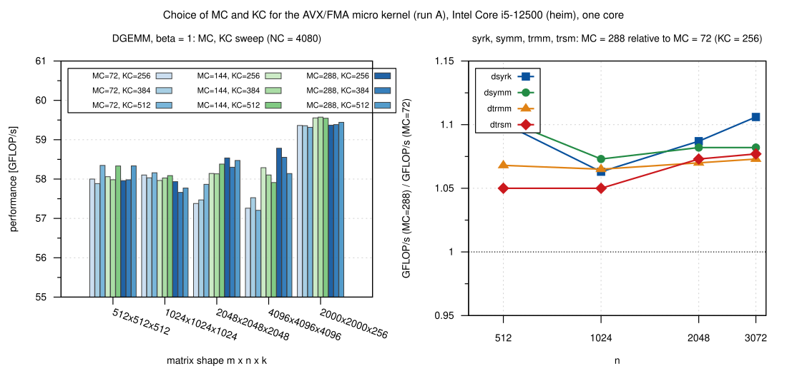
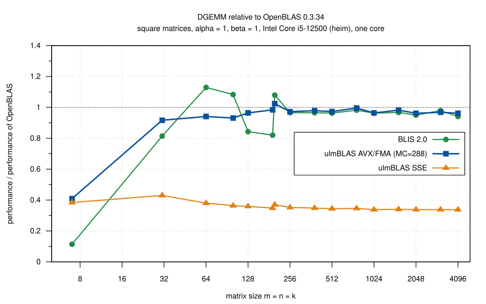
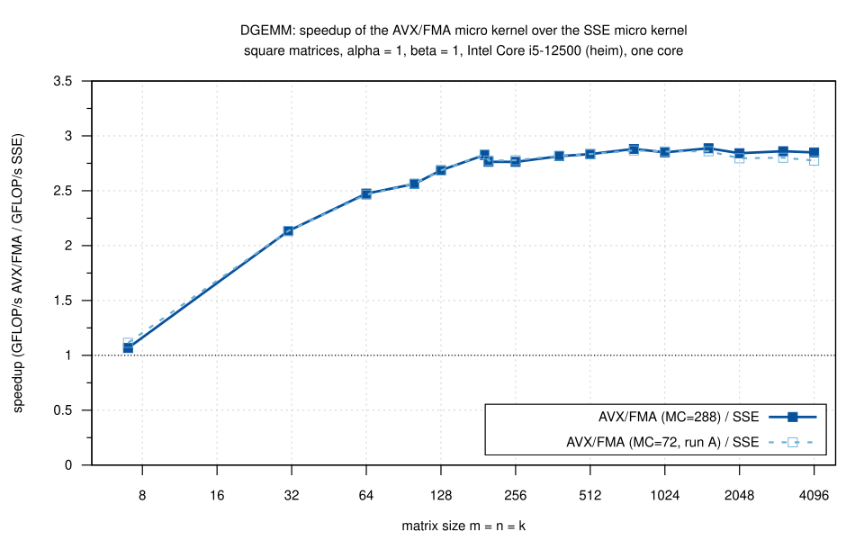
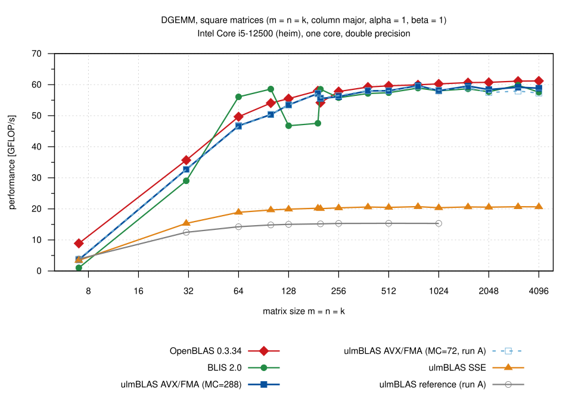
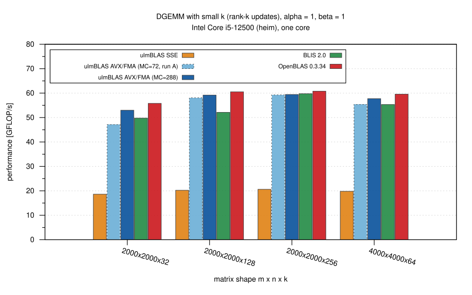
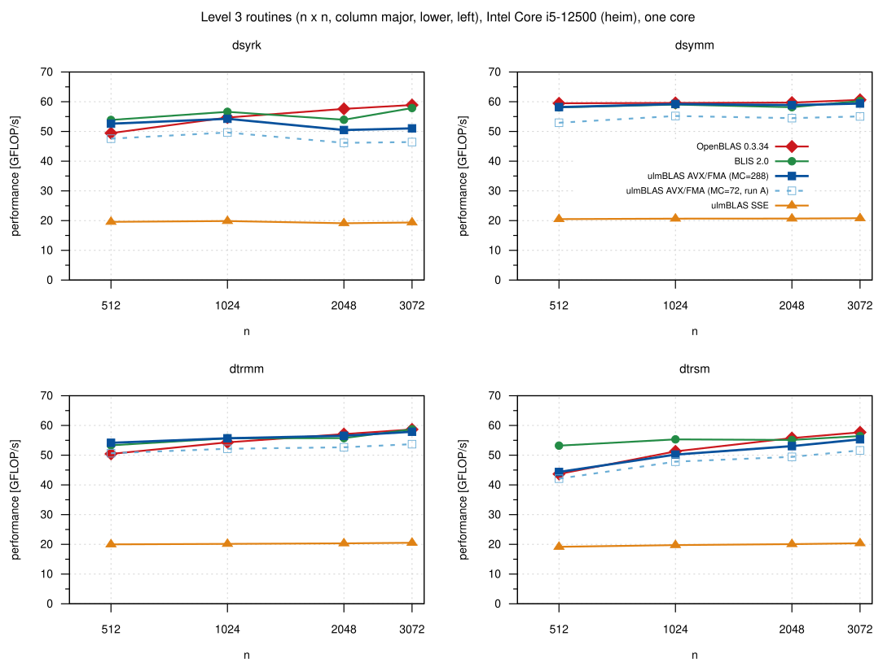

# AVX/FMA DGEMM micro kernel on an Intel Core i5-12500 (heim), 2026-10-24

Performance of the AVX/FMA micro kernel for double (MR = 6, NR = 8, derived
from the BLIS kernel `bli_dgemm_haswell_asm_6x8`, see `LICENSE` of ulmBLAS)
compared with the SSE micro kernel and the reference micro kernel of
ulmBLAS, BLIS 2.0 and OpenBLAS 0.3.34, and the choice of the block sizes MC
and KC for the new kernel.  All measurements are single threaded.

## Results

- **DGEMM**: the AVX/FMA micro kernel is **2.8 times faster** than the SSE
  micro kernel (2.76 to 2.89 for n >= 256).  It is on par with BLIS 2.0
  (0.99 to 1.02 for n >= 256; BLIS uses the same assembly kernel) and
  reaches 0.96 to 1.00 of the performance of OpenBLAS 0.3.34 for n >= 256
  (ulmBLAS up to 59.7 GFLOP/s, OpenBLAS up to 61.2 GFLOP/s).  For small
  matrices (n <= 128) BLIS and OpenBLAS are partly faster; for n = 7
  OpenBLAS is 2.3 to 2.6 times faster than the ulmBLAS variants.
- **Block sizes**: MC hardly matters for DGEMM with large k (up to 3%), but
  MC = 288 instead of MC = 72 (the BLIS value) is 12% faster for k = 32 and
  5 to 11% faster for dsyrk, dsymm, dtrmm and dtrsm, which use MC x MC
  blocks.  KC (256, 384, 512) makes hardly any difference (at most 1.1% for
  the same MC).  The final block
  sizes are **MC = 288, KC = 256, NC = 4080** (run B).
- **Other level 3 routines** (MC = 288): 2.3 to 2.9 times faster than with
  the SSE kernel.  dsymm and dtrmm reach 0.99 to 1.01 of BLIS for
  n >= 1024.  dsyrk (0.88 to 0.98 of BLIS) and dtrsm (0.83 to 0.98 of BLIS;
  with the AVX kernel the diagonal blocks of trsm use the reference
  kernels) leave room for improvement.
- The measurements are reproducible: BLIS and OpenBLAS, measured in both
  runs, differ by at most 0.9% between run A and run B; the medians of the
  rounds of one run differ by at most 1.6% (n >= 64).

## Runs

| Run | ulmBLAS AVX/FMA block sizes (double) | Contents |
|-----|--------------------------------------|----------|
| A | MC = 72, KC = 256, NC = 4080 (and the sweep MC = 72, 144, 288 x KC = 256, 384, 512) | DGEMM: reference, SSE, AVX/FMA, BLIS, OpenBLAS; MC/KC sweep; dsyrk, dsymm, dtrmm, dtrsm with MC = 72, 144, 288 |
| B | MC = 288, KC = 256, NC = 4080 (final) | DGEMM and dsyrk, dsymm, dtrmm, dtrsm: SSE, AVX/FMA, BLIS, OpenBLAS |

In the figures, "MC=72, run A" and "MC=288" (run B) distinguish the two
block sizes; the reference kernel was only measured in run A (and only up to
n = 1024, it is slow).

## Hardware and software

| | |
|-|-|
| Machine | heim (Ulm University, Institute of Numerical Mathematics) |
| CPU | 12th Gen Intel Core i5-12500 (Alder Lake, family 6, stepping 5, microcode 0x3e), 6 cores (only P-cores), 2 threads per core |
| Caches | L1d 48 KiB, L1i 32 KiB, L2 1.25 MiB per core; L3 18 MiB shared |
| Instruction sets | SSE2, SSE3, SSSE3, SSE4.2, AVX, AVX2, FMA, F16C; no AVX-512.  The operating system enables the AVX state (XCR0 = 0x207) |
| Frequency | scaling driver intel_pstate, governor powersave, turbo enabled (cpuinfo_max_freq as reported: 5.9 GHz) |
| Operating system | Debian GNU/Linux 12 (bookworm), Linux 6.1.0-54-amd64, x86-64 |
| Compilers | GCC 12.2.0 (Debian 12.2.0-14+deb12u1), GNU Binutils 2.40, glibc 2.36; benchmark programs: gcc -O2 |
| Gnuplot | 5.4 patchlevel 4 (figures) |

## Libraries

| Variant | Source | Build | MR x NR, MC, KC, NC (double) |
|---------|--------|-------|------------------------------|
| ulmBLAS reference | see below | `make cblas ARCHFLAGS=` (no SSE3: reference kernels), g++ -std=c++11 -O3 -fomit-frame-pointer | 4 x 4, 384, 384, 4096 |
| ulmBLAS SSE | see below | `make cblas` (default ARCHFLAGS: -msse3 -mfpmath=sse) | 4 x 4, 384, 384, 4096 |
| ulmBLAS AVX/FMA | see below | `make cblas ARCHFLAGS='-mavx -mfma'` | 6 x 8, run A: 72, 256, 4080; run B: 288, 256, 4080 |
| BLIS 2.0 | tag 2.0, commit e8566eb3e773fb54d11b33e371d13f22d2941e50 (archive SHA-256 in `data/logs/reference-sources.sha256`) | `./configure --disable-shared --enable-cblas -t no haswell`, GCC 12.2 | 6 x 8, 72, 256, 4080 (`config/haswell/bli_cntx_init_haswell.c`) |
| OpenBLAS 0.3.34 | tag v0.3.34 (archive SHA-256 in `data/logs/reference-sources.sha256`) | `make USE_THREAD=0 USE_OPENMP=0 NO_SHARED=1 NOFORTRAN=1 NO_LAPACK=1`, detected target HASWELL, GCC 12.2 | 4 x 8, P = 512, Q = 256, R = 13824 (`param.h`, HASWELL, x86-64) |

All libraries are static, without threading; the benchmark programs call the
CBLAS interface (`cblas_dgemm`, ...).

**ulmBLAS sources.**  The measurements were made before the changes were
committed, with working trees of the branch `feature/avx-dgemm-6x8` (based on
master 5ca91d0).  Their source states relative to the commits:

- Run B: exactly the tree of commit
  e195beabc2092368d00ef78e1f10f172745cc31b ("Tune the block sizes of the
  AVX/FMA micro kernel"; tree hash aaaba196dde274c9, verified with
  `git archive`).
- Run A: the tree of commit d004ae171e7a4082f6d68cbff86b9a79f32f878e ("Test
  the AVX/FMA micro kernel and skip unsupported configurations", MC = 72)
  with one difference in the library: the clobber list of the AVX/FMA
  kernel (`ulmblas/level3/ukernel/avx/ugemm.tcc`) also listed r8 to r12 and
  r15 (the instructions are the same).  The other differences are test
  infrastructure and documentation (`mk/probe.sh`, `mk/probe/cpu.cc`,
  `test/Makefile.config`, `README.md`); tree hash 23470970201c8ad1.  For the
  sweep, MC and KC of the AVX/FMA branch of `ulmblas/config/blocksize.h`
  were set per variant (`source/bench.sh`).

The tree hash is the first 16 hex digits of the SHA-256 of the sorted
SHA-256 list of all files: `find . -type f | LC_ALL=C sort | xargs shasum -a
256 | shasum -a 256` in the source tree (e.g. `git archive`).

## Methodology

- Single threaded, pinned to core 3 (`taskset -c 3`); no other load (load
  average about 1.0, see `data/logs`).
- Matrices are column major with leading dimension m (or n), entries
  uniformly random in [-0.5, 0.5]; alpha = 1; beta = 1 (and beta = 0 with C
  set to NaN before each sample, to check that C is not read).  dsyrk:
  lower, no transposition; dsymm: left, lower; dtrmm, dtrsm: left, lower,
  no transposition, non-unit diagonal (A diagonally dominant).
- Each measurement (`source/bench2.c` for DGEMM, `source/bench3.c` for the
  other routines): warm-up of at least 0.3 s, then 7 samples (5 for the
  sweep and the level 3 routines), each sample repeats the call until at
  least 0.2 s elapsed; the median of the samples is reported (with minimum
  and maximum).  The result of one call is checked against a naive product
  for m n k <= 2e8 (`check` in `data/dgemm.csv`; no result was wrong).
- Each run consists of 3 rounds; in every round each variant is measured
  once, the order of the variants rotates from round to round (to reduce
  effects of the temperature, the frequency and other load).  The figures
  and tables show the median of the 3 rounds.
- GFLOP/s with the usual operation counts: dgemm 2 m n k, dsyrk n^3, dsymm
  2 n^3, dtrmm and dtrsm n^3 (the copy of B before each dtrmm and dtrsm
  call is included in the time).
- Sizes: DGEMM square n = 7, 31, 64, 100, 128, 192, 199, 256, 384, 512, 768,
  1024, 1536, 2048, 3072, 4096 (reference only up to 1024), thin k: 2000 x
  2000 x 32, 128, 256 and 4000 x 4000 x 64; beta = 0: 256, 1024, 2048 and
  2000 x 2000 x 32; level 3: n = 512, 1024, 2048, 3072.

## Files

| File | Contents |
|------|----------|
| `data/raw/run-A/`, `data/raw/run-B/` | outputs of the benchmark programs, one file per kind (main: beta = 1, beta0, sweep, l3), variant and round |
| `data/dgemm.csv`, `data/level3.csv` | all measurements with run, library, variant, kernel, block sizes, sizes, alpha, beta, round, samples, median, minimum and maximum GFLOP/s, calls per sample |
| `data/summary/*.csv` | medians over the rounds (the data of the figures) |
| `data/logs/` | logs of the benchmark runs and of the builds of BLIS and OpenBLAS, SHA-256 of their source archives |
| `source/` | benchmark programs (`bench2.c`, `bench3.c`), the scripts that built the variants and ran the benchmarks on heim (`bench.sh`, `bench3.sh`, `bench-final.sh`, `build-refs.sh`), and `summarize.py`, which converts the raw outputs into the CSV files |
| `plots/*.gp`, `plots/*.svg` | Gnuplot scripts and the figures they generate |

To regenerate: `python3 source/summarize.py` in this directory (CSV files
from the raw outputs), then `make add_benchmark_result
BENCHMARK_DIR=benchmark_results/2026-10-24-heim-avx-fma` in the top-level
directory of ulmBLAS (figures).

## Tables (medians of 3 rounds, GFLOP/s)

DGEMM, square, beta = 1 (`data/summary/dgemm_square.csv`):

| n | reference (A) | SSE | AVX/FMA MC=72 (A) | AVX/FMA MC=288 | BLIS 2.0 | OpenBLAS 0.3.34 | AVX MC=288 / SSE |
|---|---|---|---|---|---|---|---|
| 64 | 14.25 | 18.90 | 46.56 | 46.75 | 56.07 | 49.67 | 2.47 |
| 256 | 15.31 | 20.33 | 56.48 | 56.17 | 55.80 | 57.80 | 2.76 |
| 1024 | 15.32 | 20.37 | 58.22 | 58.06 | 58.02 | 60.25 | 2.85 |
| 2048 | - | 20.56 | 57.47 | 58.42 | 57.71 | 60.74 | 2.84 |
| 4096 | - | 20.66 | 57.31 | 58.86 | 57.57 | 61.20 | 2.85 |

DGEMM, thin k, beta = 1 (`data/summary/dgemm_thin_k.csv`):

| m x n x k | SSE | AVX/FMA MC=72 (A) | AVX/FMA MC=288 | BLIS 2.0 | OpenBLAS 0.3.34 |
|---|---|---|---|---|---|
| 2000 x 2000 x 32 | 18.62 | 47.11 | 53.00 | 49.78 | 55.80 |
| 2000 x 2000 x 128 | 20.23 | 58.10 | 59.19 | 52.13 | 60.52 |
| 2000 x 2000 x 256 | 20.62 | 59.29 | 59.44 | 59.76 | 60.79 |
| 4000 x 4000 x 64 | 19.81 | 55.36 | 57.73 | 55.34 | 59.57 |

Level 3, n = 2048 (`data/summary/level3_*.csv`):

| Routine | SSE | AVX/FMA MC=72 (A) | AVX/FMA MC=288 | BLIS 2.0 | OpenBLAS 0.3.34 |
|---|---|---|---|---|---|
| dsyrk | 19.11 | 46.17 | 50.48 | 53.93 | 57.59 |
| dsymm | 20.69 | 54.47 | 58.87 | 58.16 | 59.71 |
| dtrmm | 20.33 | 52.65 | 56.53 | 55.74 | 57.10 |
| dtrsm | 20.08 | 49.43 | 53.05 | 55.11 | 55.76 |

## Conclusions

The AVX/FMA micro kernel brings ulmBLAS to the performance of BLIS on this
CPU, at nearly the performance of OpenBLAS, for all level 3 routines.  The
block sizes MC = 288, KC = 256, NC = 4080 are used for double.  Remaining
gaps: small matrices (packing overhead), dsyrk (handling of the diagonal
blocks) and the diagonal blocks of dtrsm (no AVX/FMA trsm micro kernel yet).
The block sizes were only measured on this CPU; other CPUs with AVX and FMA
(e.g. Haswell, Zen) may prefer other values.

## Figures

<!-- BEGIN FIGURES (generated by make add_benchmark_result) -->

<!-- END FIGURES -->
