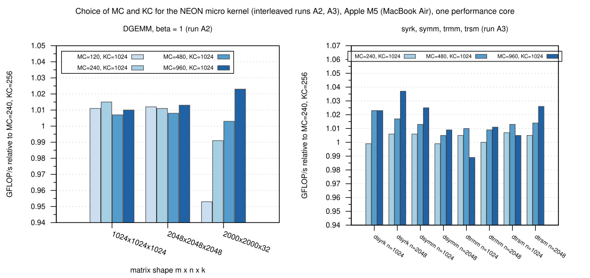
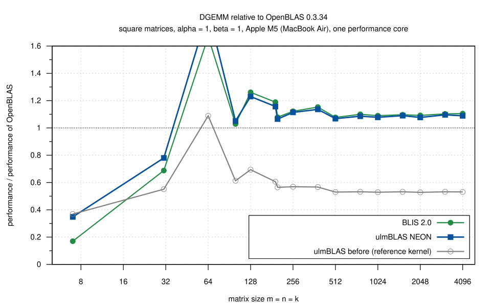
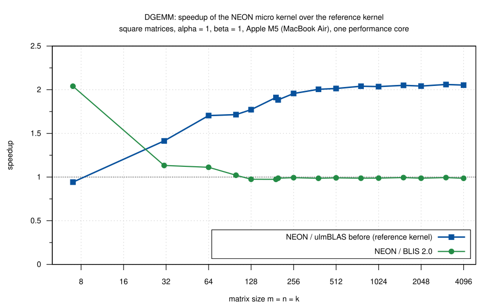
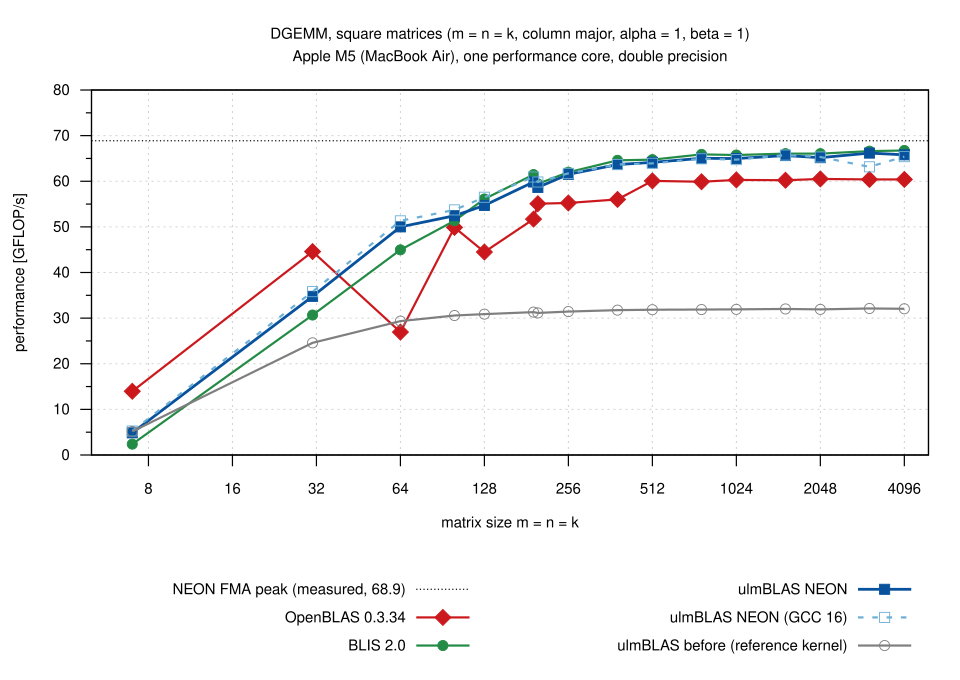
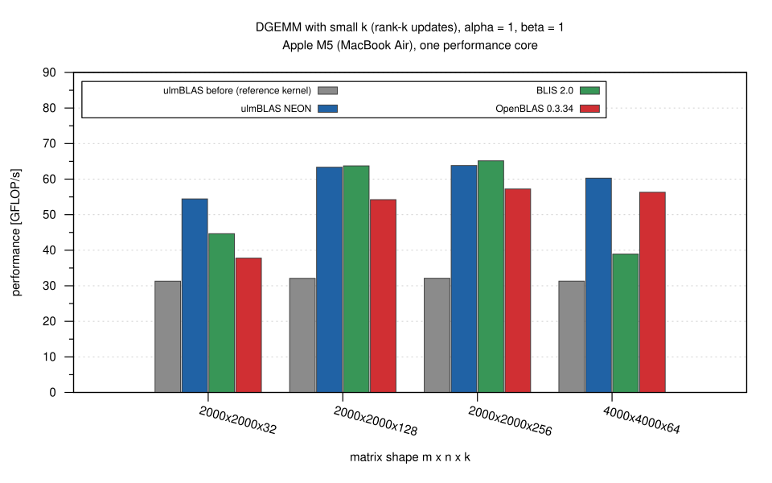
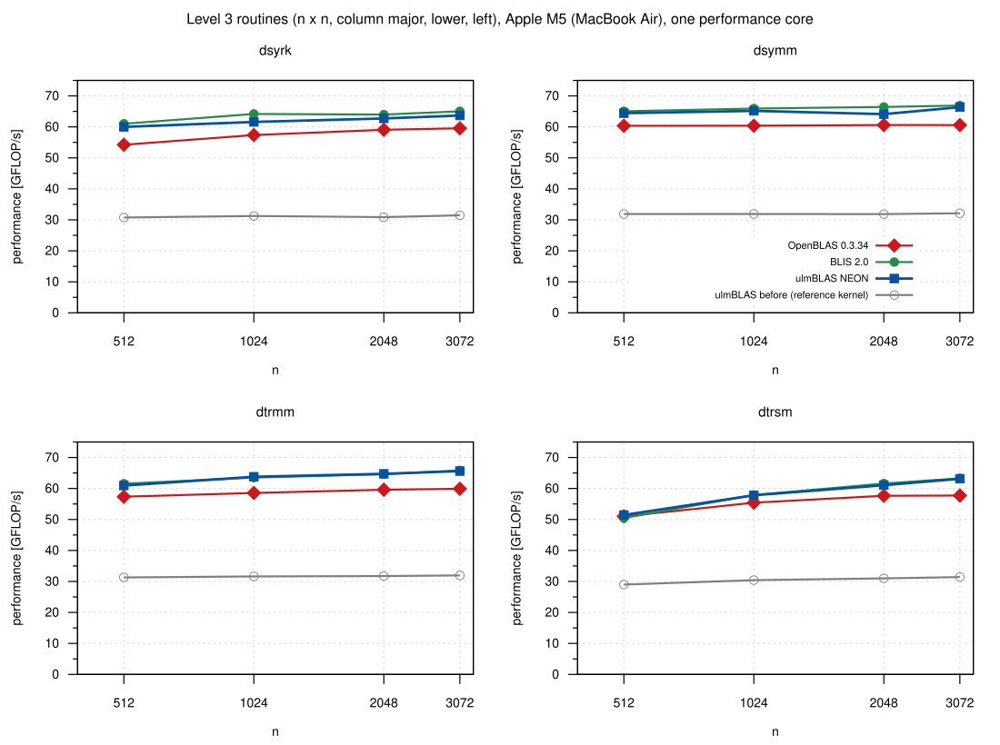
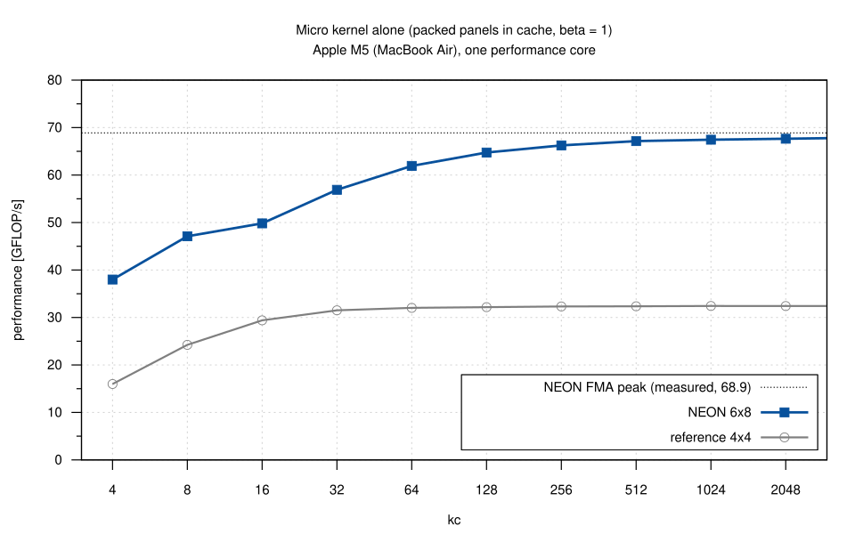

# NEON DGEMM micro kernel on an Apple M5 (MacBook Air), 2026-10-24

Performance of the AArch64 NEON micro kernel for double (MR = 6, NR = 8,
derived from the BLIS kernel `bli_dgemm_armv8a_asm_8x6r`, see `LICENSE` of
ulmBLAS) compared with the portable reference micro kernel of ulmBLAS (the
kernel used on ARM before), BLIS 2.0 and OpenBLAS 0.3.34, and the choice of
the block sizes MC and KC for the new kernel.  All measurements are single
threaded, on one performance core.

## Results

- **DGEMM**: the NEON micro kernel is **2.0 times faster** than the
  reference kernel (1.96 to 2.06 for n >= 256, 1.70 to 1.91 for
  n = 64 to 199).  It reaches **0.986 to 0.994 of BLIS 2.0** for n >= 256
  (BLIS runs the same assembly kernel, with KC = 3072) and **1.07 to 1.14
  times the performance of OpenBLAS 0.3.34** for n >= 256 (OpenBLAS uses
  its NEON kernel `dgemm_kernel_8x4` on this CPU).  ulmBLAS reaches up to
  66.2 GFLOP/s, 94 to 96% of the measured FMA peak of the core (68.9
  GFLOP/s) for n >= 1024; BLIS 95 to 97%, OpenBLAS 87 to 88%.
- **Small matrices**: for n = 31 to 100 ulmBLAS is 2 to 13% faster than
  BLIS; for n = 7 and 31 OpenBLAS is faster (n = 7: 14.0 GFLOP/s, ulmBLAS
  4.9, BLIS 2.4).
- **Thin k**: for k = 32 and k = 64 ulmBLAS is clearly faster than BLIS
  (2000 x 2000 x 32: 54.4 vs. 44.7 GFLOP/s; 4000 x 4000 x 64: 60.3 vs.
  38.9) and OpenBLAS (37.8 and 56.3); for k >= 128 BLIS is up to 2% faster.
- **Other level 3 routines** (dsyrk, dsymm, dtrmm, dtrsm, n = 512 to
  3072): 1.8 to 2.1 times faster than with the reference kernel, 0.96 to
  1.02 of BLIS and 1.01 to 1.11 times OpenBLAS.  dsyrk (0.96 to 0.98 of
  BLIS) leaves the most room.
- **Micro kernel alone** (packed panels in cache): 67.4 GFLOP/s for
  kc = 1024 and 67.8 GFLOP/s for kc = 3072, 98% of the FMA peak; the
  reference kernel reaches 32.4 GFLOP/s (it is auto-vectorized by clang).
- **Block sizes**: KC = 1024 instead of 256 is 1 to 1.5% faster for DGEMM
  (fewer updates of C per element), MC hardly matters for square DGEMM
  (within 0.5%), MC = 960 instead of 240 is 2.3% faster for k = 32 and up to
  3.7% for dsyrk and 2.6% for dtrsm (only dtrmm with n = 1024 is 1.1%
  slower).  Final block sizes: **MC = 960, KC = 1024, NC = 4080**.
- **Compilers**: the library built with GCC 16 is as fast as with Apple
  clang 21 (0.99 to 1.03 for n >= 64, except one disturbed measurement
  for n = 3072, see Repeatability; the assembly kernel is the same).
- **Thermal throttling**: the MacBook Air has passive cooling.  After about
  6 minutes of continuous load on one core macOS raises the thermal state
  from *nominal* to *fair* and DGEMM becomes about 15% slower (figure
  `thermal.svg`).  The first block size sweep (run A0) was invalidated by
  this; all other runs use a thermal guard (see Methodology).
- **Apple Accelerate** (for context, one thread) reaches 400 to 490 GFLOP/s
  for n >= 128: it uses the matrix unit (SME/AMX) of the M5, not the NEON
  units, and is not a comparison for a NEON micro kernel.

## Runs

| Run | Contents | Valid |
|-----|----------|-------|
| A0 | DGEMM block size sweep MC = 120, 240, 480, 960 x KC = 256, 512, 1024, 2048 (3 rounds, without pauses) | no: thermal throttling during the rounds (performance depended on the time, not on the variant) |
| A | DGEMM block size sweep MC = 120, 240, 480, 960 x KC = 256, 512, 1024 (3 rounds, thermal guard) | yes, but differences between the block sizes are below the variation caused by other load on the machine |
| A2 | DGEMM, 5 candidates, tightly interleaved (8 cycles) | yes: basis of the choice of KC and MC |
| A3 | dsyrk, dsymm, dtrmm, dtrsm, 4 candidates, tightly interleaved (6 cycles) | yes: basis of the choice of MC |
| B | final block sizes: DGEMM (square, thin k, beta = 0) and level 3, all variants (3 rounds, thermal guard) | yes |
| ukernel | micro kernels alone (NEON, reference), kc = 4 to 3072 | yes |
| diag | DGEMM n = 2048 for 10 minutes without pauses, thermal state logged | diagnosis of the throttling |

## Hardware and software

| | |
|-|-|
| Machine | MacBook Air (Mac17,4), on AC power, Low Power Mode off |
| CPU | Apple M5: 4 performance cores, 6 efficiency cores |
| Caches | performance cores: L1d 128 KiB, L1i 192 KiB per core, L2 16 MiB shared by the 4 cores; efficiency cores: L1d 64 KiB, L2 6 MiB; cache line 128 bytes, page size 16 KiB |
| Memory | 32 GiB |
| Instruction sets | AArch64 with AdvSIMD (NEON), FP16, BF16, DotProd, I8MM, SME, SME2 (`sysctl hw.optional.arm`); measured double precision FMA peak 68.9 GFLOP/s (with 4 FMA pipelines of 2 doubles, i.e. 16 flops per cycle, this corresponds to about 4.3 GHz; the clock frequency itself cannot be read without root) |
| Operating system | macOS 26.6 (25G72), Darwin 25.6.0, arm64 |
| Compilers | Apple clang 21.0.0 (clang-2100.3.34.2, SDK 27.0) for the libraries and benchmark programs; GCC 16.2.0 (Homebrew) for the variant `neon-gcc`; benchmark programs: `clang -O2` |
| Tools | GNU Make 4.4.1, Python 3.15.0, Gnuplot 6.0 patchlevel 5 (figures) |

## Libraries

| Variant | Source | Build | MR x NR, MC, KC, NC (double) |
|---------|--------|-------|------------------------------|
| ulmBLAS before (`base`) | commit 8266ae3 (master with the trlscal/truscal fix, before the NEON kernel) | `make cblas` (default on arm64: reference kernels), c++ -std=c++11 -O3 -fomit-frame-pointer | 4 x 4, 384, 384, 4096 |
| ulmBLAS reference (`ref`) | NEON source tree, see below | `make cblas CPPFLAGS=-DULMBLAS_NO_NEON` | 4 x 4, 384, 384, 4096 |
| ulmBLAS NEON (`neon`) | see below | `make cblas` (default on arm64) | 6 x 8, 960, 1024, 4080 |
| ulmBLAS NEON, GCC (`neon-gcc`) | see below | `make cblas CXX=g++-16 CC=gcc-16`; benchmark programs: gcc-16 -O2, linked by g++-16 | 6 x 8, 960, 1024, 4080 |
| ulmBLAS NEON sweep (`neon-MC-KC`) | NEON source tree of runs A to A3, see below | `make cblas`, MC and KC set by `source/setblocks.py` | 6 x 8, MC, KC, 4080 |
| BLIS 2.0 | tag 2.0, commit e8566eb3e773fb54d11b33e371d13f22d2941e50 (archive SHA-256 in `data/logs/reference-sources.sha256`) | `CC=/usr/bin/clang ./configure --disable-shared --enable-cblas -t no firestorm`, Apple clang 21 | 8 x 6 (kernel `bli_dgemm_armv8a_asm_8x6r`), 256, 3072, 8184 (`config/firestorm/bli_cntx_init_firestorm.c`); small matrices use the "sup" kernels of BLIS (no packing) |
| OpenBLAS 0.3.34 | tag v0.3.34 (archive SHA-256 in `data/logs/reference-sources.sha256`) | `make CC=/usr/bin/clang USE_THREAD=0 USE_OPENMP=0 NO_SHARED=1 NOFORTRAN=1 NO_LAPACK=1`, detected target VORTEXM4 | 8 x 4 (`dgemm_kernel_8x4.S`, NEON), P = 256, Q = 512, R = 4096 (`param.h`, VORTEXM4); SME is used by OpenBLAS only for single precision |
| Apple Accelerate | macOS 26.6 | `-framework Accelerate`, run with `VECLIB_MAXIMUM_THREADS=1` | matrix unit (SME/AMX), for context only |

All libraries are static (except Accelerate), without threading; the
benchmark programs call the CBLAS interface (`cblas_dgemm`, ...).  The
compile commands of the ulmBLAS variants are listed in
`data/logs/variants.txt`, the output of the build of BLIS and OpenBLAS in
`data/logs/build-refs.log` (the working directory of the campaign is
written as `DIR`).

**ulmBLAS sources.**  The measurements were made before the changes were
committed, with snapshots of the working tree of the branch
`feature/arm64-dgemm-8x6` (based on master e01406d plus the commit 8266ae3
"Fix trlscal and truscal with general strides for alpha = 0 (#15)"):

- Runs A0 to A3 (the sweep variants, MC and KC set per variant by
  `setblocks.py`): tree hash a35fbb818cd29cd4.  It differs from the tree of
  commit 7ccda42decb6226baa479f61df20638a78ec5d24 ("Test the NEON micro kernel and skip it on other
  architectures", MC = 240, KC = 256) only in comments: `LICENSE` did not
  yet contain the notice of the NEON kernel (third-party component 3), and
  the copy of the BLIS notice in `ulmblas/level3/ukernel/neon/ugemm.tcc`
  lacked one empty line.
- Runs B and ukernel: tree hash f1ecfba0f755cc98.  It differs from the tree
  of commit ad778d4894f09955cdef9528945c2c5bb84e757d ("Tune the block sizes of the NEON micro kernel", MC = 960,
  KC = 1024) only in the wording of one comment in
  `ulmblas/config/blocksize.h` ("up to 3%" instead of "2 to 4%").

The tree
hash is the first 16 hex digits of the SHA-256 of the sorted SHA-256 list of
all files: `find . -type f | LC_ALL=C sort | xargs shasum -a 256 | shasum -a
256` in the source tree (e.g. `git archive`).

## Methodology

- Single threaded.  macOS has no CPU affinity: the benchmark programs set
  the QoS class user-interactive (`pthread_set_qos_class_self_np`), which
  runs them on a performance core.
- **Thermal guard** (`source/guard.sh`, all runs except A0 and diag): every
  measurement is a short program run (a few seconds to about 30 s) that
  starts only when the thermal state of macOS (`NSProcessInfo.thermalState`,
  `source/thermal.m`) is *nominal*, after a pause of 10 s (5 s in runs A2
  and A3); it is accepted only if the state is *nominal* before and after
  the run, otherwise it is discarded and repeated.  Discarded runs: 0 (A),
  0 (A2), 2 (A3), 1 (B), 0 (ukernel) (`data/logs/run-*.discards.txt`); the
  thermal state was logged every 10 s (`data/logs/run-*.thermal.txt`).
- **FMA peak**: `source/peak.c` (24 independent `fmla v.2d`, 1 s) at the
  start and after each variant of every round; run B: median 68.9 GFLOP/s
  (66.2 to 69.0, `data/summary/peak.csv`).
- Matrices are column major with leading dimension m (or n), entries
  uniformly random in [-0.5, 0.5]; alpha = 1; beta = 1 (and beta = 0 with C
  set to NaN before each sample, to check that C is not read).  dsyrk:
  lower, no transposition; dsymm: left, lower; dtrmm, dtrsm: left, lower,
  no transposition, non-unit diagonal (A diagonally dominant).
- Each measurement (`source/bench2.c` for DGEMM, `source/bench3.c` for the
  other routines, the programs of the heim campaign plus the QoS class):
  warm-up of at least 0.3 s, then 7 samples (5 for the level 3 routines),
  each sample repeats the call until at least 0.2 s elapsed; the median of
  the samples is reported (with minimum and maximum).  The result of one
  call is checked against a naive product for m n k <= 2e8 (`check` in
  `data/dgemm.csv`; no result was wrong).
- Runs A and B consist of 3 rounds; in every round each variant is
  measured once, the order of the variants rotates from round to round.
  The figures and tables show the median of the rounds.  Runs A2 and A3
  measure the candidates in tightly interleaved cycles (each candidate once
  per cycle, a few seconds per program run, order rotated), so that slow
  changes of the state of the machine affect all candidates alike; they
  report the median of the cycles.
- GFLOP/s with the usual operation counts: dgemm 2 m n k, dsyrk n^3, dsymm
  2 n^3, dtrmm and dtrsm n^3 (the copy of B before each dtrmm and dtrsm
  call is included in the time).
- Micro kernel (`source/ukernel.cc`): `ulmBLAS::ugemm` on 8 x 4 pairs of
  packed panels (the order of the macro kernel), C with unit row stride,
  beta = 1; median of 7 samples.
- Sizes (run B): DGEMM square n = 7, 31, 64, 100, 128, 192, 199, 256, 384,
  512, 768, 1024, 1536, 2048, 3072, 4096 (`ref` only up to 1024; it is the
  same kernel as `base`), thin k: 2000 x 2000 x 32, 128, 256 and
  4000 x 4000 x 64; beta = 0: 256, 1024, 2048 and 2000 x 2000 x 32;
  level 3: n = 512, 1024, 2048, 3072.

## Repeatability and variability

The machine was not otherwise idle (a desktop session with browser and
terminal; load averages 2 to 8, `data/logs`).  Other load reduces the
performance of all variants alike for minutes at a time:

- Run B, round 1 (22:46 to 23:12, right after the parallel builds of the
  variants, load average 6 to 8) was 3 to 11% slower than rounds 2 and 3
  for all variants.  Rounds 2 and 3 agree within 0.2% (base), 0.5% (BLIS),
  1.5% (OpenBLAS) and 3.2% (NEON) for n >= 64
  (`data/summary/variability_square.csv`).  The median of the 3 rounds is
  therefore the value of round 2 or 3.
- The variant `neon-gcc` in round 2 (23:16 to 23:20) overlapped with the
  installation of Gnuplot with Homebrew on the same machine: n = 3072 was
  4.9% slower than in round 3, which makes the median for n = 3072 (63.2
  GFLOP/s, 0.954 of `neon`) an outlier.
- In run A the variation between the rounds (up to 7%) is larger than the
  effect of the block sizes (about 1%); its medians are archived
  (`data/summary/dgemm_sweep.csv`), but the block sizes were chosen with the
  interleaved runs A2 and A3, in which the candidates differ consistently.
- Within one program run the samples are tight (typically 0.1 to 0.5%
  between minimum and maximum) unless other load interferes.

## Files

| File | Contents |
|------|----------|
| `data/raw/run-*/` | outputs of the benchmark programs, one file per kind of sizes, variant and round (or cycle): A0 `sweep-*`, A `sweep*-*`, A2 `pair-*`, A3 `l3-*`, B `small-*`, `mid-*`, `sq*-*`, `thin-*`, `beta0-*`, `l3n*-*` |
| `data/raw/ukernel/` | outputs of `ukernel` (NEON and reference kernel) |
| `data/raw/diag/` | sustained DGEMM n = 2048 with time stamps, thermal state every 10 s |
| `data/dgemm.csv`, `data/level3.csv` | all measurements with run, library, variant, kernel, block sizes, sizes, alpha, beta, round, samples, median, minimum and maximum GFLOP/s, calls per sample |
| `data/summary/*.csv` | medians over the rounds (the data of the figures), ratios, variability, FMA peaks, block size comparisons |
| `data/logs/` | logs of the runs (FMA peak, thermal state and load average per round), thermal logs, discarded measurements, build output of BLIS and OpenBLAS, SHA-256 of their source archives, compile commands of the ulmBLAS variants |
| `source/` | benchmark programs (`bench2.c`, `bench3.c`, `ukernel.cc`, `peak.c`, `thermal.m`, `accelerate/cblas.h`), scripts that built the variants and ran the benchmarks (`build-refs.sh`, `build-variants.sh`, `setblocks.py`, `guard.sh`, `bench-sweep-A0.sh`, `bench-sweep.sh`, `bench-pairs.sh`, `bench-pairs-l3.sh`, `bench-final.sh`, `bench-ukernel.sh`), and `summarize.py`, which converts the raw outputs into the CSV files |
| `plots/*.gp`, `plots/*.svg` | Gnuplot scripts and the figures they generate |

The diagnosis run (`data/raw/diag`) was made by hand: `bench2` of the
variant `neon-240-256` with 360 times n = 2048 (`bench-neon-240-256 3 1
2048 2048 2048 ...`), each output line prefixed with the time, while
`thermal 10` logged the thermal state.

To regenerate: `python3 source/summarize.py` in this directory (CSV files
from the raw outputs), then `make add_benchmark_result
BENCHMARK_DIR=benchmark_results/2026-10-24-macbook-m5-neon` in the
top-level directory of ulmBLAS (figures).  The figures were generated with Gnuplot
6.0.5; the scripts also work with Gnuplot 5.4 (tested on heim), whose SVG
output differs in its details (the regenerated files are not
byte-identical).

## Tables (medians of 3 rounds, GFLOP/s)

DGEMM, square, beta = 1 (`data/summary/dgemm_square.csv`):

| n | before (reference) | NEON | NEON (GCC 16) | BLIS 2.0 | OpenBLAS 0.3.34 | NEON / before | NEON / BLIS | NEON / OpenBLAS |
|---|---|---|---|---|---|---|---|---|
| 7 | 5.16 | 4.86 | 5.26 | 2.38 | 13.97 | 0.94 | 2.04 | 0.35 |
| 31 | 24.59 | 34.77 | 35.81 | 30.68 | 44.59 | 1.41 | 1.13 | 0.78 |
| 64 | 29.35 | 50.00 | 51.33 | 44.97 | 26.94 | 1.70 | 1.11 | 1.86 |
| 128 | 30.88 | 54.70 | 56.50 | 56.12 | 44.49 | 1.77 | 0.97 | 1.23 |
| 256 | 31.44 | 61.52 | 61.73 | 61.98 | 55.24 | 1.96 | 0.99 | 1.11 |
| 512 | 31.85 | 64.14 | 63.92 | 64.74 | 60.08 | 2.01 | 0.99 | 1.07 |
| 1024 | 31.92 | 64.98 | 64.74 | 65.75 | 60.29 | 2.04 | 0.99 | 1.08 |
| 2048 | 31.92 | 65.17 | 65.32 | 66.05 | 60.51 | 2.04 | 0.99 | 1.08 |
| 3072 | 32.12 | 66.18 | 63.16 | 66.60 | 60.40 | 2.06 | 0.99 | 1.10 |
| 4096 | 32.05 | 65.79 | 65.39 | 66.74 | 60.40 | 2.05 | 0.99 | 1.09 |

DGEMM, thin k, beta = 1 (`data/summary/dgemm_thin_k.csv`):

| m x n x k | before (reference) | NEON | BLIS 2.0 | OpenBLAS 0.3.34 |
|---|---|---|---|---|
| 2000 x 2000 x 32 | 31.30 | 54.43 | 44.65 | 37.79 |
| 2000 x 2000 x 128 | 32.09 | 63.36 | 63.73 | 54.23 |
| 2000 x 2000 x 256 | 32.12 | 63.82 | 65.16 | 57.23 |
| 4000 x 4000 x 64 | 31.31 | 60.27 | 38.92 | 56.31 |

Level 3, n = 2048 (`data/summary/level3_*.csv`):

| Routine | before (reference) | NEON | BLIS 2.0 | OpenBLAS 0.3.34 | NEON / BLIS |
|---|---|---|---|---|---|
| dsyrk | 30.87 | 62.72 | 63.98 | 59.07 | 0.98 |
| dsymm | 31.86 | 64.12 | 66.44 | 60.60 | 0.97 |
| dtrmm | 31.74 | 64.73 | 64.60 | 59.60 | 1.00 |
| dtrsm | 30.99 | 61.07 | 61.59 | 57.65 | 0.99 |

Block sizes, interleaved runs (`data/summary/blocksize_dgemm.csv`,
`blocksize_level3.csv`), relative to MC = 240, KC = 256:

| Case | MC=120 KC=1024 | MC=240 KC=1024 | MC=480 KC=1024 | MC=960 KC=1024 |
|---|---|---|---|---|
| DGEMM 1024 | 1.011 | 1.015 | 1.007 | 1.010 |
| DGEMM 2048 | 1.012 | 1.011 | 1.008 | 1.013 |
| DGEMM 2000 x 2000 x 32 | 0.953 | 0.991 | 1.003 | 1.023 |
| dsyrk 2048 | - | 1.006 | 1.017 | 1.037 |
| dsymm 2048 | - | 0.999 | 1.005 | 1.009 |
| dtrmm 1024 / 2048 | - | 1.005 / 1.000 | 1.010 / 1.009 | 0.989 / 1.011 |
| dtrsm 2048 | - | 1.005 | 1.014 | 1.026 |

## Conclusions

The NEON micro kernel doubles the performance of ulmBLAS on Apple silicon
for all level 3 routines and brings it to within about 1% of BLIS (which
runs the same assembly kernel) for DGEMM and within 0 to 4% for the other
level 3 routines, and 7 to 14% above OpenBLAS for DGEMM with n >= 256.
The kernel itself runs at 98% of the FMA peak; the remaining gap to BLIS
(about 1% for large DGEMM, 2 to 4% for dsyrk) lies outside the kernel
(BLIS: KC = 3072 and its own packing and macro kernels).  For small
matrices (n <= 31) OpenBLAS is faster, for thin k ulmBLAS is the fastest of
the three.  The block sizes MC = 960, KC = 1024, NC = 4080 were measured on
this CPU only; Apple cores with smaller L2 caches (e.g. M1: 12 MiB shared
by the performance cores) may prefer a smaller MC.  On a passively cooled
machine benchmarks must control the thermal state: without it, sustained
runs measure the cooling, not the code.

## Figures

<!-- BEGIN FIGURES (generated by make add_benchmark_result) -->

<!-- END FIGURES -->
