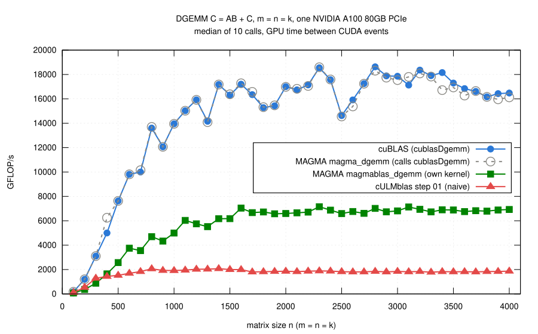

# Step 01: one thread per element of C

- Every thread computes one element of C, with a loop over l, as the
  innermost loop of the naive CPU implementation:

      C(i,j) <- beta*C(i,j) + alpha * sum_l A(i,l)*B(l,j)

- The kernel of session 32 of my
  [HPC I course](https://www.mathematik.uni-ulm.de/numerik/hpc/ws25/session32/page01.html).
- Code: [gemm.cu](gemm.cu).

## Grid, blocks and threads

- Blocks of 32 x 32 threads, a grid of ceil(m/32) x ceil(n/32) blocks
  covers C.
- Thread `(threadIdx.x, threadIdx.y)` of block `(blockIdx.x, blockIdx.y)`
  computes

      i = 32*blockIdx.x + threadIdx.x,     j = 32*blockIdx.y + threadIdx.y

- Borders: blocks at the bottom and the right of C stick out; threads with
  i >= m or j >= n return.  That is all for arbitrary m, n, k (also 0 or
  smaller than a block) and leading dimensions larger than the number of
  rows (C(i,j) is `C[i + j*ldC]`).
- Why this mapping:
  - the 32 threads of a warp have consecutive `threadIdx.x`: consecutive
    rows i of the same column j;
  - a warp reads 32 consecutive elements of a column of A (column major:
    one contiguous piece of memory, a *coalesced* access) and writes 32
    consecutive elements of C;
  - all 32 threads read the same B(l,j), delivered once to all of them.

## Details that matter

- m = 0 or n = 0: nothing is launched (a grid with zero blocks is not a
  valid launch).
- Every launch is checked (`cudaGetLastError`); a failed launch is reported
  only if one asks for it.
- alpha = 0: A and B are not read, as BLAS requires (they might contain
  NaN); beta = 0: C is not read.
- Indices in 64 bits: `blockIdx.x * blockDim.x` alone is computed with
  32-bit integers.
- `__launch_bounds__(1024)`: a block of 32 x 32 threads always fits on a
  multiprocessor (otherwise the compiler may use more registers than that
  allows, and the launch fails).

## Tests

- `make check`: the same 769 cases for every implementation, compared with
  cuBLAS:
  - all combinations of m, n, k in {1, 2, 15, 31, 32, 33, 63, 64, 65};
  - larger and rectangular matrices, padded leading dimensions;
  - alpha and beta zero and nonzero, k = 0;
  - NaN in C for beta = 0, NaN in A and B for alpha = 0.
- Matrices sit in buffers whose padding and guard zones are filled with
  NaN: a read outside a matrix spoils the result, a write outside it is
  found.
- Error bound: 4 (k+2) eps (|alpha| |A||B| + |beta| |C|), element by
  element.
- `make check-memcheck`: the small cases under compute-sanitizer.
- On an NVIDIA A100: all 1540 checks pass (769 cases for step 01 and for
  `cULMblas::gemm`, plus the argument checks); compute-sanitizer finds no
  error.

## Benchmark

- `make bench` measured m = n = k = 100, 200, ..., 4000 for this step (from
  step 04 on the default is 50, 100, 150, ..., 4000).
- Operands created once and copied to the GPU before the measurement.
- Each call timed on the GPU with two CUDA events around it, after two
  untimed calls; median of 10 calls.  Allocations and copies between host
  and GPU are not part of the time.

(From [results/2026-10-29-a100/bench-square.log](results/2026-10-29-a100/bench-square.log)
by [plot.gp](plot.gp), `make plot`.)

- Step 01: 1.8 to 2.1 TFLOP/s for n >= 800.
  - about a ninth of cuBLAS (14.6 to 18.6 TFLOP/s for n >= 1500);
  - a quarter of MAGMA's own kernel `magmablas_dgemm` (6.6 to 7.2 TFLOP/s
    for n >= 1600);
  - smaller gap for small matrices: nobody is fast there.
- **MAGMA's `magma_dgemm` is cuBLAS.**
  - In MAGMA 2.10.0 it calls `cublasDgemm`
    (`interface_cuda/blas_d_v2.cpp`); its curve lies on top of the cuBLAS
    curve.
  - MAGMA's own GEMM kernel is `magmablas_dgemm` (`magmablas/dgemm.cu`):
    blocks of 16 x 16 threads compute 64 x 64 blocks of C, A and B staged
    through shared memory in steps of 16 in k.  That is the independent
    comparison.
  - It differs from BLAS in two test cases: for alpha = 0 it still reads A
    and B (NaN in A or B gives NaN in C); for k = 0 it returns without
    scaling C by beta.
- **cuBLAS uses the Tensor Cores.**
  - FP64 peak of the A100 with ordinary fused multiply-adds: 9.7 TFLOP/s.
  - cuBLAS gets up to 18.6, only possible with the FP64 Tensor Cores
    (19.5 TFLOP/s peak).
  - `magmablas_dgemm` and this kernel use ordinary multiply-adds.
- Details of the measurements (GPU, driver, CUDA, cuBLAS and MAGMA
  versions, how MAGMA was built): [results/](results/README.md).

## What is slow here

- Every multiply-add needs two loads, A(i,l) and B(l,j); a thread does
  nothing else.
- The loads mostly hit the caches (the 32 warps of a block read the same
  column of A, B(l,j) is shared by a warp), but even from the L1 cache the
  GPU delivers far fewer operands per cycle than its arithmetic units
  could use.
- Next step: reuse a loaded value for more than one multiply-add.
