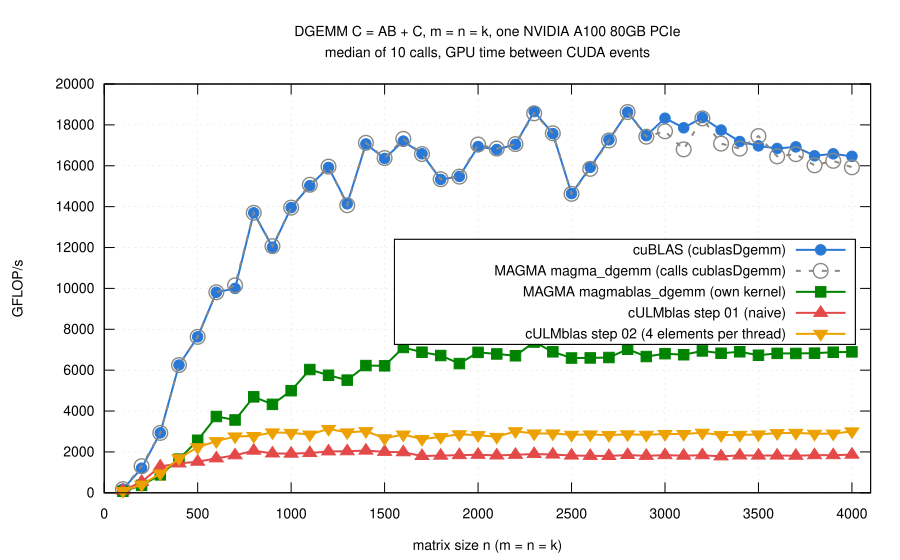

# Step 02: reuse a loaded element of A

## The problem with step 01

- First suspect on a GPU: coalescing (the 32 threads of a warp should
  access consecutive addresses, so that one memory transaction serves all
  of them).
- In step 01 they do:
  - a warp has 32 consecutive rows i of the same column j;
  - it reads 32 consecutive doubles of a column of A (256 bytes, 8 sectors
    of 32 bytes) and one element of B (one sector, broadcast to all
    threads).
- Nsight Compute, n = 2048:
  - 537 million load requests (a warp per element of a column of C per l,
    two loads each);
  - 4.5 sectors per request, exactly (8 + 1)/2; stores of C: 8 sectors per
    request;
  - so the accesses are as good as they can be.
- Where the time goes:
  - L1 cache at 87% of its peak throughput;
  - FP64 units busy only 22% of the time;
  - the kernel does not wait for memory, it waits for loads: two per
    multiply-add, and the L1 cache cannot deliver two operands per
    multiply-add.

## The idea

- Use a loaded value more than once: a thread computes four consecutive
  elements of a row of C,

      C(i,j0), C(i,j0+1), C(i,j0+2), C(i,j0+3)

- It loads A(i,l) once into a register and multiplies it with
  B(l,j0), ..., B(l,j0+3); the four sums stay in registers (`ab[4]`).
- 5 loads for 4 multiply-adds instead of 8.
- Nothing else changes:
  - a block of 32 x 8 threads still covers 32 x 32 elements of C;
  - the 32 threads of a warp still have consecutive i (loads of A and
    stores of C stay coalesced) and the same j0 (loads of B stay
    broadcasts);
  - right edge of C: a thread computes the columns that exist (`nc`), all
    the boundary handling needed.
- Registers are the only memory that is fast enough: a local array with a
  size known at compile time (`double ab[4]`), indexed in fully unrolled
  loops, lives in registers.
- Code: [gemm.cu](gemm.cu); the loop over l:

```cpp
for (std::ptrdiff_t l = 0; l < k; ++l) {
    double a = A[i + l*ldA];
    for (int c = 0; c < ThreadCols; ++c) {
        if (c < nc) {
            ab[c] += a * B[l + (j0 + c)*ldB];
        }
    }
}
```

## Result



(From [results/2026-10-29-a100/bench-square.log](results/2026-10-29-a100/bench-square.log)
by [plot.gp](plot.gp); steps 01 and 02 and the references measured in the
same job.)

- n >= 1000: 2.6 to 3.1 TFLOP/s, 1.55 times step 01 (median over the
  sizes, 1.33 to 1.62), 0.15 to 0.21 of cuBLAS.
- Profile at n = 2048:
  - load requests down from 537 to 336 million;
  - FP64 units busy 33% of the time instead of 22%;
  - L1 cache still at 83% of its throughput: loads are still the limit.
- **More is not better.**
  - 2 columns per thread: 2.0 TFLOP/s (median, n >= 1000), 8 columns: 2.3,
    4 columns: 2.9 (`bench-cols2.log`, `bench-cols8.log`; build with
    `NVCCFLAGS="-O3 -DCULMBLAS_STEP02_THREAD_COLS=8"`).
  - With 8 columns a thread saves more loads of A, but still loads every
    element of B separately, needs more registers, and there are fewer
    threads to hide the latency of the loads.
- **Small matrices got slower.**
  - n = 100 to 300: 0.73 to 0.77 of step 01.
  - A quarter of the threads; for a small C not enough work for the 108
    multiprocessors of the A100.
- Correctness: the same 769 cases, all pass for step 01, step 02 and
  `cULMblas::gemm` (2310 checks); compute-sanitizer finds no error.

## What remains inefficient

- Every element of B is still loaded by every warp separately: four loads
  of B for every load of A.
- Next: reuse B as well, a thread computes a small block of C with several
  rows and several columns; the rows must be chosen so that the loads of A
  stay coalesced.
