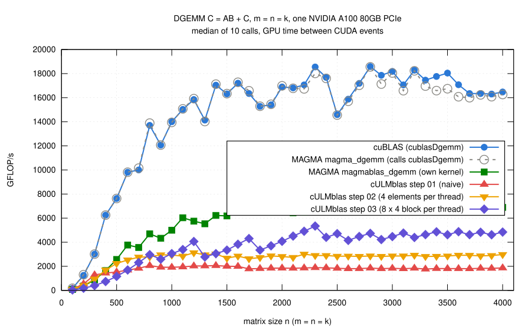

# Step 03: reuse loaded elements of A and of B

## The idea

- Step 02 reuses A(i,l) for four columns of C, but every warp still loads
  every element of B it needs separately: 5 loads for 4 multiply-adds.
- Now reuse B as well: a thread computes a block of C with several rows and
  several columns.
- For every l: load ThreadRows elements of a column of A and ThreadCols
  elements of a row of B into registers, then all ThreadRows x ThreadCols
  multiply-adds.
- The rows of a thread are 32 apart, not neighbors:

      rows    i0, i0 + 32, i0 + 64, ...     (i0 = first row of the block + threadIdx.x)
      columns j0, j0 + 1, j0 + 2, j0 + 3

  - for each load of A the 32 threads of a warp still read 32 consecutive
    elements of a column (coalesced);
  - all threads of a warp still read the same elements of B (broadcast).
- Rows and columns outside of C are loaded as 0 and not stored: the
  multiply-adds need no case distinctions.
- Code: [gemm.cu](gemm.cu); the loop over l:

```cpp
for (std::ptrdiff_t l = 0; l < k; ++l) {
    double a[ThreadRows], b[ThreadCols];
    for (int r = 0; r < ThreadRows; ++r) {
        a[r] = row[r] ? A[i0 + r*ThreadsX + l*ldA] : 0;
    }
    for (int c = 0; c < ThreadCols; ++c) {
        b[c] = col[c] ? B[l + (j0 + c)*ldB] : 0;
    }
    for (int r = 0; r < ThreadRows; ++r) {
        for (int c = 0; c < ThreadCols; ++c) {
            ab[r][c] += a[r]*b[c];
        }
    }
}
```

- The block of a thread is a compile-time choice
  (`-DCULMBLAS_STEP03_THREAD_ROWS=...`, `..._THREAD_COLS=...`).
- Default 8 x 4; a block of 32 x 8 threads then covers 256 x 32 elements
  of C.  How I got there is the main part of this step.

## First attempt: 4 x 4, and it was slower

- 4 x 4: 8 loads for 16 multiply-adds, a quarter of the loads per
  multiply-add of step 01, 40% of step 02.
- Step 02 was limited by loads (L1 cache at 83% of its throughput), so this
  should have helped.
- It did not: n >= 1000: 2.2 to 2.9 TFLOP/s, at n = 4000 0.85 of step 02
  ([shapes/bench-square-4x4.log](results/2026-10-29-a100/shapes/bench-square-4x4.log)).
- Profile at n = 2048
  ([shapes/ncu-4x4-memory.log](results/2026-10-29-a100/shapes/ncu-4x4-memory.log)):
  the loads are no longer the limit, but nothing else got better:

| n = 2048 | step 02 | step 03, 4 x 4 |
|---|---:|---:|
| L1 throughput (% of peak) | 83 | 33 |
| FP64 units busy (%) | 33 | 33 |
| warps active (% of the maximum) | 60 | 35 |
| registers per thread | 48 | 72 |

- FP64 units idle two thirds of the time, the L1 cache idle as well.
- The warps wait: the dominating stall reason is "long scoreboard",
  waiting for the result of a global load.

## Which block, and why

- Measured other blocks (n = 1000 ... 4000,
  [shapes/](results/2026-10-29-a100/shapes/)), then registers, stall
  reasons ([profile/](results/2026-10-29-a100/profile/)) and the loop over
  l in the machine code (SASS, `cuobjdump -sass`, `profile/sass-loop-*.txt`):

| block per thread | TFLOP/s, n = 4000 | registers | blocks per SM | loop over l in SASS: loads, multiply-adds per pass | multiply-adds per pass x warps per SM |
|---|---:|---:|---:|---|---:|
| 2 x 2 | 3.0 | – | – | – | – |
| 2 x 4 | 3.2 | 60 | 4 | 12, 16 (unrolled twice) | 16 x 32 = 512 |
| 4 x 4 | 2.5 | 72 | 3 | 8, 16 | 16 x 24 = 384 |
| 4 x 8 | 2.6 | – | – | – | – |
| 8 x 4 | 4.8 | 125 | 2 | 12, 32 | 32 x 16 = 512 |
| 8 x 8 | 1.8 | 194 | 1 | 16, 64 | 64 x 8 = 512 |

(Blocks per SM: the limit set by the registers, 65536 per SM, for blocks
of 256 threads; –: only measured, not profiled.)

- A warp issues the loads of one pass through the loop, then waits until
  they arrive before it can do the multiply-adds of that pass.
- What hides the wait: the work the other warps of the SM can do in the
  meantime, multiply-adds per pass times warps per SM.  Two things decide
  it:
  - **Registers limit the warps.**  A bigger block needs more registers per
    thread, fewer warps fit on an SM: 32 for 2 x 4, 24 for 4 x 4, 16 for
    8 x 4, 8 for 8 x 8.
  - **The compiler decides how much work a pass has.**  For 2 x 4 it
    unrolled the loop over l twice on its own, for the other blocks not.
    So 4 x 4 got the least work per wait, 384 multiply-adds against 512 for
    2 x 4 and 8 x 4.  That is why it lost against both.
- 8 x 8: as much work per wait as 8 x 4, but with 8 warps per SM (two per
  scheduler) too little to choose from when a warp waits: FP64 units busy
  22% of the time (8 x 4: 53%).
- Instructions per pass: 8 x 4 106 for 32 multiply-adds (2 x 4: 93 for 16,
  4 x 4: 68 for 16), the fewest per multiply-add besides 8 x 8.
- Test of the explanation without changing the idea of the kernel:
  `#pragma unroll 2` before the loop over l, a pass covers two values of l
  ([unroll/](results/2026-10-29-a100/unroll/); an experiment, not part of
  the code of this step):

| block per thread | TFLOP/s, n = 4000, `#pragma unroll 1` | `#pragma unroll 2` |
|---|---:|---:|
| 2 x 4 | 1.8 | 3.3 (what the compiler does by itself) |
| 4 x 4 | 2.5 (what the compiler does by itself) | 3.5 |
| 8 x 4 | 4.9 (what the compiler does by itself) | 5.4 |

- Every block gains when a pass has more independent work; 2 x 4 falls to
  1.8 TFLOP/s without the unrolling the compiler chose for it.
- Idea for the next step: more independent work for every warp while its
  loads are on the way.
- Here: code as simple as in step 02, block chosen by measurement: 8 x 4.

## Result



(From [results/2026-10-29-a100/bench-square.log](results/2026-10-29-a100/bench-square.log)
by [plot.gp](plot.gp); all steps and the references measured in the same
job.)

- **n >= 1000**: 2.8 to 5.3 TFLOP/s, 1.59 times step 02 (median over the
  sizes, 0.94 to 1.84), 0.18 to 0.32 of cuBLAS, 0.49 to 0.76 of MAGMA's own
  kernel.  n = 4000: 4.8 TFLOP/s, 1.63 times step 02.
- **The curve is jagged: the number of blocks.**
  - Two blocks of 256 x 32 elements of C fit on each of the 108 SMs, 216
    run at the same time.
  - n = 2300: 9 x 72 = 648 blocks, exactly three full waves: 5.3 TFLOP/s,
    the best value.
  - n = 1300: 246 blocks, one full wave and a second one with only 30
    blocks: 2.8 TFLOP/s.
  - The bigger the block per thread, the coarser these steps.
- **Small matrices got much slower.**
  - n <= 500: 0.42 to 0.52 of step 02, n = 500: 1.2 TFLOP/s.
  - C of size 500 x 500 gives 2 x 16 = 32 blocks for 108 SMs; most of the
    GPU has nothing to do.
  - Ahead of step 02 from n = 1000 on, with one exception (n = 1300,
    0.94).
- Correctness: the 769 cases, all pass for steps 01 to 03 and
  `cULMblas::gemm`, which now uses step 03 (3080 checks); compute-sanitizer
  finds no error ([check.log](results/2026-10-29-a100/check.log),
  [memcheck.log](results/2026-10-29-a100/memcheck.log)).

## What remains inefficient

- Latency: a warp waits for every pass of loads before it computes; FP64
  units busy only about half of the time.  The experiment above: more
  independent work per pass helps.
- Occupancy and the size of C: the big block per thread costs warps and
  leaves small matrices with too few blocks.
- Loads: all 8 warps of a block load the same elements of A, every warp
  loads its elements of B for itself.  Shared memory is still to come.
