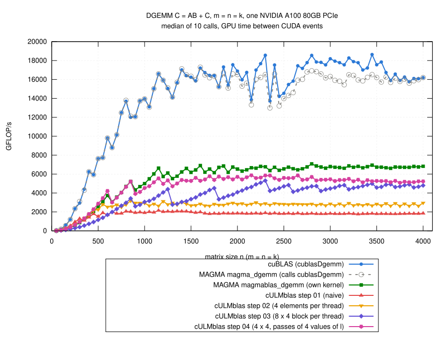

# Step 04: several values of l per pass

## The idea

- Step 03: a warp issues the loads for one value of l, waits until they
  arrive, then does the multiply-adds for this l.
  - dominating stall reason: "long scoreboard", waiting for a global load;
  - the `#pragma unroll 2` experiment of step 03: more independent work
    per pass of the loop helps.
- Now the loop over l goes in passes of several values of l: a pass first
  loads everything it needs for Pass values of l, then does all their
  multiply-adds.
- All loads of a pass are on the way at the same time; the warp waits once
  per pass instead of once per value of l.
- Block of a thread as in step 03 (rows 32 apart, neighboring columns);
  default now 4 x 4 with passes of 4 values of l; a block of 32 x 8 threads
  covers 128 x 32 elements of C.
- Code: [gemm.cu](gemm.cu):

```cpp
std::ptrdiff_t l = 0;
for (; l + Pass <= k; l += Pass) {
    double a[Pass][ThreadRows], b[Pass][ThreadCols];
    for (int p = 0; p < Pass; ++p) {
        for (int r = 0; r < ThreadRows; ++r) {
            a[p][r] = row[r] ? A[i0 + r*ThreadsX + (l + p)*ldA] : 0;
        }
        for (int c = 0; c < ThreadCols; ++c) {
            b[p][c] = col[c] ? B[l + p + (j0 + c)*ldB] : 0;
        }
    }
    for (int p = 0; p < Pass; ++p) {
        for (int r = 0; r < ThreadRows; ++r) {
            for (int c = 0; c < ThreadCols; ++c) {
                ab[r][c] += a[p][r]*b[p][c];
            }
        }
    }
}
//  the last k % Pass values of l, one by one as in step 03
for (; l < k; ++l) {
    ...
}
```

- Only whole passes this way; the last `k % Pass` values of l one by one as
  in step 03.
- Block and pass are compile-time choices
  (`-DCULMBLAS_STEP04_THREAD_ROWS=...`, `..._THREAD_COLS=...`,
  `..._PASS=...`).
- One line is not obvious and decides everything (the second half of this
  step):

```cpp
__global__ void __launch_bounds__(ThreadsX*ThreadsY, 1)
```

## How I tested

- From this step on:
  - new ideas tested with m = n = k = 50, 100, 150, 200, 300, 400, ...,
    2000, steps 03 and 04 in the same job, up to three jobs at the same
    time, each on its own A100;
  - the final code validated with m = n = k = 50, 100, 150, ..., 4000, now
    the default of `bench_gemm`.
- Numbers in the tables below: medians of the ratio step 04 / step 03 over
  the sizes of the quick test.
- All logs: [results/2026-10-29-a100/](results/2026-10-29-a100/).

## Which pass, and how to write it

- Three rounds of three jobs, 50 variants
  ([explore/](results/2026-10-29-a100/explore/); the kernel with all
  switches: [explore/gemm-knobs.cu](results/2026-10-29-a100/explore/gemm-knobs.cu)):

| variant | registers | step 04 / step 03, n >= 1000 | n <= 500 |
|---|---:|---:|---:|
| 8 x 4, one l per pass (= step 03) | 125 | 0.99 | 0.96 |
| **loads of a pass with a check l + u < k each** | | | |
| 8 x 4, 2 per pass | 134 | 0.73 | 0.96 |
| 4 x 4, 4 per pass | 126 | 1.10 | 1.48 |
| **prefetch: load the next l while computing this one** | | | |
| 8 x 4 | 140 | 0.76 | 1.07 |
| 4 x 4 | 94 | 0.88 | 1.41 |
| **`#pragma unroll 4` on the loop of step 03** | | | |
| 4 x 4 | 128 | 1.40 | 1.89 |
| **whole passes without a check, remainder one by one** | | | |
| 4 x 4, 4 per pass | 124 | **1.52** | **2.11** |
| 8 x 4, 2 per pass | 210 | 0.93 | 1.24 |

- **Prefetching** (the textbook way to hide latency) did not help:
  - the second set of registers costs warps (8 x 4: 140 registers, one
    block per SM);
  - it covers only one value of l.
- **The check `l + u < k` for every load** (my first version, no remainder
  loop needed) is expensive:
  - the same pass without the check (whole passes, then the remainder one
    by one): 1.52 against 1.10 for 4 x 4;
  - `#pragma unroll 4` (the compiler splits off the remainder itself) is in
    between: 1.40.
- **The block of step 03, 8 x 4, gains less:**
  - with a check or as above a pass of 2 values of l needs 134 to 210
    registers, only one block of 256 threads fits on an SM;
  - even with 126 to 128 registers (two blocks): 1.28 at best.
- **4 x 4 is back:**
  - fewer registers per value of l, so a pass of 4 still leaves room for
    two blocks per SM;
  - the block of threads covers only 128 x 32 elements of C: twice as many
    blocks;
  - the block that was slower than step 02 in step 03 is the best one here,
    because now a pass has enough work.

## The compiler decides how many loads are on the way

- Written cleanly (variables of the experiment renamed, switches removed),
  the kernel was suddenly slower than step 03: 0.45 of it for n >= 1000,
  1.8 TFLOP/s at n = 2000
  ([launch-bounds/validation-without-min-blocks/](results/2026-10-29-a100/launch-bounds/validation-without-min-blocks/)).
- `#pragma unroll` everywhere or a different remainder loop changed nothing
  ([launch-bounds/code-forms/](results/2026-10-29-a100/launch-bounds/code-forms/)).
- The difference to the experiment was one line: the experiment had
  `__launch_bounds__(256, 1)`, the clean code `__launch_bounds__(256)` as in
  step 03.
- `__launch_bounds__(T, B)`: the kernel is started with at most T threads
  per block, and at least B blocks per SM are asked for.
  - without B: the compiler chose 70 registers for this kernel;
  - B = 1: it may use up to 255 registers and takes 118.
- What the registers are for: the machine code
  ([launch-bounds/sass-order.txt](results/2026-10-29-a100/launch-bounds/sass-order.txt)),
  the loop over the whole passes, 32 loads (LDG) and 64 multiply-adds
  (DFMA):

| `__launch_bounds__` | registers | loop over the passes in SASS |
|---|---:|---|
| `(256)` | 70 | 2 LDG, 4 DFMA, 1 LDG, 11 DFMA, 1 LDG, 1 DFMA, 4 LDG, 4 DFMA, ... |
| `(256, 1)` | 118 | 29 LDG, 7 DFMA, 1 ISETP, 9 DFMA, 1 ISETP, 48 DFMA |

- 70 registers: no room for the 32 loaded values of a pass; loads and
  multiply-adds interleaved, the warp waits again and again within a pass,
  as in step 03.
- 118 registers: all loads of the pass issued first.
- Other values of B
  ([launch-bounds/lb1/](results/2026-10-29-a100/launch-bounds/lb1/)):

| B | registers | blocks per SM | step 04 / step 03, n >= 1000 | n <= 500 |
|---|---:|---:|---:|---:|
| none | 70 | 3 | 0.57 | 0.73 |
| 1 | 118 | 2 | **1.52** | **2.23** |
| 2 | 118 | 2 | 1.39 | 1.92 |
| 3 | 80 | 3 | 1.18 | 1.46 |

- B = 2: same registers as B = 1 and still slower; I did not look into the
  machine code of that one.
- So the `1` stays, with a comment in the kernel.
- Other blocks and passes with this code
  ([launch-bounds/lb2/](results/2026-10-29-a100/launch-bounds/lb2/),
  [lb3/](results/2026-10-29-a100/launch-bounds/lb3/)):

| block, pass | registers | n >= 1000 | n <= 500 |
|---|---:|---:|---:|
| 4 x 4, 2 | 80 | 1.31 | 1.53 |
| **4 x 4, 4** | 118 | **1.52** | **2.23** |
| 4 x 4, 8 | 190 | 1.06 | 1.95 |
| 2 x 4, 4 | 92 | 1.18 | 2.48 |
| 4 x 2, 4 | 88 | 1.27 | 2.79 |
| 8 x 4, 2 | 126 | 1.28 | 1.22 |

- 2 x 4 and 4 x 2 are better for small matrices (more blocks of threads),
  4 x 4 for the rest.

## What MAGMA does

- `magmablas_dgemm`, MAGMA's own kernel: 1.6 times step 03 at n = 1000.
- To see which of its ideas matter: rebuilt in this framework, then one
  idea removed after the other until close to steps 03 and 04
  ([magma/](results/2026-10-29-a100/magma/), kernels in
  [magma/gemm.cu](results/2026-10-29-a100/magma/gemm.cu); not part of the
  tutorial code).
- MAGMA 2.10.0, non-transposed case:
  - blocks of 16 x 16 threads for 64 x 64 elements of C;
  - every thread computes 4 x 4 elements, rows and columns 16 apart;
  - k split into panels of 16: a 64 x 16 panel of A and a 16 x 64 panel of
    B in shared memory;
  - the next panels loaded into registers while the current ones are used.
- n = 1000 (Nsight Compute, time of the kernel):

| kernel | time (us) | registers | FP64 units busy (%) | global load requests |
|---|---:|---:|---:|---:|
| magmablas_dgemm | 520 | 64 | 69 | 1.1 M |
| my rebuild of it | 621 | 134 | 59 | 1.0 M |
| ... without loading the next panels in advance | 548 | 108 | 67 | 1.0 M |
| ... without shared memory (4 x 4 per thread, passes of 16) | 634 | 254 | 58 | 16.1 M |
| step 04 | 598 | 124 | 61 | 16.0 M |
| step 03 | 853 | 125 | 33 | 12.0 M |

- Without shared memory MAGMA's scheme is where step 04 is: a 4 x 4 block
  per thread with all loads of a pass on the way.
- The rest of the difference:
  - shared memory: the threads of a block load each element of A and B
    once into shared memory instead of each warp for itself, 16 times fewer
    requests to the L1 cache;
  - few registers: MAGMA's kernel gets by with 64.
- Loading the next panels in advance cost more in registers than it gained,
  as the prefetch in the first round above.

## Result



(From [results/2026-10-29-a100/bench-square.log](results/2026-10-29-a100/bench-square.log)
by [plot.gp](plot.gp), m = n = k = 50, 100, ..., 4000; all steps and the
references measured in the same job.)

- **Faster than step 03 for every size**:
  - n <= 500: 2.28 times (median, 1.81 to 2.47);
  - n = 550 to 950: 1.52 times;
  - n >= 1000: 1.21 times (1.05 to 1.76), 4.5 to 5.9 TFLOP/s; n = 4000:
    5.2 TFLOP/s.
- **Small matrices**: the block of threads covers 128 x 32 instead of
  256 x 32 elements of C, twice as many blocks; for n <= 600 faster than
  MAGMA's own kernel (1.03 to 1.13 times).
- **Large matrices**:
  - 0.82 of MAGMA's kernel for n >= 1000 (median, 0.76 to 0.92), 0.28 to
    0.43 of cuBLAS;
  - the gain over step 03 shrinks with n: at n = 2048 the L1 cache is at
    67% of its throughput (step 03: 40%), the FP64 units are busy 67% of
    the time (step 03: 53%)
    ([ncu-step04.log](results/2026-10-29-a100/ncu-step04.log),
    [ncu-step03.log](results/2026-10-29-a100/ncu-step03.log));
  - a 4 x 4 block needs 8 loads for 16 multiply-adds, 8 x 4 needed 12 for
    32: the loads are close to being the limit again.
- Correctness: the 769 cases, all pass for steps 01 to 04 and
  `cULMblas::gemm`, which used step 04 at this point (3850 checks);
  compute-sanitizer finds no error
  ([check.log](results/2026-10-29-a100/check.log),
  [memcheck.log](results/2026-10-29-a100/memcheck.log)).

## What remains inefficient

- Loads: every warp loads its elements of A and B itself; all 8 warps of a
  block load the same elements of A.  The rebuild of MAGMA: shared memory
  is the next step.
- Registers: 118 per thread, two blocks per SM; MAGMA's kernel needs 64.
- The compiler: whether the loads of a pass are on the way together
  depends on how many registers the compiler allows itself.  Not visible
  in the source code; check the machine code.
