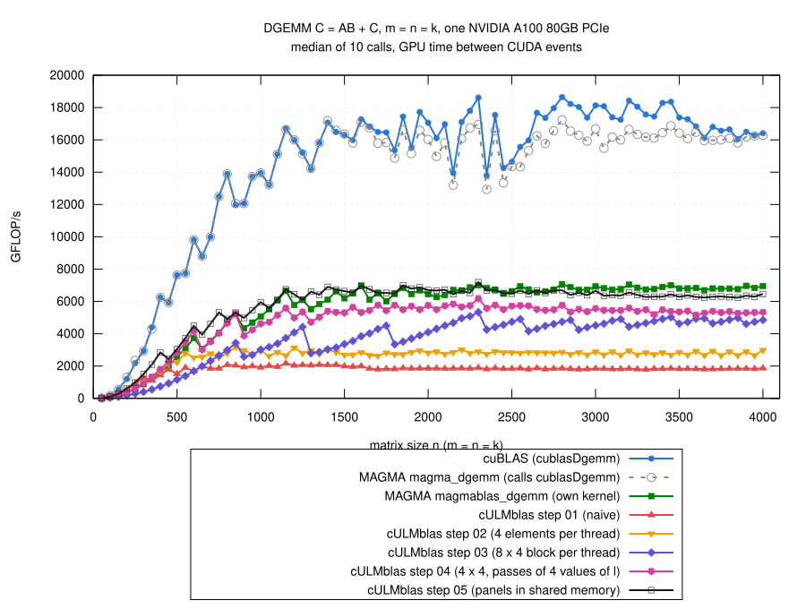

# Step 05: panels of A and B in shared memory

## The idea

- Step 04: every warp loads the elements of A and B it needs itself.
  - the 8 warps of a block all load the same elements of A;
  - every warp loads its own elements of B;
  - n = 2048: 134 million load requests to the L1 cache, at 67% of its
    throughput.
- The rebuild of MAGMA's kernel in
  [step 04](../step04/README.md#what-magma-does): what is missing is
  sharing the loaded elements through shared memory (a fast memory of each
  SM that all threads of a block can read and write).
- Now the loop over l goes in panels of 16 values of l.  For every panel the
  threads of a block
  1. copy the panel of A (the rows of the block, 16 columns) and the panel
     of B (16 rows, the columns of the block) into shared memory, each
     element once, consecutive threads reading consecutive elements of a
     column;
  2. wait until all threads are done with that (`__syncthreads()`);
  3. compute their 4 x 4 blocks of C as in step 04, operands from shared
     memory;
  4. wait again, so that no thread overwrites the panels while others still
     use them.
- Code: [gemm.cu](gemm.cu); the loop over the panels:

```cpp
__shared__ double sA[Panel][BlockRows];         // sA[l][i]: A(i,l)
__shared__ double sB[BlockCols][Panel];         // sB[j][l]: B(l,j)
...
for (std::ptrdiff_t l0 = 0; l0 < k; l0 += Panel) {
    const int kb = k - l0 < Panel ? int(k - l0) : Panel;

    for (int q = 0; q < BlockRows*Panel/NumThreads; ++q) {
        int e = tid + q*NumThreads, i = e % BlockRows, l = e / BlockRows;
        sA[l][i] = (i < mb && l < kb) ? A[i + l*ldA] : 0;
    }
    for (int q = 0; q < Panel*BlockCols/NumThreads; ++q) {
        int e = tid + q*NumThreads, l = e % Panel, j = e / Panel;
        sB[j][l] = (j < nb && l < kb) ? B[l + j*ldB] : 0;
    }
    __syncthreads();

    #pragma unroll
    for (int l = 0; l < Panel; ++l) {
        double a[ThreadRows], b[ThreadCols];
        for (int r = 0; r < ThreadRows; ++r) {
            a[r] = sA[l][threadIdx.x + r*ThreadsX];
        }
        for (int c = 0; c < ThreadCols; ++c) {
            b[c] = sB[threadIdx.y*ThreadCols + c][l];
        }
        for (int r = 0; r < ThreadRows; ++r) {
            for (int c = 0; c < ThreadCols; ++c) {
                ab[r][c] += a[r]*b[c];
            }
        }
    }
    __syncthreads();

    A += std::ptrdiff_t(Panel)*ldA;
    B += Panel;
}
```

- Elements outside of A and B: stored as 0 in shared memory, the
  multiply-adds need no case distinctions.
- The panels are copied by all threads of the block, also by those whose
  elements of C are outside of C.  They must not leave the kernel early:
  every thread has to reach every `__syncthreads()`.
- A thread still computes a 4 x 4 block of C (rows 16 apart, neighboring
  columns) as in step 04.
- New: the block of threads, 16 x 8 threads (128) for 64 x 32 elements of
  C; why, see the next section.
- Offsets within a block of C and within a panel are `int`; the host
  function checks that they fit.

## How I chose the block

- Three rounds of three jobs, 51 variants, m = n = k = 50, 100, 150, 200,
  300, ..., 2000, each against step 04 and MAGMA's own kernel in the same
  job ([explore/](results/2026-10-29-a100/explore/); the kernel with all
  switches: [explore/gemm-knobs.cu](results/2026-10-29-a100/explore/gemm-knobs.cu)).
- Medians of the ratios over the sizes; "\*": the compiler spills
  registers:

| threads, elements of C per thread, columns | registers | / step 04, n >= 1000 | / step 04, n <= 500 | / magmablas, n >= 1000 |
|---|---:|---:|---:|---:|
| 32 x 8, 4 x 4, neighboring (as step 04) | 108 | 1.13 | 1.06 | 0.96 |
| 16 x 16, 4 x 4, 16 apart (as MAGMA) | 122 | 1.14 | 1.07 | 0.97 |
| 16 x 16, 4 x 4, 16 apart, at least 3 blocks per SM | 80 | 1.20 | 1.09 | 1.02 |
| 16 x 16, 8 x 4 | 128\* | 1.03 | 0.65 | 0.86 |
| 16 x 16, 8 x 8 | 250 | 0.88 | 0.37 | 0.74 |
| 32 x 4, 4 x 4 | 140 | 1.14 | 1.43 | 0.94 |
| 16 x 8, 4 x 4, 8 apart | 130 | 1.21 | 1.50 | 0.99 |
| **16 x 8, 4 x 4, neighboring** | 112 | **1.27** | **1.50** | **1.03** |
| 8 x 16, 4 x 4, neighboring, at least 5 blocks per SM | 96 | 1.26 | 1.39 | 1.02 |

- **Bigger blocks per thread lost.**  8 x 4 or 8 x 8 elements of C per
  thread need fewer loads from shared memory per multiply-add, but 128 to
  250 registers: the compiler spills, or only one block fits per SM.
- **Smaller blocks of threads won**, also for large matrices:
  - 64 x 32 elements of C per block of 128 threads better than 128 x 32 or
    64 x 64 per block of 256 threads;
  - for small matrices also twice as many blocks;
  - which of the two ways to give a thread its columns does not matter
    much.
- **The rest made little difference** (variants of 16 x 8, 4 x 4,
  neighboring columns):
  - minimum number of blocks per SM in `__launch_bounds__`: 2 to 5: 1.26 to
    1.28; 6: the compiler spills, 1.21;
  - padding of the arrays in shared memory against bank conflicts: none:
    1.29;
  - panels of 8 values of l: 1.23; of 32: round 1, 1.15 against 1.13.
- **The index type did**:
  - `std::ptrdiff_t` instead of `int` for the offsets: 1.13 instead of
    1.28 (at most 96 registers, spills);
  - in the 32 x 8 version 126 instead of 108 registers;
  - so: `int` within a block and a panel, `std::ptrdiff_t` only for the
    start of the panels and of the block of C.
- The final code with all sizes against a few alternatives
  ([alternatives/](results/2026-10-29-a100/alternatives/), step 05 with the
  alternative / step 05 as it is):

| alternative | registers | n <= 500 | n >= 1000 |
|---|---:|---:|---:|
| `__launch_bounds__(128, 2)` | 114 | 1.04 | 1.00 |
| `__launch_bounds__(128, 5)` | 96 | 1.00 | 1.02 |
| 32 x 8 threads (128 x 32 elements of C) | 112 | 0.72 | 0.97 |
| 16 x 16 threads (64 x 64 elements of C) | 108 | 0.72 | 0.99 |
| panels of 8 | 110 | 0.89 | 0.95 |
| panels of 32 | 188 | 1.08 | 0.95 |

- Unlike in step 04, the second argument of `__launch_bounds__` makes no
  real difference here; I kept the 1 of step 04.

## Result



(From [results/2026-10-29-a100/bench-square.log](results/2026-10-29-a100/bench-square.log)
by [plot.gp](plot.gp), m = n = k = 50, 100, ..., 4000; all steps and the
references measured in the same job.)

- **Faster than step 04 for every size**:
  - n <= 500: 1.49 times (median, 1.08 to 1.60);
  - n = 550 to 950: 1.29 times;
  - n >= 1000: 1.19 times (1.10 to 1.40), 5.6 to 7.2 TFLOP/s; n = 4000:
    6.5 TFLOP/s.
- **As fast as MAGMA's own kernel**:
  - n >= 1000: 0.98 of it (median, 0.91 to 1.20); faster up to n = 2100
    (except at n = 1700), a bit slower above;
  - n <= 500: 1.59 times as fast.
- **cuBLAS**: 2.1 to 2.9 times as fast for n >= 1000 (step 05: 0.34 to 0.48
  of it).
  - the A100 does at most 9.7 TFLOP/s with its FP64 units (108 SMs x 64
    floating-point operations per cycle x 1.41 GHz);
  - cuBLAS reaches up to 18.6 TFLOP/s: it uses the FP64 Tensor Cores, not
    used here yet;
  - step 05 reaches 74% of the 9.7 TFLOP/s.
- Profile at n = 2048
  ([ncu-step05.log](results/2026-10-29-a100/ncu-step05.log),
  [ncu-step04.log](results/2026-10-29-a100/ncu-step04.log)):

| n = 2048 | step 04 | step 05 |
|---|---:|---:|
| requests of global loads | 134 M | 12.7 M |
| hit rate in L1 / L2 (%) | 81 / 86 | 1 / 73 |
| FP64 units busy (%) | 67 | 76 |
| instructions | 682 M | 528 M |
| registers per thread, blocks per SM | 118, 2 | 122, 4 |
| stalls (Nsight Compute, relative values): waiting for global loads | 226 k | 72 k |
| waiting at `__syncthreads()` | – | 41 k |
| queue of loads from shared memory full ("MIO throttle") | – | 50 k |

- 10 times fewer global load requests.
- The L1 cache has nothing to do as a cache anymore (every element is
  loaded once per block); the elements come from the L2 cache.
- The warps wait less for global loads, but at the barriers and for shared
  memory.
- Correctness: the 769 cases, all pass for steps 01 to 05 and
  `cULMblas::gemm` (4620 checks); compute-sanitizer finds no error
  ([check.log](results/2026-10-29-a100/check.log),
  [memcheck.log](results/2026-10-29-a100/memcheck.log)); after switching
  `cULMblas::gemm` to step 05 both again
  ([check-cULMblas/](results/2026-10-29-a100/check-cULMblas/)).

## What remains inefficient

- Loads from shared memory: for every value of l a thread loads 4 + 4
  elements from shared memory for its 16 multiply-adds; the queue for these
  loads is often full.
- The barriers: while a panel is copied, nobody computes; while the threads
  compute, nobody loads the next panel.  Loading the next panel in advance
  did not pay off in the rebuild of MAGMA's kernel (too many registers),
  but that does not settle it for this kernel.
- The FP64 Tensor Cores are not used.
