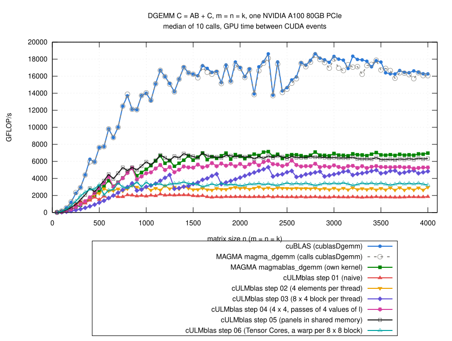

# Step 06: Tensor Cores

## Why

- cuBLAS reaches up to 18.6 TFLOP/s, the FP64 units of the A100 at most
  9.7 TFLOP/s.  The difference: the FP64 Tensor Cores (19.5 TFLOP/s peak).
- What cuBLAS runs at n = 2048 (Nsight Compute,
  [profile-cublas/ncu-step06.log](results/2026-10-29-a100/profile-cublas/ncu-step06.log)):
  - kernel `cutlass_80_tensorop_d884gemm_64x64_16x4_nn_align1` (from
    NVIDIA's CUTLASS library): Tensor Core operation 8 x 8 x 4 in double
    precision, 64 x 64 elements of C per block of 128 threads, 64 KB shared
    memory, 128 registers;
  - Tensor Cores busy 98% of the time, the FP64 units 0.2%.

## The idea

- A Tensor Core instruction is executed by a whole warp.  Double precision:

      C(8 x 8) += A(8 x 4) B(4 x 8)

  the 32 threads of the warp hold the operands together in their
  registers.
- CUDA's WMMA interface (`#include <mma.h>`, namespace `nvcuda::wmma`)
  hides how the elements are spread over the threads:
  - `wmma::fragment<...>`: the part of A, B or C a thread holds;
  - `load_matrix_sync`: load a fragment from memory;
  - `mma_sync`: the multiply-add (one `DMMA.884` instruction in SASS);
  - `store_matrix_sync`: store the result.
- Simplest GEMM with it:
  - every warp computes one 8 x 8 block of C;
  - loop over l in steps of 4;
  - every step: the 32 threads of the warp copy the 8 x 4 block of A and
    the 4 x 8 block of B into shared memory, each thread one element of A
    and one of B, 0 outside of A and B;
  - load the fragments from there, `mma_sync`.
- Why through shared memory:
  - the borders of the matrices;
  - the rules of `load_matrix_sync` for the address (32-byte aligned) and
    the leading dimension (a multiple of 16 bytes);
  - holds for any matrix; the simple, not the fast way.
- A block of WarpsM x WarpsN warps, default 2 x 2 (128 threads), covers
  16 x 16 elements of C.
- Needs compute capability 8.0 (FP64 Tensor Cores); `gemm` checks it.
- Code: [gemm.cu](gemm.cu); the loop over l:

```cpp
wmma::fragment<wmma::accumulator, TileM, TileN, TileK, double> ab;
wmma::fill_fragment(ab, 0.0);

for (std::ptrdiff_t l = 0; l < k; l += TileK) {
    sA[warp][iA + lA*TileM]
        = (i0 + iA < m && l + lA < k) ? A[i0 + iA + (l + lA)*ldA] : 0;
    sB[warp][lB + jB*TileK]
        = (l + lB < k && j0 + jB < n) ? B[l + lB + (j0 + jB)*ldB] : 0;
    __syncwarp();

    wmma::fragment<wmma::matrix_a, TileM, TileN, TileK, double,
                   wmma::col_major> a;
    wmma::fragment<wmma::matrix_b, TileM, TileN, TileK, double,
                   wmma::col_major> b;
    wmma::load_matrix_sync(a, sA[warp], TileM);
    wmma::load_matrix_sync(b, sB[warp], TileK);
    wmma::mma_sync(ab, a, b, ab);
    __syncwarp();
}
```

- C: `store_matrix_sync` into shared memory, then the threads compute
  `beta*C + alpha*AB` for the elements inside of C (beta = 0: C not read).

## Warps per block

- Quick test, m = n = k = 50, 100, 150, 200, 300, ..., 2000
  ([explore/warps/](results/2026-10-29-a100/explore/warps/)), medians of
  step 06 / step 05:

| warps per block (M x N) | elements of C per block | n <= 500 | n >= 1000 |
|---|---|---:|---:|
| 1 x 1 | 8 x 8 | 1.44 | 0.47 |
| **2 x 2** | 16 x 16 | 1.37 | **0.52** |
| 2 x 4 | 16 x 32 | 1.37 | 0.52 |
| 4 x 2 | 32 x 16 | 1.44 | 0.49 |
| 4 x 4 | 32 x 32 | 1.35 | 0.49 |
| 8 x 1 | 64 x 8 | 1.44 | 0.48 |

- Hardly matters; 2 x 2 is the default.

## Result



(From [results/2026-10-29-a100/bench-square.log](results/2026-10-29-a100/bench-square.log)
by [plot.gp](plot.gp), m = n = k = 50, 100, ..., 4000; all steps and the
references measured in the same job.)

- n >= 1000: 3.0 to 3.6 TFLOP/s
  - 0.52 of step 05 (median, 0.44 to 0.59);
  - 0.50 of MAGMA's own kernel, 0.20 of cuBLAS.
- n <= 500: faster than step 05 except at n = 400
  - 1.33 times step 05 (median), 2.03 times MAGMA's kernel;
  - n = 50: 1.11 times cuBLAS.
  - a block covers only 16 x 16 elements of C: many blocks also for small
    matrices.
- `cULMblas::gemm` stays at step 05.
- Correctness: the 769 cases, all pass for steps 01 to 06 and
  `cULMblas::gemm` (5390 checks); compute-sanitizer finds no error
  ([check.log](results/2026-10-29-a100/check.log),
  [memcheck.log](results/2026-10-29-a100/memcheck.log)).

## Step 06 and cuBLAS at n = 2048

([ncu-step06.log](results/2026-10-29-a100/ncu-step06.log),
[profile-cublas/](results/2026-10-29-a100/profile-cublas/); SASS:
[sass-step06.txt](results/2026-10-29-a100/sass-step06.txt))

| n = 2048 | step 06 | cuBLAS (CUTLASS kernel) |
|---|---:|---:|
| time of the kernel (ms, Nsight Compute) | 7.29 | 1.26 |
| Tensor Core instructions (DMMA) | 33.5 M | 33.5 M |
| Tensor Cores busy (%) | 16 | 98 |
| instructions | 1088 M | 110 M |
| registers per thread | 48 | 128 |
| warps active (% of the maximum) | 61 | 12 |

- Same number of Tensor Core operations; step 06 needs 10 times as many
  instructions in total.
- Per `mma_sync` a warp also
  - loads one element of A and one of B per thread from global memory;
  - stores them into shared memory, `__syncwarp()`;
  - loads the two fragments from shared memory.
- Step 06 at n = 2048:
  - 67 M global load requests (step 05: 12.7 M);
  - L1 cache at 91% of its throughput (global loads and shared memory
    together);
  - shared memory: 67 M bank conflicts in 204 M wavefronts of loads;
  - dominating stall: waiting for global loads ("long scoreboard").
- cuBLAS: few warps (12% active), each with a lot of Tensor Core work.

## What remains inefficient

- Every element of A and B is loaded from global memory by every warp that
  needs it, one element per thread and step of 4.
- One 8 x 8 block of C per warp: one `mma_sync` per loaded 8 x 4 and 4 x 8
  block.
- The detour through shared memory for every step.
- Candidates for the next steps: fragments loaded directly from global
  memory, several 8 x 8 blocks of C per warp, panels in shared memory for
  the whole block (as step 05), `cp.async`.
