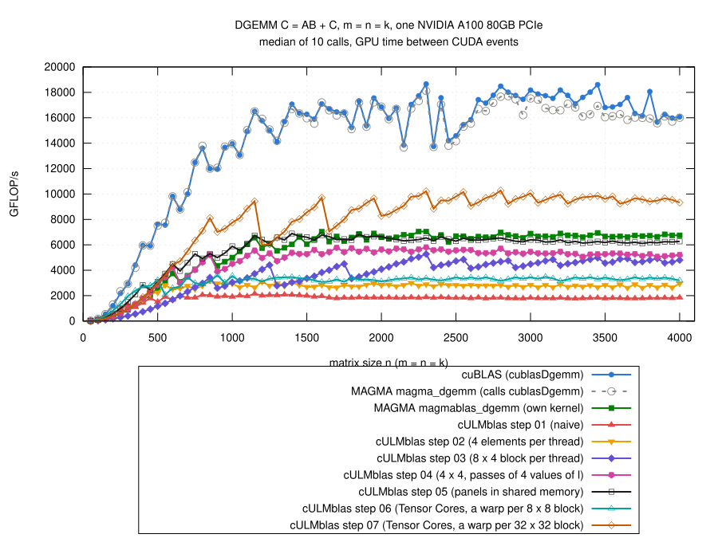

# Step 07: several 8 x 8 blocks of C per warp

## The idea

- Step 06: one `mma_sync` per loaded 8 x 4 block of A and 4 x 8 block of B;
  Tensor Cores busy 16% of the time, 10 times as many instructions as
  cuBLAS.
- Now: a warp computes TilesM x TilesN blocks of 8 x 8 elements of C
  (default 4 x 4: 32 x 32 elements), the Tensor Core version of step 03.
- Per step of 4 values of l the warp
  - copies a 32 x 4 block of A and a 4 x 32 block of B into its buffer in
    shared memory (0 outside of A and B), as in step 06;
  - loads 4 fragments of A and 4 of B;
  - does 16 `mma_sync`: every fragment of A is used for 4 blocks of C,
    every fragment of B as well.
- A block of 2 x 2 warps (128 threads) covers 64 x 64 elements of C.
- Code: [gemm.cu](gemm.cu); the loop over l:

```cpp
for (std::ptrdiff_t l = 0; l < k; l += TileK) {
    for (int q = 0; q < SizeA/32; ++q) {
        int e = lane + 32*q, i = e % WarpRows, p = e / WarpRows;
        sA[e] = (i0 + i < m && l + p < k)
              ? A[i0 + i + (l + p)*ldA] : 0;
    }
    for (int q = 0; q < SizeB/32; ++q) {
        int e = lane + 32*q, p = e % TileK, j = e / TileK;
        sB[e] = (l + p < k && j0 + j < n)
              ? B[l + p + (j0 + j)*ldB] : 0;
    }
    __syncwarp();

    wmma::fragment<wmma::matrix_a, TileM, TileN, TileK, double,
                   wmma::col_major> a[TilesM];
    wmma::fragment<wmma::matrix_b, TileM, TileN, TileK, double,
                   wmma::col_major> b[TilesN];
    for (int r = 0; r < TilesM; ++r) {
        wmma::load_matrix_sync(a[r], sA + r*TileM, WarpRows);
    }
    for (int c = 0; c < TilesN; ++c) {
        wmma::load_matrix_sync(b[c], sB + c*TileN*TileK, TileK);
    }
    for (int r = 0; r < TilesM; ++r) {
        for (int c = 0; c < TilesN; ++c) {
            wmma::mma_sync(ab[r][c], a[r], b[c], ab[r][c]);
        }
    }
    __syncwarp();
}
```

- Blocks per warp and warps per block: compile-time choices
  (`-DCULMBLAS_STEP07_TILES_M=...`, `..._TILES_N=...`, `..._WARPS_M=...`,
  `..._WARPS_N=...`).

## Which blocks

- Two rounds of three jobs, 36 variants, m = n = k = 50, 100, 150, 200,
  300, ..., 2000 ([explore/](results/2026-10-29-a100/explore/); the kernel
  with all switches: [explore/gemm-knobs.cu](results/2026-10-29-a100/explore/gemm-knobs.cu)).
- Also tried: copying the blocks for 8 or 16 values of l at once (fewer
  `__syncwarp()`), a minimum number of blocks per SM in
  `__launch_bounds__`.
- Medians of the ratios over the sizes; warps per block 2 x 2 unless noted:

| blocks of 8 x 8 per warp | values of l per copy | registers | / step 05, n >= 1000 | / step 06, n >= 1000 | / step 05, n <= 500 |
|---|---:|---:|---:|---:|---:|
| 2 x 2 | 4 | 64 | 0.89 | 1.80 | 1.08 |
| 2 x 2 | 8 | 96 | 0.91 | 1.77 | 1.29 |
| 4 x 2 | 4 | 96 | 0.91 | 1.86 | 0.78 |
| 4 x 2 | 8 | 128 | 1.02 | 2.05 | 0.86 |
| 4 x 2 | 16 | 244 | 0.94 | 1.82 | 0.96 |
| 2 x 4 | 4 | 96 | 1.10 | 2.18 | 0.90 |
| **4 x 4** | **4** | **149** | **1.31** | **2.54** | **0.68** |
| 4 x 4 | 8 | 210 | 1.14 | 2.34 | 0.72 |
| 4 x 8, 1 x 1 warps | 4 | 241 | 1.11 | 2.46 | 0.43 |
| 8 x 4, 1 x 2 warps | 4 | 244 | 1.21 | 2.29 | 0.46 |
| 2 x 8 | 4 | 159 | 1.10 | 2.18 | 0.66 |
| 8 x 2, 1 x 2 warps | 4 | 166 | 1.07 | 2.09 | 0.64 |

- 4 x 4 blocks with other warps per block: 1 x 1: 1.11, 1 x 2: 1.08,
  2 x 1: 1.20, 1 x 4: 1.08, 4 x 1: 1.19.
- 4 x 4 with `__launch_bounds__(128, B)`: B = 1, 2: 1.31 (149 registers),
  B = 3: 1.31 (128 registers); no difference, so no B.
- More values of l per copy: more registers, slower for the bigger blocks.
- Bigger blocks per warp than 4 x 4: 241 to 244 registers, slower.

## Result



(From [results/2026-10-29-a100/bench-square.log](results/2026-10-29-a100/bench-square.log)
by [plot.gp](plot.gp), m = n = k = 50, 100, ..., 4000; all steps and the
references measured in the same job.)

- n >= 1000: 6.0 to 10.3 TFLOP/s
  - 1.47 times step 05 (median, 0.93 to 1.59), 2.81 times step 06;
  - 1.41 times MAGMA's own kernel;
  - 0.55 of cuBLAS (0.38 to 0.67);
  - n = 2800: 10.3 TFLOP/s, more than the 9.7 TFLOP/s of the FP64 units
    without Tensor Cores.
- n = 550 to 950: 1.20 times step 05.
- n <= 500: slower than steps 05 and 06 (0.67 and 0.50); a block of
  threads covers 64 x 64 elements of C, few blocks for small matrices.
- The jagged curve: the number of blocks.  3 blocks per SM (limited by
  the registers and by shared memory), 324 at the same time on the 108 SMs:
  - n = 1150: 18 x 18 = 324 blocks, one full wave: 9.4 TFLOP/s;
  - n = 1200: 19 x 19 = 361 blocks, a second wave with 37 blocks:
    6.0 TFLOP/s;
  - n = 1600: 625 blocks (two waves, almost full): 9.7 TFLOP/s; n = 1650:
    676 blocks: 7.1 TFLOP/s.
- `cULMblas::gemm` stays at step 05 (faster for n <= 600).
- Correctness: the 769 cases, all pass for steps 01 to 07 and
  `cULMblas::gemm` (6160 checks); compute-sanitizer finds no error
  ([check.log](results/2026-10-29-a100/check.log),
  [memcheck.log](results/2026-10-29-a100/memcheck.log)).

## Profile at n = 2048

([ncu-step07.log](results/2026-10-29-a100/ncu-step07.log),
[../step06/results/2026-10-29-a100/ncu-step06.log](../step06/results/2026-10-29-a100/ncu-step06.log);
SASS: [sass-step07.txt](results/2026-10-29-a100/sass-step07.txt))

| n = 2048 | step 06 | step 07 | cuBLAS |
|---|---:|---:|---:|
| time of the kernel (ms, Nsight Compute) | 7.29 | 2.56 | 1.26 |
| Tensor Cores busy (%) | 16 | 52 | 98 |
| instructions | 1088 M | 294 M | 110 M |
| global load requests | 67 M | 16.9 M | – |
| registers per thread, blocks per SM | 48, 10 | 149, 3 | 128, – |
| shared memory: bank conflicts / wavefronts of loads | 67 M / 204 M | 50 M / 85 M | – |

- Same number of Tensor Core operations in all three (33.5 M).
- Stalls of step 07 (relative): waiting for global loads 235 k, waiting
  for a fixed latency ("wait") 165 k, Tensor Cores busy ("math pipe
  throttle") 75 k, queue of shared memory full 64 k.
- The fragment loads of B from shared memory (leading dimension 4) have
  bank conflicts: 50 M of 85 M wavefronts.

## What remains inefficient

- Every warp still loads its own blocks of A and B from global memory: the
  2 warps of a block with the same rows load the same block of A.
- One `__syncwarp()` and a copy through shared memory per step of 4 values
  of l; the copy and the Tensor Cores take turns.
- Bank conflicts for the fragments of B.
- Small matrices: few blocks.
- Candidates: panels in shared memory for the whole block (as step 05), a
  layout of the panels without bank conflicts, `cp.async`, more than one
  panel in flight.
