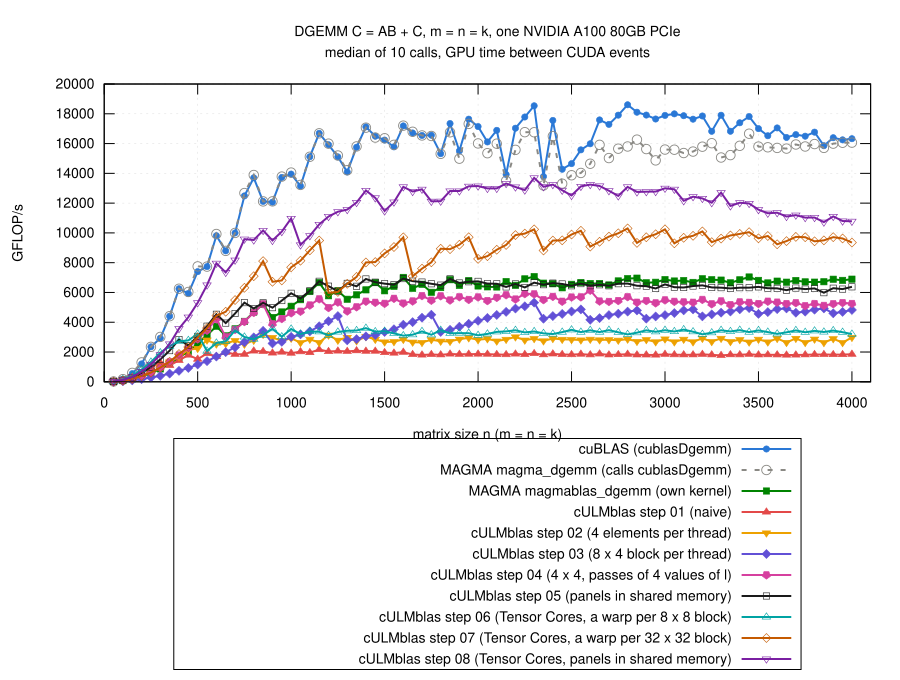

# Step 08: Tensor Cores with panels in shared memory for the block

## The idea

- Step 07: every warp copies its own blocks of A and B into its own buffer
  in shared memory, for every step of 4 values of l.
  - the 2 warps of a block with the same rows copy the same block of A;
  - one `__syncwarp()` and a copy per step of 4;
  - 50 M bank conflicts in 85 M wavefronts of fragment loads (n = 2048).
- Now the panels of step 05 for the Tensor Cores:
  - the 128 threads of a block (2 x 2 warps) copy a panel of A (the rows of
    the block, Panel = 16 values of l) and a panel of B (16 values of l,
    the columns of the block) into shared memory, each element once,
    consecutive threads reading consecutive elements of a column;
  - `__syncthreads()`;
  - every warp loads its fragments from the panels, for each of the 4
    steps of 4 values of l, and does its `mma_sync`;
  - `__syncthreads()` before the next panel.
- The columns of the panels in shared memory are 4 doubles longer than
  needed (`Pad`), against bank conflicts (next section).
- Blocks per warp now 4 x 2 (32 x 16 elements of C), a block of threads
  covers 64 x 32 elements of C; why, see below.
- Offsets within a panel are `int`, as in step 05.
- Code: [gemm.cu](gemm.cu); the loop over the panels:

```cpp
for (std::ptrdiff_t l0 = 0; l0 < k; l0 += Panel) {
    const int kb = k - l0 < Panel ? int(k - l0) : Panel;

    for (int q = 0; q < BlockRows*Panel/NumThreads; ++q) {
        int e = tid + q*NumThreads, i = e % BlockRows, l = e / BlockRows;
        sA[i + l*LdA] = (i < mb && l < kb) ? A[i + l*ldA] : 0;
    }
    for (int q = 0; q < Panel*BlockCols/NumThreads; ++q) {
        int e = tid + q*NumThreads, l = e % Panel, j = e / Panel;
        sB[l + j*LdB] = (j < nb && l < kb) ? B[l + j*ldB] : 0;
    }
    __syncthreads();

    #pragma unroll
    for (int s = 0; s < Panel/TileK; ++s) {
        wmma::fragment<wmma::matrix_a, TileM, TileN, TileK, double,
                       wmma::col_major> a[TilesM];
        wmma::fragment<wmma::matrix_b, TileM, TileN, TileK, double,
                       wmma::col_major> b[TilesN];
        for (int r = 0; r < TilesM; ++r) {
            wmma::load_matrix_sync(a[r],
                sA + wi + r*TileM + s*TileK*LdA, LdA);
        }
        for (int c = 0; c < TilesN; ++c) {
            wmma::load_matrix_sync(b[c],
                sB + s*TileK + (wj + c*TileN)*LdB, LdB);
        }
        for (int r = 0; r < TilesM; ++r) {
            for (int c = 0; c < TilesN; ++c) {
                wmma::mma_sync(ab[r][c], a[r], b[c], ab[r][c]);
            }
        }
    }
    __syncthreads();

    A += std::ptrdiff_t(Panel)*ldA;
    B += Panel;
}
```

## Panel, padding, blocks

- Two rounds of three jobs, 36 variants, m = n = k = 50, 100, 150, 200,
  300, ..., 2000 ([explore/](results/2026-10-29-a100/explore/); the kernel
  with all switches: [explore/gemm-knobs.cu](results/2026-10-29-a100/explore/gemm-knobs.cu)).
- Medians of the ratios over the sizes; padding: extra doubles per column
  of the panel of A / of B:

| blocks per warp | values of l per panel | padding A / B | registers | / step 05, n >= 1000 | / step 07, n >= 1000 | / step 05, n <= 500 |
|---|---:|---|---:|---:|---:|---:|
| 4 x 4 | 16 | 0 / 0 | 164 | 1.49 | 1.21 | 0.73 |
| 4 x 4 | 8 | 0 / 0 | 128 | 1.63 | 1.24 | 0.75 |
| 4 x 4 | 32 | 0 / 0 | 250 | 1.36 | 1.12 | 0.73 |
| 4 x 4 | 16 | 0 / 4 | 164 | 1.67 | 1.37 | 0.79 |
| 4 x 4 | 16 | 2 / 2 | 164 | 1.72 | 1.42 | 0.80 |
| 4 x 4 | 16 | 4 / 4 | 164 | 1.79 | 1.45 | 0.84 |
| 4 x 4 | 16 | 8 / 8 | 164 | 1.71 | 1.41 | 0.82 |
| 4 x 4 | 8 | 4 / 4 | 128 | 1.79 | 1.36 | 0.79 |
| 2 x 2 | 16 | 0 / 0 | 72 | 1.00 | 0.78 | 1.30 |
| 2 x 4 | 16 | 4 / 4 | 128 | 1.79 | 1.39 | 1.21 |
| **4 x 2** | **16** | **4 / 4** | **96** | **1.84** | **1.41** | **1.15** |

- **Padding**: 4 doubles per column, the best of 0, 2, 4, 8.
  - without it the columns of a panel start in the same banks of shared
    memory (column lengths 64 and 16 doubles, 512 and 128 bytes), and the
    loads of a fragment, which reads across columns, are serialized;
  - with 4 extra doubles a column starts 32 bytes later in the banks;
  - in the profile: bank conflicts of the loads from 50 M (step 07) to
    6.8 k.
- **Panel**: 16 values of l; 8 about as good with padding, 32: 250
  registers, slower.
- **Blocks per warp**: 4 x 2 instead of 4 x 4 of step 07: as fast for
  n >= 1000 in the quick test, faster for small matrices (64 x 32 elements
  of C per block of threads: twice as many blocks).
- Slower (4 x 4, panel 16, padding 4 / 4: 1.45 times step 07): partial
  unrolling of the 4 steps of a panel (1.38), at least 3 blocks per SM in
  `__launch_bounds__` (1.17), 4 x 1 warps per block (1.38).
- The final code with all sizes against alternatives
  ([alternatives/](results/2026-10-29-a100/alternatives/), step 08 with the
  alternative / step 08 as it is):

| alternative | n <= 500 | n >= 1000 | n >= 2000 | n = 4000, TFLOP/s |
|---|---:|---:|---:|---:|
| as it is (4 x 2, panel 16) | 1 | 1 | 1 | 10.8 |
| panels of 8 | 0.94 | 0.95 | 0.94 | 10.6 |
| 4 x 4 blocks per warp | 0.71 | 1.06 | 1.07 | 13.2 |
| 4 x 4 blocks per warp, panels of 8 | 0.67 | 1.07 | 1.10 | 13.1 |

- For n >= 2000 4 x 4 blocks per warp are better (fewer loads from shared
  memory per `mma_sync`, and n large enough for the bigger blocks), for
  small matrices 4 x 2.  The default stays 4 x 2.

## Result



(From [results/2026-10-29-a100/bench-square.log](results/2026-10-29-a100/bench-square.log)
by [plot.gp](plot.gp), m = n = k = 50, 100, ..., 4000; all steps and the
references measured in the same job.)

- **Faster than steps 05 and 07 for every size.**
- n >= 1000: 9.2 to 13.7 TFLOP/s
  - 1.32 times step 07 (median, 1.11 to 1.89), 1.90 times step 05;
  - 1.88 times MAGMA's own kernel;
  - 0.72 of cuBLAS (0.63 to 0.96).
- n = 550 to 950: 1.49 times step 07, 1.85 times step 05, 0.81 of cuBLAS.
- n <= 500: 1.82 times step 07, 1.20 times step 05, 0.61 of cuBLAS.
- Large n: a bit slower from n = 3000 on (10.8 TFLOP/s at n = 4000); 4 x 4
  blocks per warp hold 13.2 there (above).
- `cULMblas::gemm` now uses step 08.
- Correctness: the 769 cases, all pass for steps 01 to 08 and
  `cULMblas::gemm` (6930 checks); compute-sanitizer finds no error
  ([check.log](results/2026-10-29-a100/check.log),
  [memcheck.log](results/2026-10-29-a100/memcheck.log)); after switching
  `cULMblas::gemm` to step 08 both again
  ([check-cULMblas/](results/2026-10-29-a100/check-cULMblas/)).

## Profile at n = 2048

([ncu-step08.log](results/2026-10-29-a100/ncu-step08.log),
[../step07/results/2026-10-29-a100/ncu-step07.log](../step07/results/2026-10-29-a100/ncu-step07.log))

| n = 2048 | step 07 | step 08 | cuBLAS |
|---|---:|---:|---:|
| time of the kernel (ms, Nsight Compute) | 2.56 | 1.58 | 1.26 |
| Tensor Cores busy (%) | 52 | 75 | 98 |
| instructions | 294 M | 221 M | 110 M |
| global load requests | 16.9 M | 12.7 M | – |
| registers per thread, blocks per SM | 149, 3 | 96, 5 | 128, – |
| bank conflicts / wavefronts of loads from shared memory | 50 M / 85 M | 6.8 k / 51 M | – |
| warps active (% of the maximum) | 17 | 29 | 12 |

- Stalls of step 08 (relative): waiting for global loads 127 k, Tensor
  Cores busy ("math pipe throttle") 106 k, "wait" 71 k.

## What remains inefficient

- Copy and compute take turns: while a panel is copied, the Tensor Cores
  wait (and the copy goes through registers).
- The epilogue goes through shared memory.
- For large n 4 x 4 blocks per warp would be better.
- Next: `cp.async`, more than one panel in flight.
