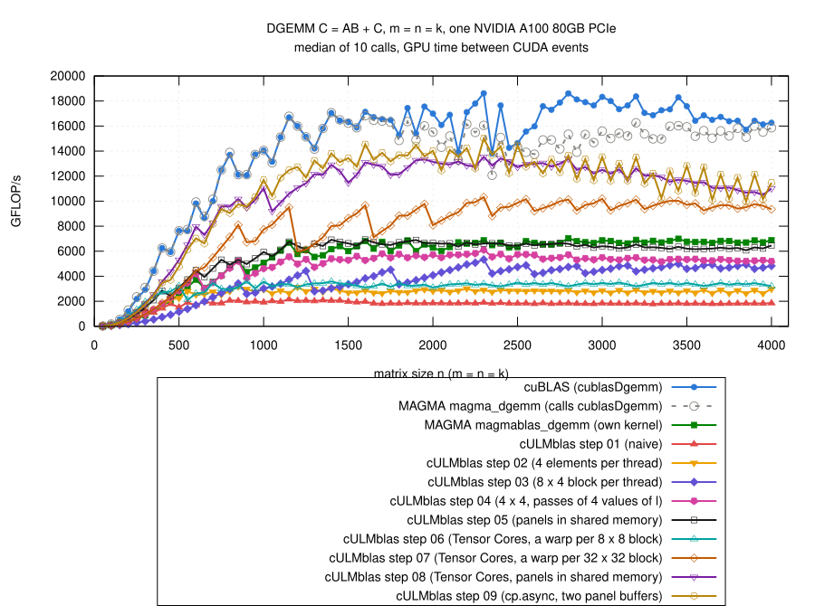

# Step 09: asynchronous copies of the panels

## The idea

- Step 08: copy and compute take turns.
  - the threads load a panel from global memory into registers, store it
    into shared memory, `__syncthreads()`, then the Tensor Cores;
  - n = 2048: dominating stall waiting for global loads (127 k), Tensor
    Cores busy 75% of the time.
- Now:
  - `cp.async` (`__pipeline_memcpy_async` from `cuda_pipeline.h`): a copy
    from global into shared memory without the registers of the thread;
    the thread issues it and goes on;
  - `__pipeline_commit()` closes a group of copies,
    `__pipeline_wait_prior(N)`: wait until at most N groups of this thread
    are still on the way;
  - Stages buffers for panels (default 2, double buffering): while the
    warps compute with panel t, the copies of panel t + 1 are on the way;
  - per panel one `__syncthreads()`: after it everybody's copies of panel
    t are visible, and everybody is done with panel t - 1, whose buffer
    gets the next panel.
- 16-byte copies: if A and B are 16-byte aligned and ldA, ldB even, a copy
  moves two consecutive elements of a column (and bypasses the L1 cache,
  `LDGSTS.E.BYPASS.128` in SASS); otherwise one element (8 bytes).
- Elements outside of A and B: stored as 0 directly.
- The rest as in step 08: 2 x 2 warps, 4 x 2 blocks of 8 x 8 per warp,
  64 x 32 elements of C per block, panels of 16 values of l, columns of the
  panels padded by 4 doubles.
- More than 48 KB of shared memory per block (3 or more stages) needs
  dynamic shared memory and `cudaFuncSetAttribute`; the kernel always uses
  dynamic shared memory.
- Code: [gemm.cu](gemm.cu); the loop over the panels:

```cpp
for (int t = 0; t < Stages - 1; ++t) {
    copyPanel(t);
}
for (std::ptrdiff_t t = 0; t < numPanels; ++t) {
    __pipeline_wait_prior(Stages - 2);
    __syncthreads();
    copyPanel(t + Stages - 1);

    const double *sA = buf + (t % Stages)*SizeStage, *sB = sA + SizeA;
    #pragma unroll
    for (int s = 0; s < Panel/TileK; ++s) {
        ...     // as in step 08
    }
}
```

- `copyPanel(t)` issues the copies of panel t into buffer `t % Stages`
  and commits them (also an empty group for t >= numPanels, so that the
  counting of `__pipeline_wait_prior` stays right).

## Stages, panel, copies

- Two rounds of three jobs, 24 variants, m = n = k = 50, 100, 150, 200,
  300, ..., 2000 ([explore/](results/2026-10-29-a100/explore/); the kernel
  with all switches: [explore/gemm-knobs.cu](results/2026-10-29-a100/explore/gemm-knobs.cu)).
- Medians of step 09 / step 08 (same job); 4 x 2 blocks per warp unless
  noted:

| copies | stages | values of l per panel | registers | n >= 1000 | n <= 500 |
|---|---:|---:|---:|---:|---:|
| 8 bytes | 2 | 16 | 96 | 1.01 | 1.16 |
| 8 bytes | 3 | 16 | 128 | 0.89 | 1.10 |
| 8 bytes | 4 | 16 | 126 | 0.85 | 1.15 |
| 8 bytes | 4 | 8 | 96 | 0.98 | 1.08 |
| **16 bytes** | **2** | **16** | **96** | **1.09 to 1.10** | **0.95 to 0.97** |
| 16 bytes | 3 | 16 | 126 | 0.97 | 0.98 |
| 16 bytes | 4 | 16 | 94 | 1.01 | 1.03 |
| 16 bytes | 2 | 8 | 94 | 0.98 | 0.97 |
| 16 bytes | 4 | 8 | 78 | 1.07 | 0.95 |
| 16 bytes | 2 | 32 | 126 | 0.98 | 0.98 |
| 16 bytes, 4 x 4 blocks per warp | 2 | 16 | 164 | 0.89 | 0.71 |
| 16 bytes, 4 x 4 blocks per warp | 4 | 8 | 128 | 1.03 | 0.71 |

- 16-byte copies: half the copy instructions; only with them does step 09
  gain.
- **More stages are slower**, contrary to what I expected.  Nsight Compute
  at n = 2048 ([stages/](results/2026-10-29-a100/stages/)):

| stages, panel | shared memory per block | blocks per SM | warps active (%) | Tensor Cores busy (%) | instructions | time (ms) |
|---|---:|---:|---:|---:|---:|---:|
| 2, 16 | 27.7 KB | 5 | 29 | 83 | 208 M | 1.42 |
| 3, 16 | 41.5 KB | 3 | 18 | 71 | 300 M | 1.65 |
| 4, 16 | 55.3 KB | 2 | 12 | 78 | 207 M | 1.55 |
| 4, 8 | 29.7 KB | 5 | 29 | 81 | 280 M | 1.46 |

  - every buffer costs shared memory, and shared memory then limits the
    blocks per SM: 5 with 2 stages, 3 with 3, 2 with 4;
  - with 3 stages the kernel also needs 300 M instead of 208 M
    instructions; probably the `t % 3` for the buffer (2 and 4: a bit mask),
    not checked in the machine code;
  - 2 stages and 5 blocks per SM: while one block waits for its copies,
    the others compute.
- The final code with all sizes against alternatives
  ([alternatives/](results/2026-10-29-a100/alternatives/), step 09 with the
  alternative / step 09 as it is):

| alternative | n <= 500 | n >= 1000 | n >= 2000 | n = 4000, TFLOP/s |
|---|---:|---:|---:|---:|
| as it is (2 stages, panel 16) | 1 | 1 | 1 | 11.5 |
| 3 stages | 1.03 | 0.89 | 0.90 | 10.8 |
| 4 stages, panels of 8 | 1.00 | 0.97 | 0.97 | 11.9 |
| 4 x 4 blocks per warp | 0.72 | 0.94 | 0.98 | 13.2 |

## Result



(From [results/2026-10-29-a100/bench-square.log](results/2026-10-29-a100/bench-square.log)
by [plot.gp](plot.gp), m = n = k = 50, 100, ..., 4000; all steps and the
references measured in the same job.)

- n >= 1000: 10.0 to 15.0 TFLOP/s
  - 1.05 times step 08 (median, 0.86 to 1.20);
  - 1.96 times MAGMA's own kernel;
  - 0.77 of cuBLAS (0.59 to 0.99); n = 2300: 15.0 TFLOP/s.
- n <= 850: a bit slower than step 08 (n <= 500: 0.95).
- n > 2000: slower than step 08 for n = 2050, 2250, ..., 3950 (next
  section), faster for the others.
- `cULMblas::gemm` stays at step 08.
- Correctness: the 769 cases, all pass for steps 01 to 09 and
  `cULMblas::gemm` (7700 checks; both copy variants: the cases have odd
  and even leading dimensions); compute-sanitizer finds no error
  ([check.log](results/2026-10-29-a100/check.log),
  [memcheck.log](results/2026-10-29-a100/memcheck.log)).

## n = 2050, 2250, ...

- n > 2000, median of the sizes:

| | n = 2100, 2200, ..., 4000 | n = 2050, 2150, ..., 3950 |
|---|---:|---:|
| step 08 (TFLOP/s) | 12.6 | 12.2 |
| step 09 (TFLOP/s) | 13.2 | 11.7 |
| cuBLAS (TFLOP/s) | 17.2 | 16.8 |

- These n are 2 mod 4: the columns of A and B (leading dimension n) start
  16 bytes into a 32-byte sector, a column of a panel covers one sector
  more.
- Nsight Compute, n = 2048 and 2050
  ([sizes/](results/2026-10-29-a100/sizes/)):

| | step 08, 2048 | step 08, 2050 | step 09, 2048 | step 09, 2050 |
|---|---:|---:|---:|---:|
| time (ms) | 1.58 | 1.67 | 1.43 | 1.66 |
| sectors read from L2 | 99.9 M | 107.3 M | 101.7 M | 155.6 M |
| Tensor Cores busy (%) | 75 | 75 | 83 | 78 |

  - step 09 reads 53% more sectors from L2 at n = 2050, step 08 7%.
- Experiment: 16-byte copies through the L1 cache (`cp.async.ca` with
  inline PTX instead of `.cg`; [sizes/gemm-ca.cu](results/2026-10-29-a100/sizes/gemm-ca.cu)):
  - n = 2050: 110 M instead of 156 M sectors from L2;
  - but slower at both sizes (1.51 and 1.73 ms); not used.

## What remains inefficient

- n = 2 mod 4: misaligned columns, more traffic for the 16-byte copies.
- Small matrices: a bit slower than step 08.
- n >= 2000: 4 x 4 blocks per warp would be faster (13.2 TFLOP/s at
  n = 4000).
- Profile at n = 2048 ([ncu-step09.log](results/2026-10-29-a100/ncu-step09.log)):
  - Tensor Cores busy 83% (cuBLAS 98%);
  - 208 M instructions (cuBLAS 110 M);
  - dominating stall now "math pipe throttle" (155 k, the Tensor Cores
    are busy), waiting for global loads down to 46 k (step 08: 127 k).
